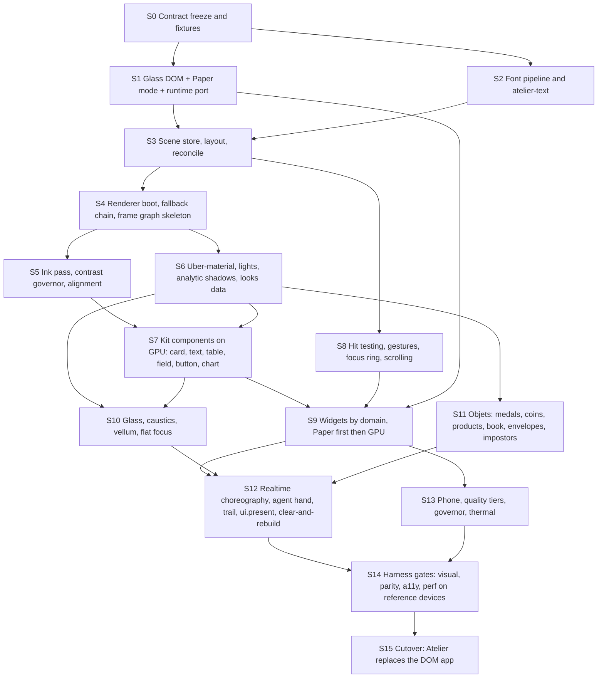

# Atelier: a lit studio desk for Plinth Suite

Proposal for the GPU frontend round (`docs/gpu-frontend/BRIEF.md`). Codename **Atelier**. Direction: **tactile
physical materials**. Every widget is a physical object on a beautifully lit studio desk: thick cotton paper,
frosted glass, anodised aluminium, glazed ceramic and minted metal, rendered with physically based materials, real
refraction, caustics and soft area-light shadows, and moved by springs and a small amount of rigid-body physics.

This document is the whole frontend spec: the scene, the rendering stack, text, input, accessibility, realtime and
the agent, budgets, the phone, the architecture and package layout, looks, a five-minute demo, a dependency-ordered
plan, and risks with kill criteria. It covers the 13 hard requirements under headings named after them (R1 to R13),
and describes every one of the 19 domains and all 77 catalogue widgets in R1.

Contents

- 0. Thesis in one page
- 1. The world: desk, units, camera, materials, the card
- R1. Feature parity (shell, then the 19 domains)
- R2. WebGPU first, WebGL2 fallback (stack, pass graph, signature-effect shaders)
- R3. Text and data density
- R4. Input and forms
- R5. Accessibility
- R6. Realtime and the agent
- R7. Performance budgets
- R8. Phone
- R9. Architecture
- R10. Looks and theming
- R11. Demo choreography
- R12. Plan ordered by dependency
- R13. Risks and kill criteria
- Appendix A. Lessons from the DOM round, applied
- Appendix B. Glossary

---

## 0. Thesis in one page

**One view tree, three faces.** Every widget renders a declarative view tree (the *Vellum* tree: sheets, text,
tables, fields, buttons, charts and *objets*). Three consumers read the same tree in the same frame:

1. the **GPU scene builder**, which turns it into lit, physical objects on the desk;
2. the **glass DOM** (the accessibility mirror), a real semantic HTML tree laid over the canvas, transparent,
   positioned exactly over its GPU counterpart, which owns focus, scrolling, selection, copy, find-in-page,
   links, form controls, IME and autofill;
3. **Paper mode**, the very same DOM made visible with a flat stylesheet. It is the first paint while shaders warm,
   the unsupported-browser path, the forced-colours path and the low-power path.

Because the DOM and the GPU are two renderings of one tree, parity between what is seen and what is announced is a
property of the architecture, tested by a parity check, not a discipline every widget author must remember.

**The desk is calm by default, spectacular on events.** Reading and operating happen on cards that lie flat,
screen-parallel and pixel-snapped, under a soft studio light. Physicality is spent where it carries meaning:
arrival (an object is laid down), state (a stamp, a seal, a minted medal), quantity (coins, a level balance
beam), history (stacked vellum revisions you can fan apart), and the agent (an invisible hand laying objects down
with a visible tool trail). When nothing changes, the frame loop sleeps: an idle desk draws zero frames.

**Flat focus is a first-class mode, not a fallback.** Any dense widget (a 900-row ledger, the permission matrix,
an 18-field form) can be pressed flat: the card rises, flattens under an orthographic camera into a matte,
uniformly lit sheet with sticky headers, tabular numerals and a keyboard grid. Flat focus is deep-linkable
(`?focus=<widget-slug>`).

**The signature moment is the agent building the studio.** `site.clear` sweeps the desk clean and slides the
index tabs back into the card file. Then the agent's invisible hand fetches specimen cards from the catalogue
drawer, flips each from its config side to its face, and sets it down on the grid, leaving a graphite tool trail
with an inked stamp per MCP call. The board never lags the trail: a card's final position and data are committed in
the same frame as its stamp.

---

## 1. The world: desk, units, camera, materials, the card

### 1.1 Units and camera

- **World unit = 1 CSS pixel on the desk plane.** The desk is the plane `z = 0`. Layout engines output CSS pixels,
  so a layout box maps to world coordinates without scaling, and the glass DOM uses the same numbers.
- **Camera.** Perspective, vertical field of view 12 degrees, looking straight down (-z), placed at distance
  `d = (viewportHeightCss / 2) / tan(6°)` so the desk plane maps 1:1 to CSS pixels at the viewport centre. At
  1080 CSS px tall, `d = 5138` units. A card resting at `z = 4` scales by `d / (d - 4)`, a 0.08 % difference, below a
  device pixel; resting cards are therefore pixel-exact after snapping (R3.6).
- **Scroll** pans the camera along desk `y` (and `x` in wide boards). The glass DOM scroller owns `scrollTop`; the
  camera follows it every frame (R9.5). Scrolling never rotates or zooms the camera.
- **Overview** (`Ctrl` + wheel down, pinch-in on touch, or the "Overview" button in the top rail): the camera
  rises to show the whole page desk at up to 0.35 scale with a 6 degree tilt, for orientation only; text is not
  read in overview, so its legibility rule does not apply there. Any click or Enter returns to the reading pose.
- **Reading pose** (the default): camera straight down, no tilt, scale 1. Every card at rest is screen-parallel.

### 1.2 The desk and its zones

```
+----------------------------------------------------------------------------------------------------+
| TOP RAIL (brushed brass rail):  mark | page title label | [magnifier Ctrl+K] | coin chip | letter  |
|                                  tray(3) | desk bell(5) | pilot lamp | ID card (identity) | Overview |
+-------------+--------------------------------------------------------------------------------------+
| CARD FILE   |  APPROVALS RIBBON (red paper band, only when approvals_pending > 0 for deciders)    |
| (nav)       +--------------------------------------------------------------------------------------+
| index tabs  |  PAGE HEADER: letterpress title, one muted line, Customise / Edit page              |
| by section  |                                                                                      |
|  Personal   |  THE GRID: 12 columns etched faintly into the desk surface, rows 72 px (4.5rem)      |
|  Rewards    |  +-----------+ +-----------+ +-----------+                                          |
|  Engage     |  | card      | | card      | | card      |   cards = widgets, laid on the grid       |
|  Insight    |  | (paper)   | | (glass)   | | (ceramic) |                                          |
|  Operate    |  +-----------+ +-----------+ +-----------+                                          |
|  Admin      |  +-------------------------------------------+                                       |
|  counts =   |  | full-width card (ledger book, board ...)   |                                       |
|  enamel tags|  +-------------------------------------------+                                       |
+-------------+------------------------------------------------------------+-------------------------+
| TOOL TRAIL TICKER (only while an agent session is active; collapses)    | SLIPS (toasts, max 4)    |
+------------------------------------------------------------------------+--------------------------+
  Off-desk (right edge, unseen): the CATALOGUE DRAWER, where the agent's hand fetches specimen cards.
```

- **Desk surface**: a look-dependent material (birch ply, dark walnut, cyanotype drafting table, terrazzo,
  newsprint blotter, laid-paper blotter). It carries the grid etch, the tool trail decals and the caustics.
- **Card file** (side nav): an index-card drawer seen from above, one tab per nav section; each nav item is an
  index card with its icon embossed and its count on a small enamel tag (R1.1).
- **Top rail**: a slim brushed-metal rail holding the shell's physical controls (R1.1).
- **Grid**: 12 columns, gutters 16 px, row 72 px (from `SIZE_GRID` and the 4.5rem row); `x, y, w, h` from Page
  layouts are used unchanged.

### 1.3 Material vocabulary (meaning, not decoration)

Material encodes the *kind of work* a widget does. Looks may retint every material but never reassign roles.

| Material | Role | Widgets (examples) | PBR parameters (calm look) |
|---|---|---|---|
| **Cotton paper** (thick, 1.2 mm, deckle optional) | Reading and writing | content, messaging, tasks, notifications, ledger statement, forms | albedo from look, roughness 0.86, sheen 0.15, fibre normal map (procedural), subsurface wrap 0.08 |
| **Frosted glass** (6 mm slab, bevelled) | Live instruments and figures | reporting visuals, suite KPIs, promotion performance, simulator results, live counts | IOR 1.5, roughness 0.32 (frost), thickness 6, attenuation tint from look, dispersion 0.012 |
| **Anodised aluminium** (3 mm plate, chamfered) | Control and governance | admin, settings, automation controls, audit verify, sessions | metalness 1, roughness 0.38, anisotropy 0.6 along plate x, base colour from look |
| **Glazed ceramic** (tile, 8 mm) | Commerce and reward displays | store plinths, tiers, badge cabinets, wishlist | dielectric, roughness 0.12, clearcoat 1.0, clearcoat roughness 0.04, crackle normal optional |
| **Minted metal** | Rewards as objects | medals (badges), coins and tokens (points), tier plates | metalness 1, roughness 0.18 to 0.42 by finish, anisotropic field brushing, polished relief |
| **Vellum** (translucent tracing paper) | History and diffs | audit node history, content versions, promotion history, builders' plans | transmission 0.55, roughness 0.7, thickness 0.1 |
| **Kraft and linen** | Containers | trays, folders, envelopes, the card file | roughness 0.9, weave normal |

### 1.4 The card (every widget instance)

A **card** is the physical body of one Widget instance.

- **Geometry**: a rounded box. Footprint = grid cell box minus gutters; corner radius from the look (6 to 14 px);
  thickness from material (paper 3 units, glass 6, aluminium 4, ceramic 8). Edges are bevelled 1.5 units. One
  shared bevelled-box geometry is instanced and scaled by a vertex shader that keeps the bevel and radius
  constant under non-uniform scale (corner-preserving 9-slice in 3D), so every card is one instance of one mesh.
- **Front face**: the widget's view (Vellum tree) printed or etched on the top surface (R3).
- **Back face (config side)**: flipping a card (header menu "Flip to configure", `Alt+Shift+C`, or a two-finger
  horizontal swipe on touch) shows the instance's configuration form, generated from its `configSchema`, when the
  viewer may edit the page; otherwise it shows **provenance**: catalogue title and description, the actions and
  events it uses, who placed it (person or agent, surface, change seq, UTC time) and its config read-only.
- **Header strip**: title (sentence case), optional count, menu (Refresh, Open as page, Flat focus, Flip to
  configure, Remove from personal page). On a fine pointer the menu knob rests quiet; always visible on touch and on
  focus within.
- **States**: loading (a blank sheet with ruled skeleton lines, first load only), empty (an embossed blank with the
  widget's own empty copy and primary action), error (a torn corner with "Couldn't load" and Retry), unavailable
  (the card is a plain kraft back with "Not available to you"). Never a stray "null": the text builder rejects
  null at the type level (R3.9).
- **Rest and motion**: each card has a critically damped spring on position, a spring on rotation (quaternion
  slerp spring) and an "elevation" spring. A card is *at rest* when all spring velocities are below 0.02 units per
  frame and displacement below 0.05 units; only resting cards get pixel-snapped text and glass-DOM hit areas.

---

## R1. Feature parity

Every domain and every catalogue widget has a home. The owner's model stands: **widgets are apps in their own right,
each an expression of part of a domain.** In Atelier each widget is a card (1.4) whose face is its app; its internal
views (the catalogue's `views`) are pages of the card, flips, or objects laid next to it inside its own footprint.
Widgets never reach into each other: they talk through the page bus topics declared in the catalogue and through
domain events, exactly as UI-MAP section 4 defines. Default page layouts are the seeded Page nodes of UI-MAP section 2,
unchanged; nothing about a page is hard-coded.

Conventions used in the tables below:

- **Object**: what the card is physically, and its material.
- **Views and operation**: the catalogue views and how a person operates each one with pointer, touch and keyboard.
  Every operation listed is also available from the keyboard and to a screen reader through the glass DOM (R5).
- **Live**: the realtime reaction (CONTRACT 6.2 events) and its motion. Motion marks only what an event changed,
  never a page load (UI-MAP principle 4).
- **Flat focus**: what the widget becomes when pressed flat (R3.7). "Default flat" means the widget opens in flat
  focus at `full` size on its module page when the viewer has "Prefer flat focus for tables and forms" on.

### R1.1 The shell (not a widget, drawn once)

| Shell element | Object and behaviour | Data |
|---|---|---|
| Side nav | **Card file**: a kraft index drawer. Six section dividers (Personal, Rewards, Engage, Insight, Operate, Admin) are tab cards; the section holding the current route stands raised, others lie closed. Items are index cards with an embossed icon and a sentence-case label; the current page's card is pulled up 6 units with an accent rule along its top edge and `aria-current="page"` in the glass DOM. Counts are enamel number tags riveted to the card's right edge; "needs attention" counts (approvals, orders attention, content reviews) use the warning enamel and an alert glyph, never colour alone. New nav entries (live, from `pages.list` re-reads, debounced 150 ms) are inserted by a card sliding into the drawer; removed ones slide out. Below 64rem it becomes a bottom-sheet drawer (R8). | `pages.list`, counts frame |
| Top rail | A brushed-metal rail. Left: the Plinth mark, debossed, then the page title on a letterpress label. Centre: a magnifier (palette, `Ctrl+K` / `Cmd+K`). Right: coin chip, letter tray, desk bell, pilot lamp, ID card, Overview button. | `me.get`, stores |
| Balance chip | **Coin chip**: a short stack of minted coins with the balance on an odometer of tabular numerals and a tier enamel pill. On `points.posted` for the viewer, coins drop onto the stack (credit) or lift off (debit), the odometer rolls from old to new, and a signed delta ("+250") is stamped beside it for 4 s. On `tier.changed` the pill is re-enamelled with a single glint. | `points.posted`, `tier.changed` |
| Inbox count | **Letter tray** with the `messages_unread` count on a paper tag; up to 5 envelopes are drawn, then the number carries it. Click goes to `/messages`. | counts frame |
| Bell | **Desk bell** with the `notifications_unread` count. On `notification.created` the dome wobbles (a 400 ms damped oscillation; none with reduced motion). Click opens a slip pad popover with the latest 8 notifications (`notifications.list`), "Mark all read", "Open all". | counts frame, `notification.created`, `notification.read` |
| Live indicator | **Pilot lamp**: a glass jewel. Live = warm glow and the word "Live"; connecting = slow pulse and "Connecting"; offline = dark, hatched, "Offline". Text is always present. Scales with the viewport on wall displays (Meridian lesson). | `rt.onState` |
| Identity switcher | **ID card** on a lanyard clip with the viewer's avatar art and name. Menu: Profile, Settings, Theme, Switch identity (`dev.principals`, featured first), Sign out of this tab. Switching slides the old card out, clips the new one in, and navigates with `?as=`. | `dev.principals` |
| Command palette | **Typewriter slip**: a paper slip rises from the bottom centre with one input (a real `<input>`, R4). Results are index cards in groups: commands (every nav page, New message, New task, Transfer points, New promotion, New automation, New content, Toggle theme, Switch identity to ..., Flat focus on or off, Overview) ranked with `search.global` results (people, products, content, promotions, automations, segments, orders, tasks, threads, dashboards). Enter opens; `Ctrl+Enter` opens `/search?q=`. A brass caret marks the active result. | `search.global` |
| Toasts | **Slips** under a bulldog clip at the top right, newest on top, max 4, for the event types of UI-MAP section 5 (message received unless open or muted; in-app notifications; credits; own badge awarded, with the medal itself on the slip; tier changed; own order status; approval requested for approvers; approval decided for requesters; task assigned; budget alerts; automation failures for owners; pinned content). A slip slides in under the clip (220 ms), stays 6 s (paused while hovered or focused), then is pulled away. Agent-caused slips carry the graphite agent mark (R6.3). | rt |
| Approvals banner | **Red paper band** across the top of the page area for viewers with `approvals_pending > 0` and a decider role: "3 approvals wait for you · Review", ink on paper with an alert glyph; the number re-prints on count changes. | counts frame |
| Offline banner | A **hatched brass plate** under the rail: "Offline. Retrying in 4 s · Retry now". The countdown is text; the hatch is a pattern, not a colour. | `rt.onState` |
| Session revoked | A **heavy sheet** laid over the whole desk with a wax seal: "This tab was signed out" and Reload. The socket stops; the glass DOM marks everything else `inert`. | `rt.onSessionRevoked` |
| Page host | The **desk** for the current Page node: header (letterpress title, one muted description line, Customise / Reset to default / Edit page when allowed) and the grid of cards. Empty site: one embossed blank in the centre, "This workspace is empty", "Pages appear here as they are built." Not found: "No page lives here" with links home and to search. Before load: a ruled skeleton heading, never the slug (DOM-round lesson). | `pages.resolve`, change stream |

Route transitions: leaving a page files its cards (they slide 40 px down and fade into a stack, 260 ms) while the
new page's cards are dealt from the card file (staggered 24 ms per card, 320 ms each, critically damped). With
reduced motion: a 120 ms crossfade, no movement. Focus moves to `#main` and the title is announced (R5).

### R1.2 Points (8 widgets)

Routes: `/points` (balance, transfer, ledger, expiry, tiers), `/points/award` (award plus directory), `/ledger`
(trial balance, saved panel, accounts), and `/` and profiles (balance).

| Widget | Object | Views and operation | Live | Flat focus |
|---|---|---|---|---|
| `points.balance` | A **coin tray** in minted metal on a ceramic tile: a stack of coins whose height is `log10(balance + 1)`-scaled (never the only carrier: the number is printed large in tabular numerals), the tier as an enamel plate, progress to the next tier as an engraved groove with a brass bead and the text "1,240 to Gold", and expiring points as a tag tied to the tray ("300 expire 1 Dec 2026 UTC"). `s`: number and tier; `m`: adds the groove; `l`: adds the tag and the last three movements. | `summary`. Clicking the number opens `/points`. | `points.posted` for the shown member: coins drop or lift (Rapier, at most 24 coins, settling in about 600 ms) and the odometer rolls; `tier.changed`: the plate flips to show the new tier. | n/a (small) |
| `points.ledger` | A **ledger book**, open, cloth-bound. Left page: opening balance, type filters and the page's date range. Right page: statement lines (date UTC, type, memo, reference, signed delta, running balance) on feint blue rules with a red margin rule, about 24 lines per page at `xl`. | `lines`: PageDown / PageUp or the corner tabs turn pages (page curl, R2.7); the wheel scrolls through the lines continuously; type filters are ribbon bookmarks. `transaction`: choosing a line lays a **receipt** beside the book with entries (debit, credit, account) and lots; Escape removes it. Publishes `order.selected` for order lines. | `points.posted`: the new line is inked at the top of the first page with an ink-spread reveal (300 ms); running balances re-ink. | **Default flat**: a pressed full-width sheet, sticky header, all ~890 seeded transactions virtualised (R3.5), sortable headers with `aria-sort`, column resize, keyboard grid, closing balance pinned at the foot. |
| `points.transfer` | A **cheque slip** with perforations: Pay to (recipient combobox), Amount (with the limits printed beneath: "Up to 5,000 today; 2,000 per transfer"), Memo. | `form` -> `confirm`: the slip turns over to "You will have 3,240 after this" with a "Sign and send" stamp button -> `done`: the stub tears along the perforation (R2.8) and stays with "Sent 500 to Ana Silva · txn 8812". Subscribes `member.selected` to fill the payee. | `points.posted` refreshes limits and balance after. | Single-column form sheet. |
| `points.award` | A **citation certificate**: recipients (chips up to `max_recipients`), amount, category, reason; applicable promotion multipliers printed as a note ("Double points week applies: x2") and the approval rule ("Awards above 1,000 per person are held for finance"). | `form` -> `confirm` (final amounts per recipient) -> `done`: stamped "Awarded", or paper-clipped with a "Held for approval" tag naming the approval id. Subscribes `member.selected`. | none | Form. |
| `points.expiry` | A **row of luggage tags** on a string, one per expiry date, each with points and date UTC. | `list`. | `points.expiring`, `points.posted`: a tag is tied on or re-written. | Table: date, points, lots. |
| `points.tiers` | A **ladder of four tier plates** (bronze, silver, gold, platinum) in minted metal on a ceramic stand, each engraved with floor, member count and perks; the viewer's token sits on their plate, offset by progress. | `ladder`. Arrow keys move through plates; each reads its perks. | `tier.changed` for the viewer: the token hops to the next plate on a short arc. | Table: tier, floor, members, perks. |
| `points.trial-balance` | A **brass balance scale**, beam level when debits equal credits, over a printed ticket: total debits, total credits, difference, system account balances, and the invariant checks with ticks. | `summary`. | `points.posted` (finance): figures re-ink. A non-zero difference tilts the beam, prints "Out of balance by N" in danger ink with an alert glyph, and fires an assertive announcement. | Table of system accounts. |
| `points.accounts` | A **card-index drawer** of ledger accounts (member and system), each card with name, kind, balance. | `accounts` -> `statement` (the card is pulled out into a statement sheet) -> `transaction` (receipt with entries; for finance, "Reverse transaction" asks for a reason and shows the dry-run effect before commit). Publishes `member.selected`. | `points.posted`: the touched account card lifts 2 units and re-inks. | **Default flat**: accounts and statement tables. |

### R1.3 Store (8 widgets)

Routes: `/store`, `/store/c/:category`, `/store/p/:product`, `/store/cart`, `/store/orders`, `/store/orders/:order`,
`/store/wishlist`, `/store/manage`, `/store/inventory`.

Every product is a **procedural objet** (R2.9): there are no product image files (DESIGN-SYSTEM section 7 keeps
artwork generated from data). Grids show **impostors** (each objet rendered once into a 256 by 256 cell of an
impostor atlas under the current look); a live 3D objet is drawn only for the hovered, focused or detailed product.

| Widget | Object | Views and operation | Live | Flat focus |
|---|---|---|---|---|
| `store.catalog` | A **gallery of ceramic plinths**: each product an impostor on a plinth tile with title, price in points (tabular), tier gate chip ("Gold and above"), stock as text ("3 left", "Out of stock"), wishlist heart, "Add to cart". Filters: a strip of category tab cards, sort and "affordable only" toggles. | `grid`; `filters` (a sheet slides out from the card's left edge: categories, tag, sort, affordable only); `product` (`open_in: "widget"`: the plinth rises and the detail opens inside the card; `"page"` navigates to `/store/p/:slug`; `"bus"` publishes `product.selected`). Add to cart: the impostor shrinks into a token that flies to the cart (the cart widget if present, else the rail). | `stock.changed`: stock re-inks, a hatched "Out of stock" band at zero; `cart.updated`; `wishlist.changed`: heart fills; `review.created`: rating re-inks; `promotion.state_changed`: the offer stamp appears or lifts off the price tag. | Table: product, category, price, stock, rating, actions. |
| `store.product` | **Turntable**: the live objet on a ceramic plinth, turning slowly (0.08 rad/s) while hovered or focused; drag, or arrow keys (15 degrees per press), turns it. Beside it: title, price, stock, tier gate, quantity, Add to cart, wishlist, and the review histogram (five frosted bars with counts as text). | `detail`, `reviews` (review cards, stars as text "4 of 5"), `write-review` (rating radio group and text, R4). | `stock.changed`, `review.created` (bar grows, average re-inks), `cart.updated`, `wishlist.changed`. | Reviews table and product facts as a definition list. |
| `store.featured` | A **walnut shelf** of 2 to 12 impostors with price and Add to cart. | `row`. Arrow keys move along the shelf; Enter publishes `product.selected`. | `stock.changed`. | List. |
| `store.cart` | A **shallow wooden tray** of product tokens with quantity steppers (buttons; `+` and `-` while a line is focused), per-line issues in danger ink ("Only 2 left; quantity reduced"), and a live **receipt** printing out of a slot as the quote changes (subtotal, named promotions, total, balance after). | `lines`, `quote`, `delivery` (an address card form), `confirm` ("Place order" stamp), `placed` (receipt stamped "Placed · order NW-1043", coins lift off the rail's coin chip, publishes `order.selected`). `compact: true`: count, total and Checkout only. | `cart.updated`; `stock.changed` (line issue printed); `points.posted` (balance after); `promotion.state_changed` (quote reprints). | Lines table and receipt. |
| `store.orders` | A **docket spike** (own orders) or an **order rack** (staff, `scope: "all"`): dockets with number, date UTC, member, items, total, status stamp. `requires_approval: true` shows only dockets clipped with an approval tag. | `list` with status filter tabs; `order` (lines, promotions, timeline, transitions). Staff transitions (Mark packed, Ship, Cancel, Refund) preview their effect (restock, refund) before commit. Publishes `order.selected`; subscribes `member.selected`. | `order.placed`: a new docket is spiked on top; `order.status_changed`: re-stamped. | **Default flat** for `scope: "all"`. |
| `store.order` | One large **docket**: lines, applied promotions, a status timeline as rubber stamps along the bottom (placed, approved, packed, shipped, delivered), allowed transitions. | `detail`. | `order.status_changed`: the next stamp strikes (160 ms press; reduced motion: appears). | Detail sheet. |
| `store.wishlist` | **Tagged items on a linen string**: impostors with stock and affordability on the tag ("You can afford this" / "450 more points"); Move to cart, Remove. | `list`. Publishes `product.selected`. | `wishlist.changed`, `stock.changed`. | List. |
| `store.inventory` | A **stockroom shelf** for staff: products with on-hand, low and out filters and an engraved stock gauge with the number. | `list`, `adjust` (restock or correction slip with a reason). Publishes `product.selected`. | `stock.changed`: the gauge moves and re-inks. | **Default flat**. |

### R1.4 Promotions (5 widgets)

Routes: `/promotions`, `/promotions/new`, `/promotions/:promotion`; `promotions.active` on `/`, `/store` and category
pages.

| Widget | Object | Views and operation | Live | Flat focus |
|---|---|---|---|---|
| `promotions.list` | A **poster rack**: flyers grouped by status (draft, pending approval, scheduled, active, paused, ended), each with window dates UTC, a usage fill line with the percentage printed, a pending-approval tag, and "New promotion". | `list`. Publishes `promotion.selected`. | `promotion.state_changed` (the flyer slides to its new group), `promotion.redeemed` (usage grows), `promotion.budget_alert` (a "80 % of budget" warning tag is tied on), `approval.decided`. | **Default flat** table. |
| `promotions.builder` | A **workbench**: a vellum blueprint over a drafting board with a step rail: Eligibility, Effects, Budget, Schedule, Review, History. Eligibility is the rule builder: conditions are **logic tiles** (ceramic chips: field, operator, value) snapping into AND / OR trays; each tile is a real form group in the glass DOM. Effects: multiplier, bonus, discount tiles. Budget: a dial gauge plus a numeric input. Schedule: a calendar strip with start and end pins. Review: the flyer as members will see it, with the dry-run summary. History: vellum revisions (as `audit.node-history`). | Save draft; transitions (submit for approval, schedule, pause, end), each previewed. Subscribes `promotion.selected`. | `promotion.state_changed`, `approval.decided`: a status stamp strikes the header. | **Default flat**: one form with section headings. |
| `promotions.simulator` | A **test bench**: pick a member (a person card slides in) and a sample cart or earn event (tokens on a mini tray); Run prints a **result receipt**: each promotion stamped APPLIED or REJECTED with its reason, totals and baseline. | `inputs`, `result`. Subscribes `promotion.selected`, `member.selected`. | none | Form and result table. |
| `promotions.performance` | A **frosted glass instrument**: redemptions and cost series etched and backlit, a budget needle gauge with the percentage printed, by-tier and by-region bars, uplift. With `promotion: null`, one row per active promotion. | `summary`, `series` (bucket hour or day). | `promotion.redeemed`: the counter rolls and the series extends; `promotion.budget_alert`: the 50 / 80 / 100 % band lights and "Budget 80 % used" prints. | Table. |
| `promotions.active` | **Hanging pennants**: printed linen banners on a brass rod with headline, benefit, end date and call to action; 1 to 6. | `banners`. Arrow keys move between banners. | `promotion.state_changed`: a newly eligible banner unfurls (240 ms); an ended one rolls up. | List. |

### R1.5 Badges (4 widgets)

Badges are **minted medals** (R2.6). Shape, icon, hue and tier ring come from the Badge node's `artwork` (the
`badgeArt` parameters of DESIGN-SYSTEM 7.2), so the medal is the same data as the DOM's SVG, struck in metal.

| Widget | Object | Views and operation | Live | Flat focus |
|---|---|---|---|---|
| `badges.showcase` | A **velvet display box** with up to three pinned medals and the earned count on the lid. | `showcase`; `pick` (owner): the box opens a tray of earned medals; drag, or Space to pick up and arrow keys to choose one of three slots. Turn any medal by dragging, or arrow keys while focused (15 degree steps). Publishes `badge.selected`. | `badge.awarded` (own): the new medal drops into the tray with a ring of light; `badge.revoked`: lifted out. | List. |
| `badges.progress` | **Unfinished strikes**: blank medals with the design partly struck; an engraved arc shows progress, with "7 of 10 orders" printed. | `list`. Publishes `badge.selected`. | `badge.progress`: the arc extends and the relief deepens proportionally; `badge.awarded`: the die comes down and the medal pops (320 ms). | List with values. |
| `badges.catalog` | A **medal cabinet**: shallow drawers of medals; locked medals are blanks with the outline debossed and "Locked" text; filter tabs (all, earned, in progress, locked). | `grid`; `badge` (one medal rises to a hero pose with criteria, rarity, points reward, holders, earned date UTC); `award` (managers: member, reason, preview, award). Publishes and subscribes `badge.selected`. | `badge.awarded`, `badge.revoked`, `badge.progress`. | Table: badge, rarity, criteria, status. |
| `badges.recent` | A **ticker ribbon** of small medals: "Ana Silva earned First Order · 14:02 UTC". Paused while hovered or focused; with reduced motion it is a static list. | `ticker`. Publishes `member.selected`. | `badge.awarded`: added at the head. | List. |

### R1.6 Messaging (4 widgets)

| Widget | Object | Views and operation | Live | Flat focus |
|---|---|---|---|---|
| `messaging.inbox` | A **pigeonhole rack** of envelopes: unread ones sealed with wax and their subject in semibold; read ones lie open. Folders (inbox, sent, starred, archived) are labelled cubbies; a search slip; bulk select (checkbox per envelope, Shift+click for ranges) with star, archive, mark read. | `list`, `search`, `thread` (`open_in: "widget"`: the envelope opens inside the card; `"bus"` publishes `thread.selected`). | `message.received`: an envelope slides into the top (280 ms) and the seal is pressed; `message.state_changed`: the seal breaks or re-forms. | **Default flat** table: from, subject, preview, time UTC, state. |
| `messaging.thread` | A **correspondence**: letters stacked with a slight offset, each with sender avatar art, time UTC, mentions underlined, attachment metadata as clipped tags, read receipts as small initial stamps; the reply box is a fresh sheet at the bottom (a real `<textarea>`, R4). | `thread`, `empty` ("Choose a conversation"). Publishes `member.selected`; subscribes `thread.selected`. | `message.received` for this thread: a letter is laid on the stack; focus stays put and the arrival is announced politely. | Reading column. |
| `messaging.compose` | **Writing a letter**: an envelope (people and groups picker, R4.3) and a sheet (subject, body with `@mention` completion, attachment metadata). `collapsed: true` shows only the envelope, "Write a message". | `form` -> `sent`: the sheet folds into the envelope, the seal is pressed, it slides off the desk edge; the card shows "Sent to 4 people" and "Open thread" (publishes `thread.selected`). Sends at the broadcast threshold print the permission note. | none | Form. |
| `messaging.unread` | A **small stack of sealed envelopes** with the unread count and the latest three subjects. | `summary`. Publishes `thread.selected`. | `message.received`, `message.state_changed`. | n/a |

### R1.7 Notifications (4 widgets)

| Widget | Object | Views and operation | Live | Flat focus |
|---|---|---|---|---|
| `notifications.feed` | A **spike of slips**: newest on top; unread slips have an inked corner mark (and "Unread" in the glass DOM); type filters as divider tabs; Mark read punches the slip, Mark all read punches the stack; rows link to their subject. | `list`. | `notification.created`: a slip is spiked on top (180 ms); `notification.read`: punched in other tabs. | **Default flat** at `full`. |
| `notifications.preferences` | A **patch bay**: an anodised plate with toggle switches, rows = notification types, columns = channels (in-app, email, digest); a digest schedule dial over a real select; quiet hours as two time fields on an engraved clock face. | `matrix`. Grid keys: arrows move, Space toggles; each switch is `role="switch"` named by row and column. | none | **Default flat**: a checkbox table. |
| `notifications.deliveries` | A **carbon-copy log book**: what the email stub and digests sent, with channel, member, time UTC and suppression reasons in red pencil. | `list`, `detail` (the carbon is lifted to show the full message). Subscribes `member.selected`. | `notification.created`. | **Default flat**. |
| `notifications.send` | A **telegram form**: recipients (people and groups), type, title, body; Send. | `form`. | none | Form. |

### R1.8 Tasks (3 widgets)

| Widget | Object | Views and operation | Live | Flat focus |
|---|---|---|---|---|
| `tasks.list` | A **notepad checklist**: checkbox, title, priority (text plus a flag glyph for high and urgent), due date UTC (overdue in danger ink with "Overdue"), assignee avatar, inline status select. | `list`; `task` (the note is torn off and laid beside: detail, comments, status, links). Publishes and subscribes `task.selected`. | `task.assigned` (inked at the top), `task.updated`, `task.commented`. | **Default flat** at `full`. |
| `tasks.board` | A **kanban on a pinboard**: columns (open, in progress, blocked, done) as linen strips, tasks as sticky-note cards (priority as colour plus text). Drag a note to another column; on release it settles with a spring and a pin press. Keyboard: `Alt+Left` / `Alt+Right` move between columns, `Alt+Up` / `Alt+Down` reorder; each move is announced ("Moved task 42 to In progress, position 1 of 5"). A "Move to ..." menu is the single-pointer alternative to dragging (WCAG 2.5.7). | `board`, `task`. Publishes `task.selected`. | `task.assigned`, `task.updated`: someone else's move slides the note with their avatar briefly on it. | Four lists. |
| `tasks.quick-add` | A **sticky-note pad**: title, assignee, due, priority, optional link; Enter creates it, and the top note tears off and flies to the board when one is on the page (publishes `task.selected`). | `form`. | none | Form. |

### R1.9 Approvals (1 widget)

| Widget | Object | Views and operation | Live | Flat focus |
|---|---|---|---|---|
| `approvals.inbox` | The **stamped document tray**: an aluminium in-tray of documents (changes, actions, high-value orders, content reviews), each with type, title, requester, requested time UTC and, when it applies, the separation-of-duties note in red marginal ink ("You requested this, so someone else must decide."). `scope: "requested"` is the out-tray of the viewer's own requests with status stamps. | `list`; `item`: the document is drawn out and laid flat; a change is shown as a **vellum overlay diff** (the proposed version on vellum over the current one: additions in ink, removals struck through, both labelled in text), an action as its typed facts and Plinth-authored effect. Decide on the **stamp rack**: Approve or Reject (Reject requires a note); the stamp strikes (180 ms press, ink spread), the document is filed, the next one comes forward. SoD-blocked decisions show the stamp locked behind glass with the reason as text. Withdraw for own requests. Publishes `approval.selected`. | `approval.requested`: a document drops into the tray (260 ms) and the approvals band re-prints its count; `approval.decided`: stamped in place for the requester. | **Default flat** at `full`: a table with decision buttons per row and the diff in an expandable row. |

### R1.10 Content (5 widgets)

| Widget | Object | Views and operation | Live | Flat focus |
|---|---|---|---|---|
| `content.feed` | **Clippings**: articles and announcements as printed cards (`layout: "cards"`) or a column of headlines (`"list"`); pinned items held with a brass pushpin at the top; reaction counts as small stamps. | `feed`, `reader` (the clipping unfolds into a reading sheet in the card). Publishes `content.selected`. | `content.published`: a clipping is laid on top (pinned announcements also send a slip); `content.engaged`: counts re-ink. | List. |
| `content.reader` | A **booklet**: one published item on a long cotton sheet at an editorial measure (max 68 characters per line); headings, generated artwork, quotes and lists from its blocks; reactions as rubber stamps. | `reader`. | `content.engaged`. | Already a flat sheet; flat focus removes the desk around it. |
| `content.editor` | A **writing desk**: block list on the left sheet (each block a real `contenteditable` while edited, R4.4); a **proof sheet** on the right with the preview; a settings card (metadata, audience: segments and groups, reviewers, schedule); workflow stamps (submit for review, publish, schedule, archive); versions as a **vellum stack**; block diff by overlaying two sheets. | `blocks`, `settings`, `preview`, `versions`, `diff`. | `content.state_changed`: a status stamp strikes the header; someone else's change shows a banner with their avatar, "Leah Grant changed this; reload the blocks" (never a silent overwrite). | **Default flat** at `full`. |
| `content.review-queue` | **Proofs in a tray** with "diff since last review" as a vellum overlay and two stamps: Approve and Request changes (with a note). | `queue`, `review`. Publishes `content.selected`. | `content.state_changed`. | Table. |
| `content.list` | A **filing drawer** of content folders by status, type, tag and author, engagement counts on the folder tabs. | `list`. Publishes `content.selected`. | `content.state_changed`, `content.engaged`. | **Default flat**. |

### R1.11 People (6 widgets)

| Widget | Object | Views and operation | Live | Flat focus |
|---|---|---|---|---|
| `people.directory` | A **business-card file**: embossed cards with avatar art, name, title, region, tier enamel (grid), or a pressed register (table). Search and filters (region, tier, group). | `grid`, `table`. Publishes `member.selected`; subscribes `filter.changed`. | `member.updated`, `tier.changed`: the card re-inks with one glint on the enamel. | **Default flat** in table view. |
| `people.profile-card` | An **embossed ID card**: avatar art, name, title, region, tier, groups, roles; Message and Award buttons. | `card`, `edit` (own profile: the card flips to a form). Publishes and subscribes `member.selected`. | `member.updated`, `tier.changed`. | Form. |
| `people.activity` | A **diary strip**: a dated paper timeline (badge with a tiny medal, points with a coin, content with a clipping, review, order). | `timeline`. Subscribes `member.selected`. | Matching events add an entry at the top. | List. |
| `people.group` | A **group folder**: description, managers in front, members behind. | `members`. Publishes `member.selected`. | Group node changes re-file cards. | Table. |
| `people.groups` | **Tabbed folders** of all groups, with a punched star on the viewer's groups. | `list`. | Group changes. | List. |
| `people.sessions` | A **keyring**: each browser and MCP session a key tag (device, surface, started, last seen UTC, "This tab"); Revoke takes the key off after confirmation. MCP sessions have a graphite agent tag. | `list`. | `session.revoked`: the key slides off. | Table. |

### R1.12 Segments (3 widgets)

| Widget | Object | Views and operation | Live | Flat focus |
|---|---|---|---|---|
| `segments.list` | **Sieves**: each segment a brass sieve card with live member count and "used by" tags (promotions, audiences, automations). | `list`. Publishes `segment.selected`. | Segment node changes. | Table. |
| `segments.builder` | A **sorting bench**: rule builder (the logic tiles of promotions) over member facts (`people.facts`), a live count odometer, a distribution etched in frosted glass (by tier and region), and sample member cards that fall through the sieve when the rule changes (at most 12 cards; reduced motion: re-listed). | `rule`, `preview`, `history`. Publishes `member.selected`; subscribes `segment.selected`. | none | Form, count and sample table. |
| `segments.members` | The **cards that passed the sieve**, in a tray. | `list`. Publishes `member.selected`; subscribes `segment.selected`. | `tier.changed`. | Table. |

### R1.13 Automation (3 widgets)

| Widget | Object | Views and operation | Live | Flat focus |
|---|---|---|---|---|
| `automation.list` | A **control panel**: an anodised plate per automation with its trigger engraved ("On order.placed", "Daily 09:00 UTC", "When metric ..."), an enable **toggle switch** (`role="switch"`), last-run status lamp with text, failure count, next fire UTC. | `list`. Publishes `automation.selected`. | `automation.run_updated`: the lamp flashes once (never more than one flash per second) and its text changes; `approval.decided`. | **Default flat** table. |
| `automation.builder` | A **blueprint flow**: trigger card, conditions (logic tiles), steps as vellum cards joined by brass connectors; a step's form opens on its flipped card; a limits plate. Dry run sends a **ghost run**: a brass token travels the connectors and each step gets a pencilled stamp ("would send 12 messages", "would skip: condition false"). Run now and Enable are previewed. | `trigger`, `conditions`, `steps`, `dry-run`, `history`. Publishes `run.selected`; subscribes `automation.selected`. | `automation.run_updated`: a live token travels the real flow for running runs. | **Default flat**: ordered steps with forms. |
| `automation.runs` | A **punched log tape**: runs as rows with status punches (queued, running, succeeded, failed, cancelled; each a distinct punch shape plus text), duration, trigger. | `list`; `run` (per-step status, errors in red pencil, Retry, Cancel). Publishes and subscribes `run.selected`. | `automation.run_updated`: punches update. | **Default flat**. |

### R1.14 Calendar (2 widgets)

| Widget | Object | Views and operation | Live | Flat focus |
|---|---|---|---|---|
| `calendar.month` | A **desk blotter calendar**: a large paper month grid; entries are paper tabs, each type with a distinct edge pattern and icon (promotion: percent, content: article, automation: workflow, expiry: clock, task: task), so type is never colour alone; multi-day windows are long tabs. | `month`, `week`, `day`. Arrow keys move the focused day (grid pattern), Enter opens it, PageUp / PageDown change month. Publishes `date.selected`, `promotion.selected`, `content.selected`. | `promotion.state_changed`, `content.state_changed`, `task.updated`: tabs re-cut or move. | Already flat. |
| `calendar.agenda` | A **pocket diary**: the next N days as dated lines. | `agenda`. Publishes and subscribes `date.selected`. | `promotion.state_changed`, `content.state_changed`. | List. |

### R1.15 Reporting (10 widgets)

All reporting visuals are **frosted glass plates** with the chart etched into the glass and lit from below by a light
table, so marks read as clean light-on-frost (R3.8). They are never extruded 3D bars.

| Widget | Object | Views and operation | Live | Flat focus |
|---|---|---|---|---|
| `reporting.table` | A glass plate with a pressed paper insert carrying the table (sortable `<button>` headers with `aria-sort`, paging). | `chart` (the table), `table`, `inspector` (the plate tilts up 8 degrees and an inspector sheet slides beside it: query, source, rows, as-of UTC, grants applied). | A watermark change on the Source's partitions re-runs this panel's query only; changed cells re-ink with a 600 ms highlight. | Table. |
| `reporting.bar` | Bars etched as frosted columns; value labels when they fit; category labels never collide (fewer ticks, then 45 degree labels, then truncation with full text in the glass DOM); minimum plot height 120 px. Clicking a bar publishes `filter.changed`. | `chart`, `table` (toggle is `aria-pressed` with a state-describing label), `inspector`. | Changed bars grow with a 300 ms spring. | Table. |
| `reporting.line` | A lit etched line; brushing a range (drag, or Shift+arrows on the focused x axis) publishes `date.selected`. | As above. | New points extend the line. | Table. |
| `reporting.area` | Stacked or single area etched with graded frost. | As above. | As line. | Table. |
| `reporting.heatmap` | Cell frost density by value (sequential ramp from the look). **Breach cells** in the accent with hatch and a triangle glyph, plus a text row under the chart ("1 cell above 600: EMEA / Crane 759.9"). | As above. | Changed cells re-frost. | Table with a breach column. |
| `reporting.scatter` | Points as small glass beads (2D). | As above. | New points appear. | Table. |
| `reporting.kpi` | A glass tile: one large tabular figure, delta with sign and arrow glyph, etched sparkline. | `chart`, `table`, `inspector`. | The figure rolls; the delta re-inks. | n/a |
| `reporting.panel` | Embeds a kernel Panel node; the plate carries its visual. | As above. | A Panel node change re-fetches that panel only. | Per visual. |
| `reporting.board` | A **light table** holding a Dashboard's panels as glass plates in their layout, with the **trace ribbon** along its bottom edge: a ticker-tape printer stamping each change, newest at display size (large monospaced "Change #1432", actor, rule chip, UTC time), older ones smaller and dimmer. New panels get the band "Added by agent claude-code · mcp · change 1432" across their top edge for 8 s, then it folds into a corner seal (R6.3). A dek under the title rewrites itself to the latest change. | `board`, `inspector`. | Only panels an event names re-query (DOM-round fix 1); a panel appears in the same frame as its trace stamp. | 2D grid of plates without the light table. |
| `reporting.suite-kpis` | A **strip of glass instrument tiles**, 1 to 6 metrics with 14-day sparklines. | `strip`. | `points.posted`, `order.placed`, `badge.awarded`: odometers roll. | Table. |

### R1.16 Audit (3 widgets)

| Widget | Object | Views and operation | Live | Flat focus |
|---|---|---|---|---|
| `audit.timeline` | A **receipt roll**: change log and domain events merged, each entry with seq, time UTC, actor (graphite for agents, ink for people), surface, node, ops summary and a short hash in monospace; undo for undoable changes; source and actor filters. | `list`, `entry` (torn off and laid beside: full hash, previous hash, ops, rule ids). Subscribes `member.selected`. | Every change-stream item prints at the top; the roll advances (reduced motion: appears). | **Default flat**. |
| `audit.verify` | A **chain of metal links**, one per verified segment of each hash chain (change log, domain events), heads printed. Verify runs `audit.verify`: links light tail to head (6 ms per link, capped at 600 ms) and a ticket prints "Both chains verified · head 1432 · 14:32:07 UTC". A failure breaks the link at the first bad seq, in danger ink with "Chain broken at change 1201" (assertive announcement). | `status`. | none | Text summary. |
| `audit.node-history` | A **stack of vellum revisions** of one node, the R11 "impossible in the DOM" moment. Fan the stack apart (drag its top edge, or `Alt+Down`) so every revision is visible in depth, each labelled with revision, actor and UTC time. Choose two (Space on each) and they slide together: identical text overlaps into one crisp line, changed text doubles, while the exact textual diff prints on paper beside them. Undo to a chosen revision with preview. | `revisions`, `diff`. | Node changes lay a new sheet on top. | **Default flat**: revision list and two-column textual diff. |

### R1.17 Admin (5 widgets)

| Widget | Object | Views and operation | Live | Flat focus |
|---|---|---|---|---|
| `admin.members` | A **membership register** with private fields; **column masks are redaction tape** (matte black tape over the cell with "Masked" printed and in the glass DOM; never an empty cell); roles; status. | `list`, `member` (details, roles, sessions with revoke), `create` (a new register page). Publishes `member.selected`. | `member.updated`, `session.revoked`. | **Default flat**. |
| `admin.roles` | **Role plates**: anodised, with scope and members; proposing a membership change clips a "Held" tag to the plate. | `roles`, `role`. Publishes `member.selected`. | `approval.decided`: the tag is removed or stamped rejected. | Table. |
| `admin.matrix` | A **perforated punch card**: rows = permissions, columns = roles; a granted cell is punched through, so light from below shows through the hole, with a check glyph in it ("Granted" in the glass DOM); denied cells are solid. The **agent ceiling** is a translucent graphite plate slid over the card: cells beyond it get diagonal hatch and "Above agent ceiling". `principal`: choose a member and their effective permissions light row by row. | `matrix`, `principal`. Grid keys with row and column headers announced. Subscribes `member.selected`. | none | **Default flat**: sticky-header table with check glyphs (R3.5). |
| `admin.grants` | **Grant cards** in a file, row predicate and column mask in monospace; "Propose a grant" shows `grant.check` counts ("This grant lets marketing see 1,204 rows") before filing (held, R-GRANT). | `list`, `propose`. | Grant node changes. | Table and form. |
| `admin.program` | The **master control panel**: a large anodised plate with engraved sections (tiers, expiry, transfer limits, award limits, store thresholds, messaging limits, notification defaults, digest default, appearance) and real controls. Every change is held (R-PROGRAM): Submit stamps "Submitted for approval" with a link to the approval. | `form`, `history` (vellum). | `approval.decided`: applied changes re-engrave; the site look relights live (R10). | **Default flat**. |

### R1.18 Pages (1 widget)

| Widget | Object | Views and operation | Live | Flat focus |
|---|---|---|---|---|
| `pages.editor` | The **layout table**: the page on a green self-healing cutting mat with the 12-column grid printed; widgets are cards. | `layout`: pick up a card (drag, or focus and Space), move (snaps with a spring; arrows move one cell), resize by the bottom-right corner (Shift+arrows), with the allowed `sizes` shown when a size is invalid. `catalogue`: the **catalogue drawer** slides in from the right with one specimen card per catalogue widget by domain; drag one onto the mat (or Enter, then place with arrows). `configure`: the card flips to its config side, a form generated from `config_schema` with validation and route-binding pickers (R4). Save commits through the node API. Items the viewer may not use appear as kraft placeholders. | Others' and the agent's changes to the same page animate in with attribution. | A list of items with x, y, w, h fields and config forms. |

### R1.19 Search (1 widget)

| Widget | Object | Views and operation | Live | Flat focus |
|---|---|---|---|---|
| `search.results` | **Sorted piles** under labelled dividers, one per type (people, products, content, promotions, automations, segments, orders, tasks, threads, dashboards); each result an index card with the match in semibold; type filter tabs. | `grouped`. | none | **Default flat**: grouped lists. |

### R1.20 Settings (1 widget)

| Widget | Object | Views and operation | Live | Flat focus |
|---|---|---|---|---|
| `settings.appearance` | A **swatch box**: theme (light, dark, system), density (comfortable, compact), reduced motion (system, on, off), "Prefer flat focus for tables and forms", quality (Automatic, Showcase, Efficient, Paper with no 3D). Theme swatches are tiny live dioramas of the desk (160 by 100 thumbnails). Admins also get the site look selector (`site.appearance.set`). | `form`. | A Program node change (site look) relights the desk (R10.4). | Form. |

### R1.21 Home, profile and the cross-widget table

- **Home** (`/`): the offers pennants across the top; coin tray, unfinished strikes and the envelope stack in a
  row; the clippings (`xl`) beside the slip spike; the approvals document tray and the notepad; the glass KPI strip
  along the bottom. Exactly the seeded layout of UI-MAP section 2.
- **Profile** (`/people/:handle`, `/profile`): ID card, coin tray, velvet showcase, diary strip, unfinished strikes
  (or the keyring on `/profile`).
- **Cross-widget behaviour** (UI-MAP section 7) is unchanged in data terms, and each row has a physical echo:
  checkout lifts coins off every coin tray and the rail chip, re-inks stock on the plinths, spikes a docket, strikes
  a slip into the bell and rolls the "orders today" odometer; a manager award drops coins on the recipient's chip;
  selecting an envelope opens the correspondence on the same page; approving a promotion moves its flyer, re-cuts
  its blotter tab and unfurls pennants for eligible members; publishing lays a clipping on home; brushing a line
  filters linked plates; the agent placing a widget lays a card on every open home; revoking a session lays the
  heavy sheet over that tab.

### R1.22 Coverage check

Per domain: points 8, store 8, promotions 5, badges 4, messaging 4, notifications 4, tasks 3, approvals 1, content 5,
people 6, segments 3, automation 3, calendar 2, reporting 10 (table, bar, line, area, heatmap, scatter, kpi, panel,
board, suite-kpis), audit 3, admin 5, pages 1, search 1, settings 1: **77**, equal to `WIDGET_IDS.length`. A build
check (`atelier-parity`, R9.10) fails when a catalogue id lacks a widget module, a flat-focus declaration, or a
glass-DOM mapping for any of its views.

---

## R2. WebGPU first, WebGL2 fallback

### R2.1 The stack, pinned

| Piece | Choice | Exact version | Why |
|---|---|---|---|
| Renderer | **three.js `WebGPURenderer` with TSL** (`three/webgpu`, `three/tsl`) | `three@0.180.0` | One material language (TSL) compiles to WGSL on WebGPU and GLSL ES 3.0 on the built-in WebGL2 backend, so the fallback is the same code, not a second renderer. Mature PBR (physical materials with transmission, anisotropy, clearcoat, sheen, iridescence), `RectAreaLight` with LTC, PMREM, MRT, post nodes (GTAO, bloom, SMAA), compute nodes, `compileAsync` for warm-up, and a large hiring pool. |
| Layout | Yoga flexbox (WASM) | `yoga-layout@3.2.1` | Card-internal layout (stacks, rows, wrap, gaps) with a text measure callback; deterministic, battle-tested. The page grid and tables use our own layout (R9.4). |
| Physics | Rapier (WASM, SIMD build) | `@dimforge/rapier3d-compat@0.14.0` | Used only for coin drops, sieve cards and the clear-desk sweep; loaded lazily (not on first paint). Cards use analytic springs, never physics (determinism, R9.10). |
| Signals | Preact signals core | `@preact/signals-core@1.8.0` | Fine-grained reactive state for widget view models; 1.6 KB gzip; no framework. |
| Runtime SDF glyphs | Mapbox TinySDF | `@mapbox/tiny-sdf@2.0.6` | Fallback glyphs (CJK and any code point missing from the MSDF atlases) generated in a worker from system fonts. |
| Build-time MSDF | msdf-atlas-gen (C++ CLI) | `msdf-atlas-gen 1.3` | MSDF atlases with kerning; run in `tools/fonts`, never at runtime. |
| Font tables | fontkit (build only) | `fontkit@2.0.4` | Resolves GSUB `tnum`, `zero`, `case` and `ss01` substitutions to glyph ids so tabular and slashed-zero figures are separate atlas glyphs. |
| Fonts (OFL) | Inter (UI), Source Serif 4 (editorial), JetBrains Mono (hashes, seq numbers) | Inter 4.1, Source Serif 4 4.005, JetBrains Mono 2.304 | Inter has true tabular figures and a large Latin, Greek and Cyrillic set. The glass DOM loads the same fonts as WOFF2 so DOM text metrics match GPU text (R3.6). |
| Bundler | Vite (already in `packages/web`) | `vite@7.1.0` | Existing toolchain. `three/webgpu` is imported as the single entry so the WebGL2 backend comes with it. |
| Tests | Playwright, axe-core (already in the repo), pixelmatch | `playwright@1.65.1`, `@axe-core/playwright@4.10.2`, `pixelmatch@6.0.0` | R9.10. |

All versions are pinned exactly in `package.json` (no `^`), and `pnpm-lock.yaml` is the authority. Upgrading three
is a deliberate step gated by the full visual-regression suite; the API surface we use is wrapped in
`@plinth/atelier-render` so a breaking upgrade touches one package.

**Why not the alternatives.**

- *Raw WebGPU*: the best control, but we would rebuild PBR, LTC area lights, PMREM, a WebGL2 path and a post stack
  ourselves, and the WebGL2 fallback would be a second renderer to keep in parity. Rejected on parity risk, not on
  capability. We do write raw WGSL for three compute passes (shadow binning, photon caustics, glyph culling) through
  TSL's `wgslFn` and compute nodes.
- *Babylon.js 8*: excellent WebGPU support and a strong PBR material, but its node material editor and our need
  to inject custom WGSL into a uber-material are a worse fit than TSL, and its bundle is larger for our subset.
- *PlayCanvas*: engine-shaped (asset pipeline, editor) rather than library-shaped; a worse fit for a data UI.

### R2.2 Backend selection, fallback and unsupported paths

```
boot
 |-- navigator.gpu present? --no--> WebGL2 path (below)
 |     |
 |     requestAdapter({ powerPreference })        powerPreference = "low-power" when on battery,
 |     |                                           data-saver, or the viewer chose "Efficient"
 |     adapter null, or adapter.info.isFallbackAdapter (software)? --yes--> WebGL2 path
 |     |
 |     requestDevice({ requiredFeatures: optional ["timestamp-query", "float32-filterable",
 |     |               "rg11b10ufloat-renderable", "shader-f16"] , requiredLimits: { maxStorageBuffersPerShaderStage: 8 } })
 |     |
 |     warm-up compile (R7.4) succeeds within the budget? --no--> WebGL2 path, and remember for 7 days
 |     |
 |     WEBGPU (quality tier by device class, R7.6)
 |
 WebGL2 path: three WebGPURenderer({ forceWebGL: true })
 |-- WebGL2 context, not "SwiftShader"/"llvmpipe"/"Basic Render Driver" renderer string, and
 |   EXT_color_buffer_float present? --no--> PAPER MODE
 |     |
 |     warm-up within budget? --no--> PAPER MODE
 |     |
 |     WEBGL2 (quality tier capped at Q2)
 |
 PAPER MODE: the glass DOM made visible with atelier-paper.css (R9.6); no canvas.
```

What the WebGL2 backend loses, and what replaces it:

| Feature | WebGPU | WebGL2 replacement |
|---|---|---|
| Compute: card shadow tile binning | compute pass, storage buffers | Casters uploaded as a 64 by N RGBA32F data texture; the desk shader loops over at most 24 nearest casters (sorted on the CPU each frame casters move). |
| Compute: photon caustics (turntable glass objets) | compute splat with atomics | Disabled. The analytic bevel caustic (R2.5) remains, so glass cards still throw light. |
| Compute: glyph culling for huge tables | GPU culls glyph instances by clip rect | CPU culls rows (virtualisation already bounds rows to the visible window), so the visible-glyph count is the same. |
| Timestamp queries for the governor | `timestamp-query` | CPU frame time plus `EXT_disjoint_timer_query_webgl2` where present. |
| Storage-buffer material table | `storage` read in the uber-material | Material table as a 256 by 4 RGBA32F texture. |
| MRT with an R32Uint id target | yes | `RGBA8` id target (24-bit ids packed), same picking code path. |

**Unsupported browser** (no WebGL2, software rendering, or failed warm-up): Paper mode. It is fully functional,
because the glass DOM *is* the app's semantic and interactive layer (R9.6). A small, dismissible note in the top rail
says "Showing the paper edition: this device can't draw the 3D desk", with a "Why?" link that lists the reason
(for example "WebGPU and WebGL2 are unavailable" or "Software rendering detected").

Browser matrix at the time of writing (Chrome and Edge 113+ on Windows, macOS, ChromeOS and Android 12+ have
WebGPU; Safari 26 on macOS and iOS/iPadOS 26 has WebGPU; Firefox 141+ has WebGPU on Windows, with other platforms on
WebGL2 until it ships there). The fallback chain handles every gap without a code branch per browser.

### R2.3 Frame graph

The frame is a fixed graph built once per quality tier. Passes run only when the frame is dirty (R7.5).

```
 [CPU] springs, physics step (if any bodies awake), layout deltas, scene SoA -> GPU upload (dirty ranges only)
   |
   v
 P0  Shadow binning (compute, WebGPU)        casters (cards, objets' footprints, the agent hand) -> per-64px tile lists
 P1  Objet shadow map (only if a 3D objet moved or a light moved) 1024^2 VSM for objets and medals
 P2  Opaque MRT pass  -> HDR colour (RGBA16F), view normal (RG16F oct), id (R32Uint), depth (D24)
        desk, paper, aluminium, ceramic, metal, kraft, impostors, objets; uber-material (R2.4);
        analytic soft card shadows evaluated in the desk and card-receiver shaders from P0's tile lists
 P3  GTAO at half resolution (Q3+)            -> AO (R8), bilateral upsample, multiplied into P2's diffuse term
 P4  Caustics (Q3+, WebGPU): photon splat for turntable glass + analytic bevel caustics -> caustic RG16F, added in P2
        of the NEXT dirty frame (one-frame latency is invisible because caustics only exist on moving light/glass)
 P5  Opaque blur pyramid: dual-Kawase down x5 / up x5 from P2 colour at half res -> mip chain for glass
 P6  Transmission pass: frosted glass and vellum, sorted back to front, sample P5 (R2.5)
 P7  Tool trail and decals (graphite, stamps, ink spreads) - drawn in P2 as decals on the desk; listed for clarity
 P8  Bloom (threshold 1.0 in linear HDR, Q2+: 5 mips), film grain (look-dependent, 0 to 0.025)
 P9  Tone map: Khronos PBR Neutral (three NeutralToneMapping), exposure from the look; output sRGB
 P10 SMAA 1x (Q2+) on the tone-mapped colour, geometry only
 P11 INK PASS: all text, icons, hairline rules and focus rings, composited AFTER tone mapping in display space,
        depth-tested against P2 depth, lit by a clamped shading factor from P2 (R3.4); never anti-aliased by SMAA
 P12 Present. Then (async) picking readback of 1 pixel from the id target if a pointer moved over a 3D objet.
```

Why the ink pass is last: tone mapping, bloom and SMAA all degrade text. Drawing ink after them, with its contrast
governed per card (R3.4), keeps text at exact colours chosen to meet WCAG ratios, while the shading factor keeps
it looking printed on the lit material.

Render targets at 2560 by 1440 device pixels (Q3), measured from format sizes: HDR colour 29.5 MB, normals 14.7 MB,
id 14.7 MB, depth 14.7 MB, AO half 3.7 MB, pyramid 9.8 MB, LDR 14.7 MB, SMAA edges and weights 22 MB: about 124 MB.
No MSAA: card silhouettes are anti-aliased analytically from their rounded-rectangle SDF (R2.4) and objets by SMAA.

### R2.4 The uber-material (paper, aluminium, ceramic, metal, kraft)

One pipeline for all opaque card materials. Each card instance carries an index into a material table; the table is
a storage buffer (WebGPU) or data texture (WebGL2) rewritten when the look changes. This keeps pipeline count low
(R7.4) and makes a look switch a buffer write.

```ts
// packages/atelier-render/src/materials/surface.ts  (TSL sketch)
import { Fn, storage, instanceIndex, vec3, vec4, float, mix, uv, normalMap, texture, positionLocal,
         smoothstep, length, max, abs, select } from "three/tsl";
import { MeshPhysicalNodeMaterial } from "three/webgpu";

// 16 floats per material: albedo.rgb, roughness, metalness, sheen, clearcoat, clearcoatRoughness,
// anisotropy, anisotropyRotation, normalScale, fibreScale, wrap, edgeDarken, inkBias, reserved
export const materialTable = storage(materialBuffer, "vec4", MATERIAL_COUNT * 4);
const instanceMat = storage(instanceBuffer, "uvec4", MAX_INSTANCES).element(instanceIndex); // x = material id

const m = (i: number) => materialTable.element(instanceMat.x.mul(4).add(i));

export function makeSurfaceMaterial() {
  const mat = new MeshPhysicalNodeMaterial();
  mat.colorNode = Fn(() => {
    const base = m(0).xyz;
    // procedural fibre / brushing / glaze micro-variation, from a tiling 512^2 noise generated at boot
    const fibre = texture(fibreNoise, uv().mul(m(2).y)).r.sub(0.5).mul(0.04);
    return vec4(base.add(fibre), 1.0);
  })();
  mat.roughnessNode = m(0).w;
  mat.metalnessNode = m(1).x;
  mat.sheenNode = vec3(m(1).y);
  mat.clearcoatNode = m(1).z;
  mat.clearcoatRoughnessNode = m(1).w;
  mat.anisotropyNode = m(2).x;           // aluminium brushing, medal fields
  mat.normalNode = normalMap(texture(microNormal, uv().mul(m(2).y)), m(2).z);
  // analytic silhouette AA from the card's rounded-rect SDF in local space (no MSAA needed)
  mat.opacityNode = Fn(() => {
    const p = cardLocalXY();              // varying: position in card px, origin at centre
    const half = cardHalfSize();          // per-instance
    const r = cardRadius();
    const q = abs(p).sub(half).add(r);
    const sdf = length(max(q, 0.0)).add(q.x.max(q.y).min(0.0)).sub(r);
    return float(1.0).sub(smoothstep(-0.5, 0.5, sdf.div(pixelSize())));
  })();
  mat.alphaToCoverage = false;
  mat.transparent = false;
  mat.alphaTest = 0.002;                  // fragments outside the rounded corner are discarded
  return mat;
}
```

Physical values per material and look live in `@plinth/atelier-looks` (R10.2), not in widget code.

### R2.5 Signature effect: frosted glass with refraction, dispersion and caustics

**Pass placement**: P5 builds the blur pyramid of everything opaque; P6 draws glass back to front.

```ts
// packages/atelier-render/src/materials/glass.ts (TSL sketch)
import { Fn, vec2, vec3, vec4, float, screenUV, normalView, positionView, texture, mix, pow, dot,
         normalize, clamp, exp, uniform } from "three/tsl";

export const glassFragment = Fn(([pyramid, envPMREM, frost, ior, thickness, tint]) => {
  const N = normalize(normalView.add(frostNormal(frost)));        // bevel normal + procedural frost
  const V = normalize(positionView.negate());
  const NdotV = clamp(dot(N, V), 0.0, 1.0);
  // refraction offset in screen space: proportional to slab thickness and normal tilt
  const offset = N.xy.mul(thickness.mul(0.0025)).mul(float(1.0).sub(float(1.0).div(ior)));
  // frost picks the pyramid level: 0 = clear, 4 = heavy frost
  const lod = frost.mul(4.0);
  // dispersion: three taps with IOR 1.50 / 1.51 / 1.52 scaled offsets
  const r = texture(pyramid, screenUV.add(offset.mul(0.985))).level(lod).r;
  const g = texture(pyramid, screenUV.add(offset)).level(lod).g;
  const b = texture(pyramid, screenUV.add(offset.mul(1.015))).level(lod).b;
  const transmitted = vec3(r, g, b).mul(exp(tint.negate().mul(thickness.mul(0.02))));   // Beer-Lambert
  const F0 = float(0.04);
  const fresnel = F0.add(float(1.0).sub(F0).mul(pow(float(1.0).sub(NdotV), 5.0)));
  const reflected = texture(envPMREM, reflectView(N, V)).level(frost.mul(6.0)).rgb;
  const edgeGlint = ltcAreaSpecular(N, V, frost);                  // the key area light on the bevel
  return vec4(mix(transmitted, reflected, fresnel).add(edgeGlint), 1.0);
});
```

**Caustics, two kinds.**

1. *Analytic bevel caustic* (all backends, Q1+ on glass cards). A glass slab with a bevelled edge focuses the key
   area light into a bright thin band on the desk, offset from the card edge by the refraction displacement. The desk
   shader evaluates, for each glass caster in the tile list, a band at distance `h * tan(theta_t)` outside the card's
   rounded rectangle (h = card elevation plus thickness, `theta_t` the refracted angle of the key light), with width
   proportional to the bevel width and intensity `k * (1 - fresnel)`, tinted by the glass attenuation colour:

   ```wgsl
   // in the desk shader, per glass caster c in this tile
   let d = roundedRectSdf(p - c.center - c.lightOffset, c.halfSize, c.radius);   // px
   let band = exp(-pow((d - c.causticOffset) / c.causticWidth, 2.0));
   caustic += band * c.causticIntensity * c.tint * keyLight.color;
   ```

2. *Photon-splat caustics* (WebGPU, Q3+, only for turntable glass and ceramic objets: the e-reader screen, the smart
   mug's glaze, the aroma diffuser, the cocktail kit glassware). From the key light's view, render the objet's front
   faces and back faces into two 512 by 512 targets (depth and normal). A compute pass shoots 256 by 256 photons:

   ```wgsl
   // packages/atelier-render/src/passes/caustics.wgsl
   @group(0) @binding(0) var frontN : texture_2d<f32>;   // light-space front normals (rgb) + depth (a)
   @group(0) @binding(1) var backN  : texture_2d<f32>;
   @group(0) @binding(2) var<storage, read_write> accum : array<atomic<u32>>;  // 512*512 desk cells
   @group(0) @binding(3) var<uniform> L : LightParams;   // light matrices, ior, desk plane, energy scale

   @compute @workgroup_size(16, 16)
   fn splat(@builtin(global_invocation_id) id : vec3<u32>) {
     let uv = (vec2<f32>(id.xy) + 0.5) / 256.0;
     let f = textureLoad(frontN, vec2<i32>(uv * 512.0), 0);
     if (f.a >= 1.0) { return; }                              // photon misses the objet
     var dir = L.dir;
     let p0 = lightToWorld(uv, f.a);
     dir = refract(dir, normalize(f.xyz * 2.0 - 1.0), 1.0 / L.ior);
     // march to the back surface using the back-face depth (two-surface approximation)
     let b = textureLoad(backN, vec2<i32>(project(p0 + dir * L.thicknessGuess) * 512.0), 0);
     let p1 = p0 + dir * max(b.a - f.a, 0.0) * L.depthScale;
     dir = refract(dir, -normalize(b.xyz * 2.0 - 1.0), L.ior);
     if (dot(dir, dir) == 0.0) { return; }                    // total internal reflection: drop
     let hit = p1 + dir * ((L.deskZ - p1.z) / dir.z);         // intersect desk plane
     let cell = deskCell(hit.xy);                             // 512^2 grid around the plinth
     if (cell.x < 0) { return; }
     atomicAdd(&accum[u32(cell.y) * 512u + u32(cell.x)], 64u);
   }
   ```

   A resolve pass converts counts to radiance (`count * energy / photonsPerCell`), clears the buffer, and a separable
   5-tap blur smooths it into the caustic texture sampled by the plinth and desk. Cost on the reference desktop GPU:
   0.35 ms per frame while the objet turns; zero when it rests (the texture is kept).

### R2.6 Signature effect: minted medals you turn in the light

- **Geometry**: the badge outline (`disc`, `hexagon`, `shield`, `star`, `diamond`, from `badgeArt`) is extruded
  2.4 mm with a rounded rim (8-segment bevel). The face is a 128 by 128 grid (about 32k triangles) displaced by a
  height field in hero poses; in grids the face is flat and the relief comes from parallax occlusion mapping (16
  steps), so a cabinet of 60 medals stays under 120k triangles.
- **Height field**: generated at runtime from the icon's SVG path (the same `icons.js` path data the DOM uses):
  Canvas2D rasterises the path at 512 by 512 in white on black, a compute (or fragment) pass blurs it by 6 px to
  round the relief, adds the rim and the pattern as engraving (DESIGN-SYSTEM `pattern` becomes **guilloché**:
  `rings` -> concentric guilloché, `waves` -> wave guilloché, `stripes` -> linear engine turning, `dots` ->
  pointillé, `grid` -> cross-hatch, `solid` -> mirror polish), and derives the normal map with a Sobel filter.
  Results are cached per badge slug in an IndexedDB store (`atelier-cache`, try/catch; regenerated when absent).
- **Material**: `MeshPhysicalNodeMaterial`, metalness 1. Field: brushed with anisotropy 0.7 rotated radially
  (`anisotropyRotation` from `atan2` of the face position) and roughness 0.38; relief tops polished (roughness 0.12),
  selected by the height field. Tier ring metal F0: bronze `(0.95, 0.64, 0.54)`, silver `(0.97, 0.96, 0.91)`, gold
  `(1.00, 0.78, 0.34)`, platinum `(0.67, 0.64, 0.60)`. Badge hue becomes a vitreous **enamel** fill in the recessed
  field (clearcoat 1.0, roughness 0.05, albedo `oklch(0.62 0.14 hue)`), so the hue survives on metal.
- **Rim legend**: the badge title is engraved around the rim with MSDF glyphs laid along a circle (ink pass, with a
  debossed normal perturbation in P2 so it catches light), and repeated as plain text in the glass DOM.
- **Turning**: drag rotates around the medal's vertical and horizontal axes through a quaternion spring
  (stiffness 180, damping ratio 0.9); arrow keys turn 15 degrees; Home resets. Releasing with velocity lets it spin
  down with damping. The key light is an area light, so the anisotropic highlight sweeps across the brushed field as
  it turns: the moment the DOM cannot do.
- **Award moment**: the press. A die (dark steel cylinder) descends, the blank flashes white-hot for 60 ms at the
  edges (emissive, clamped below the three-flashes rule), and the struck medal pops up and settles (320 ms). With
  reduced motion: the medal appears with a soft 120 ms fade.

### R2.7 Signature effect: the ledger book's page turn

- **Pages** are 64 by 32 segment meshes. At rest a page is flat and its text is drawn by the ink pass (crisp,
  selectable through the glass DOM). On turn start the page's ink is rendered once into a 2x-density page texture
  (cached for the turned page and its neighbour), and the page mesh deforms with a cylinder curl:

```ts
// TSL vertex sketch: page curl around a moving fold line
const pageCurl = Fn(([pos, foldX, radius, angle]) => {   // pos in page space, x along the page width
  const d = pos.x.sub(foldX);                              // distance past the fold
  const theta = d.div(radius);
  const curled = vec3(
    foldX.add(radius.mul(sin(theta))),
    pos.y,
    radius.mul(float(1.0).sub(cos(theta))),
  );
  const flipped = vec3(foldX.sub(d.sub(PI.mul(radius))), pos.y, radius.mul(2.0)); // fully turned part
  return select(d.lessThan(0.0), pos, select(theta.lessThan(PI), curled, flipped));
});
```

- `foldX` follows the pointer during a drag (the page follows the finger) or a spring for key presses (PageDown turns
  in 420 ms). The back of the turning page shows the next page's texture; a soft shadow under the curl comes from the
  analytic shadow of a caster whose elevation follows the curl height.
- With reduced motion, a page turn is a 120 ms crossfade between page textures.

### R2.8 Signature effect: paper tear, stamp press and ink spread

- **Tear** (`points.transfer` stub, sticky notes): the card mesh has a pre-split seam along its perforation. On tear,
  the stub's vertices rotate around the seam with a spring and a fibrous edge is drawn by an alpha mask from 1D noise
  (`fibre(x) = 0.6 + 0.4 * noise(x * 0.35)`), with tiny paper fibres as 2 px dark threads in the ink pass.
- **Stamp press** (approvals, orders, receipts): a stamp mesh descends 18 units and returns (160 to 180 ms). On
  contact frame `t0`, an ink decal is written into the card's decal atlas: the stamp's MSDF word ("APPROVED",
  "REJECTED", "PLACED") rotated by a seeded angle in -4 to 4 degrees, with ink coverage noise and a spread radius that
  grows from 0 to 1.2 px over 120 ms. The stamp word is also text in the glass DOM ("Approved by Priya Nair, 14:32 UTC").
  Stamp ink colours are look tokens and carry the word, never just colour.
- **Ink spread** (new ledger lines, new log entries): glyph alpha is multiplied by
  `smoothstep(0, 1, (t - delay(glyphIndex)) / 90ms)` with a 3 ms per glyph left-to-right delay and a 0.6 px dilation
  that relaxes to 0, reading as ink soaking in.

### R2.9 Procedural objets (products, coins, envelopes, books)

No product images exist; every objet is generated from data in a worker (`objet-worker.ts`) and cached:

| Category (seed) | Families and generators | Examples |
|---|---|---|
| Apparel (`shirt`) | Folded garment: a rounded slab with a collar or hood lofted from 2D profiles, cloth sheen (`sheen` 0.6, sheenRoughness 0.4), stitched seam decals, an embroidered crest decal from the product glyph | Fleece quarter-zip, Peak crew tee, Rain shell jacket (with a satin finish), Merino beanie (lathe knit rib), Logo cap (6-panel loft), Canvas tote, Thermal socks 3-pack, Soft-shell vest, Hi-vis running top (fluorescent albedo plus retroreflective stripe), Embroidered hoodie |
| Tech (`laptop`) | Rounded-box devices with chamfers and screens; instanced keycaps; lathe cups for audio | Wireless earbuds (pill case, open lid), Power bank 20k, Smart mug (lathe with glaze and an LED ring), Mechanical keyboard (instanced 87 keys with legends from the MSDF atlas), Desk lamp, USB-C hub, Noise-cancelling headphones (torus band, lathe cups), Fitness band, Portable speaker, E-reader (slab with an e-ink screen showing the Northwind mark) |
| Home (`plant`) | Lathe ceramics and boxes with kraft labels | Herb garden kit, Pour-over coffee set (glass server: photon caustics), Weighted blanket (folded cloth), Cast-iron skillet, Cocktail kit (glass), Ceramic planter set (three graded lathes), Picnic blanket, Knife sharpener, Aroma diffuser (glass), Board game night box |
| Experiences (`mountain`) | Letterpress tickets and vouchers with foil stamping and an illustrated vignette made from the category icon | Cooking class for two, Hot-air balloon flight, Spa day, Concert tickets pair, Climbing session, Wine tasting, Kayak tour |
| Wellness (`leaf`) and Giving (`heart`) | Lathe bottles and jars, a ceramic heart token, a seed-paper card with embedded petals | (seeded products in these categories) |

- **Determinism**: geometry parameters come from a table `objets/products.ts` keyed by product slug; slugs not in the
  table derive parameters from the category's family and the FNV-1a hash of the slug (the same rule DESIGN-SYSTEM 7.5
  uses for artwork), and colour from the artwork hue. Same slug, same objet, on every device.
- **Budgets**: at most 20k triangles per objet in hero view, 4k in a 64 px impostor render; generation at most 4 ms
  per objet in the worker on the reference laptop; impostor atlas 2048 by 2048 (64 cells of 256 by 256), re-rendered
  when the look changes (one objet per frame while idle, so a look switch never stalls).
- **Coins**: one instanced coin mesh (lathe, reeded edge, 2k triangles) with the Northwind mark on the face. At most
  24 dynamic coins exist; beyond that the stack is a single static mesh whose height encodes the log-scaled amount.
- **Envelopes and letters**: folded paper meshes (flap hinge) with the wax seal as a small displaced disc (dark
  red, clearcoat). **Ledger book**: two page stacks with page-edge texture, a cloth cover with blind-stamped title.

### R2.10 Signature effect: soft area-light shadows for cards

Cards are rounded rectangles at known heights above a plane lit by a rectangular area light. That allows an
**analytic** shadow (a Gaussian-blurred rounded box, after Evan Wallace's closed form) that is exact enough to look
photographic and costs a few ALU per caster, instead of a shadow map that would alias on thin paper edges.

**P0 binning (WebGPU compute).** Casters (cards, the hand silhouette, objet footprints) are written each dirty frame
to a storage buffer `Caster { center: vec2f, halfSize: vec2f, radius: f32, elevation: f32, opacity: f32,
kind: u32, causticOffset: f32, causticWidth: f32, causticIntensity: f32, tint: vec3f }`. One workgroup per 64 by 64
px screen tile tests caster shadow bounds (rect expanded by 3 sigma plus the light offset) and writes at most 16
caster indices per tile. Receivers (the desk and any card below another card) read their tile list.

```wgsl
// packages/atelier-render/src/passes/shadow.wgsl
fn erf2(x: vec2f) -> vec2f {                       // Abramowitz-Stegun style approximation
  let s = sign(x); let a = abs(x);
  var r = 1.0 + (0.278393 + (0.230389 + 0.078108 * (a * a)) * a) * a;
  r = r * r;
  return s - s / (r * r);
}
fn gaussian(x: f32, sigma: f32) -> f32 {
  return exp(-(x * x) / (2.0 * sigma * sigma)) / (sqrt(2.0 * 3.14159265) * sigma);
}
fn roundedBoxShadowX(x: f32, y: f32, sigma: f32, corner: f32, half: vec2f) -> f32 {
  let delta = min(half.y - corner - abs(y), 0.0);
  let curved = half.x - corner + sqrt(max(0.0, corner * corner - delta * delta));
  let integral = 0.5 + 0.5 * erf2((x + vec2f(-curved, curved)) * (sqrt(0.5) / sigma));
  return integral.y - integral.x;
}
fn roundedBoxShadow(p: vec2f, half: vec2f, sigma: f32, corner: f32) -> f32 {
  let low = -half.y; let high = half.y;
  let start = clamp(p.y - 3.0 * sigma, low, high);
  let end = clamp(p.y + 3.0 * sigma, low, high);
  let step = (end - start) / 4.0;
  var y = start + step * 0.5;
  var v = 0.0;
  for (var i = 0; i < 4; i++) {
    v += roundedBoxShadowX(p.x, p.y - y, sigma, corner, half) * gaussian(y, sigma) * step;
    y += step;
  }
  return v;
}
// receiver side: one key area light (size Lw x Lh at height Lz, centre Lxy) plus sky occlusion
fn cardShadow(p: vec2f, c: Caster, key: AreaLight) -> f32 {
  let toLight = (key.center.xy - p) / key.center.z;
  let offset = -toLight * c.elevation;                         // shadow shifts away from the light
  let sigmaKey = 0.5 + c.elevation * (0.5 * max(key.size.x, key.size.y)) / max(key.center.z - c.elevation, 1.0);
  let sigmaSky = 0.8 + 0.6 * c.elevation;                      // contact / ambient occlusion
  let k = roundedBoxShadow(p - c.center - offset, c.halfSize, sigmaKey, c.radius);
  let a = roundedBoxShadow(p - c.center, c.halfSize, sigmaSky, c.radius);
  return 1.0 - c.opacity * (key.shadowStrength * k + key.ambientStrength * a);
}
```

Glass casters use `opacity` 0.25 to 0.4 (light passes through) and contribute their caustic band (R2.5). The
agent's hand casts with a texture mask (R6.4). A lifted card (elevation 24 while dragged) gets a wide, soft,
offset shadow that reads instantly as "picked up"; resting paper (elevation 3) gets a crisp contact shadow.
Measured cost target: 0.2 ms for binning plus 0.3 ms of receiver ALU at 1440p with 40 casters.

---

## R3. Text and data density

### R3.1 Glyph sources

| Source | Covers | Format |
|---|---|---|
| **MSDF atlases** (build time, `tools/fonts`) | Inter Regular, Medium, SemiBold; Source Serif 4 Regular, Italic, Semibold; JetBrains Mono Regular. Latin (Basic, Latin-1, Extended-A), Greek, Cyrillic, general punctuation, currency, arrows used by the UI, and the OpenType alternates for tabular figures (`tnum`), slashed zero (`zero`, mono only), case-sensitive forms (`case`). | 3-channel MSDF plus true-SDF alpha (MTSDF), 48 px em, 6 px distance range, packed into 2048 by 2048 RGBA8 pages (Inter needs 2 pages for three weights; serif 1; mono 1). Shipped as lossless WebP: about 380 KB per page measured on Inter's set. Glyph metrics and kerning pairs in a binary table (about 90 KB per family). |
| **Runtime SDF** (worker) | Any code point missing from the atlases (CJK ideographs, Hangul, Thai, Devanagari, emoji outlines), with the system font stack as source | TinySDF at 64 px, 8 px buffer, into a dynamic 2048 by 2048 R8 atlas page with LRU eviction by glyph; each new glyph costs about 0.15 ms in the worker; never blocks the frame (a missing glyph renders as a pale box for at most one frame, then fills in). |
| **Raster runs** (worker) | Runs that need complex shaping or bidi: Arabic, Hebrew, Indic scripts, and emoji in colour | The run is shaped and drawn by the browser (OffscreenCanvas 2D, which uses the platform shaper) at device pixel ratio into a cached run texture; re-rasterised when DPR or text scale changes. Positioned as one quad. Selection maps through the glass DOM (where the real text lives). |

Script detection uses `Intl.Segmenter` and Unicode script properties (`/\p{Script=Arabic}/u` and so on) on each run.
Line breaking uses `Intl.Segmenter` with `granularity: "word"` plus UAX 14 break classes for CJK (any ideograph boundary
is a break opportunity). Hyphenation is off in UI text and on (soft hyphen aware) in the content reader.

### R3.2 Text layout

- `@plinth/atelier-text` lays out a `TextRun[]` (font, weight, size, features, colour role) into lines for a width,
  returning `GlyphInstance[]` and a **char map** (glyph index to UTF-16 offset), so selection, caret positions and the
  glass DOM stay in step.
- Sizes are in CSS px multiplied by the **text scale** (R5.7). The type scale is the design system's steps, so the
  GPU and Paper mode share one scale: body 15 px, small 13 px, table 14 px (13 px compact), headings 18 / 22 / 28 px,
  hero numerals 40 / 56 px.
- **Numerals**: every number in a table, a balance, a KPI, a seq or a time uses tabular figures (`tnum` glyph ids),
  right-aligned on a decimal tab; signs are true minus (U+2212) and plus, and the sign column is fixed-width so
  `+250` and `−1,200` align. Thousands separators follow the viewer's locale (`Intl.NumberFormat`); times are always
  formatted in UTC with the zone shown ("14:30:00 UTC"), and dates in `d MMM yyyy`.
- Truncation: single-line labels end with an ellipsis glyph and keep the full text in the glass DOM and in a tooltip
  slip on hover and focus. Actor names are never truncated before rule chips (lesson from Lattice's trace).

### R3.3 Glyph rendering (ink pass)

All glyphs of all cards draw in **one instanced draw call** per atlas page (typically 2 to 3 per frame). A glyph
instance is 32 bytes:

```ts
// packages/atelier-text/src/glyph-buffer.ts
// struct GlyphInstance { pos: vec2<f32>, size: vec2<f16>, uv: vec4<u16 unorm>, card: u16, colour: u8, flags: u8, clip: u16 }
// pos: card-local px; card: index into the card transform table; colour: index into the ink palette (per look);
// flags: bold-synth, underline, strike, snap; clip: index into the clip-rect table (scroll regions)
```

```wgsl
// packages/atelier-text/src/msdf.wgsl (fragment, simplified)
fn median3(c: vec3f) -> f32 { return max(min(c.r, c.g), min(max(c.r, c.g), c.b)); }

@fragment fn fs(in: VSOut) -> @location(0) vec4f {
  if (any(in.cardPos < in.clipMin) || any(in.cardPos > in.clipMax)) { discard; }   // scroll regions
  let s = textureSample(atlas, samp, in.uv);
  let sd = median3(s.rgb);
  // screen-space distance range from the atlas range and the glyph's on-screen scale (fwidth-free, stable)
  let screenPxRange = max(in.pxRange * in.screenScale, 1.0);
  var a = clamp((sd - 0.5) * screenPxRange + 0.5 + in.weightBias, 0.0, 1.0);
  // small sizes: blend toward the true SDF alpha channel to avoid MSDF corner artefacts under 11 px
  a = mix(a, clamp((s.a - 0.5) * screenPxRange + 0.5, 0.0, 1.0), in.smallSizeBlend);
  let shade = mix(1.0, in.cardShading, in.inkLitAmount);          // R3.4: bounded lighting response
  let ink = inkColour(in.colourIndex) * shade;
  return vec4f(ink * a, a);                                        // premultiplied, display-space sRGB
}
```

- **Gamma**: coverage is applied in display space with a contrast-dependent stem darkening (`weightBias` +0.03 for
  light-on-dark) so light text on dark looks the same weight as dark on light.
- **Pixel snapping**: for cards at rest (1.4), the vertex shader snaps each line's baseline origin to the device
  pixel grid after projection (`floor(clip.xy * viewport / 2 + 0.5)` back to clip), and glyph advances are rounded
  to 1/4 device pixel (subpixel positioning in x through the SDF itself). In motion, snapping is off so movement
  stays smooth.
- No subpixel (LCD) AA: grayscale only, which is also what browsers do on macOS and with transforms.

### R3.4 Contrast governor (legible in every light)

Lighting must never push text below WCAG ratios. For every card, at layout time and on look or light change, the
CPU computes the **lit paper luminance** `Lp` at the card's centre and corners from the look's analytic lights
(key area light irradiance with distance falloff, fill, environment term) and the material albedo; then:

- the ink colour is chosen from the look's ink ramp as the lightest ink (for dark ink) or darkest (for light ink)
  that keeps `(max(Lp, Li) + 0.05) / (min(Lp, Li) + 0.05) >= 7.0` for body text and `>= 4.5` for small muted text,
  with `>= 3.0` for icons, rules that carry meaning and focus rings (WCAG 1.4.11);
- `inkLitAmount` (how much the ink darkens with shading) is capped so the worst corner still meets the ratio;
- shadows from other cards over text (a lifted card's shadow) are bounded: a receiver shader clamps shadowing on the
  text area of a card to at most 18 % luminance loss, and the governor accounts for it.

The computation is deterministic (no frame read-back), so the contrast test (R5.6) can assert it per look without a
GPU.

### R3.5 Dense tables: the 900-row ledger and the permission matrix

- **Virtualisation**: a table holds its full row count in the glass DOM's `aria-rowcount` (for example 890) but only
  creates DOM rows and glyph instances for the visible window plus 20 rows overscan. Row height is fixed per density
  (36 px comfortable, 28 px compact; 44 px on coarse pointers), so the scroll position maps to the first row by
  division, with no measurement.
- **Data path**: the widget keeps rows in a typed column store (`Float64Array` for numbers, string tables
  interned per column), so sorting 890 rows by a column is one `Uint32Array` index sort (measured target: 0.6 ms on
  the reference laptop). Formatting into glyph runs happens only for the visible window and is cached per row id and
  column (an LRU of 4,000 formatted cells).
- **Scrolling**: the inner scroll region is a native `overflow: auto` element in the glass DOM (R9.5). Its
  `scrollTop` drives the table's GPU offset in the same frame (a `scroll` listener writes a uniform; no re-layout
  when the visible window does not change; one row's worth of new glyphs when it does). Measured target: scrolling the
  890-row ledger costs at most 1.2 ms of CPU per frame and adds at most 2,600 glyph instances.
- **Sticky header and first column**: drawn as separate ink runs pinned to the clip rect; hairline rules are a
  single instanced line draw.
- **Column widths**: computed once from the header text and the widest formatted value of the first 200 rows per
  column (tabular figures make numeric widths exact), then user-resizable (drag the header rule, or `Alt+Left/Right`
  on a focused header).
- **The permission matrix** (`admin.matrix`): roughly 60 permissions by 7 roles plus the agent-ceiling column. In
  flat focus it is a sticky-header table: rows labelled by permission (monospace id plus a plain-language name),
  columns by role, cells as a check glyph plus "Granted" in the glass DOM (never colour alone), hatch for "above agent
  ceiling". Keyboard: arrows move cell to cell, `Ctrl+Home` / `Ctrl+End`, and the active row and column get a faint
  crosshair band so the eye can trace the cell to both headers. In the punch-card view the same grid is perforated;
  the crosshair is a light from below through the row and column.
- **Where 3D helps**: object identity (products, medals), physical quantities that are also printed (coin stacks,
  the balance beam), state that is a physical act (stamps, seals, tears), history as layered depth (vellum stacks),
  and arrival (laying down). **Where it does not**: charts (always 2D on glass), tables, forms and long text, which
  are always screen-parallel and flat-focusable. The overview tilt never shows text you must read.

### R3.6 Text in the glass DOM matches the GPU

- The glass DOM's text uses the same fonts (WOFF2 of Inter, Source Serif 4 and JetBrains Mono, with the same
  `font-feature-settings: "tnum"` where the GPU uses tabular figures) and sizes.
- Each GPU line becomes a `<span class="ln">` with `display: block` inside its paragraph element, positioned at the
  line's box. After fonts load, a one-time calibration measures each family's DOM advance for a reference string
  and stores a per-family `scaleX` correction (measured differences are typically under 0.5 %); per-line widths are
  then corrected with `transform: scaleX(k)` so the transparent DOM text covers the GPU glyphs within 1 CSS px.
  This alignment is what makes native selection highlights, find-in-page highlights and screen-reader cursor boxes
  land on the GPU text (R4.5).

### R3.7 Flat focus

- **Entering**: the card's header button "Flat focus", `Alt+Shift+F` on a focused widget, the palette command, or a
  deep link `?focus=<widget-instance-slug>`. Widgets declared "default flat" (R1) open flat when the viewer prefers it.
- **What changes**: the card rises 40 units and the camera switches to an **orthographic** projection over 280 ms;
  the card expands to the main area (max content width 1200 CSS px, centred, full height), its material switches to
  the look's matte "pressed sheet" (no fibre normal, no sheen, roughness 1, uniform light: the key light is replaced
  for that card by a flat irradiance so `Lp` is uniform and text contrast is maximal), shadows and caustics are off,
  the rest of the desk dims to 30 % and blurs (one pyramid sample), and the frame loop renders only on scroll and
  input. Density follows the viewer's setting; compact gives 28 px rows.
- **Semantics**: flat focus is a *view state*, not a modal dialog: the URL gains `?focus=`, the widget's region
  becomes the main content (the rest of the page's widgets are marked `inert` and hidden from the accessibility tree
  while flat focus lasts, so focus cannot land behind), and Escape or the "Back to desk" button returns, restoring
  focus to the button that entered it. Back navigation also exits.
- **Cost**: measured target 0.8 ms GPU per frame at 1440p during scrolling in flat focus on the reference desktop; on
  integrated GPUs it is the lowest-cost state of the app, which is why it is the default for dense work on Q1.

### R3.8 Charts on glass

- Marks are drawn as signed-distance shapes in the ink pass (bars as rounded rects, lines as SDF polylines with
  joins, points as discs), lit as "light through frost", so they keep exact colours and crisp edges at any DPR.
- Series colours come from the look's chart ramp (validated categorical palette; at most 6 series, then "Other").
  Breach and threshold use the accent with a hatch pattern and a glyph, plus a text row.
- Axis rules: minimum plot height 120 px; label collision avoidance (fewer ticks, then rotate, then truncate with full
  text in the DOM); value labels on bars when they fit; a source and as-of caption under every chart ("Source:
  points_ledger · as of 14:30:00 UTC · 890 rows").

### R3.9 No "null" on screen

Text nodes in the view tree are built with `t(value: string)`; the type is `string`, not `string | null`, and the
runtime throws in development (and renders an em dash with "No value" in the glass DOM in production) for `null` or
`undefined`. A lint rule forbids template literals that interpolate possibly-null values into view text.

---

## R4. Input and forms

### R4.1 The principle: real controls, positioned on the glass

Every form control is a **real HTML control in the glass DOM**, always present (not created on focus), inside a real
`<form>` with real `<label>`s, `name` and `autocomplete` attributes. That gives text entry, IME composition,
spellcheck, selection, copy and paste, undo, autofill, password managers, voice input, and assistive technology for
free and correctly. The GPU draws the *field's body* (an inset well in the material, its label, helper and error
text) and, when the field is **not** being edited, its value. While a field is focused, the DOM control draws its
own value and caret.

```
           GPU (canvas, below)                         glass DOM (above, transparent except while editing)
 +-------------------------------------+        +-------------------------------------+
 | Amount            (ink, GPU)        |        | <label for=amt>Amount</label>        |  transparent text
 | [ well: inset paper, focus ring ]   |  <==>  | <input id=amt inputmode=numeric      |  value visible ONLY
 |   2,000   (GPU ink when not focused)|        |  autocomplete=off aria-describedby>  |  while focused
 | Up to 5,000 today (helper)          |        | <p id=amt-help>Up to 5,000 today</p> |
 +-------------------------------------+        +-------------------------------------+
```

### R4.2 Positioning, styling and synchronisation

- **Position**: each control's box comes from layout in card-local CSS px. For a card at rest, its glass-DOM element
  is placed with `transform: translate(x, y)` inside the card's glass container, whose own transform is the card's
  rest position minus the scroll offset (exact, because the desk maps 1:1 to CSS px, 1.1). When a card is moving
  (flip, lift, flat-focus transition), the focused control (only) follows with `transform: matrix3d(...)` computed
  each frame from `projection * view * cardWorld`, written in the same `requestAnimationFrame` callback that renders
  the frame, before `queueSubmit`, so DOM and canvas present together. A focused field never animates away from the
  user: a flip of a card that holds focus first commits or blurs (R4.6).
- **Style while editing**: the control uses the GPU field's font, size, weight and features, `color` = the ink colour
  chosen by the contrast governor (R3.4) as a CSS colour, `caret-color` = the look's accent, `background:
  transparent`, no border (the GPU draws the well and the focus ring), `padding` equal to the well's insets. The
  GPU stops drawing the value for that field while it is focused (a `hideValue` flag on the field's glyph run), so
  there is never doubled text.
- **Style while not editing**: `color: transparent`, `caret-color: transparent`, but the element keeps its box, so a
  click lands on it natively and focuses it, and `::selection` stays visible for read-only selection.
- **Autofill**: `input:autofill` triggers a zero-length CSS animation (`animation-name: atelier-autofill`) whose
  `animationstart` event tells the scene to tint the GPU well with the look's "autofilled" fill, and to read the new
  value into the view model.
- **Validation**: client validation from the action's JSON Schema (generated `widget-schemas.js` and action input
  schemas), on blur and on submit; server errors map `error.path` to fields (`formErrors` from UI-MAP 4.3). Errors
  set `aria-invalid="true"` and `aria-describedby` to the error text node, print the message in danger ink under the
  well with an alert glyph, and, on submit, focus moves to the first invalid field and a polite summary is announced
  ("2 fields need attention"). The GPU well gets a danger-ink 2 px rule, not just a colour change.

### R4.3 Composite controls

| Control | Glass DOM | GPU | Keys |
|---|---|---|---|
| Text, number, email, search, password | `<input>` with `type`, `inputmode`, `autocomplete` | inset well, ink value when blurred | native |
| Multi-line | `<textarea>` with auto-grow (rows computed from GPU layout) | lined paper well | native |
| Select | native `<select>` (it opens the OS picker, which is the most accessible on phones) | engraved chevron well | native |
| Combobox (recipients, members, products, rule-builder values) | ARIA 1.2 combobox: `<input role="combobox" aria-expanded aria-controls aria-activedescendant>` and a `role="listbox"` of `role="option"` | an index-card drop list printed under the well; the active option has a brass caret | Down/Up, Enter, Escape, Home/End; typing filters |
| Chips (multi-recipient) | `<ul aria-label="Recipients">` of chips, each a button "Remove Ana Silva" | paper chips with avatar art | Backspace in an empty input removes the last chip |
| Checkbox, radio group | native `<input type=checkbox|radio>` in `<fieldset><legend>` | small debossed boxes with an ink tick | native |
| Switch | `<button role="switch" aria-checked>` | a physical toggle lever on aluminium (R1.13) | Space, Enter |
| Date, time | `<input type="date|time">` (UTC stated in the label: "Starts (UTC)") | a calendar-strip well | native |
| Stepper | `<input type="number">` with `-` and `+` buttons | knurled `-` / `+` buttons | Up/Down, PageUp/PageDown by 10 |
| Rich text (content blocks) | `contenteditable` per block (R4.4) | proof preview on the right sheet | native plus shortcuts |
| Rule builder | nested `<fieldset>` groups: each condition is a group with field, operator, value controls; AND/OR as a radio group per tray | ceramic logic tiles in trays | `Alt+Up/Down` reorders a condition; Delete removes with confirmation |
| JSON-schema config form (card back, page editor) | generated from `config_schema`: objects as fieldsets, enums as selects or radios, arrays as lists with add/remove, `ParamBinding` as a "Bind to route parameter" toggle with a parameter select | the card's config side | native |

### R4.4 Editing long text: the content editor

The content editor's blocks are `contenteditable` elements in the glass DOM, made **visible** while editing (opaque
text in the editor's font, on a transparent background over the GPU paper), because rich editing needs the browser's
own caret, selection and IME rendering at the exact place. The GPU draws the paper, margins, block handles and the
proof sheet. When a block is blurred, its content is re-laid out by the GPU (same fonts) and the DOM text returns to
transparent. Paste is sanitised to the block model (paragraph, heading, list, quote, image reference) in a
`beforeinput` handler.

### R4.5 Selection, copy and find for read-only text

- Read-only text in the glass DOM is transparent but **selectable** (`user-select: text` on text containers;
  `user-select: none` on chrome such as card headers and menus). Because the transparent DOM text covers the GPU
  glyphs (R3.6), the browser's selection highlight (`::selection { background: color-mix(in oklch, var(--accent) 28%,
  transparent); color: transparent }`) appears right over the GPU text, and copy, drag-select, triple-click and
  `Ctrl+A` within a region are all native. Copying a table selection yields tab-separated text (a `copy` handler on
  tables builds TSV from the selected row range).
- **Find in page** (`Ctrl+F`) works natively: matches highlight in the glass DOM over the GPU text, and the browser
  scrolls the glass scroller, which moves the camera (R9.5). A match inside a virtualised table that is not in the DOM
  window is found through the widget's own "Search in this table" field instead; the table header hints this.

### R4.6 Keyboard shortcuts

All shortcuts use a modifier or are scoped to the focused component (WCAG 2.1.4), and are listed in a "Keyboard
shortcuts" sheet (`?` button in the rail, or `Ctrl+/`).

| Shortcut | Action |
|---|---|
| `Ctrl+K` / `Cmd+K` | Command palette |
| `Ctrl+/` | Shortcut sheet |
| `F6` / `Shift+F6` | Next / previous region (card file, rail, each widget, slips) |
| `Alt+Shift+F` | Flat focus on the focused widget (toggle) |
| `Alt+Shift+C` | Flip the focused widget to its config / provenance side |
| `Alt+Shift+O` | Overview on / off |
| `Alt+P` | Open what an agent is presenting (R6.5) |
| `Alt+Shift+T` | Show the agent tool trail log |
| `Escape` | Close palette, popover, receipt, flat focus, presented item; return focus to its opener |
| Widget-scoped | arrows in grids, lists, calendars and tables; `Alt+arrows` to move tasks; `PageUp/PageDown` turn ledger pages; Space to pick up in the page editor |

Focus never moves while the user is typing because of a realtime event (R6.2).

---

## R5. Accessibility

Target: WCAG 2.2 AA, operable by keyboard and screen reader. The design makes the semantic layer the primary layer:
the **glass DOM** is where focus, scrolling, selection, links, controls and announcements live. The canvas is
`aria-hidden="true"` and `role="presentation"`.

### R5.1 Layer stack

```
 z=3  #slips-live, #announcer (polite), #alerter (assertive)       aria-live regions (visually hidden)
 z=2  #glass  - the glass DOM: scroll container, landmarks, headings, controls, transparent text
 z=1  <canvas id="desk" aria-hidden="true">                         the GPU scene
 z=0  html background (look colour, shown during boot)
```

The glass DOM is above the canvas and receives all pointer input; the scene's own pointer handling (drag, turn,
flip, physics pokes) listens on `#glass` and uses the scene hit test (R9.7), calling `preventDefault` only when the
hit is a draggable or turnable object, so native behaviours (selection, links, context menus, inputs) work
everywhere else.

### R5.2 The glass DOM structure

```html
<body>
  <a class="skip" href="#main">Skip to content</a>
  <div id="glass" class="glass">                      <!-- the page scroller; its scrollTop drives the camera -->
    <header role="banner" aria-label="Plinth">          <!-- top rail -->
      <a href="/" aria-label="Plinth, home">...</a>
      <button aria-haspopup="dialog" aria-keyshortcuts="Control+K">Search or run a command</button>
      <a href="/points" aria-label="Balance 3,240 points, Gold tier">...</a>
      <a href="/messages" aria-label="Inbox, 3 unread">...</a>
      <button aria-haspopup="dialog" aria-label="Notifications, 5 unread">...</button>
      <p role="status" id="live-state">Live</p>
      <button aria-haspopup="menu" aria-label="Maya Ortiz, account menu">...</button>
    </header>
    <nav aria-label="Primary">                           <!-- the card file -->
      <h2 id="nav-personal"><button aria-expanded="true">Personal</button></h2>
      <ul aria-labelledby="nav-personal">
        <li><a href="/" aria-current="page">Home</a></li>
        <li><a href="/messages">Inbox <span class="count">3 unread</span></a></li> ...
      </ul> ...
    </nav>
    <main id="main" tabindex="-1" aria-labelledby="page-title">
      <h1 id="page-title">Points</h1>
      <p class="dek">Your balance, statement and transfers.</p>
      <section id="w-points-balance" aria-labelledby="w-points-balance-h" data-widget="points.balance">
        <h2 id="w-points-balance-h">Points balance</h2>
        <!-- widget body: real headings, lists, tables, controls -->
      </section> ...
    </main>
    <section id="agent-log" role="log" aria-label="Agent activity" aria-live="off">...</section>
    <aside id="slips" aria-label="Notifications on this page">...</aside>
  </div>
  <div id="announcer" class="sr-only" aria-live="polite" aria-atomic="true"></div>
  <div id="alerter" class="sr-only" role="alert"></div>
</body>
```

Lessons applied: `main` is named by the `h1` (not a generic `aria-label`); the trace and the agent log are labelled
regions, not `contentinfo`; seq numbers read as sentences ("Change 1432"); every time is `<time datetime="...Z">`
with "UTC" in the text.

### R5.3 Mirror data structures

```ts
// packages/atelier-vellum/src/mirror/types.ts
export interface MirrorNode {
  readonly key: string;                 // stable: `${widgetInstance}/${vnodeKey}`
  readonly el: HTMLElement;             // the real element
  readonly vnode: VNode;                // the view-tree node it renders (R9.3)
  sceneId: number;                      // the scene node it overlays (-1 for non-visual, e.g. live regions)
  box: { x: number; y: number; w: number; h: number };  // card-local CSS px from layout
  cardId: number;                       // owning card, for transform composition
  lineSpans?: HTMLSpanElement[];        // text: one span per GPU line (R3.6)
  scaleX?: Float32Array;                // per-line width correction
}

export interface MirrorCard {
  readonly cardId: number;
  readonly section: HTMLElement;        // <section aria-labelledby> for the widget
  readonly container: HTMLElement;      // positioned container; transform = rest pose - scroll
  readonly backSide: HTMLElement;       // config/provenance side; `hidden` unless flipped
  atRest: boolean;                      // when false, only the focused descendant tracks the moving card
}

export interface Mirror {
  apply(ops: ReadonlyArray<ReconcileOp>): void;   // same ops the scene applies (R9.3), same microtask
  place(cardId: number, rest: Mat4 | null): void; // rest pose, or null while moving
  trackFocused(world: Mat4, viewProj: Mat4): void;// per frame, only while the focused card moves
  focusScene(sceneId: number): void;              // GPU-side requests (e.g. palette result) focus a DOM node
}
```

Mapping from view-tree nodes to HTML (excerpt; the full table is in `atelier-vellum/src/mirror/map.ts`):

| VNode | HTML | Notes |
|---|---|---|
| `card` | `<section aria-labelledby>` + `<h2>` | the widget title; count in the heading as text ("Inbox, 12") |
| `heading` | `<h3>`..`<h6>` by depth | never skipped levels inside a card |
| `text` | `<p>` (or `<span>` inline) with line spans | `lang` set when the run's language differs |
| `list` | `<ul>` / `<ol>` with `<li>` | `aria-setsize`/`posinset` when virtualised |
| `table` | `<table>` with `<caption>`, `<thead>`, `<th scope="col">` with `<button>` and `aria-sort`, `aria-rowcount`, `aria-rowindex` on rows | virtualised window; grid keys when interactive (`role="grid"`) |
| `field` | the control of R4.3 with `<label>`, help and error ids | |
| `button` | `<button>`; toggles get `aria-pressed`, menus `aria-haspopup` | label states the action and target |
| `link` | `<a href>` | real URLs (R9.9) |
| `chart` | `<figure>` with `role="img"` SVG-free description: `<figcaption>` (title, source, as-of) + generated description + a toggle to a real `<table>` | the description is generated from the data ("Highest Crane 759.9, lowest Swift 405.1; 1 cell above 600") |
| `objet` | `<figure role="img" aria-label>` plus its action buttons ("Turn left", "Turn right", "Reset view") | alt text generated from data: "Gold medal, First Order, earned 3 Mar 2026 UTC" |
| `stamp`, `seal` | text in the owning element ("Approved by Priya Nair, 14:32 UTC") | |
| `masked` | `<span>Masked</span>` | never an empty cell |

### R5.4 Focus model

- **DOM focus is the truth.** The GPU listens to `focusin` / `focusout` on `#glass` and draws the focus ring on the
  scene node mapped from the focused element: a 2 px ring offset 2 px outside the element's box, in the look's focus
  colour with a 1 px contrasting halo (so it meets 3:1 against both the material and the desk, WCAG 2.4.7 and the
  2.4.13 appearance guidance), drawn in the ink pass so it is never tone-mapped. In forced colours the native
  outline is used instead (R5.6).
- **Order**: DOM order equals reading order: rail, card file, page header, widgets in `(y, x)` order of the layout,
  slips. Tab moves between controls; within composite widgets (grids, tables, lists, menus, calendars, the matrix,
  the shelf) a roving `tabindex` gives one tab stop and arrow-key movement, with Home/End.
- **Focus not obscured (2.4.11)**: on `focusin`, the glass scroller scrolls the element into view with 24 px margin
  (native `scrollIntoView({ block: "nearest" })` plus `scroll-padding` for the rail and slips), any card overlapping the
  focused element (a lifted card, a slip) moves aside (slips shift left; stacked cards fan), and the camera never
  covers focus with overview tilt.
- **Restoration**: closing a popover, receipt, flat focus, presented item or palette returns focus to the element that
  opened it. Removing a focused item (an approval decided elsewhere) moves focus to the next item in the same list
  and announces why ("Approval 77 was decided by Jonas Berg; moved to the next approval").
- **Route change**: focus moves to `#main` (the `h1` labels it) and `#announcer` says "Points, page loaded, 5 widgets".
- **Target size (2.5.8)**: every pointer target is at least 24 by 24 CSS px; on coarse pointers 44 by 44.
- **Dragging (2.5.7)**: every drag (cards, tasks, page editor, medal turning, page turning, the sieve) has a
  single-pointer or keyboard alternative listed in R1.

### R5.5 Announcements

| Event | Region | Wording |
|---|---|---|
| Route change | polite | "Points, page loaded, 5 widgets." |
| Realtime item added to a visible widget | polite, debounced 600 ms, clears first then sets (re-announces repeats) | "New message from Ana Silva: Order question." |
| Count changes in the rail | none (the count is in the link's name); only when it crosses 0 to 1 for approvals | "1 approval waits for you." |
| Agent adds a widget | polite | "Agent claude-code added Points balance to Home, change 1432." |
| Agent clears the site | polite | "Agent claude-code cleared the site: 41 pages and 77 widgets removed, change 1388." |
| Agent presents | polite | "Agent claude-code is presenting Points flow. Press Alt+P to open it." |
| Errors that block work, session revoked, chain broken | assertive (`#alerter`) | "This tab was signed out." |
| Toast slips | polite, with the slip text | as the slip |

Initial backfill (trace history, the last eight changes) is inserted with the log region `aria-busy="true"`, released
on the first live frame **or** after 2 s, whichever comes first (Lattice lesson). Announcements fire from the data
path (the store receiving the event), not from the render path, so a slow render can never swallow the "panel added"
announcement (DOM-round lesson).

### R5.6 Reduced motion, contrast in every look, forced colours

- **Reduced motion** (`prefers-reduced-motion: reduce` or the viewer's preference): no camera moves (route changes
  and flat focus crossfade in 120 ms), no physics (coins and sieve cards appear in place), no flips (the back side
  crossfades), no page curl (crossfade), no ticker motion, no parallax, no bloom flicker, no hand flight (the agent's
  cards fade in place with their stamps). Springs are replaced by 120 ms opacity fades. Nothing flashes more than once
  per second anywhere, in any mode (2.3.1 is three; we hold one).
- **Contrast per look**: R10.3 lists the ink, paper and accent pairs per look with their ratios at reference
  exposure; the contrast governor (R3.4) guarantees them under lighting. The contrast test renders each look in light
  and dark at a fixed seed, samples text and background pixels at 400 known glyph positions per look, and fails below
  4.5:1 for text, 3:1 for UI components and focus rings.
- **Forced colours** (`forced-colors: active`): the app switches to the GPU's **Q0 flat** tier with a system-colour
  palette read from probe elements (`Canvas`, `CanvasText`, `LinkText`, `Highlight`, `HighlightText`, `ButtonFace`,
  `ButtonText`, `GrayText` resolved through `getComputedStyle`), no materials, no textures, outlines for every card
  and control, and the native focus outline shown on the glass DOM (`outline: 2px solid Highlight`). If the GPU is
  unavailable, Paper mode with forced-colour CSS covers it.
- **Text spacing (1.4.12)**: the glass DOM honours user stylesheet text-spacing overrides by measuring them (a probe
  paragraph's computed `letter-spacing`, `word-spacing`, `line-height`) and passing them to GPU layout.

### R5.7 Zoom and text scaling

- **Browser zoom** changes `devicePixelRatio`; the renderer resizes its targets on the `resolution` media query change,
  layout stays in CSS px, and text stays crisp (MSDF). At 400 % zoom (reflow, 1.4.10) the viewport is 320 CSS px wide
  and the phone layout applies (R8): one column, no horizontal scroll except inside tables, which scroll in their own
  region.
- **Text scaling** (the viewer's text size setting, the root `font-size` set by the browser's minimum or default font
  size, or OS text size on iOS through `-apple-system-body`): read as `textScale = rootFontPx / 16`, applied to all
  type steps; cards grow in height (rows of the 12-column grid are in rem, so a row is `4.5 * rootFontPx`), and below
  the width where a card cannot hold its content at that scale, the grid drops to fewer columns. At 200 % text, nothing
  is clipped: card heights grow and tables keep their own horizontal scroll.

### R5.8 Keyboard-only and screen-reader walkthroughs (acceptance)

Each is an automated test (R9.10) and a manual check with NVDA plus Firefox, JAWS plus Chrome, VoiceOver plus Safari
on macOS and iOS, and TalkBack plus Chrome on Android:

1. Award 500 points to two members with a reason, review, submit, hear "Held for approval, approval 91".
2. Approve a held promotion with a note from the stamped document tray; hear the SoD note on an own request.
3. Sort the 890-row ledger by amount, move to row 412 with the keyboard, open its transaction, copy its id.
4. Toggle three cells in notification preferences and save.
5. Move a task from Open to Blocked with `Alt+Right` twice; hear each move.
6. Find "Crane" with `Ctrl+F` in a report; open the bar chart's table view; hear the breach row.
7. Follow the agent's rebuild through the agent log region only; open a presented item with `Alt+P`.

---

## R6. Realtime and the agent

### R6.1 The realtime client (kept, typed, hardened)

`@plinth/web/src/core/rt.ts` keeps the contract of UI-MAP 3.2 (one socket, `s1` changes, `s2` domain, resume from
`since_seq` per stream in `sessionStorage`, backoff 1, 2, 4, 8 s, `4401` = session revoked) with the DOM round's fixes:

- `try` only around `JSON.parse`; handler exceptions are reported and do not advance `through` (Lattice bug);
- frames from a socket that is no longer current are ignored (`if (socket !== ws) return`, Strata);
- `prev_through > through` or a seq gap sets `gap`, which triggers a targeted resync of the open page (Folio);
- events re-fetch **only the node or widget an event names** (DOM-round fix 1); full reloads only on reconnect or gap;
- the agent trail, the trace ribbon and the board are fed from the **same** dispatched batch, so they can never
  disagree about the head (the DOM round's lagging-board failure).

### R6.2 From frame to pixels

```
 WebSocket frame
   -> rt.ts (parse, gap check)                          [main thread, < 0.2 ms per batch]
   -> stores: entity cache (by uri / id), counts, me, page store, per-domain stores (signals)
   -> announcements (data path, R5.5) and slip queue
   -> choreographer: decides the physical story for this batch (R6.3), returns MotionScripts
   -> widgets' view() recompute (only signals that changed) -> reconcile ops (R9.3)
   -> scene + mirror apply ops in the same microtask; MotionScripts start on the next frame
```

**Honesty rules for motion.**

1. Data is committed first: the store, the glass DOM and the card's *final* resting state update in the same frame
   the batch arrives. Motion is a visual interpolation toward that state, never a delay of it. A test asserts that
   the glass DOM reflects any event within one frame of dispatch.
2. Motion only for events, never on load or on resync backfill (`backfill` flag from Folio's ceiling rule).
3. Motion is capped: if more than 12 events touch visible widgets within 500 ms, the choreographer collapses them into
   one "batch settle" (a single soft ripple across the touched cards), so a bulk import never turns into a light show.
4. A person's typing is never interrupted: a widget whose focused field is being edited receives remote changes as
   a banner "Updated by Jonas Berg · Show changes", not by replacing the field's value.

### R6.3 Who did it: agent versus person

Every change event carries `actor`, `surface`, `on_behalf_of`; domain events carry `actor`, `surface`. The
choreographer classifies:

| Class | Test | Physical signature | Text |
|---|---|---|---|
| **Agent** | `surface === "mcp"` or the actor is an agent principal (`agent:` prefix) | The **invisible hand** (R6.4) and its **graphite** tool trail; attribution band in graphite with a vermilion leading edge; a small **graphite seal** stays in the card's corner after the band folds away | "Added by agent claude-code · mcp · change 1432" (band, 8 s), then in the card's provenance (back side) and `title` text of the seal |
| **Person, elsewhere** | another human actor, surface `ui` or `api` | No hand. The object moves with a soft, short motion and the person's **avatar chip** clips to its edge for 4 s | "Changed by Jonas Berg · 14:32 UTC" |
| **System / worker** | surface `system` (scheduler, expiry, badge engine) | A **brass mechanical** feel: things are stamped or ticked by an unseen mechanism (stamps, the punched tape), no hand, no avatar | "By the scheduler" / "By the badge engine" |
| **You** | the viewer's own principal and session | Direct manipulation feedback only; no attribution band | none |

Attribution is never colour alone: the band's words and the seal's text carry it; graphite versus ink is
reinforcement.

### R6.4 The invisible hand and the tool trail

The hand is **never drawn as a hand**. It is perceived through what it does, which makes it feel like a presence
rather than a cartoon:

- **Shadow**: a soft hand-shaped shadow (an SDF silhouette, 256 by 256, of a relaxed hand holding a card) cast by
  the analytic shadow system as a caster with a texture mask, at elevation 60 to 90 units, so it falls across the
  desk ahead of the card it carries.
- **Carried object**: the card being placed rides 40 units above the desk with a slight pinch bend at its leading
  corner (vertex bend around the grip point, 2 degrees) and a lagging rotation spring, as if held at one corner.
- **Pressure**: when set down, the card's spring settles and a faint pressure ring of dust motes lifts (Q3+, 40
  particles, 300 ms), and the card's shadow tightens to contact.
- **Path**: the hand moves along a cubic Bézier from the **catalogue drawer** (off the right desk edge) or from the
  previous placement to the target cell, at a constant 1,800 CSS px per second (capped 650 ms per leg), easing in and
  out over the first and last 15 %.

**The tool trail** is the agent's distinct signature: a graphite line drawn on the desk surface along the hand's
path (a decal ribbon, Catmull-Rom through sampled path points, width 1.5 px, graphite albedo with a slight metallic
sheen so it glints under the key light), and at each MCP tool call an **inked stamp** pressed onto the desk beside
the path: a small round stamp with the tool and change seq, for example `site.widget.add · #1432`, or
`action.invoke points.award · dry run`. Dry runs are stamped in outline only (hollow ring) and their trail is dashed;
commits are solid; held-for-approval calls get a clipped tag "Held · approval 91"; refusals get a struck-through
stamp with the refusal code. Trail stamps fade to 25 % opacity over 20 s and remain as a record until the session ends
or the viewer clears them; **Alt+Shift+T** (or "Show trail" in the rail) restores the full trail for the session, and
the **agent log region** (R5.2) lists the same entries as text: seq, tool, action, target, outcome, time UTC.

**Queueing.** Agent events enter a choreography queue. If the queue holds more than 3 legs, the hand speeds up (up to
3x); above 12 legs it lays several cards per leg (a "handful"); the placement of every card's data and glass-DOM
section is never delayed (R6.2 rule 1). The trail stamps appear in the same frame as each card's final state.

### R6.5 The clear-and-rebuild over MCP (the signature demo moment)

Sequence for the agent calling `site.clear`, then `site.page.put` and `site.widget.add` repeatedly, then
`site.appearance.set`:

1. **`site.clear` dry run** (preview): a hollow stamp "site.clear · dry run · 41 pages, 77 widgets" appears on the
   desk; nothing moves. The agent log reads it.
2. **`site.clear` commit** arrives as a burst of Page and Widget deletions on the change stream. The choreographer
   recognises the burst (all Page/Widget deletes within one commit id) and plays **the sweep**: the hand's shadow
   enters from the right; every card on the desk is pushed toward the left edge by a moving invisible bar (Rapier
   kinematic body, cards become dynamic bodies for this moment only), they slide, tip and fall off the desk edge with
   real tumbling; the card file's index cards slide back into the drawer one after another (30 ms stagger). The page
   header's letterpress title lifts off. Total: about 1.1 s. The desk is left empty and the centre blank prints "This
   workspace is empty. Pages appear here as they are built." Reduced motion: all cards fade out together in 200 ms.
3. **`site.page.put`** (home): the hand fetches a new index card from the drawer's front, the card file's Personal
   divider rises, and the "Home" card is slotted in (the nav entry exists now). If the viewer's current route is `/`,
   the page header is pressed: the letterpress title "Home" is struck onto the desk.
4. **`site.widget.add`** (each): the hand reaches off-desk right to the **catalogue drawer** and returns with a
   specimen card showing its **config side** (the typed config as a printed index card, e.g. `points.balance
   {member:"$me", show_tier:true}`); over the last 40 % of the flight the card **flips** to its face, which is
   already "developing": its loading state is a blank sheet on which the data prints in as the widget's first read
   resolves (the ink-spread effect, R2.8), and it is set down in its grid cell with a spring settle. The stamp
   `site.widget.add · #1432` is pressed beside it, and the attribution band runs across its top edge.
5. **`site.appearance.set`** (say, to `nocturne`): R10.4's relighting: the sun-like key light sinks and cools, the
   room darkens, the brass desk lamp switches on with a filament warm-up (80 ms ramp), the desk material
   cross-dissolves from birch to walnut, and glass cards begin to throw warm caustics from the lamp.
6. **`site.restore`** with a `pages` subset: the same as step 4, in batches ("handfuls" for pages with many widgets).

Viewers who are not on the affected route see the card file change live (index cards slide in) and a slip "Agent
claude-code is rebuilding the site".

### R6.6 `ui.present`: the agent showing something

`ui.present { uri, target?, focus? }` arrives as a change event with `kind: "present"` on the changes stream, only for
principals that started the session (server-enforced, AC-RT-5).

- **Visual**: the **lightbox**. The desk dims to 25 % under a slow fade (400 ms), the key light narrows to a spot,
  and the presented object rises into a centred "lightbox" pose at 1.6x reading size: a page (its whole desk
  miniaturised on a board), a panel (its glass plate on a light table), a node (its widget card, or a generic
  provenance card for a raw node), a product (its turntable), a badge (its medal, slowly turning). If `focus` names a
  parameter and value, that parameter is applied (a filter, a date) and the relevant mark is circled in graphite. A
  caption under it: "Presented by agent claude-code · 14:32 UTC".
- **Control stays with the person**: presenting never steals keyboard focus. Sighted users see the lightbox and can
  press Escape or click outside to dismiss it; for keyboard and screen-reader users, the polite announcement offers
  `Alt+P`, which moves focus into the presented item (a non-modal `role="region" aria-label="Presented by agent"`
  with a Close button that restores focus). If the viewer is typing in a field, the lightbox waits as a slip "Agent
  claude-code wants to show you Points flow · Show" instead of dimming the desk.
- **Reduced motion**: no rise, no spot; the item appears in a centred sheet with a crossfade.
- A presented page or node that the viewer may not see is shown as "Not available to you" (the server already
  enforces this; the client never assumes).

### R6.7 Counts, toasts and live marks

- `counts` frames update the rail's enamel tags and the approvals band in the same frame; the number re-prints (a
  60 ms ink refresh), and the bell wobbles only for `notification.created`.
- Slips (R1.1) are the toast system; their arrival is announced politely; at most 4 visible; agent-caused slips carry
  a graphite edge and "via agent claude-code".
- **Live change highlight** inside a widget: the changed row, cell or mark gets a 600 ms warm-paper glow (an emissive
  0.06 that decays) plus, for 8 s, a tiny "new" marker in text. Never on load.

---

## R7. Performance budgets

All numbers below are **targets to be measured** by the performance harness (R9.10) on named reference devices; they
gate the plan's steps (R12) and the kill criteria (R13). They are quantities, not effort.

### R7.1 Reference devices

| Class | Reference device | Resolution tested | Refresh |
|---|---|---|---|
| Desktop discrete | Windows 11, NVIDIA RTX 3060 (desktop), Chrome stable | 2560 by 1440, DPR 1 | 144 Hz panel, target 120 |
| Desktop Apple | MacBook Pro M2 Pro, Safari 26 and Chrome | 1512 by 982 CSS, DPR 2 | 120 Hz |
| Integrated | Windows laptop, Intel Iris Xe (i7-1165G7), Chrome and Edge | 1920 by 1080, DPR 1.25 | 60 Hz |
| Integrated Apple | MacBook Air M1, Safari 26 | 1440 by 900 CSS, DPR 2 | 60 Hz |
| Phone high | iPhone 13, Safari iOS 26 | 390 by 844 CSS, DPR 3 | 60 Hz |
| Phone mid | Google Pixel 7, Chrome Android | 412 by 915 CSS, DPR 2.625 | 60 Hz (90 Hz panel capped) |
| Low end (Paper mode check) | Android Go-class device with WebGL2 only | 360 by 800 | 60 Hz |

### R7.2 Frame time targets (p95 over the scripted scenarios of R9.10)

| Scenario | Desktop discrete | Desktop Apple | Integrated (Xe / M1) | Phone (13 / Pixel 7) |
|---|---|---|---|---|
| Idle desk | 0 frames drawn | 0 | 0 | 0 |
| Scrolling home (10 cards) | 8.3 ms (GPU 3.5) | 8.3 ms | 16.6 ms (GPU 9) | 16.6 ms (GPU 8) |
| Scrolling the 890-row ledger, flat focus | 8.3 ms (GPU 1.5) | 8.3 ms | 16.6 ms (GPU 4) | 16.6 ms (GPU 4) |
| Permission matrix, flat focus, arrow-key walk | 8.3 ms | 8.3 ms | 16.6 ms | 16.6 ms |
| Agent rebuild (hand, trail, 4 cards in flight, caustics) | 8.3 ms (GPU 5.5) | 8.3 ms | 16.6 ms (GPU 12, Q2) | 16.6 ms (GPU 11, Q1) |
| Clear-desk sweep (77 bodies) | 8.3 ms (physics 1.6 CPU) | 8.3 ms | 16.6 ms (physics 3 CPU) | 16.6 ms (Q1: fade, no physics above 24 bodies) |
| Medal turning in hero pose | 8.3 ms | 8.3 ms | 16.6 ms | 16.6 ms |
| Turntable with photon caustics | 8.3 ms (GPU 4.8) | 8.3 ms | 16.6 ms (caustics analytic only) | 16.6 ms (none) |

Long frames: no frame over 50 ms after warm-up on any class (measured as the count of long animation frames via the
Long Animation Frames API, target zero in every scenario).

### R7.3 CPU budget per frame (main thread)

| Work | Desktop | Integrated | Phone |
|---|---|---|---|
| Springs and choreography (200 active springs) | 0.15 ms | 0.3 ms | 0.5 ms |
| Scene SoA update and dirty upload | 0.3 ms | 0.6 ms | 0.9 ms |
| Reconcile (one widget re-render) | 0.4 ms | 0.8 ms | 1.2 ms |
| Glass DOM placement (only moved cards) | 0.2 ms | 0.4 ms | 0.6 ms |
| three render submission (about 60 draw calls) | 1.0 ms | 1.8 ms | 2.5 ms |
| Total typical | under 3 ms | under 5 ms | under 7 ms |

Physics runs only while bodies are awake, in a fixed 120 Hz step with interpolation; Rapier WASM is loaded on first
use (about 450 KB gzip, measured from the published package's `rapier_wasm3d_bg.wasm`).

### R7.4 Shader compilation and pipeline warm-up

- **Small pipeline set by construction**: the uber-material (R2.4) covers every opaque card; glass and vellum share
  one transmission pipeline; the ink pass has two (MSDF and raster runs); objets use the physical material with
  three variants (plain, anisotropic metal, clearcoat glaze); plus desk, decal, shadow-map depth, GTAO, blur, bloom,
  tone map, SMAA, picking and three compute pipelines. **At most 24 render pipelines and 4 compute pipelines** in
  Q3. A build check counts pipelines in a headless warm-up and fails above 24.
- **Warm-up**: at boot, a hidden warm-up scene contains one instance of every material and geometry layout used by the
  current quality tier; `renderer.compileAsync(warmScene, camera)` creates all pipelines asynchronously
  (`createRenderPipelineAsync` under three's WebGPU backend) **while Paper mode is the visible first paint** (R7.7).
  The GPU desk is revealed only after warm-up completes, so no pipeline is ever compiled mid-interaction.
- **Targets** (cold, first visit; warm = second visit, where the browser's own shader caches (Dawn's blob cache in
  Chrome, Metal's in Safari) apply): desktop 350 ms cold / 90 ms warm; integrated 700 ms / 180 ms; phone 1,200 ms /
  300 ms. Above 2,500 ms on any device, that device falls back (R2.2) and the decision is remembered.
- **Lazy, never blocking**: pipelines for rare features (photon caustics, the page-curl variant, Rapier debug) compile
  in the background after reveal, one per idle frame, and the feature waits for them (the ledger uses a crossfade
  until the curl pipeline exists).
- **Look switches never compile**: a look is data (material table, light parameters, ink palette); no defines change.

### R7.4a Memory

| Class | GPU memory budget | JS heap budget |
|---|---|---|
| Desktop | 384 MB (render targets about 124 MB at 1440p, atlases 32 MB, impostors 16 MB, objets and medals 40 MB, buffers 20 MB, headroom) | 140 MB |
| Integrated | 192 MB (1080p targets about 52 MB, Q2 drops GTAO and pyramid levels) | 120 MB |
| Phone | 128 MB (render scale 0.67 at DPR 3: about 1.15 megapixels, targets about 26 MB) | 90 MB |

Textures are created at the size needed by the quality tier; the impostor atlas and medal normal maps are evicted LRU
beyond their budgets; a `device.lost` handler rebuilds all GPU resources from CPU-side data (the scene SoA and view
trees are the source of truth) while Paper mode covers the gap.

### R7.5 Render on demand, battery and low power

- **Dirty-driven loop**: a frame is requested only when something is dirty: a spring is moving, physics bodies are
  awake, a widget re-rendered, the scroll offset changed, a pointer is over a turnable objet, or a caret-dependent
  overlay moved. An idle desk draws nothing; carets blink in the DOM.
- **Battery**: if `navigator.getBattery()` reports discharging (Chromium) or the OS low-power hint is detected
  (`navigator.connection.saveData`, or frame pacing at a 30 Hz cadence under Safari's low-power mode, detected from
  `requestAnimationFrame` deltas), the app drops one quality tier, caps animation to 60 Hz, and disables the ticker
  motion, dust and photon caustics.
- **Efficient mode** (setting): Q1 everywhere, flat focus as default for dense widgets.
- **Paper mode** (setting "Paper (no 3D)"): no canvas, no GPU work at all.
- **Background tabs**: `visibilitychange` to hidden stops the loop and releases the 2x page-curl textures; the socket
  stays open.

### R7.6 Quality tiers and the governor

| Tier | Contents | Default for |
|---|---|---|
| Q4 Showcase | Everything in Q3, plus photon caustics on glass cards (not only turntables), ambient dust in the key light, 2x shadow-map resolution, bloom 6 mips, film grain | demo rigs (opt-in) |
| Q3 Desktop | GTAO half-res, photon caustics on turntables, analytic caustics, bloom 5 mips, SMAA, VSM 1024 for objets | discrete GPUs and M-Pro class |
| Q2 Integrated | No GTAO (contact term of the analytic shadow covers it), analytic caustics only, pyramid 3 levels, bloom 3 mips, VSM 512 | Iris Xe, M1, WebGL2 cap |
| Q1 Phone | Render scale 0.67 at DPR 3 (0.75 at DPR 2), no bloom, glass uses a static frosted snapshot of the desk under it (re-captured when cards under it move), no physics above 24 bodies, impostors only in grids | phones, battery |
| Q0 Flat | Orthographic matte, no lighting effects, no shadows beyond a 1 px hairline, still GPU text | forced colours, user choice |
| Paper | glass DOM visible, no canvas | unsupported devices, user choice |

The **governor** measures GPU time (timestamp queries; CPU frame time in WebGL2) over a sliding 3-second window of
dirty frames. If p90 exceeds 85 % of the frame budget for two consecutive windows, it steps down one tier (with a
200 ms crossfade); it steps up only after 30 s under 50 % and never during an interaction. Tier changes are logged to
the console and to the performance harness.

### R7.7 Load and first meaningful paint

**First meaningful paint** = the current page's header and widgets readable with real data.

1. HTML ships the glass DOM shell with `atelier-paper.css` inlined (about 14 KB) and the boot script.
2. Boot fetches `me.get` and `pages.resolve` in parallel with the JS, mounts widgets (which render their view trees
   into the glass DOM), and **Paper mode is the first paint**: real content, styled flat in the site look's palette.
3. Meanwhile the renderer initialises, the MSDF atlas pages load (Inter Regular first), and warm-up compiles.
4. **Reveal**: the canvas fades in under the now-transparent glass DOM over 300 ms; because the DOM does not change,
   focus, scroll position and any text the user has typed are untouched.

| Target (Lighthouse-style throttling, cold cache) | Desktop (cable) | Phone (4G, 4x CPU slowdown) |
|---|---|---|
| First paint (Paper mode, with skeleton) | 0.6 s | 1.4 s |
| First meaningful paint (Paper mode with data) | 1.1 s | 2.4 s |
| GPU desk revealed | 1.9 s | 4.2 s |
| Interaction to next paint (INP) p75 | 120 ms | 200 ms |

**Asset sizes** (gzip or the stated format; measured from the build manifest by the size check):

| Asset | Budget |
|---|---|
| Boot JS (router, stores, rt, glass DOM, Paper CSS) | 70 KB |
| Renderer chunk (`three/webgpu` subset, TSL, atelier-render, text) | 260 KB |
| Widgets: shared kit | 60 KB; each domain chunk at most 30 KB, loaded with its first widget |
| Yoga WASM | 45 KB |
| Rapier WASM and glue (lazy) | 450 KB |
| MSDF atlases | Inter Regular page 380 KB first; the rest (about 1.1 MB) after reveal |
| WOFF2 for the glass DOM | 3 files, about 210 KB, `font-display: swap` |
| Procedural textures (fibre, brushing, terrazzo, envmap) | 0 KB download (generated on the GPU at boot in under 20 ms on desktop) |
| Product and badge art | 0 KB (generated from data) |

---

## R8. Phone

### R8.1 Layout at 390 CSS px

```
+--------------------------------------+
| rail: mark · title ...  (search) (ID) |   48 px rail; coin chip and bell move to the tab bar
+--------------------------------------+
| page header (title, one line)        |
|                                      |
| +----------------------------------+ |   one column: cards stacked in (y, x) order, each at its
| | card (m size or its smallest)    | |   m size (or smallest allowed), full width minus 16 px gutters
| +----------------------------------+ |
| +----------------------------------+ |   the desk is a long table you scroll; cards lie flat
| | card                              | |
| +----------------------------------+ |
|              ...                     |
+--------------------------------------+
| [Home] [Inbox 3] [Points] [Bell 5] [More] |   tab bar: an aluminium strip with 5 slots; More opens
+--------------------------------------+   the card file as a bottom sheet
```

- The grid collapses to one column below 48rem (UI-MAP rule). Cards at `full` size become full-width with their
  phone internal layout (Yoga rules per widget).
- The tab bar holds Home, Inbox, Points, Notifications and More; slots are configurable from the pages' nav order
  (first four Personal and Rewards entries the viewer can use).
- Slips (toasts) slide from the top under the rail, one at a time, max 2 queued visibly.
- The trace ribbon and agent trail collapse to a one-line ticker above the tab bar with "Show recent" (Meridian
  lesson); the trail on the desk stays (it is drawn where cards are placed).
- Flat focus on a phone fills the screen; tables scroll horizontally inside their region with a sticky first column.

### R8.2 Touch gestures

| Gesture | Action | Alternative |
|---|---|---|
| Vertical pan | Native scroll of the glass scroller (momentum, rubber-band are the browser's own) | keyboard, screen reader |
| Tap | Activate (native click on the glass DOM element) | |
| Long press (450 ms) on a card header | Pick up the card (page editor and personal pages): it lifts with a haptic tick (`navigator.vibrate(8)` where supported) | "Move" menu |
| Drag on a lifted card | Move it; drop snaps to a grid cell | "Move" menu with up/down |
| Horizontal one-finger drag on a medal or turntable | Turn the objet | Turn buttons |
| Two-finger horizontal swipe on a card | Flip to config or provenance side | header menu "Flip" |
| Pinch in | Overview | Overview button |
| Pinch out on a table | Flat focus | header button |
| Horizontal swipe on a ledger page | Turn page | Previous / Next page buttons |
| Edge swipes | Reserved for the browser (back, forward); never captured | |

Gesture conflicts are resolved by hit testing first (R9.7): if the touch starts on text or a control, the browser
owns it; only explicit grips (card headers in editing contexts, objets, ledger page corners) start scene gestures
(`touch-action: none` on those elements only).

### R8.3 Thermal and power limits

- Default tier Q1 at 60 Hz; the renderer never exceeds 60 Hz on phones even on 120 Hz panels.
- Render scale 0.67 at DPR 3 (an effective DPR of 2) and 0.75 at DPR 2.625; text stays at full DPR because the ink
  pass renders into the full-resolution output (text is composited after the upscale of the 3D image).
- **Thermal governor**: sustained GPU time is tracked; if the median frame time over 10 s of dirty frames rises 25 %
  above its value in the first 10 s of the session at the same scenario class (a sign of thermal throttling), the
  governor steps down to Q0 for decorative motion (flips become crossfades, coins appear in place) while keeping
  lighting, and tells the viewer nothing unless they open Settings, where "Reduced effects to keep the phone cool" is
  shown.
- Measured target: in the 10-minute phone soak test (scripted browsing across all module pages plus one agent rebuild),
  the iPhone 13 shell temperature reading reported by the OS thermal state stays at "nominal" or "fair" (never
  "serious"), and battery drain is at most 1.5x that of the current DOM app over the same script.
- Idle phone: zero frames; the WebSocket remains.

---

## R9. Architecture

### R9.1 Module layout under `packages/`

New packages are TypeScript, ESM, strict, built by Vite (library mode) and consumed by `packages/web`. The backend
packages (`api`, `core`, `engine`, `mcp`, `query`, `rt`, `spec`, `worker`, ...) are untouched.

```
packages/
  spec/                       (existing) catalogue, actions, events, schemas: the contract. Unchanged.
  atelier-scene/              @plinth/atelier-scene
    src/store.ts              SoA scene store (R9.2), node allocation, dirty ranges
    src/math/                 mat4, quat, springs (critically damped, quaternion), bezier
    src/layout/grid.ts        12-column page grid, phone collapse, text-scale aware rows
    src/layout/yoga.ts        Yoga bridge with the text measure callback
    src/layout/table.ts       fixed-row virtual table layout, column sizing
    src/hit/                  card plane intersection, per-card quadtrees, GPU id resolve
    src/motion/               MotionScript runner, choreographer primitives (lay, flip, lift, file, sweep)
  atelier-text/               @plinth/atelier-text
    src/atlas.ts              MSDF atlas loader, metrics, kerning
    src/shape.ts              runs, script detection, segmenter-based line breaking, tnum mapping
    src/layout.ts             lines, char map, ellipsis
    src/runtime-sdf.worker.ts TinySDF fallback glyphs; raster runs
    src/glyph-buffer.ts       instance packing
    assets/                   built atlases (*.webp, *.bin), WOFF2 for the glass DOM
  atelier-render/             @plinth/atelier-render
    src/boot.ts               backend selection (R2.2), device-lost recovery
    src/renderer.ts           WebGPURenderer wrapper, frame graph (R2.3), render-on-demand loop
    src/materials/            surface (uber), glass, vellum, ink, desk, decal, objet variants (TSL)
    src/passes/               shadow.wgsl, caustics.wgsl, blur, gtao, bloom, tonemap, smaa, picking
    src/lights.ts             key area light (LTC), fill, environment (procedural PMREM)
    src/quality.ts            tiers and governor (R7.6)
    src/warmup.ts             warm-up scene and compileAsync
  atelier-objets/             @plinth/atelier-objets
    src/medal.ts coin.ts envelope.ts book.ts stamp.ts hand.ts plinth.ts
    src/products/             families (garment, device, lathe, box, ticket), products.ts parameter table
    src/objet.worker.ts       geometry generation off the main thread
    src/impostors.ts          impostor atlas
  atelier-looks/              @plinth/atelier-looks
    src/looks/*.ts            calm, meridian, nocturne, folio, lattice, strata (R10)
    src/contrast.ts           contrast governor maths (pure, testable without a GPU)
    src/transition.ts         look interpolation
  atelier-vellum/             @plinth/atelier-vellum
    src/vnode.ts              the view tree types (R9.3)
    src/kit/                  components: card, header, text, table, field, button, menu, tabs, chart, list,
                              stamp, seal, receipt, rule-builder, schema-form, empty/error states
    src/reconcile.ts          keyed reconciliation -> ReconcileOp[]
    src/scene-builder.ts      ReconcileOp -> scene store + glyph runs + materials
    src/mirror/               glass DOM builder, placement, focus tracking, announcements (R5.3)
    src/paper.css             Paper mode stylesheet (the glass DOM made visible)
  atelier-harness/            @plinth/atelier-harness (dev only)
    src/fixtures/             seeded-world fixtures, deterministic clock and RNG, rt replay
    src/visual.ts             screenshot capture and pixelmatch comparison
    src/parity.ts             scene <-> glass DOM parity assertions
    src/perf.ts               scenario runner, timestamp-query collection
  web/                        @plinth/web (the app; the current DOM frontend's src/ is replaced)
    index.html                glass DOM shell, inline paper.css, boot script
    src/app/boot.ts           identity, me.get, pages.list, rt.connect, renderer init, reveal
    src/core/                 api.ts, rt.ts, router.ts, stores.ts, identity.ts, bus.ts (typed ports of today's core)
    src/core/widget-schemas.js, action-routes.js   (generated by `pnpm schema:gen`, unchanged)
    src/runtime/              widget runtime (R9.2b), page host (desk), choreographer, agent trail
    src/shell/                card file, rail, slips, palette, banners (Vellum trees)
    src/widgets/<domain>/<name>.ts   77 widget modules (same naming rule as UI-MAP 3.1)
tools/fonts/                  build script: fontkit GSUB resolution + msdf-atlas-gen invocations
```

Dependency direction (no cycles; enforced by `dependency-cruiser` rules in CI):

```
 spec  <--  web
            |-->  atelier-vellum --> atelier-scene, atelier-text, atelier-looks
            |-->  atelier-render --> atelier-scene, atelier-text, atelier-looks, atelier-objets
            '-->  atelier-objets --> atelier-scene
 Widgets (web/src/widgets/**) may import only: atelier-vellum (kit + types), web/src/core (via ctx), spec types.
 They may NOT import three, atelier-render, atelier-scene internals or another widget.
```

### R9.2 The scene graph

A structure-of-arrays store, so transforms and springs update in tight loops and upload as contiguous ranges.

```ts
// packages/atelier-scene/src/store.ts
export const enum NodeKind { Desk, CardFile, Rail, Card, CardFace, Region, Text, Rule, Field, Button,
                             Chart, Objet, Decal, Slip, Hand, Light }
export const enum NodeFlag { Visible = 1, Pickable = 2, Focusable = 4, AtRest = 8, Dirty = 16,
                             CastsShadow = 32, Glass = 64, Agent = 128, FlatFocus = 256, Hidden3D = 512 }

export interface SceneStore {
  count: number;
  parent: Int32Array;           // -1 for roots
  kind: Uint8Array;
  flags: Uint32Array;
  local: Float32Array;          // 10 per node: tx ty tz | qx qy qz qw | sx sy sz
  world: Float32Array;          // 16 per node, recomputed for dirty subtrees
  box: Float32Array;            // 4 per node: layout x y w h in parent-local CSS px
  material: Uint16Array;        // index into the look's material table
  spring: Float32Array;         // 20 per card node: target pos(3) vel(3) | target rot(4) angVel(3) | elev, elevVel | k, zeta, pad
  mirrorKey: (string | null)[]; // glass DOM key (R5.3)
  vnodeRef: (VNode | null)[];   // the view-tree node it renders
  freeList: Int32Array; freeTop: number;
}
export interface CardRecord {             // one per Widget instance on the page
  node: number; instanceUri: string; widgetId: string; size: WidgetSize;
  grid: { x: number; y: number; w: number; h: number };   // from the Page layout
  face: number; back: number;             // CardFace nodes
  flipped: boolean; flat: boolean;
  provenance: { actor: string; surface: Surface; seq: number; at: string } | null;
}
```

Scene tree for a page:

```
Desk
 |- CardFile (nav) -> section tabs -> index cards
 |- Rail -> mark, title label, magnifier, coin chip, letter tray, bell, pilot lamp, ID card
 |- PageHeader -> title text, dek text, buttons
 |- Card (per Widget instance)
 |    |- CardFace(front) -> Region / Text / Table / Field / Button / Chart / Objet ...
 |    '- CardFace(back)  -> schema form or provenance
 |- Decals (tool trail, stamps, ink)       [drawn into the desk decal atlas]
 |- Slips
 |- Hand (shadow caster only)
 '- Lights (key area light, fill, lamp)
```

### R9.2b How widgets stay self-contained apps

The module shape of UI-MAP 4.1 is kept, with `mount` returning a view function instead of touching DOM:

```ts
// packages/web/src/widgets/points/ledger.ts
import { defineWidget, card, table, col, t, money, time } from "@plinth/atelier-vellum";
import { schemaOf } from "../../core/widgets";

export default defineWidget({
  id: "points.ledger",
  domain: "points",
  title: "Statement",
  configSchema: schemaOf("points.ledger"),
  sizes: ["l", "xl", "full"],               // must equal the catalogue entry (checked)
  flat: "default",                          // R3.7: "default" | "available" | "none"
  material: "paper",                        // role from R1.3; looks retint, never reassign
  objet: "ledger-book",                     // optional physical form for the face (R1)
  mount({ config, size, api, rt, bus, ctx }) {
    const state = createLedgerState(api, ctx, config);          // signals; owns its data
    rt.on("points.posted", (e) => state.onPosted(e));            // scoped; released on unmount
    bus.subscribe("member.selected", ({ id }) => state.setMember(id));
    return {
      view: () => card({ title: ctx.title(), count: state.count() },
        table({
          caption: t("Statement lines. Column headers sort the table."),
          rowCount: state.rowCount(),
          rowAt: state.rowAt,                                    // virtualised
          columns: [
            col("date", t("Date (UTC)"), (r) => time(r.at)),
            col("type", t("Type"), (r) => t(r.typeLabel)),
            col("memo", t("Memo"), (r) => t(r.memo)),
            col("delta", t("Points"), (r) => money(r.delta, { signed: true }), { align: "decimal" }),
            col("balance", t("Balance"), (r) => money(r.balance), { align: "decimal" }),
          ],
          onActivate: (r) => state.openTransaction(r.id),
          sort: state.sort,
        })),
      update(config, size) { state.reconfigure(config, size); },
      unmount() { state.dispose(); },
    };
  },
});
```

- **Context** (`api`, `rt`, `bus`, `nav`, `ctx`) is exactly UI-MAP 4.2, plus `ctx.motion` (a small vocabulary:
  `arrive(key)`, `stamp(key, word)`, `pulse(key)`; the runtime turns these into honest, reduced-motion-aware motion).
- **Isolation**: a widget's view tree can only contain kit nodes; its physical form comes from its declared
  `material` and `objet` kinds; it cannot draw arbitrary 3D. That keeps every widget mirrorable and testable without a
  GPU, and lets looks restyle everything.
- **Errors** are caught per widget by the runtime: a throwing `view()` puts that card into its error state (torn
  corner, Retry), never the page.
- **Lazy loading**: `widget-manifest.ts` maps the 77 ids to `() => import("../widgets/<domain>/<name>.ts")`; missing
  modules render a "Widget not built yet" kraft placeholder (so domain work lands independently, as UI-MAP 6).

### R9.3 The view tree and reconciliation

```ts
// packages/atelier-vellum/src/vnode.ts
export type VNode =
  | { k: "card"; key: string; title: Text; count?: number; children: VNode[] }
  | { k: "stack"; key: string; dir: "row" | "column"; gap: number; align?: Align; wrap?: boolean; children: VNode[] }
  | { k: "heading"; key: string; level: 3 | 4 | 5 | 6; text: Text }
  | { k: "text"; key: string; runs: TextRun[]; style: TextStyle; selectable: boolean }
  | { k: "list"; key: string; label: Text; items: VNode[]; ordered?: boolean; total?: number }
  | { k: "table"; key: string; caption: Text; columns: Column[]; rowCount: number;
      rowAt: (i: number) => RowView; sort?: SortState; interactive: boolean }
  | { k: "field"; key: string; control: ControlSpec; label: Text; help?: Text; error?: Text; value: unknown }
  | { k: "button"; key: string; label: Text; icon?: IconName; tone: Tone; pressed?: boolean; onPress: () => void }
  | { k: "link"; key: string; label: Text; href: string }
  | { k: "chart"; key: string; spec: ChartSpec; description: Text; table: TableAlt }
  | { k: "objet"; key: string; objet: ObjetSpec; alt: Text; actions: ObjetAction[] }
  | { k: "stamp"; key: string; word: Text; by: Text; at: string }
  | { k: "masked"; key: string }
  | { k: "state"; key: string; state: "loading" | "empty" | "error" | "unavailable"; message?: Text; action?: VNode };

export type ReconcileOp =
  | { op: "create"; key: string; parentKey: string; index: number; node: VNode }
  | { op: "update"; key: string; node: VNode; changed: ReadonlyArray<string> }
  | { op: "move"; key: string; index: number }
  | { op: "remove"; key: string };
```

- Each widget's `view()` runs inside a signals `effect`; when its signals change, the tree is diffed by key against the
  previous tree (keyed children, O(n) with a longest-increasing-subsequence move pass) into `ReconcileOp[]`.
- The **same ops** go to the scene builder (creates and updates scene nodes, glyph runs, materials) and to the
  mirror (creates and updates DOM), in one microtask. This is the core of parity.
- Layout runs after reconcile for dirty cards only (Yoga `calculateLayout` on the card's subtree; tables and grids by
  their own fast paths), writes `box` into the SoA, and the mirror places DOM from the same boxes.

### R9.4 The layout engine

- **Page grid**: `x, y, w, h` from the Page node; column width `(deskWidth - 11 * 16) / 12`; row height `4.5 *
  rootFontPx`; card box = cell span minus gutters. Below 48rem: one column, cards in `(y, x)` order at `m` (or
  smallest) size; heights grow to content when the text scale needs it (a card never clips content: its height is
  `max(grid h, content h)`, and later cards in the same columns shift down).
- **Card interior**: Yoga flexbox, with text measured by `atelier-text` (`measure(width) -> { width, height }` using
  cached line breaking). Sizes are CSS px.
- **Tables**: fixed rows, computed columns (R3.5); **charts**: their own axis layout with collision rules (R3.8);
  **objets**: a box with an aspect ratio.
- **Determinism**: layout is a pure function of (view tree, width, text scale, density, fonts); the harness can run it
  in Node (Yoga WASM and the atlas metrics need no GPU).

### R9.5 Scrolling, owned by the glass DOM

`#glass` is the page's scroll container (`overflow-y: auto`, height 100 dvh). Its content height is set to the desk
height from layout. On every `scroll` event, the camera's y is set from `scrollTop` and a frame is requested;
because the camera maps 1:1, the transparent DOM stays aligned with the GPU without per-element updates. Inner
scroll regions (tables, the correspondence, the receipt roll) are nested `overflow: auto` elements; their
`scrollTop` sets the region's clip offset uniform. Native scroll behaviour comes for free: momentum, keyboard
scrolling, scroll anchoring, `scrollIntoView` for focus and find, and screen readers' scroll-to-element.

### R9.6 Paper mode

`atelier-paper.css` turns the glass DOM visible: it removes the absolute positioning (positions are applied through
`.glass [data-box] { transform: translate(var(--x), var(--y)) }` only), lays widgets on a CSS grid using the same
`--x --y --w --h` variables (as Meridian does), colours text and surfaces from the look's flat palette (`--paper`,
`--ink`, `--accent` resolved from `atelier-looks` into CSS custom properties), and styles tables, forms, stamps
(bordered words), seals and objets (their `alt` text in a captioned box plus a small inline SVG of the badge or
product artwork from the existing `artwork()` rules). It is a complete, plain, accessible edition of the app: the
first paint, the unsupported path, the forced-colours fallback and the "Paper (no 3D)" setting.

### R9.7 Hit testing and picking

Two stages, CPU first:

1. **CPU, exact, synchronous** (all UI): the pointer ray is intersected with the planes of the cards under it (cards
   sorted by elevation, at most 60 per page, bounding-rect prefilter); the hit point in card-local coordinates is
   queried against the card's quadtree of interactive leaf boxes (built from layout boxes). At rest this agrees with
   the glass DOM's own hit testing by construction (same boxes), so normal clicks are simply native clicks on the DOM.
   The CPU path matters for moving cards (a card mid-flip remains clickable) and for scene gestures.
2. **GPU id buffer** (3D objets, medals, coins, products, the hand trail stamps): the opaque pass writes a 32-bit id
   (`(nodeIndex << 4) | subpart`) into the R32Uint target. On `pointermove` over an objet's box, a 1 by 1
   `copyTextureToBuffer` plus `mapAsync` reads the id under the pointer with one frame of latency (hover only;
   presses use the last resolved id plus the CPU objet bounding volume to confirm).

Gesture arbitration: `pointerdown` on `#glass` -> CPU hit test -> if the hit is a text run or control, do nothing
(native behaviour); if it is a scene grip (objet, ledger page corner, editing-mode card header), call
`setPointerCapture` and `preventDefault`, and run the scene gesture.

### R9.8 State: stores fed by rt

- `entityCache`: a `Map<uri | id, Signal<Entity>>` with revision guards (an older revision never overwrites a newer
  one); widgets read through it, so one `member.updated` refreshes every person chip at once.
- App stores (signals): `meStore`, `countsStore`, `prefsStore` (theme, density, reduced motion, flat preference,
  quality), `clockStore`, `navStore`, `pageStore` (current Page node and its widget instance nodes), `agentStore`
  (active agent sessions, trail entries, presentation requests), `lookStore` (site look and density from the Program
  node).
- rt dispatch: domain events -> per-domain reducers (`points.posted` updates `meStore.balance` when it is the
  viewer, adds to `agentStore` when surface is mcp, etc.) -> widget scoped handlers; change items -> `pageStore`
  (Page or Widget node changes re-resolve only that node), `entityCache` invalidation by URI, `agentStore` trail.
- Optimistic updates are not used for ledger, approvals or orders (the server is the authority and replies fast);
  they are used for toggles (wishlist heart, read state) with rollback on error.

### R9.9 Routing and deep links

- URLs are the same as today (UI-MAP section 2), plus view state in the query: `?focus=<widget-instance-slug>`
  (flat focus), `?view=<internal view>&id=<entity>` for a widget's internal view where shareable (for example
  `/points?focus=points-ledger&view=transaction&id=8812`), `?present=0` to suppress presentation on wall displays,
  and `?as=<handle>` preserved by `href()`.
- `router.ts` keeps `navigate`, `href`, `current`, `onRoute`; a navigation calls the page host, which resolves the
  page (`pages.resolve`), deals the new cards and files the old ones (R1.1).
- Every link in the glass DOM is a real `<a href>`, so open-in-new-tab, copy link and middle-click work.
- The camera state (scroll) is restored on back/forward by the browser's own scroll restoration of `#glass`.

### R9.10 Testing

| Layer | Tool | What it proves |
|---|---|---|
| Unit (pure) | Vitest (repo's `vitest`) | springs, layout (Yoga in Node), text line breaking and char maps with the real atlas metrics, reconcile ops, contrast governor maths per look, choreographer decisions (agent vs person, batching), rt gap logic |
| Scene snapshot | Vitest | for each widget at each size with seeded fixtures: the scene node list (kinds, boxes, materials, glyph strings) serialised to JSON and compared; no GPU |
| Parity (`atelier-parity`) | Vitest + jsdom, and Playwright | every interactive scene node has a glass-DOM element with the same box (within 1 CSS px), role and accessible name; every GPU glyph run's source string equals its DOM text; every catalogue id has a module, sizes equal to the catalogue, a flat declaration and mirror mappings for all its views |
| Headless rendering | Playwright with Chromium: `--enable-unsafe-webgpu --enable-features=Vulkan --use-vulkan=swiftshader --use-webgpu-adapter=swiftshader` for WebGPU, and `--use-angle=swiftshader` for the WebGL2 backend | the app boots on both backends in CI without a GPU; deterministic frames: fixed clock, fixed RNG seed, motion jumped to rest, no dust, governor pinned to a tier |
| Visual regression | pixelmatch (threshold 0.08, max 0.1 % differing pixels per shot) | every route x {calm, nocturne, blueprint(lattice)} x {light, dark} x {desktop 1440, phone 390} at rest, plus key moments frozen at fixed motion times (mid-flip, sweep at 50 %, medal at 30 degrees); a GPU-runner job on a real GPU (the reference RTX 3060 machine) for the WebGPU path, swiftshader for CI |
| Interaction | Playwright | the R5.8 walkthroughs, cross-widget table (UI-MAP 7) on the seeded world through the glass DOM, drag alternatives, palette, flat focus deep links |
| Accessibility | `@axe-core/playwright@4.10.2` on the glass DOM; the repo's `check:a11y` sweep | no violations at WCAG 2.2 AA rules; focus-visible checks; landmark and heading structure; live region tests that assert announcement text for agent and realtime events with a slow render injected |
| Contrast | Playwright + pixel sampling | R5.6 |
| Performance | `atelier-harness/perf` on the reference devices | R7 scenarios; reports p50, p95, long frames, GPU time per pass, pipeline count, memory |
| Agent rebuild | scripted MCP client (`@modelcontextprotocol/sdk@1.32.2`, already a dev dependency) | runs `site.clear` then a fixed rebuild script; asserts the board never lags the trail (each card's glass-DOM section exists in the same frame as its stamp entry), the announcement sequence, and the final page equals the seeded default |

---

## R10. Looks and theming

### R10.1 What a look is on the GPU

A look is **a studio**: a lighting rig, a desk, a material palette, an ink palette and a typographic pairing. The
stored ids stay the six of `SITE_LOOKS` (`calm`, `meridian`, `nocturne`, `folio`, `lattice`, `strata`) so the Program
node, `site.appearance.set` and MCP need no change; each id gets a GPU meaning. Every look has a light and a dark
variant (the viewer's theme, untouched by the site look, as UI-MAP 2.1 requires) and respects density.

```ts
// packages/atelier-looks/src/types.ts
export interface LookPreset {
  id: "calm" | "meridian" | "nocturne" | "folio" | "lattice" | "strata";
  name: string;                                  // "Studio daylight"
  variants: { light: Studio; dark: Studio };
  type: { ui: FontRef; display: FontRef; mono: FontRef; numerals: "tabular" };
  motion: { springK: number; springZeta: number; personality: "crisp" | "soft" | "weighty" };
}
export interface Studio {
  exposure: number;                              // EV offset applied before Neutral tone mapping
  key: { kind: "rect"; size: [number, number]; position: [number, number, number];
         kelvin: number; intensity: number; shadowStrength: number; ambientStrength: number };
  fill: { kelvin: number; intensity: number; direction: [number, number, number] };
  lamp?: { position: [number, number, number]; kelvin: number; intensity: number; coneDeg: number };
  environment: { kind: "softbox-room" | "night-room" | "north-window" | "light-table";
                 tint: OKLCH; intensity: number };     // generated into a PMREM at boot (no HDR files)
  desk: MaterialParams;                          // birch, walnut, blotter, cyanotype, terrazzo, newsprint
  materials: Record<MaterialRole, MaterialParams>;   // paper, glass, aluminium, ceramic, metal, vellum, kraft
  ink: { body: OKLCH; muted: OKLCH; heading: OKLCH; accent: OKLCH; success: OKLCH; warning: OKLCH;
         danger: OKLCH; info: OKLCH; agent: OKLCH; focus: OKLCH; onAccent: OKLCH };
  chart: { categorical: OKLCH[]; sequential: [OKLCH, OKLCH]; breach: OKLCH };
  post: { bloom: number; grain: number; vignette: number };
  flat: { paper: OKLCH; ink: OKLCH; rule: OKLCH };   // Q0, flat focus and Paper mode palette
}
```

### R10.2 The six looks

| Id | Name | Studio (light variant) | Materials and desk | Dark variant | Ink and accent |
|---|---|---|---|---|---|
| `calm` (default) | **Studio daylight** | A large softbox key (2.4 by 1.6 m equivalent) high and to the upper left, 5,600 K, a cool fill; soft long shadows | Birch-ply desk, bright cotton paper, frosted glass with a faint blue attenuation, satin aluminium, white glaze | Same studio at dusk: key 4,300 K, dimmer, a warm practical lamp on the right | Ink graphite `#1D232B`, accent cobalt `#2A5BD7` |
| `meridian` | **Editorial paper** | Flat, even daylight from straight above (a very large key), almost shadowless: the Swiss look, closest to the DOM Meridian | Newsprint blotter desk, bright white paper, hairline rules, glass reduced to clear acrylic, no ceramic gloss | White on near-black press sheet ("night edition") | Ink `#111111`, single vermilion accent `#C4321C` for live, attribution and breaches only |
| `nocturne` | **Night desk lamp** | A dark room; a brass desk lamp casts a warm pool (2,900 K) from the upper right, with a cool moonlit fill from the left window | Dark walnut desk, dark anodised aluminium cards, smoked glass that glows where the lamp hits it, paper slightly warm | (it is the dark look; its light variant is "early morning": the lamp off, grey-blue window light) | Ink on dark cards `#ECE6DA`, accent amber `#F0A848` |
| `folio` | **Letterpress** | Raking light from the left (low key) so deep impressions and deckle edges show | Cream laid paper with deckle edges, deep letterpress impression on titles, oxblood ribbons, linen | Same press room by lamplight | Ink `#2B2118`, accent oxblood `#8E2A22`, Source Serif 4 display |
| `lattice` | **Blueprint** | A light table from below plus a cool overhead: cyanotype sheets glow | Drafting table, cyanotype (blue) paper with white linework, vellum overlays, steel rulers | Darker cyanotype at night | Ink `#F2F6FA` on cyanotype `#1F4E8C`, accent signal yellow `#FFD25A` |
| `strata` | **Ceramic** | Morning sun raking low through a window, crisp shadows on a terrazzo surface | Terrazzo desk, glazed ceramic tiles as cards (celadon, ash, white glazes), stoneware objets | Evening, warm fill, glazes catch highlights | Ink `#23302E` on glaze `#EEF0EC`, accent deep celadon `#2F6F62` |

### R10.3 Contrast per look (reference exposure, computed from sRGB relative luminance)

| Look (variant) | Body ink on its card | Accent (text) on card | Notes |
|---|---|---|---|
| calm light | `#1D232B` on `#F7F6F3`: about 15.6:1 | `#2A5BD7`: about 5.5:1 | |
| meridian light | `#111111` on `#FAFAF7`: about 18:1 | `#C4321C`: about 5.1:1 | The DOM Meridian's `#D93A1F` measures about 4.4:1 on this paper and is darkened here to pass |
| nocturne dark | `#ECE6DA` on `#1E2126`: about 13.3:1 | `#F0A848`: about 8.2:1 | |
| folio light | `#2B2118` on `#F1E9D6`: about 13.9:1 | `#8E2A22`: about 7.1:1 | |
| lattice light | `#F2F6FA` on `#1F4E8C`: about 7.7:1 | `#FFD25A`: about 5.9:1 | |
| strata light | `#23302E` on `#EEF0EC`: about 12.7:1 | `#2F6F62`: about 5.2:1 | |

Muted text and UI components have their own rows in `atelier-looks/src/looks/*.ts` with the same method; the
contrast governor (R3.4) holds the minimums under every light, and the contrast test (R5.6) checks rendered pixels.
Semantic tones (success, warning, danger, info) always carry an icon and a word; the agent ink is graphite with a
vermilion edge in every look.

### R10.4 Switching live

- The Program node change arrives on the change stream (`site.appearance.set`); `lookStore` updates; the renderer
  interpolates **parameters**, never pipelines: light positions, colours (in OKLab), intensities, exposure and material
  table entries are tweened over 1,200 ms with an ease-in-out; the desk and materials cross-dissolve by blending two
  material table rows (`mix(a, b, t)` in the uber-material, reading both rows for the duration); the environment
  PMREM for the target look is generated before the tween starts (about 6 ms on desktop) so the tween is smooth.
- Specials per transition: into `nocturne`, the desk lamp's filament warms (80 ms) before its pool appears; into
  `lattice`, the light table switches on from below; into `folio`, titles are re-struck (impression depth animates).
- The impostor atlas re-renders one objet per idle frame under the new light; until then old impostors are colour
  corrected toward the new studio by a 3 by 3 matrix, so nothing looks wrong mid-switch.
- **Density** (`comfortable`, `compact`) changes row heights and paddings in layout; the transition is a 200 ms layout
  spring (reduced motion: instant).
- Reduced motion: a 200 ms crossfade between the two fully rendered states.
- Paper mode and Q0 switch their CSS custom properties from the look's `flat` palette.

---

## R11. Demo choreography (five minutes, live)

Setup: two browser windows side by side on a 4K projector: left, Maya Ortiz (admin) on `/` in the `calm` look at
Q4 Showcase; right, Jonas Berg (manager) on a MacBook Air (M1) at Q2 on `/store`. A terminal shows the agent
(claude-code over MCP). The seeded Northwind world is loaded. Times are cumulative positions in the script.

| At | Beat | What the audience sees | What makes it work |
|---|---|---|---|
| 0:00 | **The desk** | Maya's home: a lit studio desk. The pennants of offers across the top, the coin tray, three unfinished medal strikes, a stack of sealed envelopes, clippings, a slip spike, the approvals tray and the notepad; the glass KPI strip along the bottom catching soft light. Nothing moves. | Render on demand: the presenter mentions the desk draws zero frames while idle (the perf overlay shows "0 fps, idle"). |
| 0:20 | **Turn a medal** | Maya drags the "First Order" medal in her showcase: the brushed gold field sweeps a highlight under the area light, the enamel catches, the rim legend glints. | R2.6 anisotropic metal under an LTC area light. |
| 0:40 | **Spend points** | Jonas adds the pour-over coffee set to his cart from a ceramic plinth (it shrinks into a token and flies to the tray); checks out. The receipt prints line by line; "Placed" is stamped; coins lift off his coin chip. On Maya's screen: the "orders today" odometer rolls, a docket appears on her rail's slip spike. | R6.2 honest motion; same event batch drives both windows. |
| 1:00 | **The ledger, then flat** | Maya opens `/points`: the ledger book. She pages with PageDown (page curl), then presses `Alt+Shift+F`: the book rises and presses flat into a matte table of all 890 transactions; she sorts by amount and scrolls smoothly. | R2.7, R3.5, R3.7: efficiency is first-class. |
| 1:25 | **Clear the site** | In the terminal the agent runs `site.clear` dry run: a hollow stamp prints "site.clear · dry run · 41 pages, 77 widgets". Then commit: a hand's shadow crosses Maya's desk, every card is swept left and tumbles off the edge, index cards slide back into the card file. The desk is empty: "This workspace is empty." Jonas's store empties too. | R6.5 step 2, Rapier sweep. |
| 1:50 | **The agent builds home** | `site.page.put home`: an index card slides into the card file; "Home" is struck onto the desk. Then `site.widget.add` six times: each time the shadow of the hand fetches a specimen card from off-desk, its config side showing (`points.balance {member:"$me"}`), flips it mid-air, sets it on the grid; data inks in; a graphite trail with a stamp per call (`site.widget.add · #1432`) connects them; each card carries "Added by agent claude-code · mcp · change 1432". The agent log on screen (and to a screen reader) reads each addition. | R6.4 hand and trail; board never lags the trail. |
| 2:40 | **Agent versus person** | While the agent builds, Maya herself drags the KPI strip one row down: no hand, no trail, just her direct manipulation. Jonas, elsewhere, approves a promotion: on Maya's desk its flyer moves and Jonas's avatar chip clips to it for a moment. Three actors, three distinct signatures. | R6.3 attribution classes. |
| 3:05 | **Lights out** | The agent calls `site.appearance.set nocturne`. Maya's studio relights in 1.2 s: the daylight sinks, the room darkens, the brass lamp warms, the desk becomes walnut, and the glass KPI tiles start throwing warm caustics onto the desk; Jonas's laptop relights the same way at Q2. | R10.4 parameter tween; R2.5 caustics. |
| 3:30 | **Vellum history** (impossible in the DOM) | The agent edits the "Double points week" promotion twice. Maya opens its history: a stack of vellum revisions. She fans them apart in depth, every revision visible at once, light passing through them; she picks revisions 3 and 5 and they slide together: unchanged text overlaps into crisp single lines while the changed budget and dates visibly double, and the exact diff prints beside them. | Transmission and depth through layered translucent sheets: a real 3D optical comparison, not a DOM overlay. |
| 4:05 | **The agent presents** | The agent calls `ui.present` on the `programme-overview` board, focusing `region = EMEA`. Maya's desk dims, a spot narrows, and the light table with the board's glass plates rises into the lightbox; the EMEA bar is circled in graphite; caption "Presented by agent claude-code". She presses Escape and the desk returns. | R6.6. |
| 4:25 | **Accessible all along** | The presenter switches the left window to the screen-reader view (VoiceOver captions on the projector) and replays the last agent addition: "Agent claude-code added Points balance to Home, change 1438." Then toggles Paper mode: the same app, flat, instantly, with focus where it was. | R5, R9.6: the glass DOM is the app. |
| 4:45 | **Restore and close** | `site.restore`: the remaining pages arrive in handfuls, cards dealt across the desk with stamps along the trail. Final shot: the full home in the night studio, the trail ticker showing the session's last eight calls. | R6.5 step 6. |
| 5:00 | End | | |

Fallback for the demo: every beat works at Q2 and in Paper mode (the agent beats still announce and lay out); the
presenter's machine runs the dress-rehearsal script from the agent-rebuild test (R9.10) beforehand.

---

## R12. Plan ordered by dependency

Each step says what it touches and what it unblocks. No step has a size or a duration; the order is the only claim.
Tests follow the repository's rule: each change runs cheap checks (typecheck, format, lint); test suites run once
per stack on the integration line.



| Step | Touches | Exit condition (measured) | Unblocks |
|---|---|---|---|
| **S0 Contract freeze and fixtures** | `atelier-harness/fixtures` (seeded world snapshots, deterministic clock, rt replay files), a frozen copy of the widget catalogue checksum | Fixtures load in Node and the browser; replay reproduces a recorded agent rebuild frame-exactly | everything |
| **S1 Glass DOM, Paper mode, runtime port** | `atelier-vellum` (vnode types, reconcile, mirror builder, `paper.css`), `web/src/core` (typed ports of api, rt with the DOM-round fixes, router, stores, bus, identity), `web/src/runtime` (widget runtime, page host), shell as Vellum trees | The shell and a "Widget not built yet" placeholder for all 77 ids render in Paper mode for six identities; axe clean | S3, S9 (widgets can be built against Paper mode before any GPU exists) |
| **S2 Font pipeline and text** | `tools/fonts`, `atelier-text` (atlas, shaping, layout, char maps, runtime SDF worker, raster runs) | Atlases built reproducibly; line breaking and char maps match the DOM for a 2,000-string corpus within 1 px per line | S3, S5 |
| **S3 Scene store, layout, reconcile** | `atelier-scene` (SoA store, springs, grid, Yoga bridge, table layout), `atelier-vellum/scene-builder` | Scene snapshots for the shell and placeholders; layout runs in Node | S4, S8 |
| **S4 Renderer boot and fallback** | `atelier-render` (boot, backend selection, device-lost, frame graph skeleton, render-on-demand loop, warm-up) | WebGPU, WebGL2 and Paper paths all boot in headless CI; idle desk draws zero frames; pipeline count reported | S5, S6 |
| **S5 Ink pass and alignment** | MSDF shader, glyph buffers, pixel snapping, contrast governor, glass DOM line spans and scaleX calibration | Parity test: DOM text covers GPU glyphs within 1 CSS px on 99.5 % of lines; contrast test passes for calm | S7 |
| **S6 Materials, lights, shadows, looks data** | uber-material, desk, LTC key light, procedural environment, analytic shadow binning and receivers, `atelier-looks` six presets with dark variants | Visual baselines for an empty desk with placeholder cards in all six looks; contrast governor unit tests pass for every look | S7, S10, S11 |
| **S7 Kit components on GPU** | card, header, text, list, table (virtualised), field wells, buttons, menus, tabs, chart marks, stamps, seals, states | Kit gallery page (`/atelier/kit`, dev only) renders every component in every state; parity and axe clean | S9, S10 |
| **S8 Interaction plumbing** | CPU hit test, GPU id picking, gesture arbitration, focus ring, glass scroller driving the camera, flips, lifts | Keyboard and pointer walkthroughs on the kit gallery; no input lag regression versus Paper mode (INP p75 within 20 ms) | S9 |
| **S9 Widgets by domain** | `web/src/widgets/**` (77 modules) in four packages as UI-MAP 6 cuts them (A: shell, messaging, notifications, people, search; B: points, store, badges; C: promotions, automation, content, segments, calendar; D: reporting, approvals, tasks, audit, admin, settings, pages) | Each widget: catalogue sizes, all views, states, flat declaration, parity, axe, cross-widget rows of UI-MAP 7 | S12, S13 |
| **S10 Optical effects** | glass transmission pass and blur pyramid, analytic and photon caustics, vellum, flat focus transition | Effects meet R7 budgets on the reference desktop and integrated machines; flat focus deep links work | S12 |
| **S11 Objets** | medal generator (height fields, guilloché, enamel), coins, product families and table, impostor atlas, ledger book, envelopes, stamps, hand silhouette | Every seeded badge and product generates deterministically (hash-stable geometry across browsers); worker time within R2.9 | S12 |
| **S12 Realtime choreography and the agent** | choreographer, honesty rules, attribution classes, hand and trail, sweep, rebuild sequencing, `ui.present` lightbox, slips | The agent-rebuild test passes: board never lags trail, announcements in order, final page equals default; reduced-motion variant passes | S14 |
| **S13 Phone, tiers, governor** | Q0 to Q4, governor, render scale, thermal governor, tab bar, gestures, phone layouts per widget | Phone scenarios meet R7.2 on iPhone 13 and Pixel 7; soak test within R8.3 | S14 |
| **S14 Harness gates** | visual regression baselines, parity, a11y, contrast, perf runs on the reference devices; the R5.8 screen-reader walkthroughs | All gates green on the integration line | S15 |
| **S15 Cutover** | `packages/web` serves Atelier; the DOM prototypes remain in `public/proto/` as a record | Owner acceptance of the R11 demo on the reference rig | |

S9 can start as soon as S1 exists: widgets are written against the view tree and verified in Paper mode, then light
up on the GPU when S7 and S8 land, with no widget code change (the kit owns all rendering).

---

## R13. Risks and kill criteria

| # | Risk | Measurable signal | Kill or fallback decision |
|---|---|---|---|
| 1 | **Text legibility and alignment**: GPU text looks softer than native text, or the transparent DOM drifts from the glyphs (selection and find highlights miss) | Parity test: share of lines where DOM text and GPU glyph boxes differ by more than 1 CSS px; blind legibility check: 12 participants read a 30-row ledger excerpt from Atelier flat focus and from the DOM app in random order, scoring errors | If more than 0.5 % of lines misalign after calibration, or reading errors are more than 10 % higher than the DOM app's, text in flat focus and forms becomes **DOM-rendered** (the glass DOM made visible inside the flat sheet, Paper-mode style) while the desk stays GPU |
| 2 | **Performance on integrated GPUs and phones**, including thermal throttling and shader compile stalls | R7.2 p95 frame times on Iris Xe, M1, iPhone 13, Pixel 7; long animation frames count; warm-up time; soak test thermal state | If Iris Xe p95 exceeds 20 ms on the ledger, matrix or rebuild scenarios at Q2, Q1 becomes that class's default; if Q1 still exceeds 20 ms, the class defaults to Q0 flat; if warm-up exceeds 2,500 ms on a device class at the 75th percentile of field telemetry, that class boots in Paper mode with an opt-in to 3D |
| 3 | **Accessibility parity drifts** as widgets grow (a GPU-only affordance, an unannounced change) | Parity test failures; axe violations; the R5.8 walkthroughs; announcement tests with slow renders | Any parity failure blocks the stack (not a warning). If screen-reader walkthroughs fail on two assistive technologies for the same widget, that widget ships Paper-rendered inside its card until fixed |
| 4 | **three.js WebGPU churn** (API changes between releases, backend bugs) | Visual regression diff after an upgrade attempt; number of three APIs used outside `atelier-render` (target zero) | Stay pinned at `0.180.0` until an upgrade passes every gate; the wrapper keeps the blast radius to one package |
| 5 | **WebGL2 fallback gaps** (compute features, different precision) | Share of field sessions on WebGL2; visual diff between backends on the R9.10 baseline set | If WebGL2 frames diverge visibly (above the 0.1 % pixel threshold) on more than 5 % of baseline shots, WebGL2 is capped at Q1 |
| 6 | **Spectacle slows real work** (enterprise efficiency) | Task benchmark: 10 standard tasks (award, approve, transfer, find an order, edit a promotion budget, publish content, revoke a session, change a notification preference, move a task, read a statement line) by 8 experienced users on Atelier versus the DOM app, measuring completion time and errors | If median completion time is more than 10 % slower in Atelier's default mode, flat focus becomes the default for all Operate and Admin pages and decorative motion drops to Q1 timing; if still more than 10 % slower in flat focus, stop and keep the DOM app as the working surface (see comparison below) |
| 7 | **Agent choreography hides latency or misleads** (motion that delays truth, or attribution errors) | The rebuild test's "same frame" assertion; attribution unit tests across all `surface` values | Any lag between data and visual state beyond one frame fails the stack; attribution falls back to text-only bands if a class is ever misattributed |
| 8 | **Bundle and memory** | Size check against R7.7; GPU memory from the harness | Over budget blocks the stack; objets fall back to impostors only on phones if memory exceeds 128 MB |
| 9 | **Procedural objets look cheap** compared to photography | Owner review of the 40-product turntable gallery | Product families gain authored glTF meshes (Draco, at most 150 KB each) through the same objet interface, without changing widgets |

### R13.1 Honest comparison with "keep the DOM app and add a GPU layer"

| Criterion | Keep DOM + GPU layer (a canvas behind or beside the DOM for hero moments) | Atelier (one view tree, GPU desk over glass DOM) |
|---|---|---|
| Accessibility | Native by default; strongest | Strong by construction (the glass DOM is real semantic HTML), but needs the parity test to stay true |
| Text and dense data | Native text, best possible legibility and selection | Equal in flat focus if risk 1 holds; otherwise falls back to DOM text there |
| Visual ambition | Limited to islands: the medal or the rebuild can be 3D, but cards, shadows, light and materials stay CSS; looks are palettes, not studios | The whole site is one lit space; looks are lighting; the rebuild and history moments are spatial |
| The agent moment | A canvas overlay can animate cards only as screenshots or duplicates of DOM cards; seams show when the overlay hands back to the DOM | Cards are the same objects before, during and after the hand moves them |
| Performance and battery | Cheapest on every device | Higher cost while animating, zero when idle; Paper mode guarantees a floor |
| Engineering risk | Low | Real: text alignment, perf on integrated GPUs, three upgrades |
| Reuse of today's work | High | Medium: core, rt, stores, router, schemas and the widget model carry over; widget DOM code is rewritten as view trees |

Our recommendation is Atelier **because** its Paper mode is that DOM app: if the kill criteria trip, the product
falls back to a complete, accessible DOM edition with the same widgets, not to a rewrite. The GPU desk is a layer the
data model never depends on.

---

## Appendix A. Lessons from the DOM round, applied

| Lesson (SELECTION.md and judges) | Where Atelier answers it |
|---|---|
| Full board reload on every event made new panels late | R6.1: refetch only named nodes; R6.2 rule 1: data commits in the same frame |
| Board lagged the trace | R6.4: trail stamp and card final state in the same frame; tested in R9.10 |
| Local time without a zone | R3.2: UTC everywhere, `<time datetime>` with "UTC" |
| Short chart panels with colliding labels | R3.8: minimum plot height, collision rules |
| Heatmap breach too subtle | R1.15: accent, hatch, glyph and a text row |
| "null" and "nullnull" | R3.9: typed text builder |
| Live indicator too small on walls | R1.1: pilot lamp scales with the viewport |
| Slug shown as title before load | R1.1: skeleton heading |
| Lattice's swallowed exceptions | R6.1: `try` around `JSON.parse` only |
| Trace announcements never fired when render failed | R5.5: announcements from the data path |
| `aria-busy` never released | R5.5: released on first live frame or after 2 s |
| Generic stock-template look | The material and lighting identity; Meridian's discipline kept as the `meridian` look |
| Actor truncated before the rule chip | R3.2: actor names never truncated first |

## Appendix B. Glossary

- **Card**: the physical body of one Widget instance.
- **Glass DOM**: the transparent, positioned semantic HTML layer over the canvas; the accessibility mirror that also
  owns input, focus and scrolling.
- **Paper mode**: the glass DOM made visible with a flat stylesheet; first paint, fallback and setting.
- **Flat focus**: a widget pressed flat under an orthographic camera for dense work.
- **Objet**: a procedural 3D object a widget may declare (medal, coin, product, book, envelope).
- **Tool trail**: the graphite line and inked stamps the agent's MCP calls leave on the desk.
- **Vellum tree**: the declarative view tree each widget returns.
- **Contrast governor**: the computation that picks ink colours so text meets WCAG ratios under the look's lights.
