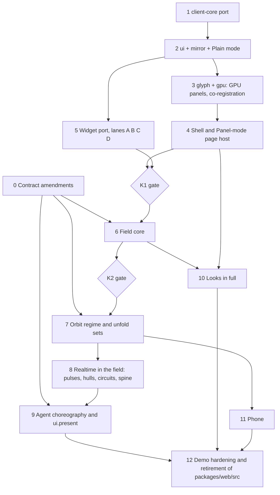

# Constellation: the organisation as a living entity graph in space

Proposal for the GPU frontend of Plinth Suite (brief: `docs/gpu-frontend/BRIEF.md`).
Codename **Constellation**. Status: proposal, implementation-ready. Task: WG-5532.

> Everything in Northwind Rewards is one entity in one continuous field: people, accounts, ledger
> transactions, orders, products, badges, promotions, segments, automations, runs, content, tasks,
> approvals, threads, pages and widgets. Their real relationships are edges. Every domain event travels
> along those edges as a pulse. Select anything and it unfolds into the widget apps that express it,
> arranged around it as orbiting panels. Domains are lenses over the one field, not places. When dense
> work starts, one key flattens everything into a crisp, pixel-snapped 2D panel grid that is as legible
> as a document.

---

## Contents

- [0. Thesis and the three decisions everything else follows from](#0-thesis-and-the-three-decisions-everything-else-follows-from)
- [1. The experience model](#1-the-experience-model)
- [R1. Feature parity](#r1-feature-parity)
- [Per-domain screens (all 19 domains)](#per-domain-screens-all-19-domains)
- [R2. WebGPU first, WebGL2 fallback](#r2-webgpu-first-webgl2-fallback)
- [R3. Text and data density](#r3-text-and-data-density)
- [R4. Input and forms](#r4-input-and-forms)
- [R5. Accessibility](#r5-accessibility)
- [R6. Realtime and the agent](#r6-realtime-and-the-agent)
- [Signature effects: frame graph, compute passes and shaders](#signature-effects-frame-graph-compute-passes-and-shaders)
- [R7. Performance budgets](#r7-performance-budgets)
- [R8. Phone](#r8-phone)
- [R9. Architecture](#r9-architecture)
- [R10. Looks and theming](#r10-looks-and-theming)
- [R11. Demo choreography](#r11-demo-choreography)
- [R12. Plan ordered by dependency](#r12-plan-ordered-by-dependency)
- [R13. Risks and kill criteria](#r13-risks-and-kill-criteria)
- [Appendix A. Contract amendments (additive)](#appendix-a-contract-amendments-additive)
- [Appendix B. Lessons carried over from the DOM round](#appendix-b-lessons-carried-over-from-the-dom-round)

---

## 0. Thesis and the three decisions everything else follows from

The previous DOM round produced a good site. The owner's complaint is that it is *a site*. Constellation
changes the unit of the interface from "a page of boxes" to "the organisation itself": the page is no
longer the place you go to, it is the set of apps that unfold around the thing you are looking at.

Three architectural decisions make that ambition usable instead of a screensaver:

1. **One semantic source, rendered twice, co-registered.** Every widget produces a *ViewTree* (a typed,
   declarative description of headings, tables, forms, charts and buttons). The ViewTree is laid out once
   (Yoga flexbox, in CSS pixels) and rendered twice from the *same* layout boxes: by the GPU as panel
   pixels, and by a semantic DOM **mirror** whose elements sit at exactly the same screen positions
   (absolute positioning inside a container carrying the panel's projective `matrix3d`). The mirror is
   transparent but real: it receives pointer events on panel content, holds the focus, carries text
   selection, find-in-page, autofill, IME, the screen reader tree and voice control targets. The GPU
   never re-implements a text input; it draws what the mirror says.
2. **Text that must be read is never 3D-distorted.** Field labels are MSDF billboards with LOD. Panel
   content is browser-shaped text rasterised at exact device pixels. Any panel that has focus, an active
   edit or more than 12 rows of data is screen-aligned and pixel-snapped. The "panel mode" (2D) is not a
   second app: it is the same panels with an orthographic camera.
3. **The field is CPU-authoritative, GPU-simulated, and stable.** The entity graph lives in a CPU store
   fed by a snapshot and the `/rt` streams. The GPU runs layout and effects over a mirror of it. Layout
   reheats *locally* (only the neighbourhood of what changed), positions persist per viewer, and the
   simulation stops entirely when settled, so the map does not move under the user and idle frames cost
   nothing.

A consequence worth stating up front: because the mirror is co-registered and complete, **making it
visible with a plain stylesheet is the unsupported-browser path, the kill-switch fallback, and the
"Plain" mode** all at once (R2, R13).

---

## 1. The experience model

### 1.1 The field

The field is a bounded 3D volume (`±2048` world units on each axis) containing every entity the viewer
may see. Entities are laid out by a GPU force simulation with **semantic anchors**: each of the 19 domains
has a *hub* (a large labelled star) placed on a ring ("the zodiac") in navigation-section order, and every
entity is softly attracted to its primary domain's hub. Real relationships pull across domains, so a
member sits between People, Points and Store in proportion to how they participate.

```
                       Insight (reporting, audit)
                 reporting *          * audit
                         \    ║║      /
          promotions *    \   ║║ <- the spine: change chain + domain chain,
     segments *            \  ║║    a double helix through the centre, genesis at the bottom
  automation *   Engage     \ ║║                       * approvals
   content *                  ║║          Personal      * tasks
    calendar *                ║║                       * notifications
     people *       . . member cloud . .                * messaging
                              ║║
        Admin                 ║║           Rewards
  admin *  settings *         ║║        * points  * store  * badges
     pages *  search *        ║║
                         Operate: orders, inventory, ledger hang off store and points
```

The **spine** is the audit record made literal: the change-log hash chain and the domain-event hash chain
as two strands of a vertical helix through the centre of the field, genesis at the bottom, head at the
top, with rungs joining a domain event to the change committed in the same transaction. Every event link
carries a faint tether to its subject entity, drawn only near the camera or on hover.

Seeded world as entities (counts from CONTRACT 11, re-measured by the snapshot builder when it lands):

| Kind | Count (seed) | Edge kinds it carries |
|---|---:|---|
| member | 40 | member-group, member-segment, member-role, member-account, member-session |
| group, segment, role | 8, 6, 7 | segment-promotion, segment-content-audience, group-thread |
| account (40 member, 8 system) | 48 | posting (via txn) |
| txn | ~890 | txn-account (debit, credit), txn-order, txn-promotion, txn-award |
| order | ~150 | order-member, order-product (line), order-approval |
| product, category, review | 60, 6, 40 | product-category, review-product, review-member, wishlist, cart |
| badge, award | 15, ~200 | award-badge, award-member |
| promotion | 8 | promotion-segment, promotion-category, redemption (promotion-order, promotion-txn) |
| automation, run | 10, ~600 | run-automation, run-trigger-event, run-step-target |
| content | 25 | content-author, content-audience, content-reviewer |
| task, approval | 30, ~40 | task-assignee, task-subject, approval-requester, approval-subject, approval-decider |
| thread (messages as satellites) | 60 (220) | thread-participant |
| notification | ~900 | notification-member, notification-subject (satellites, hidden outside the member lens) |
| page, widget, dashboard, panel | ~45, ~130, 3, ~12 | page-widget, widget-domain-hub, widget-entity (bound config) |
| domain event, change (spine links) | ~8,500, ~1,500 | event-subject tether, event-event (cause), rung |
| **total** | **~13,600 nodes, ~41,000 edges** | the simulation is sized for 65,536 nodes and 262,144 edges |

### 1.2 Three viewing regimes

| Regime | Camera | What is legible | Entered by |
|---|---|---|---|
| **Field** | perspective, free orbit | domain hubs, cluster names, high-importance entity labels (LOD) | `Esc` from Orbit, the "Field" item in the nav rail, pinch-out |
| **Orbit** | perspective, framed on an anchor | the anchor entity plus its unfolded panels on an arc, the focused panel screen-aligned at scale 1 | selecting an entity, following a route |
| **Panel** | orthographic, pixel-snapped | a flat 12-column grid, exactly like a page, field reduced to a minimap or a dimmed backdrop | `F` (flatten), the mode switch in the top bar, the default on phones and on dense routes |

Default regime per route (preference `ui.space: "auto" | "orbit" | "panel"`, Appendix A): `auto` gives
Panel for `/ledger`, `/admin*`, `/audit`, `/reports*`, `/d/*`, `/store/inventory`, `/store/manage`,
`/tasks/all`, `/pages/*/edit` and every phone viewport; Orbit for everything else.

### 1.3 Routes become anchored unfoldings

Every route still resolves through `pages.resolve` to a Page node, unchanged. What changes is where the page
is shown:

- A route has an **anchor**: the entity bound by its route parameter (`/people/:handle` anchors the member,
  `/store/p/:product` the product, `/promotions/:promotion` the promotion), or, for module routes without a
  parameter, the domain hub (`/store` anchors the Store hub, `/` anchors the viewer's own member node).
- The page's widget instances unfold around the anchor as **panels on an orbit plate**: a cylindrical arc
  segment centred on the anchor, onto which the page's 12-column layout is mapped (column → angle, row →
  height). The anchor stays visible behind and through the gaps, and a thin tether runs from the anchor to
  each panel to show which entity each app expresses.
- Selecting an entity that has no page (a task, an approval, a badge, a txn, a run, an event) unfolds its
  **unfold set**: a synthesised, unsaved arrangement of the widgets that already show that kind of thing,
  driven to the right record through the existing page-bus topics (`task.selected`, `badge.selected`,
  `run.selected`, ...). Unfold sets are data (`packages/constellation/src/unfold-sets.ts`), not code.

The URL stays the page route, so every shared link still works. Field state rides along in query
parameters (`?lens=`, `?sel=`, `?space=`, `?cam=`) that are optional and ignorable (R9.6).

### 1.4 Lenses

A lens is a filter and a force bias over the one field, never a separate scene. Lenses map one-to-one to
the six navigation sections plus "All":

| Lens | Domains brought forward | Visual bias |
|---|---|---|
| All | every domain | none |
| Personal | messaging, notifications, tasks, approvals, the viewer's own node and its 2-hop neighbourhood | the viewer is pulled to centre |
| Rewards | points, store, badges | ledger postings visible as flows between accounts; tier shells |
| Engage | people, content, promotions, automation, segments, calendar | segment hulls on; automation graphs drawn |
| Insight | reporting, audit | the spine brightens; panels show lineage tethers to their sources |
| Operate | store orders, inventory, ledger | order pipeline lanes (placed → delivered) as an attractor line |
| Admin | admin, settings, pages, search | roles and grants as a lattice; pages as plates |

Out-of-lens entities fade to 12 % opacity and drop their labels; their anchors relax so in-lens entities
come forward (anchor gravity ×3 for in-lens kinds). `[` and `]` cycle lenses; the nav rail section headers
apply them.

### 1.5 The shell, in screen space

The shell is not part of the 3D scene: it is a crisp HUD layer drawn last, in CSS pixels, from the same
ViewTree machinery (so it has a mirror too).

```
┌──────────────────────────────────────────────────────────────────────────────────────────────┐
│ ◈ Plinth  Home ›  Maya Ortiz        [Search or run a command  Ctrl K]  ⛁ 48 210 pts ·Plat │
│                                                     ✉ 3   ◔ 7   ● live   Field|Orbit|Panel  (MO)▾│
├──────┬───────────────────────────────────────────────────────────────────────────────────────┤
│ ⌂    │                                                                                       │
│ ✉ 3  │                (field / orbit / panel content)                                        │
│ ◔ 7  │                                                                                       │
│ ☑ 5  │                                                                       ┌──────────────┐│
│ ✓ 2  │                                                                       │ toasts (max 4)││
│ ─    │                                                                       └──────────────┘│
│ ⛁ ◇ ★│                                                                                       │
│ ...  │  ╭─ timeline scrubber: virtual 90 days, live head at right ─────────────────────────╮ │
│      │  ╰──────────────────────────────────────────────────────────────────────────────────╯ │
└──────┴───────────────────────────────────────────────────────────────────────────────────────┘
```

- **Nav rail** (left): sections from `navStore` with count badges; section headers double as lens
  buttons; collapsed to icons below 80rem, to a drawer below 48rem.
- **Top bar**: product mark, breadcrumb (lens › anchor), palette trigger, balance chip, inbox, bell,
  live indicator, space switch (Field, Orbit, Panel), identity menu.
- **Approvals banner** and **offline banner**: full-width HUD bands under the top bar.
- **Timeline scrubber** (bottom, collapsible): the domain-event history as a density strip over the 90
  virtual days; dragging replays pulses at up to 500 events per second of scrub (R11 beat 2).
- **Minimap** (Panel mode only): a 160 × 96 CSS px live render of the field in the top-right corner,
  updated every fourth frame, with the anchor marked.

---

## R1. Feature parity

Every one of the 77 catalogue widgets, every shell element and every route of UI-MAP section 2 has a home.
The owner's model stands: **widgets are apps in their own right, each an expression of part of a
domain**. In Constellation a widget instance is literally an app *attached to an entity*: it orbits the
thing it expresses.

### R1.1 How a widget is presented and operated, in every regime

| Aspect | Rule |
|---|---|
| Container | one panel per Widget instance node; the panel frame is the old `widgetFrame` (title, count, menu, state) drawn by the GPU, with its mirror `<section aria-labelledby>` |
| Sizes | `s m l xl full` keep their `SIZE_GRID` footprints; in Orbit one column is 96 CSS px at the plate's rest distance, a row 72 CSS px (4.5 rem at 16 px); in Panel mode they are the page grid exactly |
| Internal views | unchanged: the widget switches its own views (list, detail, form, confirm) inside its panel; a view switch is a cross-fade of the panel content only |
| Operation | pointer and keyboard on the panel go to the mirror's real elements (buttons, links, inputs, grids), which call the widget; the GPU shows hover, press and focus from mirror state |
| States | loading (skeleton for the first load only), empty, error with retry, unavailable: drawn in the panel and mirrored |
| Data and events | exactly the catalogue's actions and events (`widgets.ts`); nothing in Constellation calls an action a widget does not list |
| Bus | unchanged `BUS_TOPICS` scoped by `link_group`; an unfold set gets its own bus, so unfolding two members does not cross-wire |
| Field link | each widget declares which entity it expresses (`expresses(config, params) → EntityKey | null`) so the panel tethers to it, and may *mark* entities in the field (`ctx.field.mark`, R9.2) |

### R1.2 Complete widget map

Legend: **Where** is the route (and anchor) plus the unfold sets that include the widget. **3D adds**
names the one thing the field contributes; "none" means the widget is a flat panel and the field only
tethers it.

| Widget | Where | Panel presentation and operation | 3D adds |
|---|---|---|---|
| `points.balance` | `/`, `/points`, `/people/:handle`, `/profile`, `/store/cart`; unfold: member | hero numeral (tabular), tier pill, progress bar to next tier, expiring-soon line; credits roll the digits | the member node grows a tier ring whose fill is progress to next tier |
| `points.ledger` | `/points`; unfold: member, account | virtualised statement table (date UTC, type, memo, delta, balance) with type filter chips, opening/closing rows; row → transaction view (entries, lots) | selected line pulses its txn between the two accounts |
| `points.transfer` | `/points`; unfold: member (others, "Send points") | form → confirm (balance after) → done | on done, a pulse from viewer to recipient |
| `points.award` | `/points/award`; unfold: member (managers) | multi-recipient picker, category, reason, multiplier preview, approval-hold notice; form → confirm → done | recipients light in the field as you add them; a held award drops a held beacon |
| `points.expiry` | `/points`; unfold: member | list of lots by expiry date with totals | lots near expiry glow on the member's account node |
| `points.tiers` | `/points`; unfold: Points hub | ladder with perks, member counts, viewer's position | tier shells around the Points hub with member nodes on them |
| `points.trial-balance` | `/ledger`; unfold: Points hub (finance) | invariants (debits = credits, sum of member balances, system accounts) with pass/fail icon and text | the spine's ledger rungs flash green on a pass |
| `points.accounts` | `/ledger`; unfold: account | accounts table → statement → transaction → reverse (preview, confirm) | the selected account and its counterparties come forward |
| `store.catalog` | `/store`, `/store/c/:category`; unfold: category | filter column, sort, grid of product cards (procedural artwork), add to cart and wishlist in place, product view inside | category hub lights matched products; add-to-cart pulses product → viewer |
| `store.product` | `/store/p/:product`; unfold: product | artwork, price, stock, tier gate, add to cart, wishlist, reviews with histogram, write review | the product's buyers (orders) and reviewers surround it |
| `store.featured` | `/store`, `/store/p/:product` | row of cards | none |
| `store.cart` | `/store/cart`, `/store/p/:product`; unfold: viewer | lines with steppers and issues, live quote with promotions, checkout (delivery, confirm, placed) | checkout sends one pulse burst along order → products → accounts → promotion |
| `store.orders` | `/store/orders`, `/store/manage` (twice, link groups); unfold: member, product | table with status filters, transitions, detail inside | Operate lens: orders ride a status lane |
| `store.order` | `/store/orders/:order`; unfold: order | lines, promotions, timeline, allowed transitions | the order's lines and txns radiate from it |
| `store.wishlist` | `/store/wishlist`, `/store/cart`; unfold: viewer | list with stock and affordability, move to cart | none |
| `store.inventory` | `/store/inventory`; unfold: product (staff) | table with low/out filters, adjust view | low and out products pulse amber/red with ▲/✕ glyphs |
| `badges.showcase` | `/badges`, `/people/:handle`, `/profile`; unfold: member | three pinned badges plus earned count; pick view for the owner | pinned badges orbit the member node as small medals |
| `badges.progress` | `/`, `/badges`, `/people/:handle` | rings with what is left | none |
| `badges.catalog` | `/badges`; unfold: badge | grid with earned/in progress/locked filters, badge view, manual award | the badge's awardees cluster around it |
| `badges.recent` | `/badges` | ticker of awards | each new award is a pulse badge → member |
| `promotions.list` | `/promotions` | table by status with window, usage bar, pending approval marker, create new | none |
| `promotions.builder` | `/promotions/new`, `/promotions/:promotion` | six-step builder (eligibility rule builder, effects, budget, schedule, review, history with diff) | the eligibility rule lights the matching segment hull and member set live as you edit |
| `promotions.simulator` | `/promotions/:promotion` | inputs (member, sample cart or earn) → result (applied, rejected with reasons, totals, baseline) | the simulated member and cart products are marked |
| `promotions.performance` | `/promotions`, `/promotions/:promotion` | redemptions, cost, budget gauge, by tier and region, uplift; summary and series | redemption pulses on the promotion's edges |
| `promotions.active` | `/`, `/store`, `/store/c/:category` | member-facing banners | none |
| `messaging.inbox` | `/messages`, `/messages/t/:thread`; unfold: viewer | folders, search, list, bulk star/archive/read, thread view inside | none |
| `messaging.thread` | `/messages`, `/messages/t/:thread`; unfold: thread | conversation, read receipts, reply box | participants arranged around the thread node |
| `messaging.compose` | `/messages/new`, `/groups/:group` | recipient picker, subject, body with @mentions, send | recipients light as added |
| `messaging.unread` | `/` | count plus three latest | none |
| `notifications.feed` | `/`, `/notifications` | feed with type filters, mark read, mark all | each row's subject is markable (hover marks it) |
| `notifications.preferences` | `/settings` | type × channel matrix, digest schedule, quiet hours | none |
| `notifications.deliveries` | `/settings` | log list with suppression reasons, detail | none |
| `notifications.send` | unfold: group, segment (senders) | form | recipients light |
| `tasks.list` | `/`, `/tasks/all`; unfold: task, member | table, inline status, task view with comments | none |
| `tasks.board` | `/tasks` | kanban columns with keyboard moves | none |
| `tasks.quick-add` | `/tasks`; unfold: any entity (as "New task linked to this") | title, assignee, due, priority, link | new task condenses next to the linked entity |
| `approvals.inbox` | `/`, `/approvals` (twice), `/store/manage`; unfold: approval | list and item view with SoD reasons, diff or detail, decide inline | held beacons orbit their subjects; deciding releases the beacon along the approval edge |
| `content.feed` | `/`, `/news` | cards or list, pinned first, reactions, reader view | none |
| `content.reader` | `/read/:content`; unfold: content | article from blocks, reactions | none |
| `content.editor` | `/content/new`, `/content/:content` | block editor with side preview, settings, versions, diff, workflow | the audience (segments, groups) lights as you set it |
| `content.review-queue` | `/content` | queue and review view with diff, approve or request changes | none |
| `content.list` | `/content` | table by status, type, tag, author, engagement | none |
| `people.directory` | `/people`, `/points/award`; unfold: group, segment | grid or table, search, filters | filters dim non-matching members in the field |
| `people.profile-card` | `/people/:handle`, `/profile`; unfold: member | identity, avatar, title, region, tier, groups, roles, message and award actions; edit view (own) | none |
| `people.activity` | `/people/:handle`, `/profile`; unfold: member | timeline | each row marks its subject |
| `people.group` | `/groups/:group`; unfold: group | description, managers, members | members ring the group node |
| `people.groups` | `/people` | groups with membership markers | none |
| `people.sessions` | `/profile`, `/settings` | browser and MCP sessions with revoke | the agent's session is drawn as the comet's tether to the viewer |
| `segments.list` | `/segments` | segments with live counts and where used | hovering a row lights its hull |
| `segments.builder` | `/segments/new`, `/segments/:segment` | rule builder over member facts, live count, distribution, sample | the hull reshapes live as the rule changes (signature) |
| `segments.members` | `/segments`, `/segments/:segment`; unfold: segment | members list | none |
| `automation.list` | `/automations` | trigger, enabled switch, last run, failures, next fire | none |
| `automation.builder` | `/automations/new`, `/automations/:automation` | trigger, conditions, steps with per-step forms, limits; dry run, run now, enable | the automation's graph (trigger → conditions → steps → targets) drawn in the field; dry run sends a ghost pulse |
| `automation.runs` | `/automations`, `/automations/:automation`; unfold: run | runs list, run view with per-step status, retry, cancel | a run is a pulse travelling the automation graph (signature) |
| `calendar.month` | `/calendar` | month, week, day grids | none |
| `calendar.agenda` | `/content`, `/promotions`, `/calendar` | next N days list | none |
| `reporting.table` `.bar` `.line` `.area` `.heatmap` `.scatter` `.kpi` | custom pages, boards; unfold: dashboard | chart, table and inspector views drawn as panel marks (R3.6) | lineage tether to the source |
| `reporting.panel` | `/ledger`, boards | embeds a kernel Panel | lineage tether |
| `reporting.board` | `/reports`, `/reports/:dashboard`, `/d/:dashboard` | whole Meridian board with trace ribbon | none (boards default to Panel mode) |
| `reporting.suite-kpis` | `/`, `/reports` | strip of figures with 14-day sparklines | none |
| `audit.timeline` | `/audit`; unfold: any entity ("History") | merged change log and events, filters, undo, hash display | selecting a row flies along the spine to its link |
| `audit.verify` | `/audit` | status of both chains with heads | verification sweep up both helix strands (signature) |
| `audit.node-history` | `/content/:content`; unfold: any node entity | revisions, diff between two, undo | none |
| `admin.members` | `/admin` | table with private fields, roles, status; member, create views | none |
| `admin.roles` | `/admin/roles` | roles with members and scopes; propose membership change (held) | none |
| `admin.matrix` | `/admin/roles` | role × permission grid, agent ceiling, principal view | optional "layers" view: grants, agent ceiling and effective permissions as three stacked planes (R3.5) |
| `admin.grants` | `/admin/grants` | grant list, propose (held) with `grant.check` counts | none |
| `admin.program` | `/admin/program` | Program node form, history; every change held | none |
| `settings.appearance` | `/settings` | look, theme, density, reduced motion, space default, text scale, text spacing, effects level | look thumbnails rendered live by the GPU |
| `pages.editor` | `/pages/:page/edit` | the page plate in blueprint: grid lines, drag/resize with keyboard equivalents, catalogue, schema-generated config forms | catalogue shown as a "widget nebula" grouped by domain hub |
| `search.results` | `/search` | grouped results with type filters | matches light in the field, the rest dim |

### R1.3 Shell elements

| Element | Constellation form |
|---|---|
| Side nav | the nav rail; sections are lenses; items are routes; count badges from `countsStore` |
| Top bar | HUD band (1.5) |
| Points chip | balance chip in the top bar; on `points.posted` for the viewer the digits roll and a signed delta flashes; a pulse arrives at the viewer's node |
| Inbox | top-bar button with `messages_unread` |
| Notification bell | top-bar button with `notifications_unread`; popover panel with the latest 8, "Mark all read", "Open all" |
| Live indicator | a small star that breathes while live (static ring under reduced motion), grey and struck through when offline, with text "Live", "Connecting", "Offline" |
| Identity switcher | identity menu listing `dev.principals`; switching rebuilds the field for the new principal (R11 beat 6) |
| Command palette | `Ctrl+K`/`⌘K`: a HUD panel with a real `<input>` (R4); commands plus `search.global` results; arrowing through entity results previews them in the field |
| Toasts | HUD stack (max 4, newest on top); each toast's subject also receives a pulse |
| Approvals banner | HUD band "2 approvals wait for you" with "Review" (flies to Approvals) |
| Offline banner | HUD band with retry countdown; the field desaturates and pulses stop |
| Session revoked | full-screen notice "This tab was signed out" with Reload; the field dissolves to dust |
| Empty site | the field without pages: hubs remain dim; the plate shows "This workspace is empty. Pages appear here as they are built." |

### R1.4 Catalogue amendments needed for unfold sets

Unfold sets drive widgets to a record through existing bus topics. Four widgets need one more subscription
or one optional config key to be drivable; all are additive and generated by `pnpm schema:gen`:

| Widget | Amendment | Why |
|---|---|---|
| `approvals.inbox` | subscribes `approval.selected` (opens the item view) | unfold of an approval |
| `points.accounts` | config `account?: string`; subscribes new topic `account.selected` | unfold of an account or txn |
| `points.ledger` | subscribes new topic `txn.selected` (opens the transaction view) | unfold of a txn |
| `audit.timeline` | config `focus_seq?: { change?: Int; event?: Int }` | unfold of a spine link |

`BUS_TOPICS` gains `account.selected` and `txn.selected` (payload `{ id }`).

---

## Per-domain screens (all 19 domains)

Each domain below states: its **field presence** (entities, edges, what its hub looks like), its **routes
and arrangement** (how the Page lays out on the orbit plate, which regime is the default), every **widget**
and how it is operated, and its **realtime** behaviour. Arrangements reference UI-MAP section 2 layouts
`@x,y,w,h`; on the plate, column `x` maps to the angle `θ = θc + ((x + w/2) / 12 − 0.5) · 96°` and row `y`
to height `−y · 72 px` at rest distance.

### D1. Points

**Field.** The Points hub is a gold-neutral star circled by four **tier shells** (bronze innermost,
platinum outermost) at radii 60, 90, 120 and 150 units. Each member's account node sits on the shell of the
member's tier, angularly near the member. The 8 system accounts (issuance, redemption, expiry, breakage,
promotion funding and so on) form a ring under the hub. Each txn is a small node between its debit and
credit accounts; postings are edges coloured by `txn_type` with a type glyph at the midpoint at near LOD
(award ✦, purchase ⛁, refund ↺, transfer ⇄, expiry ⌛, adjustment ±, promotion_bonus %, badge_reward ★,
reversal ⟲). In the Rewards lens the postings animate as slow flows (UV scroll on the edge, off under
reduced motion), so the ledger reads as a circulation diagram.

**Routes.**
- `/points` (Orbit, anchor: viewer's account): arc with `points.balance` l and `points.transfer` m on the
  top row, `points.ledger` full across the middle (screen-aligned because it has more than 12 rows),
  `points.expiry` m and `points.tiers` l below.
- `/points/award` (Orbit, anchor: Points hub): `points.award` l left, `people.directory {view:"table"}`
  l right.
- `/ledger` (Panel by default, anchor: system accounts ring): `points.trial-balance` l, `reporting.panel`
  l, `points.accounts` full.

**Widgets.**
- `points.balance`: figure at the look's stat size with tabular numerals, tier pill with text, a progress
  bar "3 140 pts to Gold" and "1 200 expiring 30 Nov 2026 UTC". On `points.posted` for the shown member the
  digits roll from old to new (per-digit odometer in the UI shader, 480 ms; under reduced motion an instant
  swap with a static "+250" chip for 4 s). Read-only; the tier pill is a link to `/points`.
- `points.ledger`: columns Date (UTC), Type, Memo, Delta (signed, U+2212 minus, right-aligned), Balance.
  Filter chips for `types` (toggle buttons with `aria-pressed`). Paged by `page_size` from
  `points.statement`, appended as the user scrolls (900 rows stay smooth, R3.4). Enter or click on a row
  opens the *transaction* view: entries (account, debit, credit), lots consumed, the order link, which
  publishes `order.selected`. In Orbit, the selected row sends a pulse along the txn's two posting edges.
- `points.transfer`: recipient (people combobox over `people.directory`), amount (number input with min and
  max from the limits, shown as helper text), memo; the Confirm view shows "Balance after: 45 010"; the Done
  view has "Send another". Errors map to fields by `error.path`.
- `points.award`: recipient chips (up to 50), category select, reason, a live "Multiplier ×2 from
  gold-double-points" line, a hold notice "Awards over 5 000 are held for approval"; Confirm; Done shows
  "Held for approval" with the approval link when held.
- `points.expiry`: list grouped by date with totals; empty state "Nothing expires in the next 90 days".
- `points.tiers`: ladder rows (tier, floor, perks, member count) with a "You are here" marker; in the field
  the shells show the same.
- `points.trial-balance`: four invariant rows with a ✓ or ✕ icon and text ("Debits equal credits:
  1 912 440 = 1 912 440"); a system account balances table.
- `points.accounts`: accounts table (member/system filter) → statement → transaction → Reverse (the preview
  shows the reversing entries; Confirm commits with an idempotency key).

**Realtime.** `points.posted` → balance chip, every `points.balance` for that member, ledger prepend with
arrival highlight, pulse from the counterparty account to the account. `tier.changed` → the account node
migrates to the next shell (a 1.2 s arc; under reduced motion a jump) and a celebratory toast to the
member. `points.expiring` → expiry rows glow.

### D2. Store

**Field.** Store hub with six **category** sub-hubs (apparel, tech, home, experiences, wellness, giving),
each in its category hue; 60 products orbit their category, sized by price (log scale), artwork generated
procedurally in the node shader from category icon, hue and pattern (`dots, stripes, rings, grid, waves,
solid`, CONTRACT 11.3). Orders sit between member and products. Reviews are satellites of products. Stock
status has a non-colour cue: `low` products wear a ▲ glyph and an amber ring, `out` a ✕ and a hollow body.

**Routes.**
- `/store` (Orbit, anchor: Store hub): `promotions.active` full banner row on top, `store.featured` full,
  `store.catalog` full (screen-aligned).
- `/store/c/:category` (anchor: the category): banner and catalog.
- `/store/p/:product` (anchor: product): `store.product` xl, `store.cart {compact}` m, `store.featured` m.
- `/store/cart` (anchor: viewer): `store.cart` xl, `points.balance` m, `store.wishlist` m.
- `/store/orders`, `/store/orders/:order` (anchor: viewer, order): `store.orders`, `store.order`.
- `/store/wishlist`: `store.wishlist` full.
- `/store/manage` (Panel by default, anchor: Store hub, Operate lens): `store.orders
  {requires_approval}` xl, `approvals.inbox {types:["order"]}` m, `store.orders {link_group:"all"}` full.
- `/store/inventory` (Panel by default): `store.inventory` full.

**Widgets.**
- `store.catalog`: a filters column (category, tag, affordable only, sort) of real form controls; a grid of
  cards (artwork, title, price in points, stock text, heart toggle, "Add to cart" button); product view
  inside, or `product.selected`, or page navigation per `open_in`. Card artwork is the same procedural
  shader as the field node, so the card and the node are visibly the same thing.
- `store.product`: large artwork, price, stock ("12 in stock", "Only 2 left", "Out of stock"), tier gate
  ("Gold and above"), quantity stepper, Add to cart, Wishlist toggle; reviews tab with a five-bar histogram
  (bars with value labels) and list; write-review view (rating radio group, text area).
- `store.featured`: horizontal row of cards; arrow keys move between cards; overflow scrolls inside the
  panel.
- `store.cart`: lines with quantity steppers and issue text ("Price changed", "Only 2 left"); a live quote
  with applied promotions; the checkout views delivery → confirm → placed inside the widget. Placing emits
  the signature checkout burst (R6.3).
- `store.orders`: table (order no, member, placed UTC, items, total, status pill with text), status
  filters, transition buttons allowed by the order state, order view inside. Publishes `order.selected`.
- `store.order`: lines, promotions applied, status timeline, allowed transitions (refund is held for
  agents).
- `store.wishlist`: list with stock and affordability, "Move to cart".
- `store.inventory`: table (product, on hand, status, reorder point), low/out filters, adjust view (restock
  or correction with a reason).

**Realtime.** `stock.changed` → node glyph and ring, card text, product view; `cart.updated` → cart count;
`order.placed` → the order condenses between member and products; `order.status_changed` → in the Operate
lens the order slides along the status lane; `review.created` → a review satellite appears and the
histogram updates; `wishlist.changed` → heart toggles.

### D3. Promotions

**Field.** The Promotions hub; 8 promotion nodes shaped as faceted gems, state shown by fill and glyph
(draft hollow ◌, scheduled ◷, active ●, paused ‖, ended ■). Each promotion has edges to its eligible
segments, categories and products; redemptions are pulses promotion → order or txn.

**Routes.**
- `/promotions` (Orbit, anchor: hub): `promotions.performance {promotion:null}` l, `calendar.agenda
  {types:["promotion"]}` l, `promotions.list` full.
- `/promotions/new`, `/promotions/:promotion` (anchor: promotion): `promotions.builder` full,
  `promotions.simulator` l, `promotions.performance` l.

**Widgets.**
- `promotions.list`: table (title, status pill with text, window UTC, usage bar with percentage text,
  pending approval marker "Awaiting Priya"), status filter, "New promotion".
- `promotions.builder`: six views as a stepper (eligibility, effects, budget, schedule, review, history).
  Eligibility is the rule builder (R4.6) with pickers for segments, categories and products. While editing,
  the field marks the members the rule currently selects (via `segments.preview`) and draws the segment
  hulls involved. Review shows the diff against the last revision. Transitions (activation is held,
  R-PROMO-ACTIVATE) and history.
- `promotions.simulator`: inputs (member combobox, sample cart builder or earn event) → result: applied
  promotions with amounts, rejected with reasons ("Not in segment new-joiners"), totals against baseline.
- `promotions.performance`: redemptions, cost, a budget gauge (bar with text "78 % of 120 000"), small
  multiples by tier and region, uplift; summary and series views (`bucket` hour or day).
- `promotions.active`: banner cards ("Double points for Gold and Platinum, until 30 Nov") with a call to
  action.

**Realtime.** `promotion.state_changed` → gem glyph, list status, calendar, banners re-fetch;
`promotion.redeemed` → pulse and live counter; `promotion.budget_alert` → the gem flares amber with ▲ and a
toast goes to marketing and finance.

### D4. Badges

**Field.** Badges hub; 15 badge nodes as medals with rarity rims (common plain, uncommon one rim, rare two,
epic three, legendary three plus a halo; the rim count is the non-colour cue). Awards are not drawn
individually at far LOD; at near LOD each awardee is joined to the badge by a fine edge.

**Routes.** `/badges` (Orbit, anchor: viewer): `badges.showcase` m, `badges.progress` m and `badges.recent`
m on top, `badges.catalog` full below.

**Widgets.**
- `badges.showcase`: three pinned medals rendered with the field's medal shader, earned count; pick view
  (owner): a checkbox grid of earned badges, at most three, Save.
- `badges.progress`: rows with progress rings (arc mark plus "7 of 10 messages") and what is left.
- `badges.catalog`: grid with all/earned/in progress/locked filters, badge view (criteria, reward, rarity,
  holders), manual award form for managers (recipient, reason), revoke.
- `badges.recent`: ticker list, newest on top; each new row also pulses badge → member in the field.

**Realtime.** `badge.awarded` → the medal condenses onto the awardee (for the owner: the medal flies from
the badge node to the member and docks in the showcase panel), toast with artwork; `badge.progress` →
rings; `badge.revoked` → the medal fades from the member.

### D5. Messaging

**Field.** Messaging hub; thread nodes as small envelopes with participant edges; messages are satellite
dots of their thread at near LOD only. Unread threads carry a dot glyph. Message bodies never appear in the
field: it shows subjects only.

**Routes.**
- `/messages` (Orbit, anchor: viewer): `messaging.inbox` l (5 columns), `messaging.thread` xl.
- `/messages/t/:thread` (anchor: thread): inbox 4 columns, thread 8 columns.
- `/messages/new`: `messaging.compose` xl centred.

**Widgets.**
- `messaging.inbox`: folder tabs (inbox, sent, starred, archived), search field, list rows (sender,
  subject, preview, UTC time, unread dot with text), checkboxes and bulk actions (star, archive, mark read),
  thread view inside or `thread.selected`.
- `messaging.thread`: message list with author chips, UTC times, read receipts, mentions highlighted,
  attachment metadata; reply box (a DOM textarea, R4) with Send (`Ctrl+Enter`).
- `messaging.compose`: recipients (people and groups combobox with chips), subject, body with @mention
  completion, Send; Sent view.
- `messaging.unread`: count plus the three latest; rows publish `thread.selected` or navigate.

**Realtime.** `message.received` → an envelope pulse sender → thread → viewer, inbox count, list prepend,
open thread appends, toast unless the thread is open or muted; `message.state_changed` → row state;
`message.sent` → the sent folder in other tabs.

### D6. Notifications

**Field.** Notifications are satellites of the viewer's member node (only the viewer's), visible in the
Personal lens, unread ones bright. Each satellite has a faint tether to its subject entity.

**Routes.** `/notifications` (Orbit, anchor: viewer): `notifications.feed` full. `/settings` carries
`notifications.preferences` and `notifications.deliveries`.

**Widgets.**
- `notifications.feed`: type filter chips, list rows (icon, title, body, UTC time, unread mark with text),
  "Mark read" per row, "Mark all read"; rows link to their subject's route.
- `notifications.preferences`: a grid (types × channels in-app, email, digest) of checkboxes with
  `role=grid` keyboard movement, digest schedule select, quiet hours time inputs.
- `notifications.deliveries`: list (channel, member, UTC time, status, suppression reason), detail view.
- `notifications.send`: recipients (people, groups), title, body, link, Send.

**Realtime.** `notification.created` → a satellite condenses on the viewer, bell count, feed prepend, toast
where in-app is on; `notification.read` → satellites dim, bell count.

### D7. Tasks

**Field.** Task nodes as small squares near their assignee, tethered to their linked subject (an order, a
content item); priority shown by size and glyph (urgent ‼, high !, normal none, low ↓); overdue tasks carry
a clock glyph and the accent ring.

**Routes.** `/tasks` (Orbit, anchor: viewer): `tasks.quick-add` m, `tasks.board` full. `/tasks/all` (Panel
by default): `tasks.list` full.

**Widgets.**
- `tasks.list`: table (no, title, assignee, due UTC, priority, inline status select), filters by scope and
  status, task view with comments and a comment box.
- `tasks.board`: kanban columns by status; cards draggable by pointer; by keyboard: focus a card, `Space`
  to pick up, arrows to move between columns and positions, `Space` to drop, `Esc` to cancel, each step
  announced ("Task 31 moved to In progress, position 2 of 4").
- `tasks.quick-add`: title, assignee (people combobox), due (date input), priority (select), optional link
  (entity combobox). In an unfold set the link is prefilled with the unfolded entity.

**Realtime.** `task.assigned` → the task condenses next to the assignee, toast to the assignee;
`task.updated` → the card moves column; `task.commented` → the comment appends.

### D8. Approvals

**Field.** Every pending approval is a **held beacon**: a hollow ring orbiting its subject entity (the
change's node, the order, the content item, the role), with an edge to the Approvals hub and one to the
requester. Agent-requested items carry ◆ on the ring. Separation of duties is visible: the requester's edge
is dashed, and a viewer who cannot decide sees the SoD reason on the item.

**Routes.** `/approvals` (Orbit, anchor: Approvals hub): `approvals.inbox {scope:"to_decide"}` full,
`approvals.inbox {scope:"requested", link_group:"mine"}` xl.

**Widgets.**
- `approvals.inbox`: list (type, title, requester with agent marker, requested UTC, SoD reason when the
  viewer cannot decide), item view with a diff (for changes: before and after of the node fields) or detail
  (orders, content), Approve, Reject (with note), Withdraw (own requests). High-value orders take a
  two-step confirm.

**Realtime.** `approval.requested` → the beacon condenses, count, toast to approvers; `approval.decided` → on
approve the beacon collapses into the subject and the subject flashes "Applied"; on reject the beacon
breaks into dust with ✕; requester toast.

### D9. Content

**Field.** Content hub; content items as page-shaped tiles, status by fill and glyph (draft ✎, in review ◔,
approved ✓, published ●, archived ▫); edges to author, reviewers, audience segments and groups. Engagement
is a halo radius proportional to log(views) at near LOD.

**Routes.**
- `/content` (Orbit, anchor: hub): `content.review-queue` l, `calendar.agenda {types:["content"]}` l,
  `content.list` full.
- `/content/new`, `/content/:content` (anchor: the item; Panel by default because editing is dense):
  `content.editor` full, `audit.node-history` l.
- `/news`: `content.feed {layout:"list"}` full. `/read/:content`: `content.reader` xl centred.

**Widgets.**
- `content.feed`: cards or list, pinned first, reaction toggle buttons (like, celebrate, insightful) with
  counts, reader view inside.
- `content.reader`: blocks (headings, paragraphs, lists, quotes, images as procedural art, callouts) at a
  66-character measure, reactions.
- `content.editor`: block list with drag handles and keyboard reordering (`Alt+↑/↓`); each block is a DOM
  editing surface while focused (R4.5); side preview rendered by the GPU from `content.preview`; settings
  view (type, tags, audience pickers, reviewers, schedule); versions list and block diff (inserted and
  removed blocks marked with + and − glyphs and text, not colour alone); workflow buttons per state.
- `content.review-queue`: queue list, review view with diff since last review, Approve or Request changes
  with a note.
- `content.list`: table (title, type, status, tag, author, views, reactions), filters.

**Realtime.** `content.state_changed` → tile glyph, list pill, editor banner; `content.published` → the tile
ignites once and the audience edges pulse outward to segments and groups; `content.engaged` → counters and
halo.

### D10. People

**Field.** People hub at the centre of the Engage side; 40 member nodes as avatar discs (initials on
`avatar_hue`, the same procedural avatar as `ds/js/avatar.js`), sized by activity, with a tier ring. Groups
are soft rings enclosing their members; roles are small shields on members at near LOD. Sessions are tiny
satellites (own sessions only, unless admin).

**Routes.**
- `/people` (Orbit, anchor: hub): `people.directory {view:"grid"}` full, `people.groups` m.
- `/people/:handle`, `/profile` (anchor: member): profile card l, balance m, showcase m on top; activity xl
  and progress m (sessions m on `/profile`) below.
- `/groups/:group` (anchor: group): `people.group` xl, `messaging.compose {collapsed}` m.

**Widgets.**
- `people.directory`: search, region, tier and group filters, grid of person cards or a table; filters
  apply to the field too (non-matching members dim). Publishes `member.selected`.
- `people.profile-card`: avatar, name, title, region, tier pill, groups, roles, "Message" and "Award"
  actions; edit view for the viewer's own profile (DOM inputs, R4).
- `people.activity`: timeline rows (icon, text, UTC time); hovering a row marks its subject.
- `people.group`: description, managers, members list.
- `people.groups`: list with "Member" markers.
- `people.sessions`: list (device, surface browser or MCP, last seen UTC, current marker), Revoke with
  confirm.

**Realtime.** `member.updated` → label and chips; `tier.changed` → ring; `session.revoked` → the session
satellite goes out; the revoked tab shows the signed-out notice.

### D11. Segments

**Field.** Segments are **visible clusters**: each segment is a soft hull (iso-contour of a density field
splatted from its member nodes, shader section S5) with its name on the hull. Members of several segments
sit in the overlap because segment membership is a spring. The Engage lens turns hulls on; other lenses show
a hull only while its segment is hovered or focused.

**Routes.** `/segments` (Orbit, anchor: hub): `segments.list` l, `segments.members` xl. `/segments/new`,
`/segments/:segment` (anchor: segment): `segments.builder` full, `segments.members` l.

**Widgets.**
- `segments.list`: table (name, live count, used by promotions, content and automations); hovering or
  focusing a row lights its hull. Publishes `segment.selected`.
- `segments.builder`: rule builder over member facts (R4.6), live count, distribution bars by tier and
  region, sample members; history view. **Signature:** each edit runs `segments.preview` (debounced 250 ms)
  and the hull morphs to the new membership: members entering are pulled in, members leaving drift out, the
  count rolls. You see who you are about to target.
- `segments.members`: list of matching members with tier and region; publishes `member.selected`.

**Realtime.** `tier.changed` → tier-based segments re-evaluate on the next preview; the hull updates.

### D12. Automation

**Field.** Each automation is a small **circuit**: a trigger node (event-type icon, schedule ◷ or metric
∿), condition diamonds, step nodes (award, send_message, notify, create_task, apply_promotion, webhook) and
target edges to what the steps act on (segments, groups, the Program). Disabled automations are outlines. A
run is a **pulse travelling the circuit**: from the triggering event's spine link, through the trigger, the
conditions and each step in order, out to the effects (a task condensing next to Samir, a notification on a
member). A failed step stops the pulse with ✕ and a red flare; a skipped step passes a hollow pulse.

**Routes.** `/automations` (Orbit, anchor: hub): `automation.list` full, `automation.runs` full.
`/automations/new`, `/automations/:automation` (anchor: the trigger node): `automation.builder` full,
`automation.runs` full.

**Widgets.**
- `automation.list`: table (name, trigger summary, enabled switch as a real `role=switch`, last run UTC,
  failures with ▲, next fire UTC); enabling is held for agents (R-AUTOMATION-ENABLE) and for external steps
  (R-AUTOMATION-EXTERNAL), and the switch then reads "Held for approval".
- `automation.builder`: trigger view (event picker, cron with next-fire preview, metric with query),
  conditions (rule builder), steps (ordered list with per-step forms; add, remove and reorder by keyboard),
  limits; Dry run shows a ghost pulse travelling the circuit with predicted per-step outcomes; Run now;
  Enable; history view.
- `automation.runs`: table (run id short, status pill with text, started UTC, elapsed, steps done/total),
  status filters, run view with per-step status rows, Retry, Cancel. Publishes `run.selected`; the selected
  run replays its pulse.

**Realtime.** `automation.run_updated` → the live pulse advances to `step_index` with `step_status`; the
runs table updates in place; failures toast the owner.

### D13. Calendar

**Field.** The calendar is a lens over time, not a set of entities. Selecting a date (`date.selected`)
highlights every entity whose window covers that day (promotion windows, content schedules, cron fires,
expiry lots, task due dates) and dims the rest.

**Routes.** `/calendar` (Panel by default): `calendar.month` full, `calendar.agenda {days:7}` m. Agendas also
on `/content` and `/promotions`.

**Widgets.**
- `calendar.month`: month, week and day grids (`role=grid`, arrows between days, `PageUp`/`PageDown` for
  months), items as labelled bars with type glyphs; an item publishes `promotion.selected` or
  `content.selected`; a day publishes `date.selected`.
- `calendar.agenda`: the next N days as a grouped list.

**Realtime.** `promotion.state_changed`, `content.state_changed`, `task.updated` → items re-read.

### D14. Reporting

**Field.** Dashboards and Panels are nodes in the Insight constellation with **lineage tethers** to their
sources (orders source, `rpt_*` views). Reporting widgets are flat: 3D bars and pies harm comparison, so the
field contributes lineage, not depth.

**Routes.** `/reports` (Panel by default): `reporting.suite-kpis` full, `reporting.board
{dashboard:"programme-overview"}` full. `/reports/:dashboard`, `/d/:dashboard`: `reporting.board` full.
Reporting visuals also appear on custom pages and on `/ledger`.

**Widgets.** All drawn as panel marks by the chart kit (R3.6):
- `reporting.table`: sortable headers (`aria-sort`), paging, virtualised rows.
- `reporting.bar`: bars with value labels when they fit, threshold line, breach bars hatched with ▲ and a
  text row ("1 bar over 600 ms: EMEA 759.9"); clicking a bar publishes `filter.changed`.
- `reporting.line`, `reporting.area`: series with a brush (pointer drag, or `Shift+arrows` on the focused
  plot) publishing `date.selected`.
- `reporting.heatmap`: cells with threshold hatching plus ▲ in the accent, and a text row spelling out the
  breach.
- `reporting.scatter`: points with hover readout and keyboard point navigation.
- `reporting.kpi`: figure, delta with ▲/▼ and sign, sparkline.
- `reporting.panel`: embeds a kernel Panel (chart, table, inspector views).
- `reporting.board`: the Meridian board (panels on its own grid, the trace ribbon as a strip at the bottom
  of the board panel, a dek that rewrites to the latest change and who made it, source and as-of captions,
  "Times are UTC" footer).
- `reporting.suite-kpis`: up to six figures with 14-day sparklines.

**Realtime.** Change-stream items naming a panel or its source partitions re-run that panel's query only
(SELECTION.md fix 1). The changed panel shows the attribution band.

### D15. Audit

**Field.** The **spine**: a double helix, change-log strand and domain-event strand, one link per row,
genesis at the bottom. A link is an instanced torus coloured by actor class (human, agent, automation,
system) with the actor glyph at near LOD. Rungs join events to the change in the same transaction. The head
is at the top, glowing; new links append live, and a camera riding the spine rises with them.

**Routes.** `/audit` (Panel by default; Orbit shows the spine behind): `audit.verify` s, `audit.timeline`
full. `audit.node-history` sits on `/content/:content` and in every node entity's unfold set as "History".

**Widgets.**
- `audit.timeline`: merged changes and events (seq numerals in monospace, UTC time, actor with class
  marker, surface, node or subject, ops summary, short hash with a copy button), source filter (change,
  event), actor filter, entry view (full hash, previous hash, canonical payload, Undo when `undoable`). In
  Orbit or Field, selecting a row flies the camera along the spine to the link and unfolds the subject.
- `audit.verify`: two rows (changes chain, domain chain) with ✓/✕ status, head seq and hash, verified UTC
  time, "Verify now". **Signature:** on "Verify now" a light sweeps up both strands from genesis to head as
  `audit.verify` returns; a mismatch would crack the link at that seq with ✕ and the text "Chain broken at
  change 1 204: expected 9f2c…, found 41aa…".
- `audit.node-history`: revisions list, choose two, diff view (field-level before and after), Undo.

**Realtime.** Every `changes` and `domain` frame appends links; the verify status reads "Unverified since
seq N" until re-run.

### D16. Admin

**Field.** In the Admin lens, roles become a **lattice**: role nodes on a plane above the members, grants as
edges from roles to permission nodes grouped by module, and the agent's ceiling as a translucent dome over
the permissions the agent may hold. The Program node sits at the hub.

**Routes (all Panel by default).** `/admin`: `admin.members` full. `/admin/roles`: `admin.roles` full,
`admin.matrix` full. `/admin/grants`: `admin.grants` full. `/admin/program`: `admin.program` full.

**Widgets.**
- `admin.members`: table with private fields (column masks honoured: a masked cell shows "Hidden" with a
  lock glyph and the accessible text "Hidden by policy"), roles, status; member view (sessions with revoke,
  status change); create view (form).
- `admin.roles`: roles with members and scopes, role view, "Propose membership change" (held; shows the
  approval link).
- `admin.matrix`: the role × permission grid (R3.5) with sticky headers, an agent ceiling column, and the
  principal view (effective permissions of one principal with the grant behind each). Optional **Layers**
  view in Orbit: three stacked planes (role grants, agent ceiling, effective) aligned cell for cell, so "why
  can the agent not do this" reads as a cell lit on the grant plane and blocked on the ceiling plane.
- `admin.grants`: grants list, propose view with `grant.check` row counts (held, R-GRANT).
- `admin.program`: Program node form (tiers, expiry, limits, thresholds, defaults) generated from the
  schema; every save is held (R-PROGRAM) and reads "Held for approval"; history view.

**Realtime.** `approval.decided` for held role and programme changes updates the views; `member.updated` and
`session.revoked` refresh rows.

### D17. Settings

**Routes.** `/settings` (Orbit, anchor: viewer): `notifications.preferences` xl, `settings.appearance` m,
`people.sessions` m, `notifications.deliveries` xl.

**Widgets.**
- `settings.appearance`: theme (light, dark, system), density (comfortable, compact), reduced motion
  (system, on, off), space default (auto, orbit, panel), text scale (100–200 % in 10 % steps), text spacing
  (normal, or the WCAG 1.4.12 values), effects (full, reduced, off), field detail (high, balanced, low). The
  site look is read-only ("Set by an administrator") unless the viewer holds `admin:settings`; then it is a
  look picker with six live GPU thumbnails (each a 240 × 150 render of the current field in that look,
  rendered once when the picker opens).

### D18. Pages

**Field.** Every Page is a **plate**: in the Admin lens, pages hang off their domain hubs as small flat
constellations whose stars are their widget instances, arranged in the 12-column shape; edges join a plate
to its nav section. During a rebuild the plates are what condenses (R6.4).

**Routes.** `/pages/:page/edit` (Panel by default): `pages.editor` full.

**Widgets.**
- `pages.editor`: the target page's plate drawn flat with 12-column grid lines (blueprint material) and the
  widget instances as live miniature panels. Drag to move; drag the corner to resize (snaps to the grid and
  to `SIZE_GRID` sizes); keyboard equivalents (select a widget, arrows move one cell, `Shift+arrows` resize,
  `Delete` removes after confirm). "Add widget" opens the catalogue (a filterable list grouped by domain; in
  Orbit also shown as the widget nebula). "Configure" opens a form generated from the widget's
  `config_schema` (R4.6). Saves are kernel changes with base revisions; a conflict shows the merge result.

### D19. Search

**Field.** Search is a field-wide highlight: matching entities brighten and lift, everything else dims to
12 %, and result groups gather as temporary clusters near their hubs.

**Routes.** `/search?q=` (Orbit, anchor: centroid of the results): `search.results` full. The palette
(`Ctrl+K`) shows top results inline; `Ctrl+Enter` opens `/search`.

**Widgets.**
- `search.results`: groups (people, products, content, promotions, automations, segments, orders, tasks,
  threads, dashboards) with type filter chips; each group is a list. Arrowing through results moves a marker
  to the entity in the field without moving the camera; Enter flies there and unfolds it.

---

## R2. WebGPU first, WebGL2 fallback

### R2.1 The stack, pinned

| Layer | Choice | Exact version | Why |
|---|---|---|---|
| Renderer | **three.js `WebGPURenderer`** (`three/webgpu`) with **TSL** (`three/tsl`) for render materials | `three@0.180.0` | One material language (TSL) compiles to WGSL on WebGPU and to GLSL ES 3.0 on its WebGL2 backend, so every *render* shader exists once and runs on both paths. Mature render targets, MRT, mip generation, `compileAsync`, timestamp queries, and the `CSS3DRenderer` matrix code that the mirror reuses (R4.2). |
| Compute | raw **WGSL** kernels run through three's compute pipeline (`wgslFn` wrapped in TSL `Fn(...).compute(n)`), storage buffers via `instancedArray` / `storage()` | same | WebGPU only; the WebGL2 path replaces each kernel with a worker (R2.3) |
| Panel layout | **Yoga** flexbox | `yoga-layout@3.2.1` | Deterministic CSS-compatible layout in CSS px for both the GPU panels and the mirror |
| CPU layout (fallback) | `d3-force-3d` in a Web Worker | `d3-force-3d@3.0.5` | The WebGL2 path |
| Field label glyphs | MSDF atlas built offline | `msdf-atlas-gen` 1.3 (release tag `v1.3`, build-time binary) | Crisp labels at any scale and angle |
| Fonts | Inter (UI), JetBrains Mono (hashes, ids, seq), Fraunces (folio display) | Inter 4.1, JetBrains Mono 2.304, Fraunces 1.000 | OFL-licensed, subset and served as WOFF2 |
| Font build | `fonttools` and `opentype-feature-freezer` | `fonttools==4.60.1`, `opentype-feature-freezer==1.32.2` | Subsetting and a "Plinth Numerals" face with `tnum` frozen into the default digits (R3.3) |
| Client effects and stores | Effect | `effect@3.22.5` (the repository pin) | Same version as the backend packages |
| Build | Vite | the repository's lockfile resolution of `vite@^7.1.0`, pinned exactly when the package lands | Already in use |
| Tests | Vitest browser mode with the Playwright provider; Playwright; axe | `vitest@4.1.12`, `@vitest/browser@4.1.12`, `playwright@1.65.1`, `@axe-core/playwright@4.10.2` | All pinned at the root already except `@vitest/browser` |

Every runtime dependency is pinned exactly (no caret) in `packages/*/package.json`; upgrades are deliberate
commits that must pass the visual regression suite (R9.7).

**Why three.js and not the alternatives.**

- *Raw WebGPU*: the best control for compute, but a WebGL2 fallback would mean writing and maintaining every
  render shader twice. Constellation's render shaders are its largest shader surface (UI uber shader, node
  impostors, edges, labels, pulses, hulls, chain, comet, condensation, bloom, composite); having them once,
  in TSL, is the deciding factor. The compute kernels, where raw control matters, are raw WGSL anyway.
- *Babylon.js 8*: a strong WebGPU engine with node materials and compute, but its GUI and text stack fight
  the "semantic ViewTree plus co-registered mirror" architecture, and its bundle for this feature set is
  larger. three's smaller core and its `CSS3DRenderer` projection maths fit better.
- *A 2D-first library (PixiJS 8)*: excellent for panels, but the field is genuinely 3D with compute;
  running two engines doubles the device and memory budgets.

### R2.2 Backend selection

```
boot()
  ├─ ?render=plain|webgl2|webgpu  (URL override, persisted per tab)  ──────────────┐
  ├─ navigator.gpu?                                                                 │
  │    └─ requestAdapter({ powerPreference: "high-performance" | "low-power" })     │
  │         ├─ adapter && limits ok && !isFallbackAdapter  → WebGPU                 │
  │         └─ else → try WebGL2                                                    │
  ├─ canvas.getContext("webgl2") && EXT_color_buffer_float → WebGL2                 │
  └─ else → Plain                                                       ◄───────────┘
```

**WebGPU requirements** (checked against `adapter.limits` before `requestDevice`):
`maxStorageBuffersPerShaderStage ≥ 8`, `maxComputeWorkgroupStorageSize ≥ 16384`,
`maxComputeInvocationsPerWorkgroup ≥ 256`, `maxStorageBufferBindingSize ≥ 134217728`,
`maxBufferSize ≥ 268435456`. Optional features requested when present: `timestamp-query` (performance HUD
and the governor), `float32-filterable`, `indirect-first-instance`. `powerPreference` is `low-power` when
the battery API reports discharging below 30 %, when the effects preference is "reduced" or "off", and
always on phones.

Where WebGPU is on by default at the time of writing: Chrome and Edge 113+ on Windows, macOS and ChromeOS;
Chrome 121+ on Android 12+ with Qualcomm and ARM GPUs; Safari 26 on macOS, iOS and iPadOS; Firefox 141+ on
Windows. Everything else in the support matrix takes WebGL2.

**Device loss.** `device.lost` → the frame loop stops, the mirror stays fully operable (it never depended on
the GPU), the HUD shows "Graphics restarting", and the renderer is rebuilt from the CPU stores: the graph
store holds the last settled positions (read back once per settle, R9.4), and panel ViewTrees are re-laid
out from their current state. After two losses within one minute the tab drops to WebGL2; after a WebGL2
context loss it drops to Plain.

### R2.3 The WebGL2 path

Every render material is TSL and compiles to GLSL ES 3.0 on three's WebGL2 backend unchanged. What differs:

| Feature | WebGPU | WebGL2 |
|---|---|---|
| Force layout | GPU compute (S1) | `d3-force-3d` in a dedicated worker, positions posted as a transferable `Float32Array` at up to 30 Hz, uploaded with `bufferSubData`; at most 16,384 simulated nodes (the rest are drawn at their cached positions, unsimulated) |
| Pulse advance | compute ring buffer (S3) | CPU in the same worker, at most 2,048 live pulses, uploaded as instance attributes |
| Label collision | compute (S2) | CPU greedy over the 512 highest-priority candidates in the worker |
| Picking | compute ray test (S8) | CPU ray test over worker positions |
| Hull density | render-to-texture splat (both) | same |
| Indirect draws | `drawIndirect` from cull output | CPU-built instance counts |
| Bloom | 5 levels | 3 levels at quarter resolution |
| Panels and HUD | identical | identical |

### R2.4 The unsupported-browser path: Plain

Plain is not a degraded copy; it is the mirror made visible. The mirror already contains the complete
semantic UI with every element absolutely positioned at its Yoga box. Plain mode adds `html.plain` and
loads `plain.css` (about 9 KB), which:

- gives mirror text its colour and mirror controls their borders and backgrounds from the look's tokens
  (the same palette the GPU uses, emitted as CSS custom properties),
- lays panels out in the Panel-mode grid (positions come from the same Yoga pass; no canvas exists),
- replaces the field with "The field view needs WebGPU or WebGL2" and a list of domain hub links,
- draws charts through a small SVG backend of the chart kit (the kit emits marks as data; SVG is a second,
  simple consumer of them).

Plain is also offered to every user (effects "off" plus space "panel", or `?render=plain`, or
`Alt+Shift+P`) and is the kill-switch target (R13).

---

## R3. Text and data density

### R3.1 Two text paths, chosen by what the text is for

| Text | Path | Why |
|---|---|---|
| Panel and HUD text (everything in a widget: table cells, form values, chart labels) | **browser-shaped runs rasterised at exact device pixels** into a run atlas | the quality of DOM text; full i18n, bidi, complex scripts, emoji and OS font fallback come from the browser's shaper; the mirror uses the same font and size, so mirror spans co-register exactly |
| Field labels (entity, hub and cluster names, chain glyphs) | **MSDF glyph atlas**, billboarded, with LOD | labels scale continuously and sit at angles; MSDF stays sharp from 11 px to 200 px |
| Field labels with glyphs outside the MSDF atlas | run atlas at 48 px, mip-mapped | no missing glyph boxes, ever |

### R3.2 The run atlas (panel text)

- **Rasterisation.** A run is `(string, face, weight, size in CSS px, letter-spacing, device pixel ratio)`.
  Runs are drawn with `OffscreenCanvasRenderingContext2D.fillText` in white on transparent (coverage only;
  colour is applied in the shader, so one run serves every look). Small batches (≤ 64 new runs in a frame)
  rasterise on the main thread; larger batches go to the text worker and come back as `ImageBitmap`s.
- **Atlas.** `r8unorm` pages of 2048 × 2048 (4 MiB each), shelf-packed with shelf heights quantised to 2 px,
  up to 6 pages on desktop and 3 on phones, LRU eviction by last-drawn frame, uploaded with
  `copyExternalImageToTexture` (WebGPU) or `texSubImage2D` (WebGL2).
- **Measurement.** `measureText` on the main thread, cached by run key; Yoga's measure callback reads the
  cache. `actualBoundingBoxAscent/Descent` give the line box; baselines snap to whole device pixels.
- **Shaping.** The browser shapes: ligatures, kerning, Arabic joining, Indic reordering. Paragraph line
  breaking uses `Intl.Segmenter` (word granularity) with a greedy fill over measured segment widths;
  mixed-direction paragraphs split into runs per bidi level (the canvas `direction` is set per run).
- **Sampling.** Screen-aligned panels sample the atlas `nearest` at integer-snapped positions (texel = device
  pixel). Panels in Orbit that are not screen-aligned draw into their own panel texture first (R9.3), which
  is mip-mapped and sampled with 8× anisotropy.
- **Fallback fonts.** The run's font stack is `"Inter", system-ui, "Segoe UI", "Noto Sans", sans-serif`
  (numeric runs prepend "Plinth Numerals"), so the browser falls back per glyph to installed fonts for CJK,
  Thai, Hebrew, Arabic and emoji. Inter is subset to Latin, Latin Extended-A, Greek and Cyrillic (about
  110 KB WOFF2 for the variable font).
- **Weights.** 400, 500 and 600 from the Inter variable font; italic only in content blocks.

### R3.3 Numerals

- **Tabular by default in data.** Canvas 2D has no `font-variant-numeric`, so the font build freezes `tnum`
  into a subset face, "Plinth Numerals" (digits, `.,`, thin and narrow no-break spaces, U+2212 minus,
  `+ % ×` and currency signs; about 6 KB WOFF2). Numeric runs (numeric table columns, stats, counts, seq
  numbers) use `"Plinth Numerals", "Inter"`; prose uses proportional Inter digits.
- **Formatting.** `Intl.NumberFormat(locale)` with a narrow no-break space as group separator for points
  ("48 210 pts"); signed deltas with U+2212 ("−250") and an explicit "+" for credits.
- **Alignment.** Numeric columns right-align; decimal columns align on the separator by measuring the integer
  part and padding with figure-space advances.
- **Times.** Always UTC with the zone marked ("20 Nov 2026, 14:30 UTC"); in the mirror every time is a
  `<time datetime="2026-11-20T14:30:00Z">`.
- **Hashes and ids.** JetBrains Mono, shown as `9f2c41aa…` with the full value in the mirror and a copy
  button.

### R3.4 A 900-row ledger stays legible and fast

`points.ledger` and every long table use the **Table** ViewNode, which is virtualised by construction:

- Row height is fixed per density (32 CSS px comfortable, 24 compact); column widths come from a sizing pass
  over the header and the first 200 rows (measured runs), then stay fixed unless the user resizes a column
  (drag, or `Alt+←/→` on a focused header).
- Only the visible rows plus 8 overscan rows above and below exist in Yoga, in the panel draw list and in
  the mirror. At 1080p a full-height ledger panel shows about 26 rows; a frame touches about 42 rows, 210
  cells and 1,900 glyph-run quads.
- Scrolling moves a uniform offset; rows entering the window are laid out and rasterised (runs are mostly
  cache hits: dates, types and memos repeat). Target, measured on the reference iGPU (R7): a full-panel
  scroll frame costs ≤ 0.6 ms of main-thread JS and ≤ 0.3 ms of GPU.
- The mirror is a real `<table>` with `<caption>`, `<th scope="col">`, `aria-rowcount="900"` and
  `aria-rowindex` on the rendered rows, so a screen reader announces "row 412 of 900" while only 42 rows
  exist in the DOM. Arrow keys move a roving cell focus; `PageDown`/`PageUp` move by a page; `Ctrl+Home`
  and `Ctrl+End` jump (loading more pages from `points.statement` as needed, announcing "Loading rows
  801 to 900").
- Sticky header row and sticky first column are drawn in a second clip layer of the panel.
- No zebra striping; hairline separators at exactly 1 device pixel and a hover band.
- Copy: select rows (click, `Shift+click`, `Shift+↓`) and `Ctrl+C` writes TSV and an HTML `<table>` to the
  clipboard (`ClipboardItem` with `text/plain` and `text/html`).

### R3.5 The permission matrix

`admin.matrix` is a **Matrix** ViewNode: 7 roles (plus the agent ceiling column and an optional principal
column) × every permission (34 Suite plus the kernel set), grouped by module with group header rows.

- Cells are glyph plus colour: ✓ granted, — not granted, ◐ granted with a row predicate (scope in the cell
  detail), ⊘ blocked by the agent ceiling. Never colour alone.
- Crosshair highlight of the focused row and column; sticky role header and sticky permission column.
- Keyboard: `role=grid` in the mirror, arrows between cells, `Enter` opens the cell detail (which grant,
  which predicate, which rule).
- At 1080p in Panel mode the Suite matrix (about 60 rows) fits without scrolling at compact density.
- 3D helps in exactly one way: the optional **Layers** view (D16), where the grant plane, the agent ceiling
  plane and the effective plane stack 40 units apart and tilt 20° on hover, so a permission the agent lacks
  is visibly a lit cell occluded by the ceiling. The flat grid stays the default.

### R3.6 Charts

The chart kit emits marks as data (`Mark[]`: rects, polylines, points, text runs, hatch rects, rules), drawn
by the panel uber shader (S6) and mirrored as an accessible description plus a data table.

- From SELECTION.md: a bar panel at `h: 2` keeps its axis; ticks reduce before labels collide; category
  labels rotate 45° before they clip; value labels on bars when they fit.
- Breach: hatched fill (procedural 45° hatch, 6 px pitch), ▲ glyph, and a text row spelling the threshold.
- Lines: screen-space-width polylines with miter joins and SDF anti-aliasing; 1.5 px at comfortable density.
- The mirror carries `role="img"` with `aria-labelledby` (title) and `aria-describedby` (generated
  description: range, extremes, breaches), plus a "View as table" toggle (`aria-pressed`).

### R3.7 Field labels: LOD that stays legible at all scales

- **Priority.** `priority = kindWeight[kind] · (1 + log2(1 + degree)) · lensFactor · (selected ? 100 : 1) ·
  (inFocusNeighbourhood ? 8 : 1)`; hubs and segment names always win.
- **Screen-size gate.** An entity label is a candidate only if the node's projected radius is ≥ 3 px; hub
  and cluster labels are always candidates.
- **Collision.** The GPU label pass (S2) bins candidates into a 32 × 32 px screen grid and keeps the highest
  priority per footprint; at most 600 labels per frame on desktop, 220 on phones.
- **Tiers.** Far: hub and cluster labels only, 18 px. Mid: candidate entity labels at 12 px, one line. Near
  (projected radius ≥ 18 px): two lines, the name plus one fact (balance, status, price).
- **Contrast.** Every label sits on a plate (the look's surface colour at 88 % opacity, 4 px radius), so
  contrast is measured against the plate, not the field, and holds at 4.5:1 in every look (R10.4).
- **Size floor.** Labels never render below 11 CSS px; at text scale 200 % the floor is 22 px and the
  per-frame label cap halves (bigger labels, fewer of them).
- **Stability.** Labels fade over 150 ms with hysteresis (a shown label stays while its priority is within
  20 % of the threshold), so labels do not flicker while orbiting.

### R3.8 Where 3D helps comprehension, and where it is refused

| Helps (used) | Hurts (refused) |
|---|---|
| Relationships across domains (who, what, through which promotion) | Reading tables, forms and articles at an angle: anything with more than 12 rows or a focused control is screen-aligned |
| Segment overlap and membership change (hulls) | 3D bar charts and pies |
| Causality: an automation run or a checkout as a pulse through real edges | Perspective on numbers: all panel numerals are in screen space |
| Time as height (the spine) and the hash chain as a followable object | Depth of field or blur on any text |
| Permission layering (grant, ceiling, effective) | Bloom on panels: bloom applies to the field layer only |
| The scale and liveness of the organisation (the demo moment) | Camera motion the user did not ask for (only `ui.present` may move it, and it asks first while you edit) |

---

## R4. Input and forms

### R4.1 The edit model: real DOM controls in the mirror

The mirror holds real form controls (`<input>`, `<textarea>`, `<select>`, `<button>`, `role=combobox`,
`role=switch`, `<input type=checkbox|radio|date|number|time>`), positioned at the exact Yoga boxes of the
GPU-drawn fields. Each control has two states:

| State | The GPU draws | The DOM control shows |
|---|---|---|
| **At rest** (not focused) | field box, border, value text, placeholder, validation text | transparent text (`color: transparent; caret-color: transparent`) on a transparent background; still focusable, clickable and autofillable |
| **Editing** (focused or composing) | field box and border only (the value is suppressed for that control id) | visible text in the look's ink colour, native caret, selection and IME composition underline; background still transparent so the GPU box shows through |

Both render from the same box and the same font at the same size, so the swap is invisible: characters do
not move when focus arrives. A panel with a focused control is always screen-aligned (R4.2), so the DOM
control is never projected at an angle.

### R4.2 Positioning and synchronisation

- Each panel's mirror root is a `div.pm` with `position:absolute; left:0; top:0; width:Wpx; height:Hpx;
  transform: matrix3d(...)`. The matrix maps the panel's model-view-projection to CSS pixels with the same
  maths as three's `CSS3DRenderer` (a camera element with `perspective: f px` and the camera transform, an
  object matrix per panel). Children are absolutely positioned in panel pixels from the Yoga result.
- The matrix is written once per frame only for panels whose transform changed (one style write; no layout,
  because `.pm` has `contain: strict`).
- **Focus brings the panel to the front.** When focus enters a control in a panel that is not
  screen-aligned, the Orbit arranger moves that panel to the *front slot*: screen-aligned, at the depth
  where one panel pixel is one CSS pixel, centre clamped inside the viewport (220 ms; instant under reduced
  motion). Focus is placed immediately; typing and IME work during the move because the DOM element exists
  throughout. The camera does not move.
- **Scroll sync.** A scrolling region inside a panel is a mirror `div` with `overflow: auto`; its
  `scrollTop` is the source of truth and the GPU reads it each frame (`scroll` marks the panel dirty), so
  touch momentum scrolling is the browser's own.
- **Resize, zoom, text scale.** A `ResizeObserver` on the root and `matchMedia('(resolution: Xdppx)')`
  listeners re-run layout and re-rasterise runs.

### R4.3 Text entry, IME, selection, copy and paste

- **IME.** Native, because the focused element is a real visible input: composition, candidate windows
  (positioned by the OS against the input's rect, correct because the panel is screen-aligned), dead keys
  and dictation. `compositionstart`/`compositionend` mark the field as composing so the GPU never draws a
  stale value underneath.
- **Selecting read-only text.** Mirror text spans are real text (`color: transparent`) at the same positions
  as the GPU runs. Dragging selects them natively; `::selection { background: var(--sel); color:
  transparent }` paints the selection over the GPU text; `Ctrl+C` copies the real string. Find-in-page
  finds and scrolls to it, because mirror scroll containers are the source of truth.
- **Paste.** Into inputs: native. Into grids (inventory adjust, the matrix propose grid): the `paste`
  handler splits TSV, previews the cells it will change, and requires Confirm.
- **Autofill.** Inputs carry correct `autocomplete` and `name` (`name`, `email`, `tel`, `street-address` on
  checkout delivery; `off` on search and rule values). Autofill of an unfocused input is caught with the
  `:autofill` pseudo-class (an `animationstart` hook on a no-op animation) and `input` events, and the GPU
  redraws the value with the look's autofill tint.

### R4.4 Validation

- Client validation from action input schemas (`GET /suite/actions` serves each action's schema; a
  generated `action-schemas.ts` compiles Effect Schema decoders for forms) and from widget config JSON
  Schemas for config forms. The server re-validates; its `error.path` maps to the field with the same `name`
  (the existing `formErrors` rule).
- On blur: an inline message under the field (GPU text with ✕ glyph in the danger tone) and, in the mirror,
  `aria-invalid="true"` with `aria-describedby` pointing at a real message element.
- On submit failure: an error summary at the top of the form ("2 problems: Amount is above your transfer
  limit of 10 000; Recipient is required") whose items are links that focus the field; focus moves to the
  summary heading.
- Held and refused results are states, not errors: "Held for approval" and "Refused: the agent's ceiling
  denies points:adjust" have their own panel sections.

### R4.5 Rich and long text

- `textarea` for message bodies, reasons, memos and comments (auto-grow; the panel re-lays out on `input`).
- The content block editor: each block is a `contenteditable="plaintext-only"` element while focused
  (inline marks in a small markdown subset: `**bold**`, `_italic_`, links, @mentions), drawn by the GPU when
  not focused. Block operations (split on `Enter` at the end, merge on `Backspace` at the start, reorder with
  `Alt+↑/↓`, change type with a `/` menu) are handled by the editor and announced.
- @mention completion is a `role=listbox` popup anchored to the caret rect (`Range.getBoundingClientRect` of
  the collapsed selection, correct because the editor is screen-aligned).

### R4.6 Builders: the rule builder and schema forms

- The rule builder (promotion eligibility, segments, automation conditions) is a **Tree** ViewNode: groups
  (`all`, `any`, `not`) containing conditions (fact, operator, value). The mirror is a `role=tree` whose items
  contain labelled controls; `Insert` adds a condition, `Delete` removes, `Alt+↑/↓` reorders, `Ctrl+G` wraps
  the selection in a group. The condition grammar (CONTRACT 4) supplies facts and operators per fact type;
  value controls follow the fact type (number, enum select, date, people picker, segment picker).
- Schema forms (page editor "Configure", `admin.program`) are generated from JSON Schema: string → input with
  `pattern` and `maxLength`; integer → number input with `min`/`max`; enum or literal union → select, or a
  radio group for four options or fewer; boolean → switch; array of literals → checkbox group;
  `ParamBinding` union → a "Bind to route parameter" toggle with a parameter select; `QueryAst` → the query
  builder from the Meridian board.

### R4.7 Keyboard shortcuts

| Keys | Where | Action |
|---|---|---|
| `Ctrl+K` / `⌘K` | anywhere | command palette |
| `/` | outside inputs | palette in search mode |
| `g` then `h p s b m n t a c r u e` | outside inputs, character shortcuts on | go to Home, Points, Store, Badges, Messages, Notifications, Tasks, Approvals, Content, Reports, aUdit, sEgments |
| `F6` / `Shift+F6` | anywhere | cycle regions: nav rail, top bar, main (panels), field, toasts |
| `[` / `]` | field or orbit | previous or next lens |
| `F` | outside inputs | flatten to Panel mode, or back to Orbit |
| `Esc` | orbit | fold the unfold set into its anchor (focus returns to the anchor in the field navigator) |
| arrows | field navigator | walk the graph to the neighbour nearest the arrow's screen direction (R5.5) |
| `Enter` | field navigator | unfold the focused entity |
| `Ctrl+Enter` | palette | open `/search?q=` |
| `Ctrl+Enter` | reply, compose | send |
| `Ctrl+S` | builders, editors | save draft |
| `?` | outside inputs | shortcuts help |
| `Alt+Shift+P` | anywhere | toggle Plain mode for this tab |

Single-character shortcuts (`g …`, `[`, `]`, `F`, `/`, `?`) meet WCAG 2.1.4: they act only when focus is
outside text inputs, can be turned off, and can be remapped (a remap table in the Preference `ui` block).

---

## R5. Accessibility

Target: WCAG 2.2 AA, operable by keyboard alone and by screen reader (NVDA and JAWS on Windows with Chrome
and Edge, VoiceOver on macOS and iOS with Safari, TalkBack on Android with Chrome). The canvas is
`aria-hidden="true"` and `role="presentation"`; everything a person can perceive or operate exists in the
mirror.

### R5.1 The mirror: one semantic DOM generated from the same ViewTree

```
<body>
  <a class="skip" href="#main">Skip to content</a>
  <div id="app">
    <canvas id="stage" aria-hidden="true"></canvas>
    <div id="mirror">                                  <!-- pointer-events: none on the root -->
      <header role="banner" class="hud" data-vid="topbar">…</header>
      <nav aria-label="Main" class="hud" data-vid="navrail">…</nav>
      <main id="main" tabindex="-1" aria-labelledby="page-title">
        <h1 id="page-title">Points</h1>
        <p class="dek">Your balance, statement and tiers.</p>
        <div class="cam" style="perspective: 1203px">  <!-- CSS3D camera element -->
          <section class="pm" data-panel="w:points-ledger" aria-labelledby="w:points-ledger:h"
                   style="width:1152px;height:720px;transform:matrix3d(…)">
            <h2 id="w:points-ledger:h">Statement</h2>
            <table aria-rowcount="900">…</table>
          </section>
          …
        </div>
      </main>
      <section aria-label="Organisation field" id="field-nav">  <!-- R5.5 -->
        <div role="tree" aria-label="Entities by domain">…</div>
      </section>
      <section aria-label="Notifications" class="hud" id="toasts" role="region">…</section>
      <div id="live-polite" aria-live="polite" class="sr-only"></div>
      <div id="live-assertive" aria-live="assertive" class="sr-only"></div>
      <div id="live-log" role="log" aria-live="off" class="sr-only"></div>
    </div>
  </div>
</body>
```

Rules the mirror renderer enforces:

- **Every ViewNode kind maps to native semantics first** (`Heading` → `h2..h6`, `Table` → `<table>`, `Button`
  → `<button>`, `Link` → `<a href>`, `Field` → labelled control, `List` → `<ul>`, `Tabs` → `role=tablist`
  with roving focus, `Dialog` → `<dialog>`, `Menu` → `role=menu`, `Chart` → `role=img` plus a table,
  `Matrix` → `role=grid`, `Tree` → `role=tree`, `Status` → `role=status`). ARIA only where HTML has no element.
- **Accessible names are required by the type system**: a `Button` without `label` or `labelledBy` does not
  type-check; icon-only buttons carry `label`.
- **One heading outline**: the page title is the only `h1`; each panel's title is an `h2` (the panel is a
  `<section aria-labelledby>`); internal headings are `h3` and below. Unfold sets get a visually hidden
  `h1` "Maya Ortiz: unfolded".
- **Landmarks**: banner (top bar), navigation (rail), main (panels), a region for the field navigator, a
  region for notifications (toasts), complementary for the palette when open.
- **Order**: DOM order follows the plate's reading order (row, then column: the `(y, x)` order the DOM app
  used for its single-column collapse), not the 3D depth order, so tab order is stable while panels orbit.
- **Co-registration**: mirror boxes are the GPU boxes (R4.2), so focus outlines, magnifier tracking
  (Windows Magnifier, macOS Zoom follow the focused element's rect), voice control overlays ("click
  Transfer") and touch exploration land where the pixels are.

### R5.2 Data structures

```ts
// packages/ui/src/view.ts — the single semantic source
export type ViewNode =
  | { k: "stack" | "row" | "grid"; key: string; style: BoxStyle; children: ViewNode[] }
  | { k: "heading"; key: string; level: 2 | 3 | 4 | 5 | 6; text: Text }
  | { k: "text"; key: string; text: Text; tone?: Tone; numeric?: boolean; selectable?: boolean }
  | { k: "time"; key: string; iso: string; format: "datetime" | "date" | "time" | "relative" }
  | { k: "button"; key: string; label: string; icon?: IconName; variant: Variant; onPress: Handler;
      pressed?: boolean; disabled?: boolean; shortcut?: string }
  | { k: "link"; key: string; label: string; href: string }
  | { k: "field"; key: string; control: ControlSpec; label: string; help?: string; error?: string;
      value: unknown; onChange: (v: unknown) => void; autocomplete?: string }
  | { k: "table"; key: string; caption: string; columns: Column[]; rowCount: number;
      row: (i: number) => RowView | null; sort?: SortState; onSort?: (c: string) => void;
      selection?: RowSelection; virtual: true }
  | { k: "matrix"; key: string; caption: string; rows: Axis; cols: Axis; cell: (r: number, c: number) => CellView }
  | { k: "chart"; key: string; title: string; spec: ChartSpec; marks: () => Mark[]; describe: () => string;
      table: () => TableData }
  | { k: "tree"; key: string; label: string; root: TreeItem }
  | { k: "tabs"; key: string; label: string; tabs: Tab[]; selected: string; onSelect: (id: string) => void }
  | { k: "list"; key: string; label?: string; count: number; item: (i: number) => ViewNode | null; virtual: boolean }
  | { k: "status"; key: string; text: string; tone: Tone; politeness: "polite" | "off" }
  | { k: "image"; key: string; alt: string; art: ArtSpec }       // procedural artwork or avatar
  | { k: "viz3d"; key: string; label: string; describe: () => string; fieldMarks: FieldMark[] };

// packages/mirror/src/types.ts — what the mirror keeps per rendered element
export interface MirrorNode {
  vid: string;                     // `${panelId}/${viewKey}` (stable across re-renders)
  el: HTMLElement;
  panel: PanelId | "hud";
  box: { x: number; y: number; w: number; h: number };   // panel CSS px, from Yoga
  focusable: boolean;
  runs?: RunRef[];                 // text runs drawn by the GPU inside this box (for co-registration checks)
  state: { hover: boolean; active: boolean; focus: boolean; editing: boolean; composing: boolean };
}

export interface MirrorPanel {
  id: PanelId;
  root: HTMLElement;               // section.pm
  matrix: Float32Array;            // the last matrix3d written
  screenAligned: boolean;
  nodes: Map<string, MirrorNode>;  // keyed by vid
  scrollers: Map<string, HTMLElement>;
}
```

The mirror is reconciled by key (an O(changed) diff per frame of the ViewTrees that changed), never
rebuilt; DOM identity of focused elements survives realtime updates (the Meridian inspector lesson: focus
stays where it is when content refreshes).

### R5.3 Focus model

- **One focus owner**: the browser's `document.activeElement` in the mirror. The GPU reads it each frame and
  draws the focus ring (2 px look `--focus` colour plus a 2 px outer contrast ring, so it passes 3:1 against
  both panel and field) around the focused element's box. In forced-colors mode the CSS outline of the
  mirror element is drawn instead (`outline: 2px solid Highlight`), because the mirror element is opaque to
  forced colours in that mode (R5.7).
- **Regions** (`F6`): nav rail, top bar, main, field navigator, toasts. Each remembers its last focused
  element.
- **Roving tabindex** inside composite widgets: tables (cell focus), grids (matrix, calendar,
  preferences), lists, tabs, menus, trees, the kanban board.
- **Focus on navigation**: route change → focus to `#main` and the new `h1` is announced; unfold → focus to
  the unfold set's first panel heading; fold (`Esc`) → focus returns to the anchor's item in the field
  navigator.
- **Focus never moves on realtime**: arriving events, agent rebuilds and `ui.present` do not take focus. If
  the focused element is removed by a change (a widget deleted by the agent), focus moves to the panel's
  nearest remaining sibling or the `h1`, and the move is announced ("Statement was removed by agent
  claude-code; focus moved to Points").
- **Dialogs** are `<dialog>` with `showModal()` (native focus trapping, `Esc`, inert background), drawn by
  the GPU as a screen-aligned panel above everything; on close focus returns to the opener.
- **Visible focus never obscured** (WCAG 2.4.11): the orbit arranger moves the panel containing focus to the
  front slot; toasts and the HUD never cover the focused element (toasts shift up when they would).

### R5.4 Announcements

| Source | Region | Example |
|---|---|---|
| Route change | polite | "Points. 5 panels." |
| Toast | polite (assertive for session revoked and for errors from the viewer's own action) | "Points received: plus 250 from Maya Ortiz, award." |
| Own action results | polite | "Transfer sent. Balance 45 010 points." / "Held for approval. Priya Nair will decide." |
| Realtime change in a focused panel | polite, debounced 600 ms, collapsed | "Statement updated: 2 new lines." |
| Agent rebuild | polite, one per page built, not per widget | "Agent claude-code built page Home with 9 widgets." |
| Agent `ui.present` | polite | "Agent claude-code wants to show Promotion Black Friday tech. Press G to go, Escape to dismiss." |
| Attribution | in the panel's mirror as text, plus polite on arrival | "Added by agent claude-code via MCP, change 4 211." |
| Live activity (opt-in) | `role=log`, live only when the user turns on "Announce live activity" | "Order N-1042 placed by Ana Silva." at most one summary per 5 s |
| Drag and drop | assertive during keyboard moves | "Picked up task 31. Column Open, position 1 of 3." |

The announcer clears and re-sets the region's text (so repeats are read), queues, and coalesces bursts:
twelve changes from one actor in one second become one sentence.

### R5.5 The field, made accessible

The field is not decoration that screen-reader users miss: it is offered as a **field navigator**, a
`role=tree` in the "Organisation field" region:

```
Organisation field (region)
└─ tree "Entities by domain"
   ├─ Personal (lens) — 4 domains
   │   └─ Approvals — 2 pending
   │       ├─ Activate promotion Black Friday tech, requested by agent claude-code for Maya Ortiz
   │       └─ Add Ana Silva to manager (NA), requested by Samir Haddad
   ├─ Rewards (lens)
   │   ├─ Points — 48 accounts, 892 transactions
   │   │   ├─ (first 50 by relevance, then "Load more", and "Search this domain")
   …
```

- Moving focus in the tree moves a highlight ring in the field and frames the entity only if the user has
  "Follow focus in field" on (default on for sighted keyboard users, ignored when reduced motion is on:
  then the camera cuts).
- **Graph walking**: on an entity item, `Alt+→` opens "Connections" (its neighbours grouped by edge kind:
  "Placed 12 orders", "Member of 3 segments"), and the item's description reads "Maya Ortiz, member,
  Platinum, 214 connections". Spatial arrows in the visual field (R4.7) are a sighted convenience; the tree
  is the equivalent for everyone.
- `Enter` unfolds (navigates to the entity's route or unfold set).
- Pulses are not announced individually; their meaning arrives as toasts, panel updates and the opt-in log.
- Segment hulls, the spine and the comet each have text equivalents: segment membership is in
  `segments.members`; the chain is `audit.timeline` and `audit.verify`; the agent's activity is in the
  attribution text and the audit log.

### R5.6 Reduced motion

`prefers-reduced-motion: reduce` or the preference "on":

- Force simulation runs to convergence off-screen before display (up to 600 ticks in one burst on the GPU,
  about 9 ms on the reference iGPU), then freezes; local reheats apply the new positions in one step.
- Camera: cuts, never flies. Orbit unfold: panels appear in place with a 120 ms opacity fade (no
  scale or position animation). Panel front-slot moves are instant.
- Pulses become a static highlight of the path (edges brightened for 2 s, opacity only), no travelling head.
- Condensation, dust, comet trail and verify sweep are replaced by opacity fades; the comet is a static
  marker that moves by cuts.
- Postings flow animation, breathing live star, legendary halo rotation: off.
- Nothing flashes more than 3 times per second in any mode (WCAG 2.3.1): pulse heads are not strobed; the
  arrival highlight is a single rise and fall.

### R5.7 Contrast in every look, forced colours, and colour independence

- Each look defines its palette as tokens in light and dark (R10). A build step, `pnpm looks:check`, computes
  WCAG contrast for every text-on-surface pair the UI uses (body text ≥ 4.5:1, large text and UI component
  boundaries and graphical objects ≥ 3:1, focus ring ≥ 3:1 against both adjacent colours) for all six looks ×
  two themes, and fails the build on any miss. Field labels are tested against their plate.
- Information is never carried by colour alone: status pills carry text, breaches carry ▲ and text, actor
  classes carry glyphs (◆ agent, ⚙ automation, ⏱ system, none for humans) and dash patterns, rarity carries
  rim count, stock carries glyphs.
- **Forced colours** (`forced-colors: active`): the renderer switches to the **System** look, whose palette is
  read at runtime from CSS system colours (`Canvas`, `CanvasText`, `LinkText`, `Highlight`, `HighlightText`,
  `ButtonFace`, `ButtonText`, `GrayText`, `Mark`) by resolving them on a probe element with
  `getComputedStyle`. The field drops glows, bloom and fills to outlines; panel text uses `CanvasText` on
  `Canvas`. The mirror's focus outline is shown with `Highlight`.
- `prefers-contrast: more` selects each look's high-contrast variant (plates at 100 % opacity, hairlines 2 px,
  muted text raised to ≥ 7:1).

### R5.8 Zoom, text scaling, text spacing and reflow

- **Browser zoom** (`Ctrl +`) changes `devicePixelRatio` and the CSS viewport; the renderer listens to
  `resize` and `matchMedia('(resolution: Xdppx)')`, re-lays out in CSS px and re-rasterises runs at the new
  device pixel size, so text stays sharp at 400 %.
- **Reflow (1.4.10)**: at 320 CSS px wide (400 % on a 1280 px window) the app uses the phone layout (R8):
  one column, Panel mode, no horizontal scrolling except inside tables, which keep their own scroller.
- **Text scale (1.4.4)**: the settings text scale (100–200 %) and the root font size (a user's browser
  default font size) both scale `rem`; Yoga re-lays out and panels grow (plate rows grow; Orbit plates
  extend vertically and scroll).
- **Text spacing (1.4.12)**: the "WCAG text spacing" setting applies line height 1.5, paragraph spacing 2em,
  letter spacing 0.12em, word spacing 0.16em to runs and layout. Users' own text-spacing stylesheets or
  bookmarklets are honoured too: the layout engine reads `line-height`, `letter-spacing` and `word-spacing`
  from a probe element in the mirror each time the mirror's computed style changes (a `MutationObserver` on
  `style` and `class` of `html`, plus a one-off check after `load`).
- **Pinch zoom on phones** is not disabled (`user-scalable` stays on). The canvas covers the layout
  viewport and the browser scales it; on `visualViewport` `resize` with `scale > 1` the renderer re-renders
  at `dpr · scale` (capped at 3) after the gesture settles, so zoomed text sharpens.

### R5.9 Target size, dragging, timing, consistency (2.2 additions)

- Every pointer target is ≥ 24 × 24 CSS px with spacing (2.5.8); field entities have a pick radius of at
  least 12 CSS px regardless of drawn size.
- Every drag has a single-pointer alternative (2.5.7): kanban moves, page editor moves and resizes, column
  resizing, the brush on line charts, and the timeline scrubber all have buttons or keyboard equivalents.
- No time limits on any task; toasts persist until dismissed when they contain an action, and auto-dismiss
  only after 8 s otherwise (pausing on hover and focus).
- Consistent help (3.2.6): the `?` help and "Shortcuts" live in the same place in the top bar on every route.
- Redundant entry (3.3.7): multi-step flows (checkout, transfer, award, builders) keep entered values when
  moving back.
- Authentication (3.3.8): dev tokens and `?as=`; no cognitive test.

---

## R6. Realtime and the agent

### R6.1 Pipeline: from `/rt` frames to pixels

```
WebSocket /rt ──► rt client (one socket; s1 changes, s2 domain; resume from sessionStorage seqs)
                   │  try { JSON.parse } only; frames from a stale socket ignored; gap → resync
                   ▼
             FrameRouter ──► countsStore (counts frames)
                   │      └─► connectionStore (live | connecting | offline)
                   ▼
   ┌──────── DomainEventBus (typed by DomainEventType) ─────────┐      ChangeBus (ChangeEvent by node URI)
   │                         │                                  │            │
   ▼                         ▼                                  ▼            ▼
widgets (scoped ctx.rt)   graphStore.applyEvent(e)          toasts       graphStore.applyChange(c)
   │                         │  → entity/edge upserts                       → page/widget/node upserts
   │                         │  → PulseRequest[] (path + actor class)       → PageHost re-lay out (one page)
   ▼                         ▼                                              → panel attribution
ViewTree re-render       GPU uploads (dirty ranges only) + pulse ring append + local reheat
```

- One socket, two subscriptions, as UI-MAP 3.2. The Folio and Strata lessons apply: `try` wraps
  `JSON.parse` only; `if (socket !== current) return` guards late frames; items are inserted by `seq`; the
  head advances from every frame; a `prev_through` gap triggers a resync of the affected stream from the
  last applied seq.
- **Incremental by construction**: a change names a node URI; only the panels and entities bound to that
  node update. A layout change on a Page re-lays out that page only; a widget config change calls that
  widget's `update`. No full reloads except on gap or reconnect (SELECTION.md fix 1).
- Graph upserts write only the changed records into the GPU buffers (`writeBuffer` with byte ranges); new
  nodes are placed at their first neighbour's position plus a small deterministic offset and **reheat
  locally**: the new node and its 2-hop neighbourhood get `heat = 0.3`, everything else keeps `heat = 0`,
  so one event never shakes the whole field.

### R6.2 Actor classification and the agent's visual identity

Each change or event is classified from transport, never from timing (the Lattice `tagOf` lesson):

| Class | Rule | Pulse | Glyph | Panel attribution |
|---|---|---|---|---|
| human | `surface` web, actor `user:*` | look `ink` head, short trail | none | none for others' routine updates; "Changed by Jonas Becker" on node edits |
| **agent** | `surface` mcp, or actor `agent:*`, or `on_behalf_of` set with an agent actor | look `agent` hue (violet family in every look, distinct in hue *and* trail pattern: dashed) | ◆ on the pulse head and on spine links | full-width band "Added by agent claude-code for Maya Ortiz · mcp · change 4 211" for 8 s, then a ◆ marker in the panel header with the same text in its tooltip and mirror |
| automation | `cause` set, or actor `system:automation` | amber head with chevron trail | ⚙ | "By automation low-stock-alert, run 7f1c…" |
| system | actor `service:*`, scheduler surface | grey dot, no trail | ⏱ | "Scheduled" |
| driver (replay) | `surface` driver | as agent, with a hollow head | ◇ | "Replayed by driver for …" |

The agent also has a **body**: the **comet** (S7), a bright head with a particle tail that exists only while
an agent session is active (MCP session in `me.sessions` with recent calls). It flies to whatever the agent
is acting on and leaves its tail along the way, so an audience can see where the agent is "looking".

### R6.3 Live changes, counts and toasts in 3D

- **Pulses**: every visible domain event produces one or more pulses along its real path. Path rules
  (`packages/constellation/src/pulse-paths.ts`), for example:
  - `order.placed`: member → order → each product (lines), then order → member account → redemption system
    account (when the matching `points.posted` arrives in the same batch, the paths merge into one burst).
  - `points.posted`: counterparty account → account; for `promotion_bonus`, promotion → txn → account.
  - `badge.awarded`: badge → member (the medal flies).
  - `automation.run_updated`: along the circuit to `step_index` (R6.5).
  - `message.received`: sender → thread → recipient.
  - `approval.requested`: requester → subject (beacon condenses) → Approvals hub.
- **Counts**: `counts` frames update the nav rail badges and top-bar counts; a count that rises also sends a
  small pulse from the domain hub to the rail item's screen position (the one place the field and the HUD
  connect visually).
- **Toasts**: HUD cards; the toast's subject pulses in the field; clicking or `Enter` on the toast unfolds
  the subject.
- **Burst control**: at most 256 new pulses per frame on desktop and 64 on phones; beyond that, events of the
  same type and path merge into a thicker pulse with a count glyph ("×12"). The live `gen:live` generator
  runs at a few events per second, far below this.

### R6.4 The clear-and-rebuild over MCP

The rebuild is the agent seeding the universe. The site actions are ordinary change-log commits with
`managed: { by }` and `surface` mcp; Constellation renders each commit as it arrives:

| Agent call | Change stream | What the audience sees |
|---|---|---|
| `action.invoke site.clear` (dry run) | none | the comet appears from the edge of the field, circles the Pages hub; a ghost overlay outlines every plate that would go, with the counts "45 pages, 132 widgets" floating above the hub |
| `action.invoke site.clear` (commit) | deletes of every Page and Widget | plates **dissolve into dust**: each widget panel and page plate becomes 1,024 particles that drift outward and fade; nav rail items fade out one by one in reverse nav order; open orbit plates fold into their anchors; the page host shows "This workspace is empty. Pages appear here as they are built." Domain hubs dim to 30 % but entities remain, because data is not pages |
| `site.appearance.set { look: "nocturne" }` | Program node change | look transition (R10.3): a radial wipe from the comet's position |
| `site.page.put home …` | Page create plus Widget creates | **condensation**: particles stream from the comet's tail to the Home anchor (the viewer's member node) and condense into a plate; each widget panel condenses in its grid cell in commit order, then **unfolds** (the fold shader, S7); the nav rail item "Home" fades in with a ◆ for 8 s |
| `site.widget.add` | Widget create, Page change | one panel condenses into the first free slot on its plate |
| `site.restore { pages: [...] }` | many creates | pages condense in nav order, each with its own short comet run, batched at 16 pages per frame maximum |
| `ui.present` | `present` (R6.6) | the comet flies to the presented entity and draws a ring |

Every open browser sees the same sequence because it is driven by the change stream, not by the presenter's
tab. Attribution bands make clear it was the agent. The mirror announces one sentence per page built. If a
viewer is on a route whose page was deleted, they stay on it and watch it come back.

### R6.5 Automation runs as pulses through their graph

`automation.run_updated` frames carry `run_id`, `status`, `step_index` and `step_status`. The pulse state
machine per run:

```
queued   → pulse spawns at the triggering event's spine link (found by the run's trigger event seq)
running  → pulse travels trigger → conditions → step[i]; each `step_index` update extends the path
step ok  → step node flashes, the effect edge fires (task condenses, notification satellite appears)
step skipped → hollow pulse passes the step
failed   → pulse stops at the step with ✕ and a red flare; toast to the owner; the run panel shows the error_code
succeeded → pulse exits along the effect edges and fades
```

Runs are keyed by `run_id` in the pulse ring, so out-of-order frames reorder by `step_index`.

### R6.6 `ui.present`: an agent showing something on screen

`ui.present` today emits `pg_notify('plinth_present', { ws, node, target, focus, by })` and writes no change.
Constellation needs it delivered to screens: the rt gateway LISTENs on `plinth_present` and forwards a
`present` item to subscribers whose principal matches `target` (`all`, or the named principal), as a
`ChangeEvent` with `kind: "present"` (the kind already exists in `change.ts`) on the `changes` stream
(Appendix A). The tool's `delivered_to` then reports real counts.

On a screen:

1. The comet flies to the presented entity (resolved from `uri` through the graph store) and draws a ring
   around it with the label "Presented by agent claude-code".
2. If the viewer is **not editing** (no focused control, no open dialog, no drag in progress), the camera
   follows the comet and the entity unfolds; `focus` (parameter and value) is applied as a bus publish or a
   filter on the unfolded widgets (for example `{ parameter: "region", value: "EMEA" }` → `filter.changed`).
3. If the viewer **is editing**, nothing moves: a non-modal HUD prompt appears, "Agent claude-code wants to
   show Promotion Black Friday tech. Go (G) · Dismiss (Esc)", and the field shows the ring at the entity.
4. A "Back" chip appears in the top bar for 30 s to return to where the viewer was (the previous URL and
   camera).
5. Reduced motion: cut instead of fly. Rate limits are the server's (one per target per 10 s, six per minute
   per principal).

### R6.7 Offline, reconnect, revoked

- Offline (`rt` state offline): banner with retry countdown (1, 2, 4, 8 s backoff), the field desaturates to
  30 % chroma, pulses stop, the live star is struck through and reads "Offline". Panels remain operable;
  mutations still go over HTTP and show their results; their realtime echo arrives after reconnect.
- Reconnect: resume both streams from stored seqs; if the gateway answers `snapshot`, the affected stores
  re-read and the field shows a single "Caught up: 38 changes" pulse burst from the spine head rather than
  38 individual pulses.
- Session revoked (close code 4401): the field dissolves to dust, the full-screen "This tab was signed out"
  notice with Reload appears, focus moves to it, assertive announcement.

---

## Signature effects: frame graph, compute passes and shaders

All sketches are WGSL (compute kernels, and the fragment logic of render materials, which are authored as
TSL and compile to WGSL or GLSL). Constants are the shipped defaults; budgets per pass are in R7.

### S0. Frame graph

```
per frame (WebGPU)                                     runs when
────────────────────────────────────────────────────────────────────────────────────────────────
C1  bin            nodes → cell key (64³ grid)         simulation awake
C2  radixSort      stable sort of (key, index), 3×6-bit passes        awake
C3  cellRanges     sorted keys → cellStart/cellEnd                    awake
C4  monopole64     one thread per cell: centroid and mass, in sorted order (deterministic)   awake
C5  pyramid        64³ → 32³ → 16³ → 8³ (8 children summed in fixed order)              awake
C6  forces         near field (PP over 27 cells) + far field (interaction lists) + springs (CSR) + anchors  awake
C7  integrate      velocity, damping, per-node heat, pinning, max-speed reduce            awake
C8  pulses         advance ring buffer, flash flags, merge counts                         pulses alive
C9  particles      condensation, dust, comet shedding                                     particles alive
C10 cull+LOD       frustum, projected radius, three LOD buckets, indirect args, label candidates   camera or field changed
C11 labels         grid collision (atomicMax), winners, glyph expansion, indirect args    C10 ran
C12 pick           ray test over visible list (atomicMin), on pointer move only           pointer moved
G1  hullSplat      member splats → 2× rgba16f half-res density targets                   hulls visible
G2  field          HDR rgba16f + depth32f: spine links, node impostors, edges, pulses, comet, particles
G3  hullContour    fullscreen: iso-contour fill and outline from G1, composited into G2   hulls visible
G4  labels         MSDF glyph instances, plates first, depth-tested with bias           labels > 0
G5  bloom          5-level dual filter on G2 (field only)                               effects ≠ off
G6  composite      field + bloom → AgX tone map → swapchain (bgra8unorm)                always
G7  panelTextures  dirty panels not screen-aligned → their own rgba8 targets (+ mips)   panel dirty
G8  panels         panel quads (textured or direct UI instances) over the composite    always
G9  hud            nav rail, top bar, toasts, palette, focus ring, minimap              always
────────────────────────────────────────────────────────────────────────────────────────────────
idle (nothing awake, no pulses, no particles, camera still, nothing dirty) → no frame is rendered
```

The frame loop is **render-on-demand**: `requestAnimationFrame` is scheduled only when one of the "runs
when" conditions holds. An idle Constellation costs 0 GPU time and 0 frames.

Compute kernels are WGSL modules run through three's compute path (`wgslFn` inside TSL
`Fn(...).compute(count, [256])`). The radix sort and the atomics-heavy kernels (C2, C11, C12) use the raw
`GPUDevice` from `renderer.backend.device` with the same `GPUBuffer`s three allocated
(`renderer.backend.get(storageAttribute).buffer`), because they need workgroup-shared memory and explicit
bind group layouts that the node system does not expose. All other passes stay inside three.

### S1. Force layout (C1–C7)

**Buffers** (structure of arrays, sized for `MAX_N = 65 536` nodes, `MAX_E = 262 144` directed adjacency
entries):

```wgsl
struct Params {
  n: u32, frame: u32, dt: f32, alpha: f32,          // global alpha (cooling), per-node heat overrides
  kRepulse: f32, kSpring: f32, kAnchor: f32, damping: f32,
  lensMask: u32, lensBoost: f32, theta: f32, softening: f32,
  strataK: f32, look: u32, _p0: u32, _p1: u32,
}
@group(0) @binding(0) var<uniform> P: Params;
@group(0) @binding(1) var<storage, read_write> pos:   array<vec4f>;  // xyz, mass (1..16, integral)
@group(0) @binding(2) var<storage, read_write> vel:   array<vec4f>;  // xyz, radius
@group(0) @binding(3) var<storage, read>       meta:  array<vec4u>;  // x: kind(8)|flags(24), y: lensMask, z: labelId, w: anchorId
@group(0) @binding(4) var<storage, read_write> heat:  array<f32>;    // local reheat, decays
@group(0) @binding(5) var<storage, read>       rowStart: array<u32>; // CSR, n+1
@group(0) @binding(6) var<storage, read>       adj:   array<vec2u>;  // x: neighbour, y: kind(8)|strength unorm16<<8
@group(0) @binding(7) var<storage, read>       anchors: array<vec4f>; // hub positions, xyz + gravity scale

const FLAG_PINNED: u32 = 1u << 8u;     // spine links, hubs
const FLAG_HIDDEN: u32 = 1u << 9u;     // not visible to this principal (never uploaded, kept for safety)
const G64: u32 = 64u; const CELL: f32 = 64.0; const HALF: f32 = 2048.0;

fn cell3(p: vec3f, g: u32, size: f32) -> vec3i {
  return clamp(vec3i(floor((p + HALF) / size)), vec3i(0), vec3i(i32(g) - 1));
}
fn cellId(c: vec3i, g: u32) -> u32 { return (u32(c.z) * g + u32(c.y)) * g + u32(c.x); }
```

**C1 bin**

```wgsl
@group(1) @binding(0) var<storage, read_write> keys: array<u32>;
@group(1) @binding(1) var<storage, read_write> vals: array<u32>;
@compute @workgroup_size(256)
fn bin(@builtin(global_invocation_id) gid: vec3u) {
  let i = gid.x;
  if (i >= P.n) { return; }
  keys[i] = cellId(cell3(pos[i].xyz, G64, CELL), G64);   // 18-bit key
  vals[i] = i;
}
```

**C2 radix sort**: least-significant-digit, three passes of 6 bits over the 18-bit key, each pass a stable
counting sort: (a) per-workgroup 64-bucket histogram in workgroup memory, (b) an exclusive scan of the
`buckets × workgroups` histogram matrix in bucket-major order, (c) a scatter where each invocation's rank
inside its workgroup is computed with a workgroup-local prefix over its own digit (ballot-free: a
`workgroupBarrier`-separated scan over 256 lanes). Stability plus index-ordered input makes the result
deterministic.

**C3 cell ranges**

```wgsl
@group(1) @binding(2) var<storage, read_write> cellStart: array<u32>;   // 262 144, cleared to 0xffffffff
@group(1) @binding(3) var<storage, read_write> cellEnd:   array<u32>;
@compute @workgroup_size(256)
fn ranges(@builtin(global_invocation_id) gid: vec3u) {
  let k = gid.x;
  if (k >= P.n) { return; }
  let key = keys[k];
  if (k == 0u || keys[k - 1u] != key) { cellStart[key] = k; }
  if (k == P.n - 1u || keys[k + 1u] != key) { cellEnd[key] = k + 1u; }
}
```

**C4 monopoles at 64³**: one invocation per cell, summing its sorted range in order, so the float sums are
identical run to run (this is what makes visual regression of the field deterministic):

```wgsl
@group(1) @binding(4) var<storage, read_write> mono64: array<vec4f>;  // centroid xyz, mass
@compute @workgroup_size(256)
fn monopole64(@builtin(global_invocation_id) gid: vec3u) {
  let c = gid.x;
  if (c >= G64 * G64 * G64) { return; }
  let s = cellStart[c];
  if (s == 0xffffffffu) { mono64[c] = vec4f(0.0); return; }
  var acc = vec3f(0.0); var m = 0.0;
  for (var k = s; k < cellEnd[c]; k++) { let p = pos[vals[k]]; acc += p.xyz * p.w; m += p.w; }
  mono64[c] = vec4f(acc / max(m, 1e-6), m);
}
```

**C5 pyramid**: `mono32[c] = Σ children of mono64 in (z, y, x) order`, then 16³ and 8³ the same way.

**C6 forces**: near field over the 27 neighbouring 64-cells; far field over interaction lists (at the 8³ level
every cell outside the 3³ neighbourhood; at 16³, 32³ and 64³ the children of the parent's 3³ neighbourhood
that are outside the node's own 3³ neighbourhood: at most 485 + 3 × 189 = 1 052 monopoles); springs over the
CSR row; anchors and look constraints.

```wgsl
fn coulomb(d: vec3f, mm: f32) -> vec3f {
  let r2 = dot(d, d) + P.softening;            // softening 4.0
  return d * (P.kRepulse * mm / (r2 * sqrt(r2)));
}
fn restLength(kind: u32) -> f32 {              // per edge kind, from a small LUT in the real kernel
  return select(40.0, 18.0, kind == 3u);       // e.g. kind 3 = txn-account postings are short
}
@group(1) @binding(5) var<storage, read> mono32: array<vec4f>;
@group(1) @binding(6) var<storage, read> mono16: array<vec4f>;
@group(1) @binding(7) var<storage, read> mono8:  array<vec4f>;
@group(1) @binding(8) var<storage, read_write> force: array<vec4f>;

fn farLevel(p: vec3f, mi: f32, g: u32, size: f32, lvl: ptr<storage, array<vec4f>, read>, full: bool) -> vec3f {
  var f = vec3f(0.0);
  let me = cell3(p, g, size);
  let parent = me / 2;
  // candidate block: all cells (full) or children of parent's 3x3x3 neighbourhood
  let lo = select((parent - 1) * 2, vec3i(0), full);
  let hi = select((parent + 2) * 2, vec3i(i32(g)), full);
  for (var z = max(lo.z, 0); z < min(hi.z, i32(g)); z++) {
    for (var y = max(lo.y, 0); y < min(hi.y, i32(g)); y++) {
      for (var x = max(lo.x, 0); x < min(hi.x, i32(g)); x++) {
        let c = vec3i(x, y, z);
        if (all(abs(c - me) <= vec3i(1))) { continue; }         // own neighbourhood: handled one level finer
        let m = (*lvl)[cellId(c, g)];
        if (m.w > 0.0) { f += coulomb(p - m.xyz, mi * m.w); }
      }
    }
  }
  return f;
}

@compute @workgroup_size(128)
fn forces(@builtin(global_invocation_id) gid: vec3u) {
  let i = gid.x;
  if (i >= P.n) { return; }
  let mt = meta[i];
  if ((mt.x & FLAG_PINNED) != 0u) { force[i] = vec4f(0.0); return; }
  let p = pos[i].xyz; let mi = pos[i].w;
  var f = vec3f(0.0);

  // far field, coarse to fine
  f += farLevel(p, mi, 8u,  512.0, &mono8,  true);
  f += farLevel(p, mi, 16u, 256.0, &mono16, false);
  f += farLevel(p, mi, 32u, 128.0, &mono32, false);
  f += farLevel(p, mi, 64u,  64.0, &mono64, false);

  // near field: particle-particle over the 27 neighbouring 64-cells, sorted order
  let me = cell3(p, G64, CELL);
  for (var dz = -1; dz <= 1; dz++) { for (var dy = -1; dy <= 1; dy++) { for (var dx = -1; dx <= 1; dx++) {
    let c = me + vec3i(dx, dy, dz);
    if (any(c < vec3i(0)) || any(c >= vec3i(i32(G64)))) { continue; }
    let cid = cellId(c, G64);
    let s = cellStart[cid];
    if (s == 0xffffffffu) { continue; }
    for (var k = s; k < cellEnd[cid]; k++) {
      let j = vals[k];
      if (j == i) { continue; }
      f += coulomb(p - pos[j].xyz, mi * pos[j].w);
    }
  }}}

  // springs: both endpoints list every edge, so no atomics are needed
  for (var e = rowStart[i]; e < rowStart[i + 1u]; e++) {
    let a = adj[e];
    let d = pos[a.x].xyz - p;
    let len = max(length(d), 1e-3);
    let strength = f32(a.y >> 8u) / 65535.0;
    f += d / len * (P.kSpring * strength * (len - restLength(a.y & 0xffu)));
  }

  // semantic anchor: domain hub gravity, boosted for in-lens kinds
  let anc = anchors[mt.w];
  let inLens = (mt.y & P.lensMask) != 0u;
  f += (anc.xyz - p) * (P.kAnchor * anc.w * select(1.0, P.lensBoost, inLens));

  // look constraint: strata pulls kinds onto horizontal layers
  if (P.look == 5u) { f.y += P.strataK * (layerY(mt.x & 0xffu) - p.y); }
  force[i] = vec4f(f, 0.0);
}
```

**C7 integrate** (with the settle detector):

```wgsl
@group(1) @binding(9) var<storage, read_write> maxSpeedBits: atomic<u32>;
@compute @workgroup_size(256)
fn integrate(@builtin(global_invocation_id) gid: vec3u) {
  let i = gid.x;
  if (i >= P.n) { return; }
  if ((meta[i].x & FLAG_PINNED) != 0u) { return; }
  let a = max(P.alpha, heat[i]);
  if (a < 1e-4) { return; }
  var v = vel[i].xyz + force[i].xyz / pos[i].w * P.dt;
  v *= P.damping;                                      // 0.6
  let sp = length(v);
  v = v * min(1.0, 24.0 / max(sp, 1e-6));              // clamp speed
  pos[i] = vec4f(clamp(pos[i].xyz + v * a, vec3f(-HALF + 8.0), vec3f(HALF - 8.0)), pos[i].w);
  vel[i] = vec4f(v, vel[i].w);
  heat[i] = heat[i] * 0.97;
  atomicMax(&maxSpeedBits, bitcast<u32>(sp * a));      // positive floats order like their bits
}
```

The CPU reads `maxSpeedBits` back once every 8 frames (a 4-byte `mapAsync` of a copy). When it stays below
`0.02` for 4 consecutive reads the simulation sleeps (C1–C7 stop), positions are read back once into the
graph store (for persistence in IndexedDB and for device-loss recovery), and only C10 onward runs when the
camera moves.

**Cooling and stability.** Global `alpha` starts at 1.0 on a cold start (no cached positions), decays by
`alpha *= 0.9772` per tick (300 ticks to 0.001), and is 0 on warm starts from cached positions; changes
reheat locally (R6.1). Initial positions for nodes without a cache are deterministic: a hash of the entity
key places them on a small sphere around their anchor.

### S2. Cull, LOD and label placement (C10–C11)

```wgsl
struct Camera { viewProj: mat4x4f, view: mat4x4f, eye: vec3f, pxPerUnitAt1: f32, viewport: vec2f, _p: vec2f }
struct DrawArgs { vertexCount: u32, instanceCount: atomic<u32>, firstVertex: u32, firstInstance: u32 }
@group(0) @binding(0) var<uniform> cam: Camera;
@group(0) @binding(8) var<storage, read_write> lodArgs: array<DrawArgs, 3>;   // far dots, mid impostors, near detailed
@group(0) @binding(9) var<storage, read_write> lodList: array<u32>;           // 3 * MAX_N
@group(0) @binding(10) var<storage, read_write> labelCand: array<vec2u>;      // (node, priorityBits)
@group(0) @binding(11) var<storage, read_write> labelCandCount: atomic<u32>;
@group(0) @binding(12) var<storage, read> kindWeight: array<f32, 32>;
@group(0) @binding(13) var<storage, read> degree: array<u32>;
@group(0) @binding(14) var<storage, read> selection: array<u32>;              // bit flags: selected, focusHood, marked

@compute @workgroup_size(256)
fn cull(@builtin(global_invocation_id) gid: vec3u) {
  let i = gid.x;
  if (i >= P.n) { return; }
  let p = pos[i]; let r = vel[i].w;
  let clip = cam.viewProj * vec4f(p.xyz, 1.0);
  if (clip.w <= 0.0) { return; }
  let ndc = clip.xyz / clip.w;
  let rNdc = r * cam.pxPerUnitAt1 / clip.w / cam.viewport.y * 2.0;
  if (any(abs(ndc.xy) > vec2f(1.0 + rNdc))) { return; }
  let rPx = r * cam.pxPerUnitAt1 / clip.w;
  let lod = select(select(0u, 1u, rPx >= 2.5), 2u, rPx >= 18.0);
  let slot = atomicAdd(&lodArgs[lod].instanceCount, 1u);
  lodList[lod * MAX_N + slot] = i;

  let kind = meta[i].x & 0xffu;
  let isHub = kind == KIND_HUB || kind == KIND_SEGMENT;
  if (isHub || rPx >= 3.0) {
    let inLens = (meta[i].y & P.lensMask) != 0u;
    let sel = selection[i];
    var pr = kindWeight[kind] * (1.0 + log2(1.0 + f32(degree[i])))
           * select(0.15, 1.0, inLens) * select(1.0, 100.0, (sel & 1u) != 0u)
           * select(1.0, 8.0, (sel & 2u) != 0u) * select(1.0, 1000.0, isHub);
    let c = atomicAdd(&labelCandCount, 1u);
    if (c < 4096u) { labelCand[c] = vec2u(i, bitcast<u32>(pr)); }
  }
}
```

**C11 labels** (three dispatches over the candidates):

```wgsl
// A: claim. Each candidate writes its packed key into every 32 px cell its plate covers.
//    key = (quantised priority: 20 bits) << 12 | (candidate index: 12 bits)  → unique, ordered by priority
@group(0) @binding(15) var<storage, read_write> labelGrid: array<atomic<u32>>;   // ceil(W/32) * ceil(H/32), cleared
@group(0) @binding(16) var<storage, read> labelWidthEm: array<f32>;               // per labelId, from ingest layout
fn plateRect(cand: u32) -> vec4f { /* project node, size = labelWidthEm * fontPx + padding */ }
@compute @workgroup_size(256)
fn claim(@builtin(global_invocation_id) gid: vec3u) {
  let c = gid.x;
  if (c >= min(atomicLoad(&labelCandCount), 4096u)) { return; }
  let key = (quantise20(bitcast<f32>(labelCand[c].y)) << 12u) | c;
  let r = plateRect(c);
  for (var gy = cellY(r.y); gy <= cellY(r.w); gy++) {
    for (var gx = cellX(r.x); gx <= cellX(r.z); gx++) { atomicMax(&labelGrid[gy * gridW + gx], key); }
  }
}
// B: verify. A candidate wins if it still owns every cell it claimed; winners append to labelList (cap 600)
//    and add their glyph count to the glyph draw's instanceCount.
// C: expand. Each winner copies its pre-laid-out glyph quads (from the ingest-time MSDF layout of its label
//    string) into glyphInstances, offset by its screen anchor; plates go to plateInstances.
```

Hysteresis is applied on the CPU side of the next frame: a label shown last frame gets its priority × 1.2.

### S3. Pulses (C8, and the pulse render material)

```wgsl
struct Pulse {
  pathOff: u32,        // offset into pathEdges
  pathLen: u32,        // number of edges
  idx: u32,            // current edge within path
  cls: u32,            // actor class (3 bits) | hollow (1) | count (8) << 4 | runKey (16) << 16
  t: f32,              // 0..1 along current edge
  speed: f32,          // units per second (180 default; 90 for agent so the audience can follow)
  born: f32,           // time
  alive: u32,
}
@group(0) @binding(0) var<storage, read_write> pulses: array<Pulse>;    // ring of 16 384
@group(0) @binding(1) var<storage, read> pathEdges: array<u32>;         // directed edge ids
@group(0) @binding(2) var<storage, read> edgeEnds: array<vec2u>;        // edge → (src, dst)
@group(0) @binding(3) var<storage, read_write> nodeFlash: array<atomic<u32>>; // arrival flags, cleared by the node shader's fade
@group(0) @binding(4) var<uniform> clock: vec4f;                        // time, dt, reducedMotion, _

@compute @workgroup_size(256)
fn advance(@builtin(global_invocation_id) gid: vec3u) {
  let k = gid.x;
  if (k >= 16384u || pulses[k].alive == 0u) { return; }
  var pl = pulses[k];
  let e = edgeEnds[pathEdges[pl.pathOff + pl.idx]];
  let len = max(distance(pos[e.x].xyz, pos[e.y].xyz), 1.0);
  pl.t += pl.speed * clock.y / len;
  if (pl.t >= 1.0) {
    atomicOr(&nodeFlash[e.y], 1u | ((pl.cls & 7u) << 1u));   // flash the arrival node in the actor colour
    pl.idx += 1u; pl.t = 0.0;
    if (pl.idx >= pl.pathLen) { pl.alive = 0u; }
  }
  pulses[k] = pl;
}
```

Spawning is a CPU `writeBuffer` of new `Pulse` records at the ring head (the path edges for that event are
appended to `pathEdges`, itself a ring of 262 144 entries). For automation runs, `runKey` lets a later
`automation.run_updated` extend `pathLen` in place.

**Render** (instanced, one instance per live pulse; 6 vertices = one ribbon quad for the trail plus the head
billboard drawn as a second instance range):

```wgsl
// vertex: trail ribbon from t - trailLen to t along the (slightly curved) edge
fn edgePoint(e: vec2u, t: f32) -> vec3f {
  let a = pos[e.x].xyz; let b = pos[e.y].xyz;
  let mid = (a + b) * 0.5 + normalize(cross(b - a, vec3f(0, 1, 0)) + 1e-4) * distance(a, b) * 0.08; // gentle arc
  return mix(mix(a, mid, t), mix(mid, b, t), t);                                              // quadratic Bézier
}
// fragment
@fragment fn pulseFrag(in: PulseVary) -> @location(0) vec4f {
  let along = in.u;                                    // 0 at tail, 1 at head
  var a = pow(along, 2.2);
  let cls = in.cls & 7u;
  if (cls == CLS_AGENT) { a *= step(0.35, fract(along * 9.0 - clock.x * 2.0)); }   // dashed, marching
  if ((in.cls & 8u) != 0u) { a *= smoothstep(0.2, 0.45, abs(in.v)); }              // hollow pulse
  let c = actorColour(cls) * (1.0 + 5.0 * along * along);                           // HDR head → bloom
  return vec4f(c * a, a);
}
```

Under reduced motion `advance` is not dispatched; the spawn path instead raises `edgeHighlight[e]` for every
edge of the path for 2 s (opacity only).

### S4. Nodes and edges (G2)

**Node impostor** (LOD 1 and 2; LOD 0 is a 2 px round point sprite). One instanced quad per visible node; the
fragment ray-traces a sphere so depth is correct where nodes and spine links intersect:

```wgsl
@fragment fn nodeFrag(in: NodeVary) -> NodeOut {
  let q = in.quad;                                     // -1..1 across the billboard
  let r2 = dot(q, q);
  if (r2 > 1.0) { discard; }
  let z = sqrt(1.0 - r2);
  let n = normalize(in.right * q.x + in.up * q.y + in.toEye * z);
  var base = kindAlbedo(in.kind, in.artSeed);           // procedural: avatar initials, product artwork, medal, gem
  if (in.lod == 2u) { base = mix(base, iconSample(in.kind, q), iconMask(q)); }      // MSDF icon atlas
  let lambert = max(dot(n, look.lightDir), 0.0);
  let rim = pow(1.0 - z, 3.0) * look.rim;
  var c = base * (look.ambient + lambert * look.diffuse) + rim * look.rimColour;
  c += flashColour(in.flash) * in.flashAmt;             // pulse arrival
  c = mix(c, look.selection, ring(q, 0.86, 0.06) * in.selected);   // selection ring
  if (in.agentTouched > 0.0) { c += look.agent * ring(q, 1.0, 0.08) * in.agentTouched; }
  let alpha = select(look.outOfLens, 1.0, in.inLens);
  var o: NodeOut;
  o.colour = vec4f(c * alpha, alpha);
  let viewPos = in.centre + n * in.radius;
  let clip = cam.viewProj * vec4f(viewPos, 1.0);
  o.depth = clip.z / clip.w;                            // @builtin(frag_depth)
  return o;
}
```

**Edges**: instanced quads from the edge list of edges whose both endpoints passed the cull (built by a
small compaction dispatch after C10), expanded in screen space so widths are in pixels at any depth:

```wgsl
@vertex fn edgeVert(@builtin(vertex_index) v: u32, @builtin(instance_index) k: u32) -> EdgeVary {
  let e = visibleEdges[k];
  let a = cam.viewProj * vec4f(pos[e.x].xyz, 1.0);
  let b = cam.viewProj * vec4f(pos[e.y].xyz, 1.0);
  let sa = a.xy / a.w; let sb = b.xy / b.w;
  let dir = normalize((sb - sa) * cam.viewport);
  let nrm = vec2f(-dir.y, dir.x);
  let w = edgeWidthPx(e.z) + 1.0;                       // +1 px for AA
  let end = select(a, b, (v & 1u) == 1u);
  let side = select(-1.0, 1.0, v >= 2u && v != 3u);   // 6-vertex quad layout
  var o: EdgeVary;
  o.pos = end + vec4f(nrm * side * w / cam.viewport * end.w, 0.0, 0.0);
  o.v = side * w; o.halfW = w * 0.5; o.kind = e.z; o.u = f32(v & 1u);
  return o;
}
@fragment fn edgeFrag(in: EdgeVary) -> @location(0) vec4f {
  let d = abs(in.v) * 0.5;
  var a = clamp(in.halfW - d, 0.0, 1.0) * edgeAlpha(in.kind);
  if (isDashed(in.kind)) { a *= step(0.5, fract(in.u * in.lengthPx / 8.0)); }   // held, pending, requester
  return vec4f(edgeColour(in.kind) * a, a);
}
```

Posting flows (Rewards lens) add `a *= 0.6 + 0.4 * sin(in.u * in.lengthPx / 12.0 - clock.x * 3.0)` when
motion is allowed.

### S5. Segment hulls (G1, G3)

```
G1 hullSplat: for each (member, segmentSlot) in the active membership list (≤ 8 segments visible at once):
   instanced quad at the member's position, radius 3.2 × node radius, additive blend into
   targets T0 (slots 0..3) and T1 (slots 4..7), rgba16float, half resolution.
   fragment: weight = membershipWeight[k] * exp(-4.0 * dot(q, q))  → written to channel (slot % 4)
G3 hullContour: fullscreen, reads T0/T1, writes over the field target before labels.
```

```wgsl
@fragment fn hullContour(@builtin(position) fc: vec4f) -> @location(0) vec4f {
  let uv = fc.xy / cam.viewport;
  let d0 = textureSampleLevel(T0, lin, uv, 0.0);
  let d1 = textureSampleLevel(T1, lin, uv, 0.0);
  var outC = vec3f(0.0); var outA = 0.0;
  for (var s = 0u; s < 8u; s++) {
    let v = select(d1[s - 4u], d0[s], s < 4u);
    if (segSlots[s].active == 0u) { continue; }
    let w = fwidth(v);
    let inside = smoothstep(0.5 - w, 0.5 + w, v);
    let edge = 1.0 - smoothstep(0.0, 1.5 * w, abs(v - 0.5));
    let a = inside * 0.08 * segSlots[s].emph + edge * 0.85;
    outC = mix(outC, segSlots[s].colour, a); outA = max(outA, a);
  }
  return vec4f(outC * outA, outA);
}
```

**Morph.** `membershipWeight[k]` is a per-(member, segment) value animated by the CPU tween toward 1 (member
in the preview) or 0 (member out) over 400 ms; the springs for segment membership switch at the same moment,
so members physically move in or out while the hull boundary follows the density. Hull labels sit at the
density-weighted centroid computed by a 256-invocation reduce over the membership list.

### S6. Panels and the UI uber shader (G7, G8, G9)

Every panel and HUD element is drawn by one instanced pipeline. Instances come from the panel's layout
result; screen-aligned panels draw directly into the swapchain pass in CSS-pixel space (orthographic, pixel
snapped); angled panels draw into their own render target which is then drawn as a textured quad.

```wgsl
struct UiInst {
  rect: vec4f,        // x, y, w, h in panel CSS px
  uv: vec4f,          // atlas rect (run, icon) | pattern params | art seed
  colour: vec4f,      // sRGB, straight alpha (panels blend in sRGB space like the browser does)
  shape: vec4f,       // corner radius, border width, border colour index, hatch pitch
  kindClip: vec4u,    // x: kind, y: clip rect index, z: art id, w: flags (focus, hover, pressed, editing-suppress)
}
const K_RECT = 0u; const K_RUN = 1u; const K_ICON = 2u; const K_ART = 3u; const K_LINE = 4u;
const K_HATCH = 5u; const K_RING = 6u; const K_DIGITS = 7u;

fn sdRoundRect(p: vec2f, half: vec2f, r: f32) -> f32 {
  let q = abs(p) - half + vec2f(r);
  return length(max(q, vec2f(0.0))) + min(max(q.x, q.y), 0.0) - r;
}

@fragment fn uiFrag(in: UiVary) -> @location(0) vec4f {
  let clip = clips[in.kindClip.y];
  if (any(in.px < clip.xy) || any(in.px > clip.zw)) { discard; }
  switch (in.kindClip.x) {
    case K_RUN: {                                    // browser-rasterised text coverage
      let cov = textureSampleLevel(runAtlas, nearestSamp, in.uv, 0.0).r;
      return vec4f(in.colour.rgb, in.colour.a * cov);
    }
    case K_ICON: {                                   // MSDF icons from ICON_NAMES
      let s = textureSampleLevel(iconAtlas, linSamp, in.uv, 0.0).rgb;
      let d = median3(s) - 0.5;
      let a = clamp(d * screenPxRange(in.uv) + 0.5, 0.0, 1.0);
      return vec4f(in.colour.rgb, in.colour.a * a);
    }
    case K_HATCH: {                                  // breach cells and bars
      let stripe = step(0.5, fract((in.px.x + in.px.y) / in.shape.w));
      return vec4f(mix(in.colour.rgb, look.breachInk, stripe), in.colour.a);
    }
    case K_RING: {                                   // badge progress, tier progress
      let a = arcCoverage(in.local, in.uv.x /*progress*/, in.shape.x /*thickness*/);
      return vec4f(in.colour.rgb, in.colour.a * a);
    }
    case K_DIGITS: {                                 // odometer: digit strip scrolled by uv.y
      let cov = textureSampleLevel(runAtlas, nearestSamp, vec2f(in.uv.x, in.uv.y + in.roll), 0.0).r;
      return vec4f(in.colour.rgb, in.colour.a * cov * digitWindow(in.local));
    }
    case K_ART: { return artwork(in.kindClip.z, in.local, in.uv); }   // procedural product art and avatars
    default: {                                       // K_RECT: fill + border, AA by 1 device px
      let half = in.rect.zw * 0.5;
      let d = sdRoundRect(in.local - half, half, in.shape.x);
      let aa = 0.5 / in.dpr;
      let fill = 1.0 - smoothstep(-aa, aa, d);
      let border = fill * smoothstep(-in.shape.y - aa, -in.shape.y + aa, d);
      let c = mix(in.colour, palette[u32(in.shape.z)], border);
      return vec4f(c.rgb, c.a * fill);
    }
  }
}
```

The editing-suppress flag (`kindClip.w & 8`) hides the value runs of the control the mirror is currently
editing (R4.1). Frosted panel backgrounds (nocturne, strata) sample the bloom chain's mip 2 at the panel's
screen position and tint it, which costs one texture fetch per pixel and no extra blur pass.

**MSDF field labels** (pass G4): glyph quads from C11, billboarded at the node, plate drawn first.

```wgsl
fn median3(s: vec3f) -> f32 { return max(min(s.r, s.g), min(max(s.r, s.g), s.b)); }
fn screenPxRange(uv: vec2f) -> f32 {
  let unitRange = vec2f(4.0) / vec2f(textureDimensions(msdfAtlas));   // atlas distance range 4 px
  let screenTexSize = vec2f(1.0) / fwidth(uv);
  return max(0.5 * dot(unitRange, screenTexSize), 1.0);
}
@fragment fn labelFrag(in: GlyphVary) -> @location(0) vec4f {
  let s = textureSample(msdfAtlas, linSamp, in.uv).rgb;
  let d = median3(s) - 0.5;
  let a = clamp(d * screenPxRange(in.uv) + 0.5, 0.0, 1.0);
  return vec4f(look.labelInk * a * in.fade, a * in.fade);
}
```

### S7. The agent: comet, condensation, unfold, dust

**Comet.** CPU state: position, velocity, target, a 64-entry history ring (positions sampled every 16 ms,
Catmull-Rom smoothed). Flight is a critically damped spring toward the target along a Bézier whose control
point is lifted by `0.3 × distance` away from the field centre, so the comet arcs around hubs instead of
passing through them. Head: two billboards (core at HDR intensity 8.0, glow at 1.5) feeding bloom. Tail: a
camera-facing ribbon over the history ring, width tapering `w(s) = w0 · (1 − s)^1.5`, alpha
`(1 − s)^2`, colour the look's `agent` hue, dashed with the same marching pattern as agent pulses (the
non-colour cue). It sheds 256 particles per second into the particle pool with the *dust* behaviour.

**Particle pool (C9)**: 65 536 particles shared by condensation, dust and comet shedding.

```wgsl
struct Particle { p: vec4f /* xyz, age */, v: vec4f /* xyz, life */, target: vec4f /* xyz, mode */, tgtId: vec4u }
const MODE_CONDENSE = 0.0; const MODE_DUST = 1.0;

fn curl(p: vec3f, t: f32) -> vec3f { /* curl of a 3-octave simplex potential, standard formulation */ }

@compute @workgroup_size(256)
fn particles(@builtin(global_invocation_id) gid: vec3u) {
  let k = gid.x;
  var q = parts[k];
  if (q.v.w <= 0.0) { return; }
  q.p.w += clock.y;
  let s = smoothstep(0.0, 1.0, q.p.w / q.v.w);
  if (q.target.w == MODE_CONDENSE) {
    // early: swirl in the comet's wake; late: pulled hard to the target point (a sample on the node or panel rect)
    let acc = curl(q.p.xyz * 0.01, clock.x) * 60.0 * (1.0 - s) + (q.target.xyz - q.p.xyz) * 14.0 * s * s;
    q.v = vec4f((q.v.xyz + acc * clock.y) * 0.92, q.v.w);
    q.p = vec4f(q.p.xyz + q.v.xyz * clock.y, q.p.w);
    if (distance(q.p.xyz, q.target.xyz) < 1.5 || s >= 1.0) {
      atomicAdd(&condensed[q.tgtId.x], 1u);            // target's scale = condensed / spawned
      q.v.w = 0.0;
    }
  } else {
    // dust: outward drift plus curl, fading
    let acc = curl(q.p.xyz * 0.02, clock.x) * 25.0;
    q.v = vec4f((q.v.xyz + acc * clock.y) * 0.97, q.v.w);
    q.p = vec4f(q.p.xyz + q.v.xyz * clock.y, q.p.w);
    if (s >= 1.0) { q.v.w = 0.0; }
  }
  parts[k] = q;
}
```

Spawning a condensation for a panel samples its target points on a jittered 32 × 32 grid over the panel's
destination rect (1 024 particles), so the particles fill the panel's exact shape before it unfolds; for a
node, 256 particles target its sphere surface. Particles render as additive soft points (1.5 to 3 px).

**Unfold.** A panel mesh is a strip of 16 vertical folds (17 × 2 vertices). The vertex shader folds it like
an accordion from the anchor node to its plate slot with one parameter `u ∈ [0, 1]`:

```wgsl
@vertex fn panelUnfoldVert(@location(0) xy: vec2f /* 0..1 across the panel */, @builtin(instance_index) k: u32) -> PanelVary {
  let pn = panels[k];
  let u = pn.unfold;                                   // eased with cubic-out on the CPU
  let S = 16.0;
  let theta = (1.0 - u) * 1.45;                        // fold angle, ~83° fully folded
  let s = floor(xy.x * S); let f = fract(xy.x * S);
  let stripW = pn.size.x / S;
  let x = (s + f) * stripW * cos(theta);
  let z = select(1.0 - f, f, (u32(s) & 1u) == 0u) * stripW * sin(theta);
  var local = vec3f(x - pn.size.x * 0.5 * cos(theta), (0.5 - xy.y) * pn.size.y, z);
  let scale = mix(0.04, 1.0, u);                       // grows out of the node
  let slot = pn.slotMatrix;                            // plate slot (or front slot) transform
  let world = mix(pn.anchorPos, (slot * vec4f(local * scale, 1.0)).xyz, smoothstep(0.0, 0.35, u));
  var o: PanelVary;
  o.pos = cam.viewProj * vec4f(world, 1.0);
  o.uv = xy;
  o.contentAlpha = smoothstep(0.7, 1.0, u);            // text appears only when nearly flat
  o.shade = 0.75 + 0.25 * cos(theta) * select(1.0, -1.0, (u32(s) & 1u) == 1u);   // alternate strips lit
  return o;
}
```

Content is never shown folded: `contentAlpha` keeps text invisible until the panel is within 16° of flat,
and at `u = 1` the panel is drawn by the ordinary (direct or textured) path. Fold-back (`Esc`, or the panel
being deleted) runs `u` from 1 to 0; deletion by the agent ends in *dust* instead of folding.

### S8. Picking (C12)

```wgsl
@group(0) @binding(0) var<uniform> ray: vec4f;           // origin xyz, unused
@group(0) @binding(1) var<uniform> rayDir: vec4f;
@group(0) @binding(2) var<storage, read_write> best: array<atomic<u32>, 2>;   // depth bits, node id
@compute @workgroup_size(256)
fn pickDepth(@builtin(global_invocation_id) gid: vec3u) {
  let k = gid.x;
  if (k >= visibleCount) { return; }
  let i = visibleList[k];
  let c = pos[i].xyz - ray.xyz;
  let tca = dot(c, rayDir.xyz);
  let r = max(vel[i].w, minPickRadiusWorld(i));           // ≥ 12 CSS px at the node's depth
  let d2 = dot(c, c) - tca * tca;
  if (tca < 0.0 || d2 > r * r) { return; }
  atomicMin(&best[0], bitcast<u32>(tca - sqrt(r * r - d2)));
}
// pickId: same test; if bitcast<u32>(t) == atomicLoad(&best[0]) → atomicStore(&best[1], i)
```

Readback is an 8-byte `mapAsync` copy, one frame later; hover uses the result of the previous frame. Edges
are picked by a second, lower-priority test (screen distance ≤ 4 px to the projected segment, only for
edges in the visible-edge list) used when no node is hit. Panel content is never picked by the GPU: the
co-registered mirror receives those pointer events (R9.5).

### S9. The spine and the verify sweep

Links are positioned analytically from their **merged index** `m` (both chains merged in time order, so a
domain event and the change from the same transaction are adjacent):

```wgsl
fn linkPos(m: u32, strand: u32) -> vec3f {
  let a = f32(m) * 0.21 + f32(strand) * 3.14159265;    // two strands half a turn apart
  return vec3f(cos(a) * 38.0, -1800.0 + f32(m) * 0.36, sin(a) * 38.0);
}
```

About 10 000 links span 3 600 units of height. Near the camera (≤ 400 units, at most 1 200 links) a link is
an instanced 12 × 6 torus rotated 90° about the helix tangent on every other link, so they read as a chain;
further away it is a two-triangle capsule impostor. Rungs are edges between adjacent `m` in the same
transaction.

```wgsl
@fragment fn linkFrag(in: LinkVary) -> @location(0) vec4f {
  var c = actorColour(in.cls) * shade(in.n);
  let verified = f32(in.m) <= spine.sweepFront;        // CPU animates sweepFront from 0 to head
  c = mix(c, look.success, 0.35 * f32(verified) * spine.verifyShown);
  let front = exp(-pow((f32(in.m) - spine.sweepFront) / 40.0, 2.0));
  c += look.success * front * 4.0;                     // bright band at the sweep front (bloom)
  if (in.m == spine.brokenM) { c = look.danger * 3.0; }               // broken link drawn split, ✕ label
  c += look.headGlow * smoothstep(spine.headM - 30.0, spine.headM, f32(in.m));
  return vec4f(c, 1.0);
}
```

The sweep front advances at 4 000 links per second (about 2.5 s for the seed; under reduced motion the
verified tint appears at once). `audit.verify` supplies the heads; when it reports a failing seq the CPU sets
`brokenM` and draws the split link and the text label.

### S10. Bloom and composite (G5, G6)

- Field target: `rgba16float` + `depth32float`, at render scale (1.0 desktop, 0.75 iGPU auto, 0.67 phone
  Field mode).
- Bloom: threshold soft-knee at 1.0, 13-tap downsample chain to 1/64, 9-tap tent upsample with additive
  accumulation (5 levels; 3 on WebGL2), strength from the look (0 for meridian, folio and lattice; 0.35
  nocturne; 0.15 strata; 0.08 calm).
- Composite: `field + bloom · strength`, AgX tone mapping (three's `agxToneMapping`), dithering 1/255 to
  prevent banding in dark looks, written to the `bgra8unorm` swapchain.
- Panels and HUD are drawn after the composite, in sRGB space with no tone mapping, so the palette tokens
  arrive on screen exactly as specified and contrast checks hold.

---

## R7. Performance budgets

### R7.1 Reference devices and how numbers are measured

| Id | Device | Browser | Viewport |
|---|---|---|---|
| D-dGPU | Windows 11, RTX 3060 12 GB, Ryzen 5 5600X | Chrome stable | 2560 × 1440, DPR 1 |
| D-iGPU | Windows 11, Intel Iris Xe (i7-1165G7), 16 GB | Chrome stable | 1920 × 1080, DPR 1 |
| D-mac | MacBook Air M2, 16 GB | Safari 26 | 1470 × 956 CSS, DPR 2 |
| P-ios | iPhone 15 | Safari 26 | 390 × 844 CSS, DPR 3 (rendered at ≤ 2) |
| P-and | Pixel 8 | Chrome stable | 412 × 915 CSS, DPR 2.6 (rendered at ≤ 2) |
| P-floor | Pixel 6a | Chrome stable | 412 × 892 CSS, DPR 2.6 (rendered at ≤ 1.5) |

GPU time per pass comes from `timestamp-query` (where the browser exposes it) written to
`window.__plinth.perf`; main-thread time from the Long Animation Frames API and `performance.measure` around
the frame callback. Budgets are **p95 over a scripted scenario**, recorded by `pnpm perf` on the reference
machines as part of stack verification (they are not run in SwiftShader CI). The numbers below are targets;
the kill criteria in R13 are stated against the same measurements.

### R7.2 Frame-time targets (p95, seed world: about 13 600 nodes, 41 000 edges)

| Scenario | D-dGPU GPU / main | D-iGPU GPU / main | D-mac GPU / main | Phones GPU / main | Frame rate |
|---|---|---|---|---|---|
| Idle (nothing moving) | 0 / 0 (no frames) | 0 / 0 | 0 / 0 | 0 / 0 | none |
| Panel mode, ledger scroll | 0.8 / 2.0 ms | 1.6 / 3.5 ms | 1.2 / 3.0 ms | 4.0 / 6.0 ms | 60 (120 where the display allows on dGPU and mac) |
| Orbit, 5 panels, camera moving, sim asleep | 3.0 / 2.5 ms | 8.0 / 4.0 ms | 6.0 / 4.0 ms | 14 / 8 ms (Field on phone) | 60 desktop, 30 phone Field |
| Field, sim settling | 4.5 / 2.5 ms | 12.0 / 4.0 ms | 9.0 / 4.0 ms | 22 / 8 ms | 60 desktop, 30 phone |
| Rebuild peak (condensation of 9 panels, 16 000 particles, comet, pulses) | 6.0 / 4.0 ms | 14.0 / 6.0 ms | 11.0 / 5.0 ms | 24 / 10 ms | 60 desktop, 30 phone |

Pass budget on D-dGPU, Field settling scenario: C1–C7 0.9 ms (C6 forces 0.6), C8 0.02, C9 0.10, C10 0.06,
C11 0.08, hull splat and contour 0.30, field draw 1.10, labels 0.15, bloom 0.35, composite 0.10, panels
0.40, HUD 0.10 — 3.6 ms with 0.9 ms headroom. On D-iGPU the governor (R7.6) lowers field render scale to
0.75 before any pass is dropped.

### R7.3 Memory

| Item | Size | Notes |
|---|---:|---|
| Simulation buffers (pos, vel, meta, heat, force at 65 536 nodes) | 4.5 MiB | structure of arrays |
| Adjacency (CSR, 262 144 entries) and row starts | 2.3 MiB | |
| Sort keys and values, ping-pong | 1.0 MiB | |
| Monopoles 64³ + 32³ + 16³ + 8³ | 4.6 MiB | |
| Cell start/end at 64³ | 2.0 MiB | |
| Pulses (16 384) and path ring (262 144) | 1.5 MiB | |
| Particles (65 536 × 64 B) | 4.0 MiB | |
| LOD lists, labels, pick | 1.0 MiB | |
| Field HDR colour + depth (1440p) | 44 MiB | 4.7 MiB on phone Field at 0.67 scale |
| Bloom chain | 10 MiB | |
| Hull density targets (half res) | 14.7 MiB | allocated only while hulls are visible |
| Run atlas (≤ 6 pages × 4 MiB) | ≤ 24 MiB | ≤ 3 pages on phones |
| MSDF label atlas (1024², rgba8) and icon atlas (1024², rgba8) | 8 MiB | |
| Panel texture pool (angled panels only) | ≤ 64 MiB desktop, ≤ 48 MiB iGPU, ≤ 16 MiB phone | LRU; screen-aligned panels need none |
| **GPU total** | **≤ 200 MiB D-dGPU, ≤ 160 MiB D-iGPU, ≤ 96 MiB phones** | |
| JS heap | ≤ 120 MiB desktop, ≤ 80 MiB phones | graph store about 9 MiB for the seed |
| Mirror DOM | ≤ 4 000 elements | virtualised tables and lists keep it bounded |

### R7.4 Shader compilation strategy

- **Few pipelines, no variants per data.** About 22 pipelines in total (14 render, 8 compute families).
  Entity kind, look, LOD and actor class are data (uniforms, instance attributes, branches on uniform
  values), never pipeline variants. A look switch creates no pipeline.
- **Stable WGSL.** Shader source strings are content-hashed at build time and never interpolate per-session
  values, so browser shader caches (Dawn's blob cache in Chrome, the Metal shader cache in Safari) hit on
  the second visit.
- **Async creation, ordered warm-up.** All pipelines are created with `createRenderPipelineAsync` /
  `createComputePipelineAsync` (three's `renderer.compileAsync` for TSL materials) in this order:
  (1) UI uber shader, composite and HUD (gates GPU panel paint); (2) node, edge and label materials;
  (3) C1–C7, C10–C12; (4) pulses, hulls, spine, particles, comet, bloom — in `requestIdleCallback` slices.
- **Never block.** A pass whose pipeline is not ready is skipped for that frame (the effect simply starts a
  little later); the mirror and the Plain styling cover anything not yet drawn.
- **Targets** (cold cache / warm cache): UI path ready ≤ 120 / 30 ms on D-dGPU, ≤ 350 / 80 ms on P-ios; all
  pipelines ready ≤ 900 / 200 ms on D-dGPU, ≤ 2 500 / 500 ms on P-floor.

### R7.5 Asset sizes and first meaningful paint

| Asset | Brotli size | When |
|---|---:|---|
| App shell JS (three WebGPU core tree-shaken, client-core, ui, mirror, constellation shell) | ≤ 260 KB | initial |
| Yoga (wasm, base64 in module) | ≈ 50 KB | initial |
| Inter variable subset + Plinth Numerals | ≈ 116 KB | initial (`<link rel=preload>`) |
| UI icon MSDF atlas (512², PNG) | ≈ 90 KB | initial |
| Widgets of the first route's domains | ≤ 30 KB per domain | initial for that route, then lazy |
| Graph snapshot (seed) | ≈ 230 KB | after first panel paint |
| Field label MSDF atlas (1024², PNG) | ≈ 350 KB | after first panel paint |
| JetBrains Mono subset | ≈ 30 KB | lazy (audit, hashes) |
| Fraunces subset | ≈ 60 KB | lazy (folio look only) |
| **To first meaningful paint** | **≤ 560 KB** | |
| **To full field** | **≤ 1.3 MB** | |

Paint milestones (Lighthouse desktop profile for desktops; "Fast 4G" with 4× CPU slowdown for phones):

| Milestone | Desktop | Phone |
|---|---:|---:|
| M1: shell and page content as Plain mirror (real text, styled by `plain.css`) | ≤ 0.8 s | ≤ 1.6 s |
| M2: GPU panels take over (cross-fade 150 ms from Plain to GPU) | ≤ 1.4 s | ≤ 2.6 s |
| M3: field visible behind the panels (layout from the IndexedDB position cache, or the cold burst) | ≤ 2.2 s | on request only |

M1 is possible because the mirror and Yoga do not need the GPU: Plain mode is also the progressive first
paint.

### R7.6 Battery, low-power and the quality governor

- **Render on demand** (S0): an idle screen renders nothing. A settled field with no events costs nothing.
- **Governor**: an exponentially weighted moving average of GPU frame time (timestamp queries; `rAF` deltas
  where timestamps are unavailable). Steps down when the average exceeds the scenario budget × 1.15 for 2 s,
  steps up when it stays below × 0.7 for 10 s:

  | Level | Change |
  |---|---|
  | L0 | full |
  | L1 | field render scale − 15 %, bloom 3 levels |
  | L2 | hull targets at quarter resolution, particles capped at 16 384 |
  | L3 | 30 fps cap, labels capped at 300, simulation at 30 Hz |
  | L4 | field frozen as a still image (re-rendered only on camera stop and on events), panels unaffected |

- **Low-power mode** (battery discharging below 30 % where `navigator.getBattery` exists, `saveData`, effects
  "reduced", or `powerPreference: low-power` adapters): starts at L3, Panel mode default, simulation sleeps
  after the first settle and wakes only locally.
- **2D modes**: Panel mode (GPU panels, field as minimap or hidden) and Plain (no GPU at all).

---

## R8. Phone

### R8.1 The 390 px layout

```
┌──────────────────────────────┐
│ ☰  Points            ◔ 7  (MO)│   top bar: menu, title, bell, identity (balance chip in the drawer header)
├──────────────────────────────┤
│ ┌──────────────────────────┐ │
│ │ Points balance         ⋯ │ │   single column, (y, x) order, each widget at m or its smallest size
│ │ 48 210 pts   Platinum    │ │
│ │ ███████████░░  to …      │ │
│ └──────────────────────────┘ │
│ ┌──────────────────────────┐ │
│ │ Statement              ⋯ │ │   tables keep their own horizontal scroller; first column sticky
│ │ 20 Nov  Award     +250   │ │
│ │ …                        │ │
│ └──────────────────────────┘ │
│                              │
├──────────────────────────────┤
│  ⌂ Home   ✦ Field   ⌕ Search │   bottom bar (safe-area aware)
└──────────────────────────────┘
```

- **Panel mode is the default** on any viewport narrower than 48 rem (768 px), matching the DOM app's
  collapse rule. The same Yoga layout, so the 360 px and 390 px checks from UI-MAP section 6 still apply.
- **The field on a phone** is a full-screen view behind the bottom bar's "Field" tab: the field fills the
  screen at render scale 0.67 and 30 fps; selecting an entity raises its unfold set as a **bottom sheet** of
  stacked panels (swipe up to expand to full screen, swipe sideways between panels), with the anchor visible
  above the sheet. Orbit plates are not used below 48 rem.
- **Safe areas**: HUD uses `env(safe-area-inset-*)`.
- **Virtual keyboard**: on `visualViewport` resize, the focused control's panel scrolls so the control sits
  above the keyboard (the mirror scroll container is the source of truth, so `scrollIntoView` on the mirror
  element moves the GPU content too).

### R8.2 Touch gestures

| Gesture | Panel mode | Field |
|---|---|---|
| One-finger drag | scroll (native, on the mirror scroller) | orbit the camera |
| Two-finger drag | — | pan |
| Pinch | browser zoom (never disabled) | dolly |
| Tap | activate (native button or link) | select entity (shows its label card) |
| Double-tap | — | unfold (bottom sheet) |
| Long press | context menu of the row or card (native `contextmenu` from the mirror) | entity menu: Unfold, Open page, New task linked, Copy link |
| Edge swipe from left | open nav drawer | open nav drawer |
| Swipe down on sheet | — | fold the unfold set |

Pick radius is at least 22 CSS px on coarse pointers; primary buttons are 44 × 44 CSS px.

### R8.3 Thermal and battery limits

- Phones never exceed 30 fps in the field and DPR 1.5 for the field target; Panel mode runs at 60 fps with
  DPR ≤ 2.
- The governor starts phones at L1 and is allowed to reach L4.
- The simulation never runs more than 20 s continuously on a phone; after that it freezes in place until the
  next local reheat.
- No frames are drawn while the tab is hidden (`visibilitychange`); `/rt` keeps running so counts stay
  current, and pulses that would have played are skipped (a single "caught up" burst on return).
- Target: 20 minutes of continuous Panel-mode use on P-and draws no more than 6 % battery, measured with
  Android's battery historian against the DOM app's 5 % baseline on the same script.

---

## R9. Architecture

### R9.1 Module layout under `packages/`

```
packages/
  spec/              (exists) + src/suite/graph.ts (GraphSnapshot schema), widgets.ts amendments (R1.4)
  api/  rt/  mcp/    (exist) + graph.snapshot action, plinth_present forwarding (Appendix A)
  client-core/       @plinth/client-core   api, rt, router, stores, bus, identity, actor classification
                                           (a TypeScript port of packages/web/src/core, same signatures)
  ui/                @plinth/ui            ViewNode types, DS vocabulary as ViewNode builders, Yoga layout,
                                           text measurement cache, chart kit (marks), form generation
  glyph/             @plinth/glyph         run atlas, text worker, MSDF label layout, font loading, numerals
  gpu/               @plinth/gpu           backend selection, three renderer wrapper, frame scheduler,
                                           governor, pipeline warm-up, perf HUD, device-loss recovery
  field/             @plinth/field         graph store → GPU buffers, WGSL kernels (C1–C12), field materials
                                           (nodes, edges, labels, pulses, hulls, spine, comet, particles)
  mirror/            @plinth/mirror        DOM mirror reconciler, focus manager, announcer, edit model,
                                           co-registration, plain.css
  constellation/     @plinth/constellation regimes, lenses, camera director, orbit arranger, plates,
                                           unfold sets, pulse paths, page host, HUD shell
  widgets/           @plinth/widgets       src/<domain>/<name>.ts (77 widget apps), manifest.ts
  looks/             @plinth/looks         look presets (tokens + scene parameters), contrast checker
  web/               @plinth/web           the app: index.html, boot, vite config (current src/ retired)
  gpu-test/          @plinth/gpu-test      browser harness, fixtures, SwiftShader config, visual baselines
```

Dependency direction (enforced by `scripts/check-deps.mjs`, run with the typecheck):

```
spec ◄── client-core ◄── ui ◄── widgets
                 ▲        ▲
                 │        └── glyph ◄── gpu ◄── field ◄── constellation ◄── web
                 │                       ▲               ▲
                 └────────── mirror ─────┴───────────────┘
looks ◄── (gpu, mirror, constellation)
```

Widgets depend on `ui`, `client-core` types and `spec` only. They cannot import `gpu`, `field`, `mirror`,
`constellation` or another widget.

### R9.2 How widgets stay self-contained apps

```ts
// packages/widgets/src/types.ts
export interface WidgetApp<C = unknown> {
  readonly id: WidgetId;                       // e.g. "points.ledger"; must exist in WIDGET_CATALOGUE
  readonly domain: DomainId;
  readonly sizes: ReadonlyArray<WidgetSize>;   // checked equal to the catalogue entry
  /** Which entity this instance expresses, for tethers and unfold sets. */
  expresses(config: C, ctx: ExpressCtx): EntityKey | null;
  mount(ctx: WidgetContext<C>): WidgetInstance;
}

export interface WidgetInstance {
  /** The whole UI of the widget, as a reactive ViewTree. Re-evaluated when its signals change. */
  readonly view: ReadSignal<ViewNode>;
  update?(config: unknown, size: WidgetSize): void;   // without it the runtime remounts
  dispose(): void;
}

export interface WidgetContext<C> {
  config: C; size: WidgetSize;
  api: { call<N extends ActionName>(name: N, input: ActionInput<N>): Promise<ActionOutput<N>>;
         nodes: NodesApi; query: QueryApi; idempotencyKey(prefix: string): string };
  rt: { on<T extends DomainEventType>(t: T, f: (e: DomainEventOf<T>) => void): Off;
        onChange(pred: (c: ChangeEvent) => boolean, f: (c: ChangeEvent) => void): Off;
        onNode(uriOrKind: string, f: (c: ChangeEvent) => void): Off };
  bus: { publish(topic: BusTopic, payload: BusPayload): void; subscribe(topic: BusTopic, f: (p: BusPayload) => void): Off };
  nav: { go(path: string): void; href(path: string, query?: Record<string, string>): string };
  ctx: { me: MeOut; can(permission: string): boolean; memberHandle(t: MemberTarget): string;
         params: Record<string, string>; page: PageInfo; instance: InstanceInfo;
         setTitle(t: string): void; setCount(n: number | null): void;
         setState(s: "loading" | "ready" | "empty" | "error", info?: unknown): void;
         announce(text: string): void; toast(o: ToastOpts): void;
         openDialog(v: DialogSpec): Promise<unknown>; confirm(o: ConfirmOpts): Promise<boolean> };
  /** The only door to the field, and it is advisory. */
  field: { mark(keys: EntityKey[], style: "hover" | "focus" | "preview" | "target"): Off;
           pulse(path: EntityKey[], cls?: "self"): void };
}
```

Rules (checked by `scripts/check-widgets.mjs`): a widget calls only the actions listed for it in the
catalogue; subscribes only to its catalogue events; publishes and subscribes only its catalogue bus topics;
renders only ViewNodes (no DOM, no GPU); its `sizes` equal the catalogue; it handles loading, empty, error
and unavailable states. The runtime gives each instance scoped `rt` and `bus` handles and asserts they are
released on `dispose`. `ctx.field.mark` is advisory: the field draws marks only while the panel is visible
and the lens allows it.

A widget module is code-split per domain (`manifest.ts` maps the 77 ids to dynamic imports); one domain's
chunk loads the first time any of its widgets mounts.

### R9.3 The scene graph and the layout engines

```ts
// packages/constellation/src/scene.ts
export interface Stage {
  regime: "field" | "orbit" | "panel";
  lens: LensId;
  camera: CameraState;                    // perspective or orthographic, with transition blend
  field: FieldLayer;                      // GPU-resident; see below
  orbits: OrbitGroup[];                   // at most 2 alive (the current one and the one folding away)
  hud: HudTree;                           // ViewNodes in screen space
  overlays: { dialogs: DialogNode[]; palette?: PanelNode; prompt?: PresentPrompt };
}

export interface OrbitGroup {
  id: string;
  anchor: EntityKey | { hub: DomainId };
  source: { kind: "page"; page: NodeLink; params: Record<string, string> } | { kind: "unfold"; set: UnfoldSetId };
  arrangement: "plate" | "ring" | "sheet" | "grid2d";   // plate (Orbit), ring (≤ 4 panels), sheet (phone), grid2d (Panel)
  plate: PlateGeometry;                   // radius, arc span, rest distance, scroll offset
  panels: PanelNode[];
  bus: PageBus;
}

export interface PanelNode {
  id: PanelId;                            // the Widget instance URI, or a synthesised id in unfold sets
  widget: WidgetId; instance: WidgetInstance;
  grid: { x: number; y: number; w: number; h: number; size: WidgetSize };
  slot: Mat4;                             // target transform on the plate or grid
  transform: Mat4;                        // current (animated) transform
  unfold: number;                         // 0..1 (S7)
  screenAligned: boolean;                 // true in Panel mode, in the front slot, or when > 12 rows / focused control
  surface: { kind: "direct" } | { kind: "texture"; target: RenderTargetHandle; dirty: boolean };
  view: ViewNode; layout: LayoutTree;     // Yoga result, CSS px, panel-local
  draw: UiInstanceBuffer;                 // instances for S6, rebuilt from layout when dirty
  mirror: MirrorPanel;                    // R5.2
  attribution?: { actor: string; cls: ActorClass; seq: number; until: number };
}

export interface FieldLayer {
  entities: EntityTable;                  // CPU: key ↔ dense index, kind, label, flags, domain, anchor
  edges: EdgeTable;                       // CPU: src, dst, kind, strength; CSR built on change
  spine: SpineTable;                      // merged index → (strand, seq, actor class, time, subject index)
  gpu: FieldBuffers;                      // handles of the S1–S9 buffers
  dirty: { nodes: RangeSet; edges: boolean; spine: RangeSet };
  sim: { awake: boolean; alpha: number; settleReads: number };
}
```

Four layout engines, one per space:

| Space | Engine | Input → output |
|---|---|---|
| Field | GPU force simulation (S1) | entities, edges, anchors → positions |
| Orbit plate | analytic mapping | Page grid cells → panel slot matrices on a cylinder of radius `R = restDistance · 1.15`, arc 96°, columns of 96 CSS px at rest distance, rows of 72 CSS px; plates taller than the viewport scroll vertically (wheel, keyboard focus, touch) |
| Panel content and HUD | Yoga | ViewTree → boxes in CSS px (the same boxes the mirror uses) |
| Panel mode grid | the DOM app's 12-column rules | Page grid → screen rects, single column below 48 rem |

Transition between Orbit and Panel mode: each panel's transform lerps from its plate slot to its grid rect
while the camera's projection blends from perspective to orthographic (a dolly-zoom that keeps the focused
panel's screen size constant), 320 ms; instant under reduced motion.

### R9.4 State: stores fed by rt

| Store | Contents | Fed by |
|---|---|---|
| `meStore` | `MeOut` | `me.get` |
| `countsStore` | `NavCounts` | `counts` frames, `me.counts` |
| `prefsStore` | Preference `ui` (theme, density, reduced motion, space, text scale, spacing, effects, shortcut remap) | `me.preferences.get`, change stream on the Preference node |
| `lookStore` | site appearance `{ look, density }` | `site.appearance.get`, change stream on the Program node |
| `navStore` | pages with nav entries | `pages.list` (debounced 150 ms on Page changes) |
| `pageStore` | resolved pages by path, with items | `pages.resolve`, change stream on Page and Widget nodes |
| `graphStore` | entities, edges, spine; dirty ranges; position cache | `graph.snapshot`, then `domain` and `changes` frames |
| `pulseStore` | pending pulse requests and run keys | `domain` frames through `pulse-paths.ts` |
| `agentStore` | active agent sessions and the comet's target | `changes` and `domain` frames with agent class, `present` items |
| `connectionStore` | live / connecting / offline, seqs | rt client |
| `selectionStore` | regime, lens, anchor, selection, camera | router, user input, `ui.present` |
| `clockStore` | virtual now, speed, paused | `me.get` |

Stores are the existing `createStore` shape (`get`, `set`, `update`, `subscribe`), plus `derived`. Widgets
use their own state and data access (R9.2); the global stores are read by the shell, the field and the
runtime, never written by widgets.

**The graph snapshot** (`graph.snapshot`, Appendix A) is a binary, columnar payload built server-side under
the viewer's grants and column masks (an entity or edge the principal may not read is simply absent; masked
labels arrive as "Hidden"). Layout:

```
magic "PLGS" | version u16 | flags u16 | nodeCount u32 | edgeCount u32 | spineCount u32 | stringBytes u32
strings     : UTF-8 blob, u32 offsets
nodes       : key u32 (string) | kind u8 | domain u8 | flags u16 | label u32 | sub u32 | weight f32 | art u32
edges       : src u32 | dst u32 | kind u8 | strength u8 | flags u16
spine       : strand u8 | actorClass u8 | _ u16 | seq u32 | t u32 (seconds since window start) | subject u32
watermarks  : change_head u64 | domain_head u64      (the rt subscriptions resume from these)
```

For the seed: about 13 600 nodes × 24 B, 41 000 edges × 12 B, 10 000 spine rows × 16 B and about 300 KB of
strings — about 1.3 MB raw, about 230 KB brotli.

### R9.5 Hit testing and picking

Pointer events resolve top-down:

| Order | Layer | Mechanism |
|---|---|---|
| 1 | Dialogs, palette, menus | mirror DOM (`<dialog>` top layer) |
| 2 | HUD (nav rail, top bar, toasts, banners) | mirror DOM, `pointer-events: auto` |
| 3 | Panel content | mirror DOM inside `.pm` containers with the panel's `matrix3d`: the browser's own hit testing on co-registered elements, including 3D-transformed ones |
| 4 | Panel chrome drag (page editor, kanban) | pointer capture on the mirror element; the GPU draws the drag ghost |
| 5 | Field entities and edges | GPU pick (S8) on the canvas, which receives events only where no mirror element covers the point (`#mirror` has `pointer-events: none`; `.pm` and HUD have `auto`) |
| 6 | Empty field | camera director (orbit, pan, dolly) |

Hover, press and focus state flow from the mirror into `MirrorNode.state` and from there into the UI
instance flags of S6, so the GPU draws exactly the state the browser has.

### R9.6 Routing and deep links

- **Paths are unchanged.** Every UI-MAP route resolves through `pages.resolve` exactly as today; `?as=` is
  kept on every link (`href()` keeps it).
- **Field state in the query, all optional:** `lens=rewards`, `sel=member:maya-ortiz`, `space=orbit|panel|field`,
  `cam=x,y,z,yaw,pitch,dist` (rounded to whole units and degrees), `render=plain|webgl2|webgpu`.
  A shared link without `cam` frames its anchor automatically, so links stay short and robust.
- **Client routes without pages:** `/field` (the field regime with no anchor) and `/e/:kind/:id` (the unfold
  set of an entity without a page route: task, approval, badge, txn, account, run, event, change). They are
  handled by the client router before `pages.resolve`.
- **History.** Route changes, unfolds and folds push history entries; camera-only moves replace the current
  entry (debounced 500 ms) so Back is meaningful. Back from an unfold folds it.
- **Titles.** `document.title` is "Anchor · Page · Plinth" and the `h1` matches.

### R9.7 Testing

| Layer | Tool | What it proves |
|---|---|---|
| Widget logic | Vitest (node) | each widget's ViewTree for fixture data (snapshot of ViewNode JSON), state transitions, catalogue conformance |
| Layout | Vitest (node, Yoga wasm) | panel layouts at every size and density; no overlap; minimum chart heights |
| Pulse paths, unfold sets, actor classes, URL codec, graph reducers | Vitest (node) | pure functions over fixtures |
| GPU kernels | Vitest browser mode with the Playwright provider, Chromium with SwiftShader WebGPU (`--enable-unsafe-webgpu --enable-features=Vulkan --use-vulkan=swiftshader --use-webgpu-adapter=swiftshader`) | radix sort equals a CPU sort; monopoles equal CPU sums; with anchors off, Σ forces ≈ 0 (Newton's third law within 1e-3 relative); two runs give byte-identical positions after 200 ticks; label winners never overlap; pick returns the nearest sphere; pulses arrive at path ends |
| Visual regression | Playwright `toHaveScreenshot` (`maxDiffPixelRatio: 0.002`) on SwiftShader WebGPU and on SwiftShader WebGL2 (`--use-angle=swiftshader`) | every route in Panel mode × looks calm and nocturne × light and dark; field scenes from fixed cameras on the seeded snapshot (deterministic layout, S1); signature effects at frozen animation times via the test hook `?clock=frozen&t=0.5` |
| Interaction | Playwright, driving the mirror by role (`getByRole`) with real pointer clicks on co-registered elements | checkout, transfer, held award, approval decide, kanban keyboard move, rule builder, page editor keyboard moves, palette, `ui.present` prompt while editing |
| Accessibility mirror | `@axe-core/playwright` on every route × the six seeded principals × Panel and Orbit; plus a co-registration test | axe clean; every focusable mirror element's `getBoundingClientRect()` is within 1 CSS px of the GPU box reported by `window.__plinth.debug.boxes()`; text co-registration: the GPU run layer rendered alone versus the Plain mirror screenshot differ in ≤ 0.5 % of text pixels |
| Realtime | Playwright against the rt package in test mode replaying a recorded frame log (including the full MCP rebuild) | attribution bands, announcements text, focus never moved by realtime, counts, toasts, incremental panel updates |
| Performance | `pnpm perf` on the reference machines (R7.1) as part of stack verification | the R7 budgets |

---

## R10. Looks and theming

### R10.1 What a look is on the GPU

A look is a preset of **palette tokens** (for panels, HUD, mirror Plain styling and field colours) plus
**scene parameters** (background, lighting, node and edge style, panel material, bloom, layout
constraints, typography, motion). It is still stored as `appearance: { look, density }` on the Program node
and switched live by `site.appearance.set`. The viewer's light/dark theme and high-contrast preference pick
the palette variant.

```ts
// packages/looks/src/types.ts
export interface LookPreset {
  id: "calm" | "meridian" | "nocturne" | "folio" | "lattice" | "strata" | "system";
  palette: { light: Tokens; dark: Tokens; lightHC: Tokens; darkHC: Tokens };
  scene: {
    background: { kind: "gradient" | "starfield" | "paper" | "blueprint" | "strata"; params: number[] };
    fog: { colour: TokenRef; near: number; far: number } | null;
    light: { dir: [number, number, number]; ambient: number; diffuse: number; rim: number; rimColour: TokenRef };
    node: "disc" | "sphere" | "ink" | "cube" | "pebble";
    edge: "hairline" | "glow" | "ink" | "blueprint";
    edgeOpacity: number; bloom: number; outOfLens: number;
    panel: "paper" | "rule" | "frosted" | "vellum" | "blueprint" | "slab";
    floor: "none" | "grid12" | "lattice";
    strata: boolean;                       // kinds pulled onto horizontal layers (C6)
  };
  type: { sans: string; display?: string; mono: string; titleWeight: 500 | 600 | 700; labelCaps: boolean };
  motion: { ease: [number, number, number, number]; unfoldMs: number; flyMs: number };
}

export interface Tokens {             // every colour the UI and field use, sRGB hex
  paper: string; paper2: string; surface1: string; surface2: string; surface3: string;
  ink: string; ink2: string; ink3: string; rule: string; focus: string; selection: string;
  accent: string; accentOn: string; success: string; warning: string; danger: string; info: string;
  chartBreach: string; breachInk: string;
  agent: string; automation: string; system: string; human: string;
  labelInk: string; labelPlate: string;
  segment: [string, string, string, string, string, string, string, string];
  category: [string, string, string, string, string, string];
}
```

### R10.2 The six looks (and System)

| Look | Field | Panels | Type | Bloom |
|---|---|---|---|---:|
| **calm** (default) | soft daylight gradient (light) or deep slate (dark); matte discs; hairline edges at 35 % ink; light fog | paper surfaces, one soft shadow, separators over boxes | Inter | 0.08 |
| **meridian** | white or black void with a 12-column hairline floor grid; flat circles with 1 px ink outline; black hairline edges; vermilion used only for live, attribution and breach | hairline rules, no shadows, tabular hero numerals, tracked small-caps labels | Inter, caps labels | 0 |
| **nocturne** | deep space: procedural starfield, glossy spheres with rim light, glowing edges, the most vivid comet | frosted glass (bloom-mip backdrop, S6), bright ink | Inter | 0.35 |
| **folio** | warm paper with grain; ink-stroke edges with width varying along their length; ink-dot nodes | vellum panels with a deckle shadow; display titles | Fraunces display, Inter text | 0 |
| **lattice** | blueprint: navy on white (light) or cyan on navy (dark), a lattice volume grid, cube nodes; the camera prefers a near-isometric pitch | flat slabs, tinted badges, compact rhythm | Inter | 0 |
| **strata** | domains settle on horizontal layers (the C6 strata term), tinted layer planes, pebble nodes, tinted shadows | tinted shadow panels | Inter | 0.15 |
| *System* (automatic under `forced-colors`) | outlines only from system colours, no glow | system colours | system | 0 |

Core tokens (light / dark):

| Look | paper | ink | accent | agent | focus |
|---|---|---|---|---|---|
| calm | `#F7F7F4` / `#14171C` | `#1B1E23` / `#E8EAED` | `#2F5BD3` / `#8FB0FF` | `#6E3FD8` / `#B69CFF` | `#1F4FD1` / `#9DBBFF` |
| meridian | `#FFFFFF` / `#0B0B0B` | `#111111` / `#F2F2F2` | `#E0431A` / `#FF6A3D` | `#5B2BD6` / `#B7A0FF` | `#111111` / `#F2F2F2` |
| nocturne | `#EEF0F7` / `#05060D` | `#141826` / `#E6E9F5` | `#3D7BFF` / `#7FA8FF` | `#7A3CFF` / `#C3A6FF` | `#2F66F0` / `#A8C2FF` |
| folio | `#F5EFE3` / `#1A1714` | `#231E18` / `#EFE7DA` | `#9C3B1B` / `#E59A72` | `#5D3BA8` / `#BCA5F0` | `#7A2D12` / `#F0B08E` |
| lattice | `#FBFCFE` / `#0A1A2F` | `#0D2240` / `#D8F1FF` | `#0077B6` / `#4CC9F0` | `#6A3FD0` / `#C4A8FF` | `#005A8C` / `#7FDBFF` |
| strata | `#F4F1EC` / `#16130F` | `#25201A` / `#ECE5DA` | `#2E7D6B` / `#6FD1B8` | `#6B42C9` / `#BFA6FA` | `#1F6656` / `#8BE3CC` |

The agent token is in the violet family in every look, so "the agent" has a stable identity across looks,
and it is always paired with ◆ and a dashed trail.

### R10.3 Switching live

1. `lookStore` changes (from the Program node's change event, or a local preview in settings).
2. The composite copies the current swapchain image into a "previous frame" texture (one
   `copyTextureToTexture`).
3. New palette and scene uniforms are written; no pipeline is created, because every look-dependent choice is
   a uniform branch.
4. For 600 ms the composite blends previous and new frames through a radial mask growing from the origin: the
   top bar's right end when a person switched, the comet's screen position when the agent did (the DESIGN-SYSTEM
   "circle growing from the top bar" kept and extended). Reduced motion: an instant switch.
5. Layout-affecting scene changes (strata layers, lattice camera pitch) apply as new force terms; the field
   moves to its new arrangement with the normal local dynamics.
6. Panel text needs no re-rasterisation (runs are colour-free coverage); only runs whose font changes (folio
   display titles) are re-measured, and only those panels re-lay out. A density change re-lays out every panel
   once.

### R10.4 Contrast in every look

`pnpm looks:check` computes WCAG contrast for every pair the UI uses, in all six looks × light, dark and both
high-contrast variants, and fails the build on any miss:

| Pair | Minimum |
|---|---:|
| `ink` on `paper`, `surface1..3`, `labelPlate` | 4.5:1 (7:1 in HC) |
| `ink2` (secondary text) on the same surfaces | 4.5:1 |
| `ink3` (disabled, placeholder) | 3:1 (placeholder text also has a visible label) |
| `accent` text and links on surfaces | 4.5:1 |
| `focus` against both the surface and the field background | 3:1 |
| status tones (`success`, `warning`, `danger`, `info`) as text | 4.5:1 |
| chart marks, field node fills, edges in focus neighbourhood, segment outlines against their background | 3:1 |
| `agent`, `automation`, `system`, `human` actor colours against the field background | 3:1 |

The field background is not a single colour (starfield, paper grain, gradients), so its check uses the
lightest and darkest background samples the background shader can produce, both of which must pass.

---

## R11. Demo choreography

**Setup.** Presenter laptop on the big screen: Maya Ortiz (`?as=maya-ortiz`), look nocturne, Chrome, WebGPU.
A phone on a document camera or mirrored: Ana Silva (`?as=ana-silva`), Panel mode. `pnpm gen:live` running at
its low rate so the field is breathing. Claude Code connected over MCP as `agent:claude-code` for Maya.
`scripts/rebuild-live.ts` armed as the driver fallback (its actions are tagged `driver`, drawn as ◇).

| Clock | Beat | Presenter does | Audience sees | Says |
|---|---|---|---|---|
| 0:00 | **The organisation** | opens `/field` | 13 600 entities in the nocturne field, the double-helix spine glowing through the centre, faint pulses arriving from the live generator; hub labels legible | "This is Northwind Rewards. Not a site: the organisation. Every person, order, badge, promotion and automation, and every one of the 8 500 events that connect them." |
| 0:25 | **Time-lapse** | drags the timeline scrubber from day 1 to today | 90 days of history replay as pulses at 500 events per second of scrub; the spine grows link by link | "Ninety days, replayed along the real relationships." |
| 0:45 | **Unfold** | presses `]` to the Rewards lens, clicks Maya | ledger circulation between accounts; Maya unfolds into her apps: profile, balance, badges showcase, activity, orbiting her | "Select anything and it unfolds into the apps that express it." |
| 1:05 | **Flatten** | presses `F` | the plate flattens into a crisp 2D page; then `/points`: the 900-line statement scrolls smoothly | "And when it's time to work, one key and it's a page again. Same apps." |
| 1:25 | **Live checkout** | Ana checks out a Merino beanie on the phone | on the big screen a burst of pulses: Ana → order → product → ledger accounts → the peak-season promotion gem; the Operate count rises; Ana's phone balance rolls | "One transaction, travelling through the real graph." |
| 1:50 | **Segments as clusters** | opens `/segments/big-spenders`, changes 5 000 to 3 000 | the hull swells; members drift in; the count rolls from 7 to 12 | "You can see who you're about to target." |
| 2:15 | **Automation as a pulse** | in `/store/inventory`, adjusts the soft-shell vest to 2 | `stock.changed` → the low-stock-alert circuit lights step by step → a task condenses next to Samir | "Automations aren't settings pages. They're circuits you can watch run." |
| 2:40 | **The chain** | `/audit`, Orbit, "Verify now" | the camera rides up the spine; a light sweeps up both strands of 10 000 links to the head | "Both hash chains, verified, as a thing you can follow." (**impossible in the DOM**) |
| 3:05 | **Agent clears the site** | asks Claude: "Clear the site, then rebuild Home and the Store, in the meridian look" | the violet comet arrives; dry run outlines 45 plates; commit: plates dissolve to dust, the nav rail empties, "This workspace is empty" | "The pages are data. The agent can take them all away." |
| 3:30 | **Agent seeds the universe** | (agent continues) | a radial wipe from the comet switches to meridian; particles stream from the comet's tail and condense into the Home plate; nine panels unfold one by one with "Added by agent claude-code" bands; the nav rail repopulates; the phone rebuilds too | "Every open screen rebuilds live, attributed to the agent." |
| 4:05 | **Agent shows something** | asks Claude: "Show Priya the Black Friday promotion that's waiting for her" | the agent calls `ui.present`; on Maya's screen the comet circles the held beacon on the promotion gem | "The agent can point. It never takes your focus while you're typing." |
| 4:20 | **Permission as topology** | switches identity to Priya Nair | the field re-forms: what Priya may not see is gone, finance flows come forward; she approves from the beacon; it collapses into the gem, which turns active; eligible members light | "Same universe, seen through her grants." (**impossible in the DOM**) |
| 4:45 | **For everyone** | `Alt+Shift+P`, then NVDA reads the statement | Plain mode: the same app with no GPU; the screen reader reads "Statement, table, row 1 of 900" | "Under every pixel is a real, accessible page." |
| 5:00 | end | `Esc` to the field | the field, breathing | |

If the agent stalls for 8 s at any agent beat, the presenter presses the driver key and the recorded sequence
runs (visibly ◇ driver, not ◆ agent).

---

## R12. Plan ordered by dependency

Each step names what it touches and what it unblocks. Steps in the same lane after their dependency can run
in parallel. No step has a duration.



| Step | Touches | Exit check | Unblocks |
|---|---|---|---|
| **0. Contract amendments** | `spec` (graph schema, widget catalogue amendments, Preference `ui` fields), `api` (`graph.snapshot`), `rt` (present forwarding), `mcp` (`ui.present` delivered counts) | schema-gen output regenerated; snapshot built under grants for each seeded principal; present frames reach a test socket | 6, 7, 9 |
| **1. client-core port** | new `client-core` package: api, rt (with the realtime lessons), router (with `/field` and `/e/` client routes), stores, bus, identity, actor classification | unit tests for rt resume, gap resync, stale-socket guard, URL codec | 2 |
| **2. ui + mirror + Plain** | `ui` (ViewNode, Yoga, measurement, DS vocabulary builders, chart kit marks with the SVG consumer, form generation, rule builder tree), `mirror` (reconciler, focus manager, announcer, edit model, `plain.css`) | a hand-built page in Plain mode is axe-clean and fully keyboard operable; tables virtualise to 900 rows | 3, 5 |
| **3. glyph + gpu** | `glyph` (run atlas, worker, fonts, Plinth Numerals build), `gpu` (backend selection, three wrapper, frame scheduler, UI uber shader S6, warm-up, device loss) | co-registration ≤ 1 CSS px; text pixel diff ≤ 0.5 %; WebGL2 path renders the same page | 4 |
| **4. Shell and Panel mode** | `constellation` HUD shell (nav rail, top bar, palette, toasts, banners), Panel-mode page host on the 12-column grid, `looks` palettes (tokens only) | every UI-MAP route renders in Panel mode with placeholder widgets; shell parity checklist (R1.3) | K1 |
| **5. Widget port** | `widgets/src/<domain>/*` in four lanes mirroring UI-MAP packages A–D; each widget built and accepted in Plain mode first, then seen on the GPU once 3 and 4 exist | per widget: catalogue conformance, all sizes, all states, keyboard only, six principals, 360 px | K1 |
| **K1 gate** | measurement only | kill criteria K1 (R13) | 6 |
| **6. Field core** | `field` (snapshot ingest, buffers, C1–C7, C10–C12, node/edge/label materials, MSDF atlas build), camera director, lenses, field navigator tree, WebGL2 worker path | determinism test; R7 budgets on D-iGPU for Field and Orbit scenarios; field navigator axe-clean | K2, 10 |
| **K2 gate** | measurement and a moderated legibility test | kill criteria K2 (R13) | 7 |
| **7. Orbit regime** | plates, rings, unfold sets, panel texture surfaces, front slot, Orbit ↔ Panel transition, `matrix3d` mirror for angled panels, history and deep links | co-registration holds in Orbit; IME and autofill tests pass with a panel brought to the front slot | 8, 11 |
| **8. Realtime in the field** | pulse paths and C8, local reheat, attribution bands, toast pulses, hulls (S5) with builder morph, automation circuits, spine (S9) with verify sweep, offline and reconnect behaviour | recorded rt log test: every event type produces its path; counts and focus rules hold | 9 |
| **9. Agent** | comet, particles C9, condensation and dust, unfold shader, rebuild choreography, `ui.present` prompt and follow | full MCP rebuild replay passes the realtime test; announcements one per page | 12 |
| **10. Looks in full** | scene parameters for six looks, System look, HC variants, radial transition, `looks:check` | `looks:check` passes; visual baselines for every look | 12 |
| **11. Phone** | sheet arrangement, gestures, governor tuning, thermal rules, safe areas, keyboard handling | R7 phone budgets on P-ios, P-and, P-floor; 390 px route sweep | 12 |
| **12. Demo hardening and retirement** | driver parity with `rebuild-live.ts`, perf runs on all reference machines, deletion of `packages/web/src` and its CSS | the R11 script runs end to end twice on the presenter machine with the driver unused; route and a11y sweeps green | done |

The ordering's key property: **widgets can be ported and accepted in Plain mode before any GPU code exists**
(step 5 depends on 2, not on 3), so the largest body of work never waits on the renderer.

---

## R13. Risks and kill criteria

### R13.1 The risks that could make this fail

| # | Risk | Why it is real | Mitigation built into the design |
|---|---|---|---|
| 1 | **Text co-registration drifts** (canvas and DOM disagree on metrics; Safari and Chrome differ; fractional DPR) | the edit model and selection depend on pixel agreement | same font files via `FontFace` for both; baseline snapping; per-run measurement from the same engine; the co-registration test on every browser in CI and on reference devices |
| 2 | **The field is a hairball** and people cannot find things | 13 600 nodes and 41 000 edges | semantic anchors, lenses, LOD labels with plates, local reheat for stability, the palette and nav rail as primary navigation, Panel mode as the working surface |
| 3 | **Integrated GPUs and phones miss budgets** | compute layout + bloom + hulls + panels | render on demand, sleep when settled, governor L1–L4, Panel mode default on phones and dense routes |
| 4 | **WebGPU implementation instability** (young Safari and Firefox implementations, Android driver variety) | device loss and validation errors on some stacks | WebGL2 path for every render material; device-loss rebuild from CPU state; adapter blocklist |
| 5 | **Accessibility regresses below the DOM app** | a mirror is easy to let drift from the pixels | one ViewTree source; mirror required by the type system; co-registration and axe tests on every route; Plain mode equals the mirror |
| 6 | **77 widgets do not fit the ViewNode vocabulary** | some widgets (content editor, page editor, rule builder) are complex | the vocabulary is the DS component set, plus Tree and Matrix; an explicit escape hatch `k: "dom"` (a mirror-visible DOM island inside a GPU-drawn frame) exists, counted and capped |
| 7 | **Graph snapshot cost and leakage** | a server-side join over every domain under grants | built per principal from the same authorised read paths as the actions; cached per (principal, heads); a test per seeded principal asserts no entity outside its grants |
| 8 | **Live agent demo stalls** | network, model latency | driver replay with visible ◇ attribution; rebuild beats are change-stream driven, so a replay looks identical apart from the tag |

### R13.2 Kill criteria (measurable signals and what we fall back to)

| Gate | Signal (measured as in R7.1 and R9.7) | Fallback |
|---|---|---|
| **K1** (after steps 4 and 5) | co-registration error > 1 CSS px on more than 0.5 % of focusable elements on any supported browser; or text pixel diff > 0.5 %; or Panel-mode ledger scroll p95 > 16.7 ms main+GPU on D-iGPU or P-floor | **Hybrid panels**: panel text becomes the visible mirror text (Plain styling) over GPU-drawn panel chrome, charts and effects; the field and all signature moments stay |
| **K2** (after step 6) | Orbit scenario p95 GPU > 16.7 ms on D-iGPU at governor L2; or in a moderated test with 8 participants, fewer than 6 complete "find Ana Silva's most recent order starting from the field" without the palette, or the median exceeds 6 interactions | the field becomes an on-demand view (`/field` and the minimap) rather than the backdrop of every route; Panel mode becomes the default everywhere |
| **K3** (any time) | device-lost or GPU validation errors in more than 1 % of sessions for a browser family on the dev fleet | that browser family defaults to WebGL2 by adapter blocklist |
| **K4** (any time) | any route with more axe violations than the DOM app's baseline, or a failed NVDA or VoiceOver script step | that route ships in hybrid panels until fixed |
| **K5** (after step 5) | more than 3 widgets need the `k: "dom"` escape hatch | the vocabulary is extended before step 6 starts, or those widgets ship as DOM islands permanently |

### R13.3 Honest comparison: "keep the DOM app and add a GPU layer"

| Dimension | Keep DOM + GPU layer | Constellation |
|---|---|---|
| Text quality and i18n | native, perfect | native-equivalent via browser-rasterised runs; must be proven by K1 |
| Accessibility | native semantics, mature | a mirror of native semantics, co-registered; more machinery to keep right |
| Effort surface | a field canvas behind existing panels | a renderer, a mirror, a layout engine and 77 widget ports |
| Panels in 3D | CSS 3D transforms on DOM panels: possible, but backdrop blur and many transformed layers are expensive to composite, and DOM content cannot be part of the GPU scene (no condensation into a panel, no bloom coupling, no depth intersection with the field) | panels are scene objects: condense, unfold, receive pulses, sit in depth with the field |
| Live rebuild spectacle | DOM fade-ins plus particles in a separate canvas that cannot touch the panels | the agent's comet literally builds the panels out of particles |
| Consistency of looks | CSS looks plus a separately themed canvas | one palette and one scene preset drive both |
| Performance at density | DOM virtualised tables are fast; many transformed panels are not | GPU panels at a fixed cost per visible row; idle cost zero |
| Reversibility | — | **Constellation contains this alternative**: making the mirror visible is exactly "DOM app plus GPU layer", per panel, per route or globally (the K1 and K4 fallbacks) |

The honest summary: the DOM-plus-layer option is lower risk for text and accessibility and would deliver a
pretty backdrop; it cannot deliver the owner's "entire website experience rendered with the GPU" or a
rebuild in which the panels themselves are made of the agent's particles. Constellation takes the risk on
text and accessibility deliberately, measures it at K1 before the field is built, and keeps the DOM option
as a per-panel fallback rather than a fork.

---

## Appendix A. Contract amendments (additive)

1. **`graph.snapshot`** (new read action): `GET /suite/graph/snapshot`, permission `suite:use`, read, agent
   `direct`. In: `{ format?: "bin" | "json"; since?: { change: Int; domain: Int } }`. Out: the binary layout of
   R9.4 (`application/vnd.plinth.graph`), or the same data as JSON for agents. Built per principal under row
   grants and column masks from the same read paths the domain actions use; cached per
   `(principal, change_head, domain_head)`.
2. **Present delivery**: the rt gateway LISTENs on `plinth_present` and sends matching sockets an `events`
   frame on their changes subscription with one `ChangeEvent { kind: "present", node: uri, actor: by,
   ops_summary: JSON focus, rev: null }`; `ui.present` returns the real `delivered_to` count.
3. **Widget catalogue** (R1.4): `BUS_TOPICS` + `account.selected`, `txn.selected`; `approvals.inbox`
   subscribes `approval.selected`; `points.accounts` config `account?` and subscribes `account.selected`;
   `points.ledger` subscribes `txn.selected`; `audit.timeline` config `focus_seq?`.
4. **Preference `ui` block**: `space: "auto" | "orbit" | "panel"`, `text_scale: 100..200`,
   `text_spacing: "normal" | "wcag"`, `effects: "full" | "reduced" | "off"`, `field_detail: "high" |
   "balanced" | "low"`, `shortcuts: boolean`, `shortcut_remap: Record<string, string>`, `follow_focus:
   boolean`, `announce_live: boolean`.
5. **`audit.verify`**: `ChainVerify` reports the first failing seq when a chain does not verify (needed to
   place the crack on the spine).

## Appendix B. Lessons carried over from the DOM round

| Source | Lesson | Where in this spec |
|---|---|---|
| SELECTION fix 1 | incremental updates: re-read only the node an event names | R6.1, D14 |
| SELECTION fix 2 | UTC everywhere, zone marked, `<time datetime>` | R3.3 |
| SELECTION fix 3 | minimum chart heights, no label collisions | R3.6 |
| SELECTION fix 4 | heatmap breach in the accent with hatch and glyph | R3.6, D14 |
| SELECTION fix 5 | the live indicator scales | R1.3 (HUD scales with text scale) |
| SELECTION fix 6 | skeleton heading before load, never the slug | R5.1 (`h1` set from the resolved page; skeleton until then) |
| Lattice | in-panel attribution band; `aria-sort` header buttons; forced-colours coverage | R6.2, R3.4, R5.7 |
| Nocturne | threshold text rows under breaching charts; "Times are UTC"; large monospaced seq numerals | R3.6, D14, D15 |
| Folio | a dek that rewrites to the latest change; trace backfill without motion; source and as-of captions; complete announcement wording | D14, R5.4 |
| Strata | value labels on bars; stale-socket guard | R3.6, R6.1 |
| Judge (arch) | `try` around `JSON.parse` only; gap flag; insert by seq; head from every frame; null-guard every header string | R6.1, R5.2 (names required by type) |
| Judge (a11y) | the "added" moment must always announce, even if rendering fails; focus stays in a live-updating inspector | R5.4 (announcements come from the change stream, not from the renderer), R5.3 |
