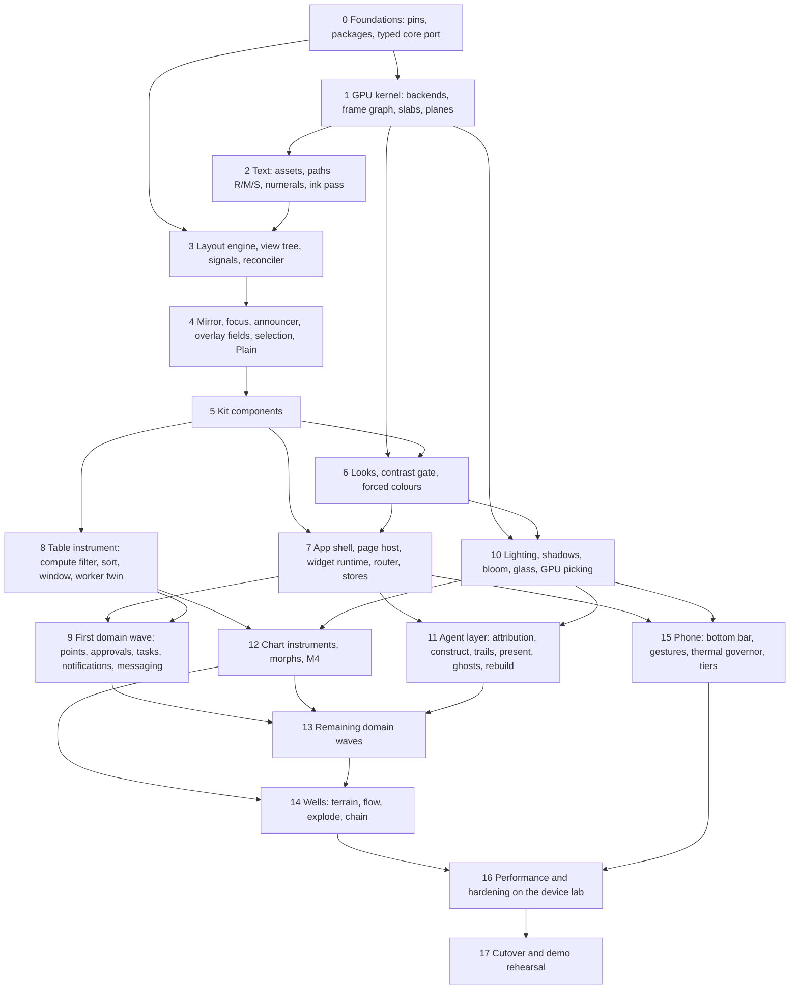

# Instrument: a GPU-rendered frontend for Plinth Suite

Codename **Instrument**. Direction: a cinematic mission-control surface in 2.5D. The whole UI is one GPU-composited
instrument panel: crisp vector panels on layered depth planes, real-time lighting, bloom on live signals only,
refractive glass for transient surfaces, and signed distance fields for every shape, glyph and icon. It is built for
the operations lead who lives in it all day: density first, 120 fps panning, GPU filtering of large tables, and
keyboard-first operation everywhere. Depth, light and motion carry meaning; the camera moves rarely and on purpose.

This document is the complete specification. It covers the 13 hard requirements of
`docs/gpu-frontend/BRIEF.md` under headings numbered to match them (sections 1 to 13), preceded by a short
vocabulary (section 0) and followed by appendices with the exact type definitions, the pipeline inventory, the keyboard
map and the announcement templates. Nothing in the backend changes: the action registry, `/rt`, Pages and Widgets as
data, `site.*`, looks, identity and the seed are consumed as they are today.

Contents

- 0. Direction, principles and vocabulary
- 1. Feature parity (shell, then all 19 domains and 77 widgets)
- 2. WebGPU first, WebGL2 fallback (stack, versions, fallback and unsupported paths)
- 3. Text and data density
- 4. Input and forms
- 5. Accessibility
- 6. Realtime and the agent
- 7. Performance budgets
- 8. Phone
- 9. Architecture (packages, widgets as apps, scene graph, layout, frame graph and signature shaders, picking, state,
  routing, testing)
- 10. Looks and theming
- 11. Demo choreography
- 12. Plan ordered by dependency
- 13. Risks and kill criteria
- Appendix A. Type definitions
- Appendix B. Pipeline inventory
- Appendix C. Keyboard map
- Appendix D. Announcement and attribution templates
- Appendix E. Lessons carried over from the DOM round

---

## 0. Direction, principles and vocabulary

### 0.1 The seven rules of the instrument

1. **Ink is never lit.** Text, numerals, hairlines and icons are drawn in an unlit ink pass after lighting and after
   bloom for their plane group. Light can make a panel edge gleam; it can never lower the contrast of a figure.
2. **Light means signal.** Only four things emit light: live data that just changed, the agent, a breach, and keyboard
   focus. Static UI never glows. A board at rest has no emissive pixels apart from the live dot in the top bar and, while an agent is active,
   the agent beacon.
3. **Depth means priority.** A thing's plane is its interaction priority: the bench at the back, the page's panels,
   the lifted selection, overlays, the shell, transient notices. Depth is shown by parallax, shadow length, slab
   thickness and a slight focus falloff, never by shrinking text.
4. **The camera moves rarely.** Four sanctioned moves exist (section 9.6.9): the route dolly, the presentation
   spotlight, the tilt inside a 3D well, and the pull-back during a site clear and rebuild. Nothing else moves the
   camera. Panning a board scrolls the planes, not the camera.
5. **Keyboard first.** Every action in every widget has a key path; the command line (Ctrl+K) can run any action the
   viewer may run; every list, table, grid and board has a roving cursor.
6. **Parity by construction.** A widget renders one view tree. The same tree produces the GPU scene and the
   accessibility mirror, so a control cannot exist on screen without existing for assistive technology, and the
   reverse.
7. **Motion only on events.** Page loads and route changes do not animate content in. Motion marks what a realtime
   event or a user action changed, and nothing else (the rule carried over from UI-MAP section 1).

### 0.2 Vocabulary

| Term | Meaning |
|---|---|
| **Bench** | The backdrop plane (plane 0): a dark or light machined surface with the look's grid etched into it. The empty-site state is drawn on the bench. |
| **Plane** | A depth layer, numbered 0 to 5 (section 9.3.2). Each plane has a z, a shadow length and a parallax factor. |
| **Slab** | A panel-shaped SDF primitive: rounded rectangle with a bevel, a face material and a thickness. Widget frames, cards, buttons, fields and pills are slabs. |
| **Panel** | The slab that frames one widget instance on the page grid (the `widgetFrame` of UI-MAP 4.4). |
| **Ink** | Everything drawn in the unlit ink pass: glyphs, rules, hairlines, SDF icons, focus rings, selection. |
| **Signal** | Emissive output. Signals feed bloom and the panel lights. Colours: live, agent, breach, focus. |
| **Instrument** | A GPU data component: the table, the chart kinds, the matrix, the timeline, the terrain, the flow ribbon. Instruments read columnar data from storage buffers and draw marks. |
| **Mark buffer** | An instrument's per-mark instance data (position, size, colour index, flags) in a storage buffer, with an A layout and a B layout for morphs. |
| **Well** | A 3D sub-viewport inside a panel, rendered to its own target with its own perspective camera (terrain, flow ribbon, exploded matrix, hash chain). Outside wells the UI is 2.5D. |
| **Mirror** | The accessibility DOM: a complete semantic DOM of the current screen, positioned over the canvas, which receives real focus, real keyboard events and real text entry. |
| **Overlay field** | A mirror form control made visible over its GPU field while it is being edited (section 4). |
| **Trace** | The change strip along the bottom of the deck, and the agent's light trail across the screen. |
| **Beacon** | The agent's dock in the top bar: a small diamond in the agent colour that is the origin of the agent's trails. |
| **Construct** | The scan-line, wireframe-to-solid effect for anything the agent creates (section 6.5). |

### 0.3 Screen anatomy (desktop, 1440 x 900 CSS px)

```
 plane 4 (shell, glass)                                                                       plane 5 (toasts)
┌───────────────────────────────────────────────────────────────────────────────────────────┐ ┌──────────────┐
│ ▣ PLINTH │ Operate › Orders        [ Ctrl+K  run or find… ]   ● LIVE 48 213  ◆ AGENT   ✉ 3  🔔 7  1 240 pts ▾│ │ ◆ Page built │
├──────┬────────────────────────────────────────────────────────────────────────────────────┤ └──────────────┘
│ NAV  │  ORDERS                                   dek: "Order NW-1043 approved by priya-nair, 14:30:02 UTC" │
│ rail │ ┌────────────────────────────────────────────┐ ┌──────────────────────┐                 plane 1    │
│      │ │ ORDERS AWAITING APPROVAL            12   ⋯ │ │ APPROVALS        4 ⋯ │                (panels)    │
│ ⌂    │ │ no.     member        pts     status       │ │ ▸ NW-1043  2 400 pts │                             │
│ ✉ 3  │ │ NW-1043 ana-silva   2 400   ◐ held         │ │   requested by …     │                             │
│ ✓ 4  │ │ …                                          │ │                      │                             │
│ ◎    │ └────────────────────────────────────────────┘ └──────────────────────┘                             │
│ ▤    │ ┌──────────────────────────────────────────────────────────────────────┐                             │
│ ⚙    │ │ ALL ORDERS                                                     148 ⋯ │                             │
│      │ │ ... dense GPU table, 32 px rows comfortable, 24 px compact ...       │                             │
│      │ └──────────────────────────────────────────────────────────────────────┘                             │
├──────┴────────────────────────────────────────────────────────────────────────────────────┤
│ TRACE  #48213 ◆ agent claude-code  widget:orders-all placed · #48212 priya-nair approved … │ plane 4 strip
└───────────────────────────────────────────────────────────────────────────────────────────┘
 plane 0: the bench (etched grid, deepest), visible in gutters between panels
```

---

## 1. Feature parity

Every domain and widget of the brief keeps a home. The model is unchanged: **widgets are apps**, each the expression
of part of a domain, placed by Page nodes on the 12-column grid, configured by their `configSchema`, operating through
their own catalogue actions, events and bus topics. All routes of UI-MAP section 2 resolve exactly as today through
`pages.resolve`. Instrument changes how a widget is drawn and operated, not what it is.

This section first fixes the shared furniture every widget uses (1.1 to 1.3), then the shell (1.4), then each of the
19 domains with every widget (1.5 to 1.23). For each widget the entry gives its presentation by size, its internal
views, its key operations, its live behaviour, and any 3D or signal use. The kit components and instruments named
here are specified in sections 3, 4 and 9.

### 1.1 The panel (widget frame)

A panel is a slab on plane 1 at the widget's grid rectangle. Its parts, top to bottom:

- **Header rail** (28 px comfortable, 24 px compact): title in tracked small caps (catalogue title or the instance's
  `title`), the optional count as a tabular numeral (`ctx.setCount`), a status glyph (live, stale, held, breach), the
  view switcher when the widget has more than one internal view at this size, and the panel menu (`⋯`: Refresh, Open as
  page, Configure in page editor, Remove from personal page, View as table, Copy link to this view, Show source and
  as-of).
- **Body**: the widget's view tree, clipped to the panel's rounded rectangle by the SDF clip (section 9.3.5).
- **Foot caption** (optional, 18 px): source and as-of in UTC (`as of 14:30:02 UTC`), carried over from Folio.

`full` panels on module pages drop the slab chrome to a heading rule with a 1 px hairline, as Meridian did, and sit
flush on plane 1 so dense module screens read as one sheet.

Panel states (UI-MAP 4.3 rule 4):

| State | Drawing | Mirror |
|---|---|---|
| loading (first load only) | Slab drawn, body shows skeleton bars (flat slabs at 40% ink contrast) with no shimmer animation | `aria-busy="true"` on the region; the heading text is the real title from the catalogue, never a slug |
| empty | Centred SDF icon, the widget's own copy, the primary action as a button | Same text, the button is a real `<button>` |
| error | Breach-coloured hairline on the header, message, "Retry" button; previous data stays drawn under a 60% scrim if it existed | `role="alert"` once, then static |
| unavailable | Slab drawn with a diagonal hatch face, "Not available to you" and the reason from `unavailable_reason` | Region with the same text |
| held | Header rail shows `◐ held for approval` with the approval link | Text in the heading's description |

### 1.2 Kit components

Widgets compose these; each is one or more slabs plus ink, and one mirror subtree with fixed semantics.

| Component | Drawn as | Mirror semantics |
|---|---|---|
| `Button`, `IconButton` | Slab with bevel; pressed state lowers z by 1 px and darkens face | `<button>` with name; icon buttons carry `aria-label` |
| `Toggle`, `Switch`, `Checkbox`, `Radio` | Slab plus SDF glyph | native `<input type=checkbox/radio>` or `<button aria-pressed>`; switch is `role="switch"` |
| `Tabs` (view switcher) | Segmented slab; active segment raised | `role="tablist"`/`tab`/`tabpanel`, arrow keys |
| `Menu` | Glass popover on plane 3 | `role="menu"`, `menuitem`, roving focus, Escape restores focus (Meridian's model) |
| `Field` family | Slab well (inset bevel) plus ink value; becomes an overlay field while edited | native `<input>`, `<textarea>`, `<select>`, combobox pattern; `aria-invalid`, `aria-describedby` |
| `TokenField` (recipients, handles) | Field with pill slabs inside | combobox with a listbox of selected tokens |
| `Table` | Table instrument (section 3.4) | `role="grid"` (interactive) or `<table>` (read-only) with `aria-rowcount`, `aria-rowindex`, `aria-sort` on header buttons |
| `List` | Rows with 1 px rules | `<ul>`/`role="listbox"` for selectable lists |
| `CardGrid` | Cards as slabs on a grid; selection lifts to plane 2 | `role="grid"` with roving cursor, or a list of articles |
| `Numeral` | Display figures with tabular numerals; changes roll digit by digit | text with `aria-live` off (announcements go through the announcer) |
| `Meter`, `Ring`, `Sparkline` | Ink and marks | `role="meter"` or `img` with a text alternative |
| `Pill` | Small slab with glyph and text; status pills always carry a glyph | text |
| `Timeline` | Vertical rail with event nodes | `<ol>` of items with `<time datetime>` |
| `Diff` | Two-column or unified diff with change bars in the gutter | `<table>` with "added"/"removed" text prefixes |
| `RuleBuilder` | Nested condition slabs with connector rails | `role="tree"` of groups, each condition a fieldset |
| `Stepper` | Horizontal step rail (form, confirm, done) | `<ol>` with `aria-current="step"` |
| `Drawer`, `Dialog` | Glass slabs on plane 3; the deck dims and recedes 8 px in parallax | `<dialog>` with `showModal()`, focus trapped natively, restored on close |
| `Artwork` | Texture from the artwork atlas inside a slab with a lit bevel | `` from the node's `alt` |
| `Avatar` | Circle SDF with initials or artwork | text alternative is the display name |
| `Banner` | Full-width slab in a tone | `role="status"` or `alert` by tone |
| `EmptyState`, `ErrorState`, `Skeleton` | As in 1.1 | As in 1.1 |

### 1.3 Instruments

| Instrument | Used by | GPU technique |
|---|---|---|
| `TableInstrument` | ledger, accounts, orders, inventory, audit, members, grants, runs, content list, directory table, deliveries, search | Columnar storage buffers, compute filter and sort, virtualised row window, ink for visible cells (3.4) |
| `BarInstrument` | reporting.bar, review histogram, segment distribution, promotion performance by tier | Instanced slab marks; threshold hatch in shader |
| `LineInstrument`, `AreaInstrument` | reporting.line/area, performance series, KPI sparklines | M4 decimation in compute, instanced SDF segments, area as triangle strip (9.6.6) |
| `ScatterInstrument` | reporting.scatter | Instanced SDF points, GPU density mode above 200 000 points |
| `HeatmapInstrument` | reporting.heatmap, promotion performance by tier and region | Instanced cells; raises to a terrain well (9.6.7) |
| `KpiInstrument` | reporting.kpi, suite-kpis, trial balance figures | Numeral plus sparkline plus delta |
| `MatrixInstrument` | admin.matrix, notifications.preferences | Cell grid with crosshair; exploded-role well for the principal view (1.20) |
| `FlowInstrument` | points.ledger flow view, points.accounts flow view, reporting.panel suite-points-flow | Ribbon well: Bezier triangle strips with width from amounts (9.6.8) |
| `ChainInstrument` | audit.verify | Link chain in a small well; links light as verification walks the returned head list |
| `CalendarInstrument` | calendar.month/week/day | Day cells, window bars across cells, now line |
| `KanbanInstrument` | tasks.board | Columns as plane-1 trays, cards lift to plane 2 while moved |
| `PipelineInstrument` | automation.builder steps, automation.runs run detail, promotion simulator sieve | Vertical node rail with per-step status lights |

Morphs between `bar`, `line`, `area` and `scatter` (and `table`) are available in every reporting visual widget through
the panel's view switcher (key `V` cycles) and are drawn as a mark-buffer interpolation (9.6.5). The stored Widget
config is not changed by a morph; it is a view of the same query, recorded in the URL (9.8) so it is shareable.

### 1.4 The shell (not a widget)

| Element | Instrument presentation | Operation | Data |
|---|---|---|---|
| **Nav rail** | Plane 4 glass rail, 64 px collapsed (icons and count badges), 232 px expanded (section labels in small caps, items, counts). New entries since the last read fade in; entries removed by a site clear deconstruct (6.5) | `G` then a letter jumps (`G H` home, `G I` inbox, `G A` approvals, `G P` points, `G S` store, `G R` reports, `G U` audit, `G T` tasks); `[` toggles expanded; arrow keys within | `navStore` from `pages.list`, counts frame |
| **Top bar** | Plane 4 glass bar, 44 px: product mark, breadcrumb (section › page title), command field, live indicator, agent beacon, inbox, bell, balance chip, avatar | Tab order left to right; `Ctrl+K` focuses the command field from anywhere | `me.get`, stores |
| **Live indicator** | `● LIVE` dot (the only resting emissive) plus the change-stream head seq in monospace; `◌ OFFLINE` with retry countdown; `◐ RESUMING` while replaying | Activating it opens the trace drawer | `rt.onState`, head seq |
| **Agent beacon** | A diamond in the agent colour; dim when no agent session is active for this workspace; lit steadily (no idle animation, so an idle board still draws no frames) while an agent has made a change in the last 60 s; source of agent trails | Activating opens the agent panel: recent agent changes, pending holds, "Follow agent" toggle | change stream filtered by agent actors |
| **Balance chip** | Numeral and tier pill; on `points.posted` for the viewer the digits roll from the old to the new balance and a signed delta (`+250`) flashes in the live colour, one pulse of signal light | Activating goes to `/points` | `points.posted`, `tier.changed` |
| **Inbox and bell** | Icon buttons with count badges; a count increase pulses the badge once | The bell opens a glass popover with the latest 8 notifications, "Mark all read", "Open all" | counts frame, `notification.created/read` |
| **Command line (palette)** | A glass slab on plane 5, 640 px wide, centred at 18% from the top; the deck recedes and dims; results grouped (Commands, Actions, People, Products, Content, Promotions, Automations, Segments, Orders, Tasks, Threads, Dashboards) | Type to filter; `↑ ↓` move; `Enter` runs or opens; `Ctrl+Enter` opens `/search?q=`; `Tab` fills arguments for an action command (4.6) | `search.global`, `GET /suite/actions` filtered by `me.permissions` |
| **Toasts** | Glass cards on plane 5, top right under the bar, max 4, newest on top; each drops in from z+24 to its plane with a short shadow settle; agent-caused toasts carry the agent edge and glyph | `Alt+T` focuses the toast stack; `Escape` dismisses the focused toast; each has its action button | rt events of UI-MAP 5 |
| **Approvals banner** | A thin full-width slab under the top bar in the held tone with `◐ 4 approvals waiting for you`, shown while `approvals_pending > 0` and the viewer is an approver and not on `/approvals` | `Alt+A` goes to `/approvals` | counts frame |
| **Offline banner** | Full-width slab in the offline tone, retry countdown numeral, "Retry now" | `Alt+R` retries | `rt.onState` |
| **Identity switcher** | Avatar menu item opening a glass list of `dev.principals`, featured first, with role pills | Type-ahead; `Enter` switches (navigates with `?as=`) | `dev.principals` |
| **Session revoked** | The deck drains to grey and the planes settle flat; a centred slab "This tab was signed out" with Reload | Focus moves to Reload | `rt.onSessionRevoked` |
| **Trace strip** | Plane 4 strip, 28 px, along the bottom: the latest changes newest left, seq in large monospace with a "Change" prefix in the mirror, actor glyph (person, agent ◆, system ⚙), the node, the time in UTC; collapses on phone to one line with "Show recent" | `Alt+.` focuses; arrow keys walk; `Enter` opens the node or its page | change stream |
| **Page header** | Title (h1), dek (rewrites itself to the latest change on this page and who made it, Folio's idea), "Customise", "Reset to default", "Edit page" | Buttons; `E` opens the page editor where allowed | `pages.resolve`, change stream |
| **Agent presentation chip** | When `ui.present` targets the viewer: a chip under the top bar in the agent colour, "◆ claude-code is showing: Orders by carrier. Go (G G)" | `G G` goes; `Escape` dismisses | change stream `kind: "present"` |

### 1.5 Domain: points (8 widgets)

Routes: `/points`, `/points/award`, `/ledger`, plus home and profile placements. The points screen is the instrument's
"flight deck": a large balance numeral top left, transfer beside it, the statement as a full-width dense table, expiry
and tiers below.

| Widget | Presentation by size | Views and operation | Live and signal |
|---|---|---|---|
| `points.balance` | `s`: balance numeral (48 px display, tabular) and tier pill. `m`: adds progress bar to the next tier with the points left as a numeral and "expiring soon" one-liner. `l`: adds the 14-day balance sparkline and the expiring list (date, points) | Single `summary` view; `Enter` on the panel opens `/points` when not already there | `points.posted` for the target member: digit roll, signed delta flash, one live pulse; `tier.changed`: the tier pill re-cuts (scan from left) and the progress bar resets with a bloom tick at 100% |
| `points.ledger` (Statement) | `l`: date, type, memo, delta, balance. `xl`/`full`: adds txn no, account, lots column, a type filter chip row, opening and closing balance pinned as header and footer rows | `lines` view: the table instrument (filter by type chips or `F` to the filter field; sort by any column; `Enter` opens the row). `transaction` view: entries (debit and credit legs side by side with a connecting ribbon), lots consumed, related order (publishes `order.selected`). A third presentation, **Flow** (`Shift+F`), turns the statement into the flow ribbon described below | `points.posted`: the new line slides in at the top only if the table is sorted by date descending and scrolled to the top; otherwise a "1 new line ↑" pill appears; the balance column re-rolls |
| `points.transfer` | `m`: compact form. `l`: form plus the recipient's profile card preview | `form` (recipient combobox over `people.directory`, amount numeric field with limit meter showing daily remaining, memo) → `confirm` (balance after, recipient, amount as display numerals; `Enter` confirms, `Escape` back) → `done` (txn no, link to statement) | After commit the balance chip and this widget's own summary roll; the confirm step's "balance after" is recomputed live if a `points.posted` arrives during confirm |
| `points.award` | `m`: single recipient. `l`: token field for up to 50 recipients, category, reason, multiplier preview table | `form` → `confirm` (per-recipient preview: base, promotion multipliers applied with names, total; approval hold notice when the amount crosses the threshold) → `done` (committed or `◐ held` with approval link) | Holds render in the held tone; once `approval.decided` arrives for the hold the done view updates in place |
| `points.expiry` | `s`: next expiry date and points. `m`/`l`: list grouped by date with a horizontal date bar (bars whose length is points) | `list` view; rows link to the statement filtered to the lot | `points.expiring`, `points.posted` re-read |
| `points.tiers` | `m`: ladder as four stepped slabs (Bronze to Platinum) rising in z by tier: the only place where plane height encodes an ordinal, and each step also carries its name and floor as text. `l`/`xl`: perks list per step and member counts as numerals | `ladder` view; arrow keys move along steps; the viewer's position is a marker in the live colour on the current step at the fraction of the way to the next floor | `tier.changed` for the viewer: the marker climbs to the next step (the one celebratory motion in points) |
| `points.trial-balance` | `m`: the invariant set as a check list (Debits = Credits, no negative member balance, lot sums, chain intact) with ✓ or ✗ and figures. `l`: adds the system accounts table | `summary` view | `points.posted` re-reads; a failed invariant lights the breach signal with the text "✗ Debits and credits differ by 120" |
| `points.accounts` | `l`/`xl`/`full`: accounts table (kind, account, member, balance, lifetime, last posting) | `accounts` → `statement` (same as ledger lines for that account) → `transaction` (entries and lots, "Reverse" for `points:ledger` holders, via a confirm dialog that shows the reversing entries before commit). A **Flow** presentation shows system-wide flows between account kinds | `points.posted` (finance audience gets system accounts) updates balances in place with a digit roll |

**Ledger becomes a flow ribbon** (the second 3D moment). `Shift+F` in `points.ledger` or `points.accounts` opens a
well inside the panel. The camera in the well tilts from straight-on to 28 degrees over 420 ms (reduced motion:
straight-on, no tilt). The statement's time axis runs left to right. The running balance is a ribbon whose width is
the balance. Credits join from above as tributary ribbons coloured by transaction type (award, purchase reward, badge
reward, promotion bonus, transfer in); debits leave below (redemption, transfer out, expiry, reversal). Each ribbon's
width is proportional to points, so the ledger's conservation is visible: what enters minus what leaves is what
remains. In `points.accounts` the flow shows system accounts (issuance, redemption, expiry, breakage) as vertical
gates and members as one aggregated band per tier. Hovering or arrowing to a ribbon shows the transactions it
aggregates; `Enter` drills into the statement filtered to them. The mirror for the flow view is a table "Flows by type
and day" with the same numbers, and the visible legend lists each type with its total.

### 1.6 Domain: store (8 widgets)

Routes: `/store`, `/store/c/:category`, `/store/p/:product`, `/store/cart`, `/store/orders`, `/store/orders/:order`,
`/store/wishlist`, `/store/manage`, `/store/inventory`. Product artwork is drawn from the artwork texture array
(section 7.5) inside lit slabs; product cards are the most "physical" objects in the suite, with a slightly deeper
bevel than data panels.

| Widget | Presentation by size | Views and operation | Live and signal |
|---|---|---|---|
| `store.catalog` | `l`: 3-column card grid. `xl`: 4 columns plus a filter rail. `full`: 5 columns, filter rail, sort bar, search field. Card: artwork, title, price numeral with the currency label, stock pill (in stock, low, out, each with glyph), tier gate lock, wishlist heart, add button | `grid` (roving cursor over cards; `Enter` opens product, `A` adds to cart, `W` toggles wishlist, `/` focuses search), `filters` (category, tag, affordability, sort), `product` (in-widget detail when `open_in: "widget"`; publishes `product.selected` when `bus`; navigates when `page`) | `stock.changed`: the stock pill re-cuts; going to out draws the card face down to 60% and lights nothing (absence is not a signal). `cart.updated`: the card's add button shows the in-cart quantity. Add to cart: a small token slab arcs from the card to the cart count in the top bar (user action motion; reduced motion: none) |
| `store.product` | `l`/`xl`/`full`: artwork in a lit display well (the artwork slab sits at plane 1.5 with a key light raking from top left; a slow pointer-following highlight within 4 degrees, off in reduced motion and on touch), price, stock, tier gate explanation, quantity stepper, add, wishlist; reviews with a rating histogram | `detail`, `reviews` (histogram bar instrument plus list; `R` focuses write), `write-review` (rating radio group as five SDF stars, text area overlay field) | `review.created`: histogram bar for the rating grows and the average numeral rolls; `stock.changed` |
| `store.featured` | `m`: 2 cards. `l`/`xl`/`full`: a horizontal row of up to 12 cards with snap scrolling | `row`; `← →` move; `Enter` publishes `product.selected` or opens | `stock.changed` |
| `store.cart` | `s`: item count and subtotal. `m`: lines compact. `l`/`xl`: lines with steppers, issue pills (out of stock, tier gate, limit), live quote (subtotal, promotions applied as named lines, total, balance after) | `lines` → `quote` → `delivery` (address fields as overlay fields with autofill) → `confirm` → `placed` (order no, link; publishes `order.selected`). `+`/`-` change quantity on the focused line; `Ctrl+Enter` proceeds | `cart.updated`, `stock.changed` (issue pill appears on the line with breach tone and text), `points.posted` (balance after recomputes), `promotion.state_changed` (quote re-runs) |
| `store.orders` | `m`: own orders list. `l`/`xl`/`full`: table (order no, member, placed UTC, items, points, status pill, requires approval) with status chips | `list` (filter by status chips, `Enter` opens), `order` (detail as in `store.order`). Store staff (scope `all`) get transitions in the row menu (`T` opens transitions) | `order.placed`: row slides in when sorted by newest; `order.status_changed`: pill re-cuts |
| `store.order` | `l`/`xl`/`full`: lines, promotions applied, a horizontal status rail (placed → approved → fulfilled → delivered, or cancelled/refunded branches) with the current node lit in the live colour for 2 s after a change, then steady | `detail`; allowed transitions as buttons; refunds and high-value approvals show the hold state | `order.status_changed` |
| `store.wishlist` | `m`: list. `l`/`xl`/`full`: cards with stock and affordability ("You can afford this" with ✓, or "Needs 1 200 more points") | `list`; `M` moves to cart; `Delete` removes | `wishlist.changed`, `stock.changed` |
| `store.inventory` | `l`/`xl`/`full`: table (product, category, on hand with an inline bar, reorder level, status) with low and out filters | `list` (filter chips `1` all, `2` low, `3` out), `adjust` (dialog: restock or correction, quantity, reason) | `stock.changed`: the inline bar animates to its new length; crossing into low or out draws the status glyph and text |

### 1.7 Domain: promotions (5 widgets)

Routes: `/promotions`, `/promotions/new`, `/promotions/:promotion`, plus store and home placements of `active`.

| Widget | Presentation by size | Views and operation | Live and signal |
|---|---|---|---|
| `promotions.list` | `l`/`xl`/`full`: table (title, status pill, window as a mini timeline bar relative to today, usage meter of budget used, redemptions, pending approval) | `list`; status chips; `N` new (navigates to `/promotions/new`); `Enter` opens (publishes `promotion.selected`) | `promotion.state_changed` pill re-cut; `promotion.redeemed` usage meter grows; `promotion.budget_alert` at 80% and 100% lights the meter's breach band with the text "80% of budget used"; `approval.decided` clears the pending marker |
| `promotions.builder` | `xl`/`full`: a left step rail (Eligibility, Effects, Budget, Schedule, Review, History) and the active step's form; a right live summary column with the current audience count from `segments.preview` | `eligibility` (rule builder over member facts and pickers for products, categories, segments), `effects` (multiplier, bonus, discount forms), `budget` (max cost, per-member caps, alert thresholds), `schedule` (a timeline field with start and end handles, keyboard: `[`/`]` nudge by a day, `Shift` by a week), `review` (rendered summary, simulate link, "Submit for approval" or transitions allowed), `history` (revisions with diff) | `promotion.state_changed` and `approval.decided` update the review step's status; while a field is being edited, remote revisions show a "Newer revision 7 by priya-nair" bar with "Show diff" rather than replacing the form |
| `promotions.simulator` | `l`/`xl`: inputs left (member combobox, sample cart or earn event), result right | `inputs` → `result`: a **sieve**: every promotion as a row passing through the eligibility checks; applied ones pass through and light in the live colour, rejected ones stop at the failing check with its reason text ("Tier below Gold"), and totals vs baseline as display numerals | none (pure simulation) |
| `promotions.performance` | `m`: redemptions, cost and budget used as KPI numerals. `l`/`xl`: adds the series (line or area, hour or day bucket) and a tier by region heatmap (raises to terrain like reporting.heatmap) | `summary`, `series` | `promotion.redeemed`: the redemption numeral rolls and a new point arrives at the head of the series with a brief live head glow; `promotion.budget_alert` |
| `promotions.active` | `s`: one compact banner. `m`/`l`: 1 to 2 banners. `xl`/`full`: a row of up to 6 glass banners with artwork | `banners`; each banner's CTA navigates to the relevant store category or product | `promotion.state_changed`: a newly active promotion constructs in (scan line in the live colour; if the cause was the agent, in the agent colour) |

### 1.8 Domain: badges (4 widgets)

Badges are the one place where light is used for delight rather than signal, and it is contained: badge medallions are
SDF discs with a relief normal map derived from the artwork's SDF, lit by the key light, with a specular highlight.
They are not emissive.

| Widget | Presentation by size | Views and operation | Live and signal |
|---|---|---|---|
| `badges.showcase` | `s`: three medallions. `m`/`l`: three medallions with titles and the earned count | `showcase`, `pick` (owner only: a grid of earned badges, choose up to three, `Space` toggles, `Enter` saves via `me.profile.update`); publishes `badge.selected` | `badge.awarded` for the target member: the new medallion is struck: it drops in z onto the slab with a single specular sweep across its relief (reduced motion: appears) |
| `badges.progress` | `s`/`m`/`l`: rows with a progress ring (SDF arc), badge name, "3 of 5 reviews" text | `list`; `Enter` publishes `badge.selected` | `badge.progress`: the ring arc extends; `badge.awarded`: the ring closes and the row hands off to the showcase |
| `badges.catalog` | `l`/`xl`/`full`: grid of medallions with earned (full colour), in progress (ring), locked (flat, low contrast face plus lock glyph and the word "Locked") | `grid` (filter `1`-`4`: all, earned, in progress, locked), `badge` (detail: criteria, rarity, holders count, recent awardees), `award` (managers: member picker, reason) | `badge.awarded`, `badge.revoked`, `badge.progress` |
| `badges.recent` | `m`/`l`: ticker list of awards across the organisation: medallion, member, badge, time UTC | `ticker`; `Enter` publishes `member.selected` | `badge.awarded`: new row slides in at top |

### 1.9 Domain: messaging (4 widgets)

Routes: `/messages`, `/messages/t/:thread`, `/messages/new`, `/groups/:group` (compose).

| Widget | Presentation by size | Views and operation | Live and signal |
|---|---|---|---|
| `messaging.inbox` | `m`: thread list. `l`/`xl`/`full`: folder rail (inbox, sent, starred, archived) plus list with subject, from, preview, time, unread dot, star | `list` (roving cursor; `J`/`K` next and previous; `X` selects for bulk; `S` star; `E` archive; `Shift+U` mark unread; `/` search), `search`, `thread` (in-widget when `open_in: "widget"`); publishes `thread.selected` | `message.received`: the row moves to the top with a single live edge flash; unread dot appears; `message.state_changed` updates rows |
| `messaging.thread` | `l`/`xl`/`full`: message column (each message a slab with sender, time UTC, body ink with mentions as pills, attachment metadata rows, read receipts as small avatars) and a reply box at the bottom | `thread`, `empty`; `R` focuses reply (overlay textarea); `Ctrl+Enter` sends; publishes `member.selected` on a sender | `message.received` for this thread appends the message; the thread scrolls only if it was at the bottom, otherwise a "New message ↓" pill appears |
| `messaging.compose` | `m`: collapsed (recipients and a one-line body that expands). `l`/`xl`: full form | `form` (token field for people and groups via `messages.recipients`, subject, body with `@` mention completion), `sent` (link to the thread) | none |
| `messaging.unread` | `s`/`m`: count numeral and the latest three unread threads | `summary`; `Enter` publishes `thread.selected` or navigates | `message.received`, `message.state_changed` |

### 1.10 Domain: notifications (4 widgets)

| Widget | Presentation by size | Views and operation | Live and signal |
|---|---|---|---|
| `notifications.feed` | `m`: list of notifications with type glyph, text, time, unread dot. `l`/`xl`/`full`: adds type filter chips and "Mark all read" | `list`; `Enter` opens the subject; `M` marks read; `Shift+M` mark all read | `notification.created`: row slides in at the top; `notification.read`: dots clear |
| `notifications.preferences` | `l`/`xl`/`full`: a matrix instrument of notification type (rows) by channel (in-app, email, digest) with toggle cells, plus digest schedule and quiet hours fields | `matrix`; arrow keys move the cell cursor; `Space` toggles; changes save on a debounce of 600 ms with a saved tick in the header | none (Preference node change from other tabs re-reads) |
| `notifications.deliveries` | `l`/`xl`: table of email and digest sends (time UTC, member, channel, subject, status, suppression reason) | `list`, `detail` (rendered email stub as ink on a paper slab) | `notification.created` |
| `notifications.send` | `m`/`l`: recipients token field, type, title, body, send | `form` | none |

### 1.11 Domain: tasks (3 widgets)

| Widget | Presentation by size | Views and operation | Live and signal |
|---|---|---|---|
| `tasks.list` | `m`: title, due, status pill. `l`/`xl`/`full`: table with no, title, assignee, priority glyph, due (UTC date, overdue in breach tone with the word "Overdue"), status | `list` (inline status change via `S` menu), `task` (detail with description, comments thread, `C` to comment, link to the linked node) | `task.assigned` row arrives; `task.updated` pill re-cuts; `task.commented` appends |
| `tasks.board` | `xl`/`full`: Kanban instrument: columns open, in progress, blocked, done as trays on plane 1; cards slabs on the trays | `board`: roving cursor across cards; `Ctrl+←/→` moves the card to the adjacent column (`tasks.update`); drag with pointer lifts the card to plane 2 with a longer shadow; `Enter` opens `task` view | Remote moves animate the card along a short arc between columns; the moving card carries the actor's attribution edge for 2 s |
| `tasks.quick-add` | `s`/`m`: title field, assignee combobox, due date field, priority segmented control, link field (in `m`) | `form`; `Enter` in title creates with defaults; publishes `task.selected` | none |

### 1.12 Domain: approvals (1 widget)

| Widget | Presentation by size | Views and operation | Live and signal |
|---|---|---|---|
| `approvals.inbox` | `m`: list (type glyph, title, requester, age). `l`/`xl`/`full`: list plus an item pane: what is requested (diff for node changes, action preview `effect` and typed facts for held actions, order lines for high-value orders, the content diff for content reviews), the rule (`rule_id`), the requester and whether the requester is the agent acting for someone | `list`, `item`. Decide with `A` approve, `Shift+R` reject (reason required), withdraw for own requests. **Separation of duties** is visible: when the viewer is the requester or the delegator of the agent that requested it, the approve button is replaced by the text "You requested this. A second approver must decide (separation of duties)", and the mirror carries the same text as the button's disabled reason. The agent can never decide (CONTRACT 14.2), so no agent-attributed decision exists to draw | `approval.requested`: the item constructs in at the top (agent colour if requested by the agent); `approval.decided`: the status pill re-cuts and the row settles to the decided section |

### 1.13 Domain: content (5 widgets)

Routes: `/news`, `/read/:content`, `/content`, `/content/new`, `/content/:content`.

| Widget | Presentation by size | Views and operation | Live and signal |
|---|---|---|---|
| `content.feed` | `m`: list. `l`/`xl`/`full`: `layout: "cards"` as artwork cards, `list` as rows; pinned first with a pin glyph; reactions inline | `feed`, `reader` (in-widget reading view); `Enter` opens; `1`-`5` react on the focused item | `content.published`: the item constructs in at its position (pinned announcements also toast); `content.engaged` updates counts |
| `content.reader` | `l`/`xl`/`full`: a reading column of 68 characters measure, blocks rendered: headings, paragraphs with bold, emphasis and mention marks, lists, quotes, callouts, images with alt and caption, dividers, CTA buttons, embedded panels (a live reporting panel inside the article, drawn by the same instruments), product strips, badge medallions | `reader`; reactions row; text is selectable and copyable (4.5) | `content.engaged` |
| `content.editor` | `xl`/`full`: block list on the left two thirds (each block a slab with a drag handle and a type glyph), live preview on the right third (the same block renderer as the reader), metadata, audience, reviewers, schedule fields in a settings view | `blocks` (each block edits as an overlay field; `Alt+↑/↓` moves a block; `/` at the start of an empty paragraph opens the block type menu), `settings`, `preview` (full width), `versions`, `diff` (block diff: added, removed and changed blocks with change bars). Workflow buttons: submit for review, publish, schedule, archive, per `content.transition` | `content.state_changed`: editor banner ("In review since 14:02 UTC by leah-okafor"); remote edits while editing show a "Newer version" bar |
| `content.review-queue` | `m`: list. `l`/`xl`: list plus review pane with the diff since the last review | `queue`, `review`; `A` approve, `Shift+R` request changes with a note | `content.state_changed` |
| `content.list` | `l`/`xl`/`full`: table (title, type, status pill, author, tags, updated, views, reactions) | `list`; status and type chips; `N` new | `content.state_changed`, `content.engaged` |

### 1.14 Domain: people (6 widgets)

Routes: `/people`, `/people/:handle`, `/profile`, `/groups/:group`, `/settings` (sessions).

| Widget | Presentation by size | Views and operation | Live and signal |
|---|---|---|---|
| `people.directory` | `l`/`xl`/`full`: `grid` view as avatar cards (avatar, name, title, region, tier pill); `table` view as the table instrument (handle, name, department, region, tier, groups) | Toggle with `V`; filters by region, tier and group; type-ahead search; publishes `member.selected` | `member.updated`, `tier.changed` |
| `people.profile-card` | `s`: avatar and name. `m`: adds title, region, tier. `l`: adds groups, roles, contact actions (Message, Award) | `card`, `edit` (own profile: overlay fields) | `member.updated`, `tier.changed` |
| `people.activity` | `m`/`l`/`xl`: timeline instrument: events on a vertical rail with type glyphs, time UTC, and the subject link | `timeline`; type filter chips | Listed events for the member arrive at the top |
| `people.group` | `m`/`l`/`xl`: description, managers, members as avatar list | `members`; publishes `member.selected` | Group node changes re-read |
| `people.groups` | `m`/`l`: list of groups with a membership marker (✓ member, ★ manager) | `list` | Group node changes |
| `people.sessions` | `m`/`l`: list of own browser and MCP sessions (surface glyph, created, last seen, client) with Revoke; the current session marked "This tab" | `list`; `Delete` on a row revokes after confirm | `session.revoked`: row strikes through and fades to the revoked section |

### 1.15 Domain: segments (3 widgets)

| Widget | Presentation by size | Views and operation | Live and signal |
|---|---|---|---|
| `segments.list` | `m`/`l`/`xl`: list with the live member count numeral and "used by" pills (promotions, content audiences) | `list`; publishes `segment.selected` | Segment node changes |
| `segments.builder` | `xl`/`full`: rule builder left; right column with the live count numeral (rolls as the rule changes, debounced 250 ms on `segments.preview`), a distribution bar instrument (by tier, region, department) and sample members | `rule`, `preview`, `history`; publishes `member.selected` | Count updates are user-driven, not events |
| `segments.members` | `m`/`l`/`xl`: members table | `list` | `tier.changed` re-reads |

### 1.16 Domain: automation (3 widgets)

| Widget | Presentation by size | Views and operation | Live and signal |
|---|---|---|---|
| `automation.list` | `l`/`xl`/`full`: table: name, trigger glyph and summary, enabled switch, last run status, failures in the last 7 days, next fire UTC | `list`; `Space` on the switch column toggles enabled (`automation.set_enabled`) | `automation.run_updated`: last run cell re-cuts, a failure lights the breach dot with text; `approval.decided` |
| `automation.builder` | `xl`/`full`: step rail on the left (Trigger, Conditions, Steps, Dry run, History); Steps as the pipeline instrument, a vertical chain of step slabs each with its form in a side pane | `trigger` (event picker, schedule cron field with a human reading "Every weekday at 09:00 UTC", metric with query), `conditions` (rule builder), `steps` (add, reorder with `Alt+↑/↓`, configure), `dry-run` (runs `automation.dry_run` and lights each step in sequence with its simulated outcome), `history`. Buttons: Run now, Enable | `automation.run_updated` for this automation streams into the dry run and history views |
| `automation.runs` | `m`: recent runs list. `l`/`xl`/`full`: table (run, automation, started, status, duration, error code) | `list`, `run` (pipeline instrument with per-step status lights; Retry and Cancel) | `automation.run_updated`: the running step's node pulses in the live colour while running, settles to ✓ or ✗ |

### 1.17 Domain: calendar (2 widgets)

| Widget | Presentation by size | Views and operation | Live and signal |
|---|---|---|---|
| `calendar.month` | `l`/`xl`/`full`: calendar instrument; month grid of day cells, promotion windows and content schedules as bars spanning days (each type its own glyph and lane), cron fires as tick marks, expiry and task due dates as dots with glyphs; a now line | `month`, `week`, `day` (`M`/`W`/`D`); arrow keys move the day cursor, `Enter` publishes `date.selected`; `PageUp/PageDown` changes month; bars are focusable and publish `promotion.selected`/`content.selected` | `promotion.state_changed`, `content.state_changed`, `task.updated` re-read the range; changed bars re-cut |
| `calendar.agenda` | `s`/`m`/`l`: next N days as a list grouped by date | `agenda`; subscribes to `date.selected` to jump | as month |

### 1.18 Domain: reporting (10 widgets)

Routes: `/reports`, `/reports/:dashboard`, `/d/:dashboard`, `/ledger` (panel), home KPIs, and any custom page. Every
reporting visual widget shares the chart views `chart`, `table` and `inspector`. `inspector` is a glass drawer on plane
3 with the query AST rendered as readable text, the source, partitions watermark, as-of, row count and the grants that
filtered rows ("3 rows hidden by your grants"). All visuals honour the Selection fixes carried from the DOM round:
UTC with the zone marked, minimum chart heights with tick thinning before clipping, breach cells in the breach colour
with hatch and glyph, a text row spelling the threshold breach under the chart.

| Widget | Presentation | Operation | Live and signal |
|---|---|---|---|
| `reporting.table` | Table instrument over the query result, page size from the visual options, sortable headers | Sort, filter row (`F`), column resize with `Alt+←/→`, copy selected cells as TSV and HTML | Source watermark change re-runs the query; changed cells flash in the live colour once (the cell value change, not the row) |
| `reporting.bar` | Bar instrument; value labels inside bars when they fit (Strata's idea), threshold as a hairline with the breach bars hatched and labelled | Click or `Enter` on a bar publishes `filter.changed`; `V` cycles bar → line → area → scatter → table with the morph | Re-run on watermark; bars animate between old and new heights |
| `reporting.line` | Line instrument with M4 decimation; brush to select a range | `Shift+←/→` extends the brush from the cursor; brushing publishes `date.selected`; zoom with `Ctrl+wheel` or `+`/`-` | New points arrive at the head with a brief live glow at the head mark |
| `reporting.area` | Area instrument, stacked or single | as line | as line |
| `reporting.heatmap` | Heatmap instrument; breach cells in the breach colour with a hatch and a `▲` glyph; the breach text row below ("1 cell over 600 ms: Crane / EMEA 759.9") | `T` raises to terrain (the first 3D moment, below); arrow keys walk cells; `Enter` publishes `filter.changed` | Changed cells re-cut |
| `reporting.scatter` | Scatter instrument; above 200 000 points switches to GPU density (point splat into an r32float accumulation target, then colour-mapped) with a "density" label | Box select with `Shift+drag` or keyboard rectangle; publishes `filter.changed` | Re-run on watermark |
| `reporting.kpi` | KPI instrument: figure, delta with sign glyph and word ("up 4.2% on last week"), sparkline, threshold state | `Enter` opens inspector | Figure rolls on change; breach lights the breach signal and the word "Over limit" |
| `reporting.panel` | Renders an existing kernel Panel by reference with the same visuals | as its visual | as its visual |
| `reporting.board` | A whole Dashboard inside one `full` panel, drawn as a nested grid of sub-panels on plane 1 with the board's trace ribbon along its foot; Meridian's board semantics (newest change at display size, older dimmed) | `board`, `inspector`; sub-panels are reachable with `F6` cycling regions | Incremental: an event re-fetches only the node it names; only affected sub-panels re-query (Selection fix 1); attribution band on the changed sub-panel within one frame of the data |
| `reporting.suite-kpis` | Strip of up to 6 KPI instruments with 14-day sparklines | `strip`; arrow keys move between figures | `points.posted`, `order.placed`, `badge.awarded`: the affected figure rolls |

**Heatmap becomes terrain** (the first 3D moment). Pressing `T` (or "Raise as terrain" in the panel menu) converts the
heatmap's cells into a heightfield well inside the panel: the cell grid becomes a continuous mesh whose height is the
cell value normalised to the visual's domain, the camera in the well tilts from 0 to 52 degrees and orbits 18 degrees
over 600 ms (reduced motion: cut to the final view), contour lines are drawn at the threshold and at each axis tick
value, and breach cells rise above a translucent threshold plane drawn in the breach colour with the hatch projected on
their faces. Axis labels stay in the ink pass as screen-space labels anchored to the projected grid edges, so they stay
crisp. Arrow keys still walk cells; the focused cell gets a vertical focus line to its peak and its value as a
screen-space label. `T` or `Escape` lowers it back. Why 3D helps here: the breach becomes a shape, a ridge above a
plane, and its extent across one axis reads at a glance. The mirror is unchanged (the heatmap table), and the panel
announces "Terrain view. 1 cell above the threshold of 600: Crane, EMEA, 759.9".

### 1.19 Domain: audit (3 widgets)

| Widget | Presentation | Operation | Live and signal |
|---|---|---|---|
| `audit.timeline` | `l`/`xl`/`full`: the table instrument over the merged change log and domain events (8 500+ rows in the seed, held entirely in GPU column storage): seq (large monospace), time UTC, actor with glyph (person, ◆ agent, ⚙ system), surface, kind, node or event type, summary, hash prefix, undo. A density strip on the right edge plots every matching row as a tick, coloured by actor class, so filtering shows where matches are in the whole log | `list` (filter field with a small query language: `actor:agent`, `kind:change`, `node:page:*`, free text; every keystroke re-filters on the GPU; sort by any column), `entry` (full change with ops summary, rule ids, `on_behalf_of`, untrusted-text marker, hash and previous hash). `U` undoes an undoable change after confirm. Subscribes to `member.selected` to filter by actor | Every change-stream item appends at the top (when at top), agent rows carry the agent edge; the density strip gets a new tick with a short glow |
| `audit.verify` | `s`/`m`: chain instrument: a short chain of links in a small well, the heads of both chains as monospace hashes, "Verified ✓ through #48 213" or "✗ Broken at #31 007" | `status`; `Enter` runs `audit.verify`; while the call is in flight the chain shows an indeterminate state; on return the links light in sequence (one sweep over 500 ms, reduced motion: lit at once) to the verified head, or stop at the break in the breach colour | none (on demand) |
| `audit.node-history` | `m`/`l`/`xl`: revision rail (rev, actor glyph, time, summary) and a diff pane between any two revisions; `undo` for the latest undoable | `revisions` (`Space` marks A and B), `diff` (JSON-aware diff with path labels) | Node changes add revisions at the top |

### 1.20 Domain: admin (5 widgets)

| Widget | Presentation | Operation | Live and signal |
|---|---|---|---|
| `admin.members` | `xl`/`full`: table (handle, name, email, roles, status, last seen, sessions) with masked columns drawn as `••••` with a mask glyph and the text "masked" | `list`, `member` (detail, disable/enable with reason, sessions with revoke), `create` (form; shows that the role change is held for a second admin) | `member.updated`, `session.revoked` |
| `admin.roles` | `l`/`xl`/`full`: roles list with member counts and scopes; role detail with members | `roles`, `role`; propose membership changes (held; R-ROLE) | `approval.decided` |
| `admin.matrix` | `xl`/`full`: matrix instrument with **permissions as rows** (grouped by domain, about 60 rows) and **roles as columns** (7 roles plus the agent ceiling column), so no header text ever needs rotation. Cell glyphs: `●` granted, `◐` granted with a row predicate, `▣` with a column mask, empty when not granted. The agent ceiling column is hatched in the agent colour with `◆`. A crosshair highlights the cursor's row and column | `matrix` (arrow keys move the cell cursor; the cell's tooltip-equivalent pane shows the grant that produces it), `principal` (pick a principal; shows effective permissions and where each comes from). **Exploded view** (`X`) in the principal view: a well where each of the principal's roles is its own translucent matrix plane separated in depth, with the effective plane at the front; the union is visible as cells that line up through the stack, and each effective cell traces a thin line back to the role plane that granted it. Why 3D helps: "why can this person do that" becomes a line you can follow | Grant and Role node changes re-read |
| `admin.grants` | `xl`/`full`: table of Grant nodes (principal, resource, action, predicate, mask, status) | `list`, `propose` (form; runs `grant.check` with counts and shows "This grant would expose 1 240 rows" before filing the held proposal) | Grant node changes |
| `admin.program` | `xl`/`full`: Program node form: tiers (four tier rows with floors, perks, artwork), expiry months and warn days, limits, thresholds, defaults; history with diff | `form` (every change is held: the submit button reads "Propose change (held for approval)"), `history` | `approval.decided`; Program node change (also drives the site look, section 10) |

### 1.21 Domain: pages (1 widget)

| Widget | Presentation | Operation | Live and signal |
|---|---|---|---|
| `pages.editor` | `full`: the page being edited is drawn in **blueprint mode**: the bench grid lights up as a 12-column lattice, every widget instance is drawn as a wireframe slab with its catalogue id, size and footprint, and the selected instance is solid on plane 2. A catalogue drawer on the right lists widgets grouped by domain with availability; a configure pane renders a form generated from the widget's JSON config schema (field kinds from schema types: enum → segmented control or select, boolean → switch, integer with bounds → stepper, array of literals → chip set, `ParamBinding` → a "bind to route parameter" toggle) | `layout` (arrow keys move the selected instance by one cell; `Shift+arrow` resizes by one cell; `Enter` configures; `Delete` removes; pointer drag and resize handles with snapping; every drag has these keyboard equivalents, WCAG 2.5.7), `catalogue` (type-ahead; `Enter` adds at the first free slot), `configure` (validates with `validateConfig` live; errors per field) | Remote edits to the same page (another person or the agent) construct in live with attribution; a conflicting move shows "Moved by claude-code just now" on the instance |

### 1.22 Domain: search (1 widget)

| Widget | Presentation | Operation | Live and signal |
|---|---|---|---|
| `search.results` | `l`/`xl`/`full`: grouped result sections (people, products, content, promotions, automations, segments, orders, tasks, threads, dashboards), each a compact list with the matched span highlighted in ink (bold weight, underline, never colour alone), counts per group, type filter chips | `grouped`; `J`/`K` move; `Enter` opens; `Tab` moves between groups; the query field is at the top and bound to `q` | none |

### 1.23 Domain: settings (1 widget)

| Widget | Presentation | Operation | Live and signal |
|---|---|---|---|
| `settings.appearance` | `m`/`l`: look picker as six live thumbnails, each a miniature of the current page rendered by the same renderer with that look into a small render target (section 10.4); light, dark or system; density comfortable or compact; reduced motion (system, on, off); text size (100% to 200% in 25% steps); text spacing (WCAG 1.4.12 preset on or off); render quality (Full, Balanced, Flat, Plain); "Follow agent presentations" | `form`; arrow keys move between looks; changes apply live and persist through `me.preferences.update` | The site look (Program node) is shown as "Site look: nocturne (set by claude-code)" when the agent set it |

### 1.24 Parity checklist

All 77 catalogue ids appear above: points 8, store 8, promotions 5, badges 4, messaging 4, notifications 4, tasks 3,
approvals 1, content 5, people 6, segments 3, automation 3, calendar 2, reporting 10, audit 3, admin 5, pages 1, search
1, settings 1, for 77. The plan (section 12) gates each domain on the acceptance list of UI-MAP section 6 (every size,
light and dark, 360 px wide in a single column, keyboard only, loading, empty, error and unavailable states, the six
seeded identities) plus the GPU-specific gates of section 9.9.

---

## 2. WebGPU first, WebGL2 fallback

### 2.1 Decision: three.js `WebGPURenderer` with TSL, used as a GPU abstraction, under our own UI kernel

**Stack: `three@0.180.0`, imported only as `three/webgpu` and `three/tsl`.** Instrument uses three.js for what it is
best at (device and backend management, a node-based shader language that compiles to both WGSL and GLSL ES 3.0,
render targets and MRT, pipeline caching, `compileAsync` warm-up, storage buffers and compute on WebGPU) and does
**not** use three's `Object3D` scene graph for the UI. The UI has its own retained scene (section 9.3) that writes
flat instance buffers; three sees roughly a dozen batched meshes per plane group plus a handful of well scenes.

Why this and not the alternatives:

| Option | For | Against | Verdict |
|---|---|---|---|
| **three.js `WebGPURenderer` + TSL** | One shader source for WebGPU and the WebGL2 backend, so the fallback is a backend switch, not a second renderer. Mature texture, render target and resource lifetime handling. `renderer.compileAsync` gives pipeline warm-up. Storage buffers (`instancedArray`, `storage`) and compute (`Fn().compute(n)`) on WebGPU. The post-processing node graph (`PostProcessing`, `pass`, `mrt`) matches our frame graph. Large community, readable source | The WebGL2 backend has no compute shaders, so compute work needs a worker path there (we need one anyway for the CPU side of tables). Some per-draw overhead compared with raw WebGPU, irrelevant at our draw counts. The release cadence means we pin and bump deliberately | **Chosen** |
| Raw WebGPU (hand-written WGSL) | Total control, smallest runtime | Every shader written twice (WGSL and GLSL) for the fallback, or no fallback. Our inventory is 30 pipeline families (Appendix B), so writing them twice is a real maintenance cost on the effects that matter most | Rejected; kept as an escape hatch: `instrument-gpu` exposes `RawComputePass` for WebGPU-only compute (the GPU sort, the table predicate) with a worker twin |
| Babylon.js 8 | Strong engine, WebGPU and WebGL2, node materials, inspector | About three times the runtime we need; its GUI is not built for dense MSDF text; we would bypass most of it | Rejected |
| PixiJS 8 | Excellent 2D batching, WebGPU and WebGL2, MSDF bitmap text | 2D-first: lighting, refraction, wells and terrain would be bolted on; its text path does not give the three-path text system of section 3 | Rejected |
| DOM plus a GPU layer | See section 13.4 | | Compared in 13.4 |

### 2.2 Pinned dependencies

All versions are exact in `package.json` (no ranges) and locked in `pnpm-lock.yaml`. Bumps go through the pin-bump
gate of section 9.9.6 (full visual regression on both backends).

| Package | Version | Where | Purpose |
|---|---|---|---|
| `three` | `0.180.0` | `instrument-gpu`, `instrument-charts` | `three/webgpu` renderer, `three/tsl` nodes |
| `effect` | `3.22.5` | `instrument-app` (matches `@plinth/spec`) | Schema decoding of action outputs and rt frames, config validation |
| `@plinth/spec` | workspace | all | Action, widget, rt and node schemas |
| `vite` | `7.1.0` | `web` host | Build, code splitting per domain |
| `typescript` | `5.9.3` | all | Repo pin `~5.9.3` |
| `opentype.js` | `1.3.4` | `instrument-assets` (build time only) | Read cmap, metrics, kerning (GPOS pair adjustments) and `tnum`/`zero`/`case` substitutions into JSON |
| `msdf-atlas-gen` | `1.3` (CLI binary) | `instrument-assets` (build time only) | MSDF atlas generation |
| Inter | `4.1` | fonts | UI sans; tabular figures via `tnum` |
| JetBrains Mono | `2.304` | fonts | Seq numbers, hashes, codes |
| Source Serif 4 | `4.005` | fonts (folio look only, on demand) | Editorial headings |
| Noto Sans (Latin-Ext, Greek, Cyrillic subsets) | `2.015` | fonts, on demand | Glyph fallback for paths R and M |
| `playwright` | `1.65.1` | `instrument-test` (repo pin) | Headless Chromium with WebGPU and WebGL2 |
| `@axe-core/playwright` | `4.10.2` | `instrument-test` (repo pin) | Axe on the mirror |
| `vitest` | `4.1.12` | all (repo pin) | Unit tests |
| `pixelmatch` | `7.1.0` | `instrument-test` | Visual diff |
| `pngjs` | `7.0.0` | `instrument-test` | PNG IO for goldens |

No UI framework is used. The view layer (section 9.2) is our own: a keyed view tree, a small signals implementation
(`instrument-view/src/signal.ts`, about 300 lines) and the reconciler that emits both scene and mirror.

### 2.3 Backend selection at boot

```
boot()
 ├─ read prefs.render_quality (Auto | Full | Balanced | Flat | Plain)
 ├─ if Plain → mount mirror with the visible "plain" stylesheet, stop
 ├─ adapter = await navigator.gpu?.requestAdapter({ powerPreference })
 │    powerPreference = (onBattery && level < 0.3) ? "low-power" : "high-performance"
 ├─ if adapter && meetsLimits(adapter) && !blocklisted(adapter.info)
 │      device = await adapter.requestDevice({ requiredFeatures: available(["timestamp-query",
 │                 "float32-filterable", "rg11b10ufloat-renderable"]), requiredLimits })
 │      backend = "webgpu"
 ├─ else if canvas.getContext("webgl2") (EXT_color_buffer_float optional)
 │      backend = "webgl2"   // new WebGPURenderer({ forceWebGL: true })
 ├─ else → Plain, with a one-line notice: "Your browser cannot draw the full interface; showing the plain view."
 └─ device.lost.then(recover)  // section 2.6
```

`meetsLimits` requires `maxStorageBufferBindingSize >= 134217728` (128 MiB), `maxBufferSize >= 268435456`,
`maxColorAttachments >= 4`, `maxComputeWorkgroupStorageSize >= 16384` and `maxTextureArrayLayers >= 256`. Adapters
below this run the WebGL2 backend. `blocklisted` is a table keyed on `adapter.info.vendor` and `architecture` for
drivers our device lab finds broken; it is data in `instrument-gpu/src/blocklist.json`.

### 2.4 Capability tiers

| Capability | WebGPU | WebGL2 + float RT | WebGL2 without float RT | Plain |
|---|---|---|---|---|
| Slabs, ink, panels, all widgets | yes | yes | yes | DOM |
| HDR scene target | `rgba16float` | `RGBA16F` | `RGBA8` (emissive clamped) | n/a |
| Bloom | 5-level dual filter | 4 levels | 3 levels, LDR threshold | none |
| Glass refraction | full (3-tap dispersion) | full | frosted only | solid surfaces |
| Table filter and sort | compute on GPU (3.4) | worker on typed columns, then upload the index window | worker | DOM table, worker filter |
| Line decimation (M4) | compute | worker | worker | summary table |
| Scatter density mode | compute splat with `atomicAdd` on `u32` fixed point | additive blending into `R16F` | additive into `RGBA8`, capped at 200 000 points | summary table |
| Terrain, flow, exploded matrix, chain wells | yes | yes | yes, lower mesh resolution | tables |
| Picking | `r32uint` MRT + `copyTextureToBuffer` | `R32UI` MRT + `readPixels` into a PBO with a fence | same | DOM |
| GPU timestamps | `timestamp-query` when present | `EXT_disjoint_timer_query_webgl2` when present | no | no |

### 2.5 Browser matrix (as of the stack pin)

| Browser | Backend |
|---|---|
| Chrome and Edge 113+ on Windows, macOS, ChromeOS; Chrome 121+ on Android 12+ | WebGPU |
| Safari 26 on macOS, iOS and iPadOS | WebGPU |
| Firefox 141+ on Windows | WebGPU |
| Firefox on macOS and Linux, older Safari, Chrome on blocklisted drivers | WebGL2 |
| No WebGL2, or a crash loop (3 device losses in 60 s) | Plain |

### 2.6 Device loss and recovery

All GPU resources are recreated from retained CPU state: the scene graph, the column stores (kept as typed arrays on
the CPU side), the glyph caches (rebuilt lazily) and the look. On `device.lost` with a reason other than `destroyed`,
the canvas keeps showing the last presented frame (an `ImageBitmap` snapshot taken whenever the renderer goes idle,
drawn into a 2D canvas behind the GPU canvas), the mirror stays fully operable, and the renderer re-initialises. Three
losses within 60 s switch to Plain for the session with a notice. The mirror never depends on the GPU, so no
interaction is lost during recovery.

### 2.7 The unsupported-browser path: Plain

Plain is not a separate app. It is the accessibility mirror (section 5) made visible with `plain.css`: a restrained
stylesheet in the Meridian manner (tabular numerals, hairlines, one accent) applied to mirror nodes that already carry
their role, name, text and controls. Charts in Plain render as their accessible tables plus the one-line summary;
wells render as their tables. Because the mirror is complete by construction, Plain gives full feature parity with no
extra widget code. It is also offered as a user preference (render quality: Plain) and is the forced choice when no GPU
path works.

---

## 3. Text and data density

### 3.1 Three text paths

No single technique renders every string well, so the text system has three paths, chosen per glyph run.

| Path | When | How | Why |
|---|---|---|---|
| **R: hinted raster glyphs** | Run on a screen-parallel plane, glyph size times device pixel ratio at or below 22 device px, every glyph in the face's atlas cmap | Glyphs rasterised on demand with `OffscreenCanvas` 2D `fillText` at the exact device pixel size and one of three 1/3 px horizontal sub-pixel phases, packed into `r8unorm` atlas pages (2048 x 2048); positions snapped to device pixels | Small text is where MSDF fails: no hinting, soft stems at 11 to 13 px. Browser rasterisation gives the platform's hinting and gamma and matches DOM legibility |
| **M: MSDF glyphs** | Display sizes (above 22 device px), or text under a non-identity transform (wells, morphs, the construct, terrain labels during tilt) | Prebuilt MSDF atlases (msdf-atlas-gen 1.3, 48 px em, 4 px distance range, `rgba8unorm`) for Inter Regular, Medium, Semibold and Bold and JetBrains Mono Regular and Bold, with `tnum`, `zero` and `case` alternates baked as separate glyph ids | Scales and transforms cleanly; one atlas serves every display size |
| **S: shaped runs** | Any run containing a code point outside the atlas cmap, or a script that needs shaping or bidi (Arabic, Hebrew, Devanagari, Thai, CJK), or emoji | The whole run is drawn by the browser into a run atlas (`rgba8unorm`, premultiplied, 2048 x 2048 pages) with `ctx.direction` set from the run's bidi class and the system fallback chain; the run is one textured quad | The browser already shapes every script and falls back across fonts. Run images are cached by (text, font, size, weight, colour class, DPR) |

Path selection is per run, computed once when the run is laid out:

```ts
// instrument-text/src/choose.ts
const NEEDS_SHAPING =
  /[\p{Script=Arabic}\p{Script=Hebrew}\p{Script=Devanagari}\p{Script=Bengali}\p{Script=Thai}\p{Script=Han}\p{Script=Hiragana}\p{Script=Katakana}\p{Script=Hangul}\p{Extended_Pictographic}]/u;

export const choosePath = (run: RunInput, cmap: CmapSet, dpr: number): TextPath =>
  !cmap.coversAll(run.text) || NEEDS_SHAPING.test(run.text) ? "S"
  : run.transformed || run.sizePx * dpr > 22 ? "M"
  : "R";
```

Paths R and M share metrics (advances and kerning from build-time JSON), so a run that switches paths during a morph
keeps its glyph positions.

### 3.2 Glyph caching and atlases

- **MSDF atlas budget.** The Latin core (Basic Latin, Latin-1, Latin Extended-A, General Punctuation, arrows, the
  symbols used as glyphs `● ◐ ▣ ◆ ⚙ ✓ ✗ ▲ ▼ ★ ↑ ↓`) is 4 pages of 1024 x 1024 at 48 px em for the six faces, shipped
  as lossless WebP: target 380 KB in total, and the asset build fails above 420 KB. Greek and Cyrillic pages load on
  first use.
- **Raster glyph cache.** Key `(face, sizeDevicePx, glyphId, subpixelPhase)`. LRU over 2048 x 2048 pages, at most 4
  pages (16 MiB) on desktop and 2 on phones; an evicted page is repacked from live runs in the next idle frame.
- **Run cache (path S).** Key `(text, font, sizeDevicePx, weight, colourClass, dpr)`; LRU with a 32 MiB budget on
  desktop and 12 MiB on phones. Names and message subjects are the main users.
- **Layout cache.** Shaped runs (glyph ids, positions, path) cached by `(text, styleHash, maxWidth)`, LRU of 50 000
  entries; scrolling a table reuses runs for rows already seen.
- **Glyph instances.** Each visible glyph is one 32-byte instance (Appendix A.6); the ink pass draws all glyphs of a
  plane group in one instanced draw per atlas page.

### 3.3 Numerals

Numbers are the hero, so their rules are strict:

- **Tabular figures wherever data appears** (`tnum` glyph ids); proportional figures only in prose.
- **Real minus sign** U+2212 for negative values, with figure-width advance so signs align; positive deltas carry `+`.
- **Grouping**: display numerals use a thin space (U+2009) between groups; tables use the viewer's locale through
  `Intl.NumberFormat`, padded with figure spaces.
- **Decimal alignment** in numeric columns: the table instrument measures the widest integer part per column and pads.
- **Slashed zero** (`zero`) in monospace for seq numbers, hashes, order numbers and ids.
- **Digit roll** for changing numerals: each digit cell is a vertical strip of 0 to 9 in the glyph buffer, and a
  per-digit `rollOffset` slides the strip within a clip. 360 ms ease-out; reduced motion swaps the value with a 120 ms
  cross-fade. The mirror text changes once, to the end value.
- **Times in UTC** with the zone printed (`14:30:02 UTC`) and `<time datetime>` in the mirror (Selection fix 2).

### 3.4 How a 900-row ledger or an 8 500-row audit log stays legible and fast

The table instrument keeps **all rows of the result on the GPU as columns** and draws text only for the visible
window.

Data layout (Appendix A.7): each column is a storage buffer of `u32` (dictionary codes for strings, fixed point for
decimals, epoch seconds for times) or `f32`. Strings also live in a UTF-8 byte buffer with an offset buffer,
lower-cased once at load, for substring filtering. A 100 000-row, 12-column table is about 5 MB of columns plus about
4 MB of string bytes.

Per keystroke in the filter field:

```
CPU      parse filter → FilterProgram (postfix ops: eq, range, in-set, contains, and, or, not) → small storage buffer
GPU P1a  predicate   one invocation per row: mask[i] = eval(program, sortedIdx[i])         workgroup 256
GPU P1b  scan        exclusive prefix sum over mask (workgroup scan, block sums, add back: 3 dispatches)
GPU P1c  compact     visible[scan[i]] = sortedIdx[i] where mask[i] == 1; total count
GPU P1d  window      copy visible[scrollRow .. scrollRow + windowRows + overscan] and the count → readback (≤ 1 KB)
CPU next frame       mapAsync resolves → glyph runs for window rows from CPU-side strings → ink pass
```

```wgsl
// instrument-charts/src/table/predicate.wgsl (sketch)
struct Op { code: u32, col: u32, a: u32, b: u32 };   // 1 eq, 2 range, 3 inSet, 4 contains, 5 and, 6 or, 7 not
struct Params { rowCount: u32, progLen: u32, _pad: vec2u };
@group(0) @binding(0) var<storage, read> cols: array<u32>;         // column-major, rowCount per column
@group(0) @binding(1) var<storage, read> strOff: array<u32>;       // string columns: byte offsets per row
@group(0) @binding(2) var<storage, read> strBytes: array<u32>;     // lower-cased UTF-8, 4 bytes per u32
@group(0) @binding(3) var<storage, read> prog: array<Op>;
@group(0) @binding(4) var<storage, read> needles: array<u32>;      // packed contains() needles
@group(0) @binding(5) var<storage, read> sortedIdx: array<u32>;
@group(0) @binding(6) var<storage, read_write> mask: array<u32>;
@group(0) @binding(7) var<uniform> P: Params;

fn evalOp(op: Op, row: u32) -> bool {
  let v = cols[op.col * P.rowCount + row];
  switch op.code {
    case 1u: { return v == op.a; }
    case 2u: { return v >= op.a && v <= op.b; }
    case 3u: { return setHas(op.a, op.b, v); }          // sorted set slice in needles[], binary search
    case 4u: { return containsBytes(row, op.col, op.a, op.b); } // naive scan; needles are short
    default: { return false; }
  }
}

@compute @workgroup_size(256)
fn main(@builtin(global_invocation_id) g: vec3u) {
  if (g.x >= P.rowCount) { return; }
  let row = sortedIdx[g.x];
  var st: array<bool, 16>;
  var sp = 0u;
  for (var i = 0u; i < P.progLen; i++) {
    let op = prog[i];
    if (op.code == 5u) { sp--; st[sp - 1u] = st[sp - 1u] && st[sp]; }
    else if (op.code == 6u) { sp--; st[sp - 1u] = st[sp - 1u] || st[sp]; }
    else if (op.code == 7u) { st[sp - 1u] = !st[sp - 1u]; }
    else { st[sp] = evalOp(op, row); sp++; }
  }
  mask[g.x] = select(0u, 1u, st[0]);
}
```

**Sorting.** The sort permutation is computed once per sort-key change with a GPU bitonic sort over (key, original
index) pairs for tables up to 262 144 rows (a `RawComputePass`), stable by original index; on WebGL2 a worker sorts
typed arrays. Filtering runs on the sorted permutation, so sort order survives every filter change.

**Drawn without waiting for the readback:** row stripes, the selection band, inline bars (on-hand stock, usage meters),
heat cells, the density strip of all matches along the scrollbar, and the match count numeral. The window's text lands
one frame later. Target: **keystroke to fully drawn filtered window in 2 frames at 120 Hz for 100 000 rows on the
reference desktop, 3 frames at 60 Hz on the reference integrated GPU** (section 7).

**The 900-row ledger** is small for this machinery: `points.ledger` pages through `points.statement` in the background
(page size 100, cursor) until the member's whole statement is resident, up to 5 000 lines, so filtering, sorting and
scrolling never wait on the network after the first page. The first page draws immediately; the scrollbar density
strip shows the loaded fraction until complete. `audit.timeline` does the same over `audit.timeline` and
`audit.events` for the seed's 8 500+ rows.

Legibility rules for dense tables:

- Row height 32 px comfortable, 24 px compact; body text 13 px comfortable, 12 px compact (always path R); header
  labels 11 px small caps tracked +4%.
- A 1 px hairline per row in compact; zebra stripes at a 3% luminance step in comfortable.
- Sticky header and sticky first column are separate clip regions; horizontal scroll moves only the body.
- Truncation shows an ellipsis glyph, and the full value is in the mirror cell and the row inspector, never lost.
- Text never sits on a lit or blooming surface: table faces have zero bevel lighting inside the body region.
- The keyboard row cursor and the pointer hover are different marks: the cursor is a 2 px focus ring around the row;
  hover lifts the face by 4% luminance.
- Columns resize and reorder (`Alt+←/→`, `Alt+Shift+←/→`); widths persist per widget instance in local storage.

**The permission matrix** is about 60 permission rows by 8 columns: small enough to draw entirely, so it is not
virtualised. Its legibility comes from the row-per-permission orientation (no rotated labels), domain group headers,
the crosshair, the cell glyph vocabulary of section 1.20, and a legend that is always visible.

### 3.5 Internationalisation and fallback fonts

- All shell and kit strings come from message catalogues (`instrument-app/src/i18n/<locale>.json`); English is
  complete. Numbers and plurals use `Intl`. Times stay UTC by product rule.
- Line breaking uses `Intl.Segmenter` (`granularity: "word"`) plus the UAX 14 break classes of the characters on paths
  R and M.
- Bidi: a paragraph with mixed direction is drawn as path S runs per line, so the browser performs the UAX 9
  reordering; pure LTR paragraphs stay on R or M.
- Fallback chain for paths R and M: Inter, then Noto Sans subsets; anything else goes to path S and the system chain.
- User text (names, subjects, memos) is never interpreted: it is drawn as text, and inserted in the mirror with
  `textContent` only. Untrusted-marked strings from agent sources are drawn as plain text like any other.

### 3.6 Where 3D helps comprehension, and where it is forbidden

3D appears in exactly these places, each with a stated reason and a flat default:

| Place | 3D form | What it makes visible | Default |
|---|---|---|---|
| `reporting.heatmap`, the `promotions.performance` matrix | Terrain | A breach as a ridge above a threshold plane; its extent along an axis | Flat heatmap |
| `points.ledger`, `points.accounts`, the suite points-flow panel | Flow ribbon | Conservation: inflows minus outflows equals what remains | Table |
| `admin.matrix` principal view | Exploded role planes | Which role grants each effective permission | Flat matrix |
| `audit.verify` | Chain of links | Order, and where a chain breaks | Status text |
| `points.tiers` | Stepped slabs | The ordinal tier ladder | Always on, with text on each step |

Forbidden: 3D bar charts, pie charts of any kind, perspective on tables, text on non-screen-parallel surfaces outside
wells, rotation as decoration, and any 3D view without a flat equivalent and a mirror table.

---

## 4. Input and forms

### 4.1 Principle: the browser owns text entry

Instrument does not reimplement text editing. Every field is a **real form control in the mirror**, always present and
focusable. While a field is **not** focused, the GPU draws its value in the ink pass and its chrome as a slab. While it
**is** focused, the mirror control becomes the visible **overlay field**: the browser draws the text, caret, selection,
IME composition, spellcheck underline and autofill preview; the GPU draws only the field's chrome under it.

### 4.2 Overlay field: positioning, styling and synchronisation

```html
<div id="mirror-root" style="position:fixed; inset:0; pointer-events:none; contain:strict">
  <!-- mirror subtree: every element absolutely positioned at its scene node's screen rect (section 5.3) -->
  <input class="ov-field" ...>   <!-- the same element; gains .is-editing while focused -->
</div>
```

1. **Screen-parallel guarantee.** A panel containing a focused field is snapped flat: its plane offset, parallax and
   any tilt ease to zero (90 ms; reduced motion: immediately) and its rect is rounded to device pixels. Fields never
   live inside wells. The CSS box and the GPU chrome therefore coincide exactly.
2. **Position.** Each frame, after layout and before GPU submit, the overlay writer sets `transform:
   translate(Xpx, Ypx)`, `width` and `height` on overlay fields whose rect changed (CSS px from the layout box, inset by
   the field's inner padding). This runs in the same `requestAnimationFrame` callback as the GPU frame, so both land in
   the same composited frame.
3. **Clip.** A field partly scrolled out of its panel gets `clip-path: inset(...)` equal to the panel's clip rect.
4. **Style.** The overlay root carries custom properties written from the current look on every look change:
   `--ov-ink`, `--ov-ink-muted`, `--ov-selection`, `--ov-caret`, `--ov-font-size`, `--ov-line-height`,
   `--ov-letter-spacing`, `--ov-font-family`. Inter is also loaded as a web font (`@font-face`, the same 4.1 files,
   WOFF2 Latin subset, 96 KB) so browser-drawn text matches path R. The overlay is `background: transparent; border:
   0; outline: 0; color: var(--ov-ink); caret-color: var(--ov-caret)`, with `::selection { background:
   var(--ov-selection) }`. The GPU draws the field's focus ring (5.4); the overlay draws none.
5. **Hand-over without a flash.** On focus, the GPU stops drawing the field's value glyphs in the same frame as the
   overlay becomes opaque. On blur, the overlay becomes transparent and the GPU draws the committed value in the same
   frame. One `focusin`/`focusout` handler marks the scene node and the overlay in a single frame transaction.
6. **Scroll and resize.** A panel scroll moves the overlay in the same frame; a focused field scrolled out of view
   keeps focus, and the layout engine scrolls it back into view on the next key input (WCAG 2.4.11).
7. **Multi-line fields** (`textarea`: message bodies, reasons, paragraph blocks) grow with their content: an `input`
   listener reads `scrollHeight` and feeds it to the layout engine as the field's intrinsic height, so the GPU chrome
   and the panel's following content move in the same frame.

### 4.3 IME, selection, copy and paste, autofill

- **IME.** Composition happens in the real control and `compositionstart/update/end` are untouched. The OS places the
  candidate window at the real caret, which is correct because the overlay is positioned exactly. The GPU draws none
  of the field's text during composition.
- **Selection in fields.** Native.
- **Selection of read-only text** (message bodies, articles, table cells, numbers). The ink pass supports selection.
  A pointer drag over ink resolves a glyph range from the cached glyph positions (section 9.7), draws a selection band
  and **mirrors the selection into the DOM**: the mirror holds the same text nodes, so we call
  `document.getSelection().setBaseAndExtent(...)` on them. `Ctrl+C`, the context menu's Copy and screen reader
  selection commands work natively from that DOM selection. A `selectionchange` listener maps selections made by
  assistive technology back into the GPU band.
- **Table copy.** Selected cells (`Shift+arrows` with the cell cursor, or a drag) copy as TSV (`text/plain`) and as a
  `<table>` (`text/html`) through a `copy` handler on the grid's mirror element.
- **Paste.** Native into fields. Pasting a column of handles into the award recipients field turns them into tokens.
- **Autofill.** Fields are real `<input>` elements with `name` and `autocomplete` tokens (`name`, `email`,
  `street-address`, `postal-code`, `country`, `tel`) inside real `<form>` elements, so browser autofill works. The
  `:autofill` state is observed with an `animationstart` hook on a `@keyframes ov-autofill` rule, and the GPU tints the
  field chrome in the autofill tone while the browser draws the value.

### 4.4 Validation

- Page editor config forms validate against the widget's JSON Schema with `validateConfig`; action forms validate
  against the action's input schema with Effect `Schema.decodeUnknownEither` from `@plinth/spec`. The server
  re-validates; server errors map by `error.path` to fields (UI-MAP 4.3 rule 2).
- An invalid field gets breach-tone chrome and an error line in ink with a `✗` glyph (never colour alone); in the
  mirror, `aria-invalid="true"` and `aria-describedby` pointing at the error text.
- On submit with errors, an error summary slab at the top of the form ("2 fields need attention") takes focus and
  lists links to each field (WCAG 3.3.1, 3.3.3).
- Redundant entry (WCAG 3.3.7): multi-step flows (transfer, award, checkout) carry values forward and never ask twice.
- Idempotency: one key per user intent (`idempotencyKey(prefix)`), created on entering the confirm step and reused on
  retry.

### 4.5 Keyboard model

- **Focus belongs to the DOM.** `document.activeElement` (a mirror element) is the single source of truth. The GPU
  draws the focus ring for the scene node mapped to it (section 5.4).
- **Regions.** `F6` / `Shift+F6` cycle the landmark regions: nav rail, top bar, page header, each panel, trace strip.
  Inside a panel, `Tab` moves between controls; composite controls (tables, grids, boards, lists, tabs, menus, matrix,
  calendar) are one tab stop with a roving cursor (`↑ ↓ ← →`, `Home`, `End`, `PageUp`, `PageDown`).
- **Panel keys.** With focus in a panel: `V` cycles views or chart kinds, `F` focuses the filter field, `I` opens the
  inspector, `Shift+F` opens the flow view where available, `T` raises terrain where available, `X` explodes where
  available, `.` opens the panel menu, `Alt+Enter` maximises the panel (it lifts to plane 2 and fills the deck;
  `Escape` returns).
- **Single-character shortcuts** are active only when focus is not in a text field, and can be turned off or remapped
  in settings (WCAG 2.1.4). The full map is Appendix C.

### 4.6 The command line

The palette is also a command line for actions. Typing `award ana-silva 250 "Great onboarding"` matches the
`points.award` action (from `GET /suite/actions`, filtered by `me.permissions`), and `Tab` walks its argument slots
with completion from the right source (people for handles, literal sets for enums). `Enter` opens the owning widget's
confirm step pre-filled, in a dialog if no such widget is on the page; the palette never commits a mutation by itself.
Navigation commands, "New ...", "Toggle theme", "Switch identity to ...", "Raise terrain", "Show flow" and "Clear and
rebuild site (admin)" are commands too. Results are a `listbox` in the mirror driven by `aria-activedescendant`.

### 4.7 Pointer and touch

Pointer events go to the canvas. The picker (section 9.7) resolves the target scene node and the event goes to the
node's handlers. A click on a control is converted into `click()` on its mirror element, so there is one activation path
for pointer, keyboard, voice control and switch access. Minimum target size is 24 x 24 CSS px in compact density and
32 x 32 in comfortable (WCAG 2.5.8); the layout engine enlarges hit boxes beyond drawn bounds where needed.

---


## 5. Accessibility

Target: WCAG 2.2 AA, operable by keyboard and by screen reader. The canvas is `aria-hidden="true"` and is never in the
tab order. Everything a person can perceive or operate exists in the **mirror**, a complete semantic DOM generated
from the same view tree as the GPU scene.

### 5.1 The mirror is generated, not written

A widget's `render()` returns one view tree of kit elements (section 9.2). The reconciler walks it once and emits two
outputs from the same keyed nodes:

```
            ┌──────────────────────────┐
 widget ──▶ │ view tree (IElement)     │
            └────────────┬─────────────┘
                         │ reconcile (keyed diff)
            ┌────────────┴─────────────┐
            ▼                          ▼
  SceneNode ops (GPU)          MirrorNode ops (DOM)
  slabs, ink, instruments      role, name, value, state, text, controls
  layout box ──────────────▶   absolute position = same box (5.3)
```

Kit components have fixed mirror templates (section 1.2 table). Widgets cannot create a GPU-only control: the
`control` and `field` element kinds require an accessible name at the type level (`label: string` is mandatory and
non-empty, checked at runtime in development with an error drawn on the panel). Instruments require an `a11y` block
(summary sentence, table data, cursor description function) at the type level.

### 5.2 Mirror structure per page

```html
<body>
  <a class="skip" href="#main">Skip to content</a>
  <canvas id="deck" aria-hidden="true"></canvas>
  <div id="mirror-root">
    <header role="banner" aria-label="Top bar"> product link, breadcrumb nav, command field (combobox),
      <div role="status" id="live-state">Live, change 48213</div>, agent button, inbox, bell, balance, avatar menu </header>
    <nav aria-label="Main"> <h2 class="sr">Main navigation</h2> sections as <ul> with aria-current="page" </nav>
    <main id="main" tabindex="-1" aria-labelledby="page-title">
      <h1 id="page-title">Orders</h1> <p id="page-dek">Order NW-1043 approved by priya-nair, 14:30:02 UTC</p>
      <section aria-labelledby="w-orders-held-h" class="panel" data-scene="1287">
        <h2 id="w-orders-held-h">Orders awaiting approval <span class="count">12</span></h2>
        … widget mirror subtree …
      </section>
      …
    </main>
    <section aria-label="Recent changes, newest first" id="trace"> <ol> <li>Change #48213 … <time datetime="…">14:30:02 UTC</time></li> </ol> </section>
    <div aria-live="polite" id="announce-polite"></div>
    <div aria-live="assertive" id="announce-assertive"></div>
    <div id="dialogs"></div>
  </div>
</body>
```

Heading levels: `h1` page title, `h2` panel titles, `h3` inside widgets. Each panel is a `section` named by its
heading, so screen reader region navigation lands on widgets. The `h1` shows a skeleton heading until `pages.resolve`
returns; it never shows the slug (Selection fix 6).

### 5.3 Positioning the mirror over the canvas

Every mirror element that corresponds to a visible scene node is absolutely positioned at that node's screen rect
(CSS px, from the layout box after plane parallax), transparent (`color: transparent`, no backgrounds) and
`pointer-events: none`. Reasons:

- Screen magnifiers (Windows Magnifier, macOS Zoom) follow focus and caret using element rects.
- Voice control ("click Approve") and switch access target element rects.
- Mobile screen readers (VoiceOver, TalkBack) explore by touch over element rects.
- Browser "find in page" highlights land on the right place (the GPU additionally draws the find highlight by mapping
  the DOM selection back to glyph ranges).

The rect writer runs in the frame transaction (section 9.4) and only touches elements whose rect changed. Rects are
written as `transform: translate()` plus `width`/`height` on a containing block, which avoids layout thrash: the mirror
root is `contain: strict`, and each mirror element is `position: absolute` with `contain: layout style`.

Off-screen rows of a virtualised table exist in the mirror as a window of rendered rows (the visible window plus 20
overscan) with `aria-rowcount` and `aria-rowindex` giving the true position; moving the row cursor past the window
shifts it, as every accessible virtual grid does.

### 5.4 Focus model

- **Single source of truth**: `document.activeElement`. A `focusin` listener on the mirror root maps the element's
  `data-scene` id to the scene node and asks the renderer to draw the focus ring there.
- **Focus ring**: a 2 px ring in the look's focus colour, offset 2 px outside the control, plus a 1 px inner ring in the
  bench colour so it contrasts on any surface (3:1 against both adjacent colours, WCAG 2.4.13 style double ring). The
  ring is ink (unlit) and also feeds a faint emissive halo so it is visible from across a room on the wall display.
- **Never obscured** (WCAG 2.4.11): before drawing, the layout engine checks the focused rect against the occluders on
  higher planes (top bar, trace strip, toasts, approvals banner) and scrolls the deck so the focus rect is fully
  visible; toasts never cover the focus rect (they shift down beside it).
- **Roving cursors** in composite widgets use `aria-activedescendant` (listbox, grid with large row counts) or roving
  `tabindex` (tabs, toolbars, menus) per the APG pattern for that role.
- **Live updates keep focus**: when a realtime event re-renders a widget, keyed reconciliation keeps the focused mirror
  element alive; if the focused item is deleted, focus moves to the next item, or to the list, with an announcement
  ("Order NW-1043 removed; focus moved to NW-1044"). Meridian's inspector refresh model is the reference.
- **Dialogs** use `<dialog>` with `showModal()`: native focus trap, `Escape`, and focus restore to the opener.
- **Route change**: focus moves to `#main`; the new page title is announced ("Orders page, 3 panels").

### 5.5 Announcements

Two live regions, polite and assertive, driven by one queue in `instrument-a11y/src/announcer.ts`: clear, then set on
the next animation frame (so repeats re-announce); merge bursts within 400 ms into one sentence; never more than one
announcement per 1.5 s from realtime sources (route and user-action confirmations bypass the rate limit). Templates are
in Appendix D. Highlights:

- User actions: "Transferred 250 points to Ana Silva. Your balance is 990."
- Realtime, polite: "New message from Jonas Becker: Q3 rewards review." "Your balance changed by plus 250 to 1 240."
- Agent: "Agent claude-code added panel Orders by carrier to this page, change 48213." (Folio's wording with the
  agent named, fired from the change event itself, not from the render path, so it fires even if the render is late:
  the judges' finding that announcements never fired when the board was slow is closed by design.)
- Rebuild: during a site rebuild, per-widget announcements are merged: "Agent claude-code is rebuilding the site: 4
  pages, 18 panels so far." every 5 s at most, then "Rebuild finished: 31 pages."
- Assertive only for: session revoked, offline, an error on the user's own submit, and a breach on a KPI the user
  pinned.
- A "Quiet live updates" preference turns realtime announcements off while keeping user-action confirmations.

### 5.6 Charts and instruments for assistive technology

Each instrument's mirror is a `figure` with:

- `figcaption`: title plus the generated summary sentence ("Orders by carrier, bar chart. 4 carriers. Highest Meridian
  960, lowest Harbor 905. 1 carrier above the limit of 950.");
- a real `<table>` of the data with `caption`, `scope="col"` headers and sortable header buttons with `aria-sort`
  (Lattice's pattern);
- the keyboard cursor: arrow keys move across marks; each move updates `aria-activedescendant` to the matching table
  cell, which screen readers read with its headers ("Crane, EMEA, 759.9, above the limit").

Wells (terrain, flow, exploded matrix, chain) use the same table as their flat form, plus a one-sentence description
of what the 3D view shows.

### 5.7 Reduced motion

The effective setting is `prefers-reduced-motion` unless the user's preference overrides it (system, on, off). With
reduced motion:

| Effect | Full | Reduced |
|---|---|---|
| Construct (agent builds) | Outline trace, scan line sweep, print-in | Outline and solid in two steps, 120 ms apart, no sweep; attribution band shown |
| Digit roll | 360 ms roll | 120 ms cross-fade |
| Camera moves (route dolly, spotlight, well tilt, rebuild pull-back) | 300 to 600 ms | Cut, no movement |
| Parallax while scrolling | Planes move at different rates | All planes move together |
| Toast drop-in | 24 px z-drop with shadow settle | Fade 120 ms |
| Agent trail | Comet along a curve | Static line drawn for 1 s, then removed |
| Live pulse, beacon lighting up | 1 pulse; the beacon flares once when the agent acts | No pulse, static |
| Morphs between chart kinds | Interpolated marks | Cross-fade 120 ms |

Nothing flashes more than three times per second anywhere (WCAG 2.3.1); bloom pulses are single and below 3 Hz.

### 5.8 Contrast in every look

- **Ink is unlit**, so text contrast is a property of tokens, not of lighting. Every look defines ink and surface
  tokens (section 10) for light and dark variants and must pass the token gate: body text and numerals 4.5:1 or more
  against every surface token they can sit on, large text (24 px, or 18.66 px bold) 3:1, non-text UI and focus ring 3:1,
  status glyphs 3:1.
- **Rendered contrast gate**: because surfaces are lit (bevel gradients) and overlays are glass, the visual test
  harness also measures contrast on rendered frames: for every text run in the golden scenes it samples the darkest and
  lightest background pixels inside the run's box (from a frame rendered with ink hidden) and the ink colour, and fails
  below the thresholds. Glass under text has a minimum tint opacity per look (0.72 dark, 0.78 light) so the background
  luminance range under glass is bounded.
- Bloom is masked by ink coverage (section 9.6.3), so a glowing signal next to a figure cannot wash it out.
- Colour is never the only carrier: every status has a glyph and a word; breach has hatch, glyph and text; agent has
  glyph, edge pattern and text.

### 5.9 Zoom, text scaling and reflow

- **Browser zoom** changes CSS px per device px; the renderer re-reads `devicePixelRatio` on `resize` and on the
  `matchMedia("(resolution: Xdppx)")` change event, relayouts in CSS px and re-rasterises path R glyphs at the new
  device size. At 400% zoom on a 1280 px window the layout is 320 CSS px wide and reflows to the single-column phone
  layout (WCAG 1.4.10) with no horizontal scrolling except inside data tables, which are allowed two-dimensional scroll.
- **Text size**: the root size follows the browser's default font size (read from the mirror's computed
  `font-size` on `html`, so a user who sets 20 px in browser settings gets a 125% type ramp) times the Instrument text
  size preference (100% to 200%). Layout uses rem-equivalent units throughout, so panels grow and reflow; at 200% no
  content is clipped or overlapped (WCAG 1.4.4), verified by the reflow test of section 9.9.
- **Text spacing** (WCAG 1.4.12): the text spacing preference applies line height 1.5, paragraph spacing 2x, letter
  spacing 0.12 em and word spacing 0.16 em to ink layout; panels reflow. User stylesheets apply in Plain mode.
- **Forced colours** (Windows High Contrast): `matchMedia("(forced-colors: active)")` switches to a generated
  **system look**: the renderer reads the system colours by computing styles of probe elements in the mirror with
  `color: CanvasText`, `background: Canvas`, `LinkText`, `Highlight`, `HighlightText`, `ButtonText`, `ButtonFace`,
  `GrayText`, and builds a flat look (no lighting, no glass, no bloom, 1 px borders on every slab) from them. The
  overlay fields inherit forced colours natively.

### 5.10 Other WCAG 2.2 criteria with specific handling

| Criterion | Handling |
|---|---|
| 2.1.1 Keyboard, 2.1.2 No trap | Every action has a key path; wells and dialogs release with `Escape`; tested by the keyboard walk (9.9) |
| 2.4.1 Bypass blocks | Skip link, landmarks, `F6` regions |
| 2.4.3 Focus order | Mirror order follows layout reading order `(y, x)`, not scene draw order |
| 2.4.7 Focus visible | Double ring (5.4) |
| 2.5.1 Pointer gestures | Pinch and two-finger gestures have single-pointer and button alternatives (zoom buttons on charts) |
| 2.5.7 Dragging | Board moves, page editor moves and resizes, schedule handles, brushes: all have keyboard and click alternatives |
| 2.5.8 Target size | 24 px minimum hit boxes (4.7) |
| 3.2.1/3.2.2 On focus/input | No context change on focus; `ui.present` never moves focus (6.6) |
| 3.2.6 Consistent help | The help entry is in the same place in the avatar menu on every page |
| 3.3.8 Accessible authentication | Dev tokens; no cognitive test |
| 4.1.2 Name, role, value | Kit templates; axe on the mirror; parity test |
| 4.1.3 Status messages | Live regions (5.5) |

### 5.11 Assistive technology test matrix

NVDA 2025.3 with Chrome and Firefox; JAWS 2025 with Chrome; VoiceOver on macOS 26 with Safari and Chrome; VoiceOver
on iOS 26 with Safari; TalkBack on Android 16 with Chrome. Scripted task list for each (section 9.9.5): navigate to
`/points` and transfer points, approve an approval, filter the audit log to agent changes and open one, read the
heatmap's breach, edit a page in the page editor with the keyboard, and follow an agent rebuild by announcements alone.

---

## 6. Realtime and the agent

### 6.1 The realtime client

`instrument-app/src/core/rt.ts` is a typed port of today's `core/rt.js` (UI-MAP 3.2): one socket, `hello` with the
token and `client_id`, `s1` changes and `s2` domain subscriptions, resume each from its own last seq (session storage),
backoff 1, 2, 4, 8 s, `4401` closes as session revoked. Frames are decoded with the `ServerFrame` schema from
`@plinth/spec` (`packages/spec/src/rt.ts`); a frame that fails to decode is logged and skipped without breaking the
stream. Its API is unchanged (`on`, `onChange`, `onCounts`, `onState`, `onSessionRevoked`), so the widget contract of
UI-MAP 4.2 holds.

Every incoming item is classified once:

```ts
type ActorClass = "self" | "person" | "agent" | "system";
const actorClass = (e: { actor: string; surface: Surface; on_behalf_of: string | null }, me: string): ActorClass =>
  e.actor.startsWith("agent:") || e.surface === "mcp" ? "agent"
  : e.actor.startsWith("service:") || e.surface === "system" ? "system"
  : e.actor === me ? "self" : "person";
```

### 6.2 What each realtime input looks like

| Input | Visual | Mirror |
|---|---|---|
| Domain event naming something on screen | The widget updates in place: digit roll for numbers, re-cut for pills (a 160 ms scan across the pill), slide-in for new rows at the top of a list sorted newest-first, else a "N new ↑" pill. One live-colour pulse of signal light on the changed element (bloom and a 0.6 s panel light) | Polite announcement per Appendix D, rate-limited |
| Change on a Page node (layout) | Re-layout: panels glide to their new rects (240 ms; reduced: cut); new items construct (6.5); removed items deconstruct | "Panel X added/removed by Y" |
| Change on a Widget node (config) | The widget's `update(config, size)`; the panel header re-cuts with the actor's attribution edge | "Panel X reconfigured by Y" |
| Change on any node shown by a widget | The widget re-fetches that node only (Selection fix 1: never the whole page) | as above where visible |
| `counts` frame | Badges on nav, inbox, bell, cart and approvals update; an increase pulses the badge once | Counts are in the buttons' names ("Inbox, 3 unread") |
| `kind: "present"` | Section 6.6 | Section 6.6 |
| Toast-worthy events (UI-MAP 5 list) | Glass toast on plane 5 | Polite announcement; toasts are in a `section aria-label="Notifications"` reachable with `Alt+T` |
| Socket offline | The live dot turns hollow, the deck desaturates by 30% (data might be stale, and the UI says so), the offline banner appears with a countdown | Assertive "Connection lost. Retrying in 4 seconds." |
| Resume | Replayed items apply without motion (backfill rule from the DOM round); the trace backfills the last eight without motion | "Reconnected. 12 changes caught up." |

Honest motion: an animation plays only when the frame's data changed because of the event that triggers it. The
widget runtime tags each re-render with its cause (event seq or user action), and the construct, pulse and attribution
effects read that tag; a re-render without a cause draws without motion.

### 6.3 Attribution: how agent actions differ from a person's

Four independent carriers, so the distinction survives greyscale, colour blindness and screen readers:

| Carrier | Person | Agent | System (automations, scheduler) |
|---|---|---|---|
| Colour | The live colour (per look, e.g. vermilion in meridian) | **The agent colour**, a violet reserved for the agent in every look (e.g. `#8C7BFF` dark, `#5B3FD9` light), never used for anything else | Neutral steel |
| Edge pattern | Solid 2 px attribution edge on the changed element | **Dashed scan edge**: a 2 px edge with a moving 6/4 px dash (static dashes in reduced motion) | Dotted edge |
| Glyph | Avatar initials | `◆` | `⚙` |
| Text | "Changed by priya-nair" | "◆ Added by agent claude-code · mcp · change 48213" (and "for maya-ortiz" when `on_behalf_of` is set) | "⚙ By automation Welcome bonus" |

The attribution band (Lattice's full-width band, carried over) appears inside the changed panel's header for 8 s,
then condenses to a corner chip that stays until the viewer interacts with the panel or for 60 s. The trace strip
keeps the full history.

**The agent trail.** For every agent change visible on screen, a light trail runs from the beacon in the top bar to the
changed element: a quadratic curve rendered as an emissive polyline whose head is bright and whose tail fades over
900 ms (shader in 9.6.4). Trails are the agent's handwriting: watching a rebuild, you see where its attention goes.
Several changes in one commit share one trail that forks. Person changes never draw trails (people are not on screen;
the agent is represented by its beacon).

### 6.4 Toasts, counts and banners

- Toasts: glass slabs on plane 5, top right, max 4, newest on top; older ones step back in z by 6 px each and dim.
  Each toast: type glyph, one line title, one line detail, action button, dismiss. Agent-caused toasts use the agent
  edge. Auto-dismiss after 6 s unless focused or hovered (WCAG 2.2.1: the user can extend by focusing; `Alt+T`).
- Counts: see 6.2.
- Approvals banner and offline banner: section 1.4.

### 6.5 The clear-and-rebuild over MCP, in 3D

This is the signature moment. The agent drives `site.clear` (dry run, then commit), then `site.restore { pages }` in
stages, `site.page.put`, `site.widget.add` and `site.appearance.set` (CONTRACT 5A.5). Each is an ordinary change-log
commit, so every open browser sees a stream of changes on Page and Widget nodes. Instrument turns that stream into a
construction sequence.

**Clear (deconstruct).** When the change stream delivers the deletions of `site.clear` (one commit, many node
deletions):

1. The camera pulls back (the fourth sanctioned move): the deck recedes 60 px in z and the camera's field of view widens
   so the whole page and nav rail are framed with the bench around them (500 ms). Reduced motion: no move.
2. Each panel deconstructs in reverse reading order, staggered by 40 ms: a scan line in the agent colour sweeps
   bottom to top; below it the ink un-prints (glyph reveal mask goes to 0), the face goes transparent, and the slab is
   left as a wireframe outline (the SDF edge only) in the agent colour (420 ms).
3. Each wireframe contracts to its centre point and becomes a single emissive particle that travels along an agent
   trail into the beacon (500 ms). Nav entries deconstruct the same way, a few frames behind their pages.
4. The bench remains, its etched grid visible, with the empty-workspace state in ink: "This workspace is empty. Pages
   appear here as they are built." (UI-MAP 2.1). The beacon is lit. The trace strip shows "◆ Change 48 101 · site
   cleared · 31 pages, 77 widgets".

**Rebuild (construct).** For each Page node created on the current route, and for each Widget node placed on it:

1. **Blueprint.** The page's 12-column grid lights up on the bench in the agent colour at 30% (the page frame exists
   before its widgets do). The page title prints in.
2. **Outline trace (0 to 120 ms).** The new panel's outline draws itself: the SDF edge is revealed along its perimeter
   parameter from the top-left corner clockwise, in the agent colour, with an emissive head.
3. **Scan line (120 to 520 ms).** A horizontal scan line, 2 px core with a 24 px emissive falloff in the agent colour,
   sweeps from the panel's top to its bottom. Above the line the panel is solid: the face material fades in, the bevel
   lighting turns on, and ink prints in: each glyph's reveal is 0 until the scan line passes its baseline, then ramps
   to 1 over 60 ms. Below the line the panel is wireframe with faint construction hatching.
4. **Data arrival.** If the widget's data arrives after the scan line passed, its content prints in with a short
   left-to-right reveal per line (still causal: it is the widget's first data for an agent-created instance). If the
   data arrives first, it prints with the scan.
5. **Settle (520 to 600 ms).** The scan glow fades, the attribution band appears ("◆ Added by agent claude-code · mcp
   · change 48 213"), the agent trail from the beacon to the panel completes.
6. **Stagger.** Panels placed by one commit construct in reading order `(y, x)`, 90 ms apart; a page's scan lines align
   to grid rows, so a whole page reads as one machine printing row by row.

**Nav entries** construct in the rail with a short horizontal scan as their Page nodes appear (debounced re-read of
`pages.list` 150 ms, UI-MAP 2.1). If the viewer's current route gains a page, the deck renders it at once and its
widgets construct.

**Look change.** `site.appearance.set` re-lights the whole instrument: the look's uniforms interpolate over 700 ms
(palette in OKLab, light direction, bloom strength, glass tint) with a single agent-coloured scan sweeping across the
whole deck top to bottom as the leading edge of the change. Reduced motion: switches at once.

**Why it is impossible in the DOM.** The scan line passes *through* text: glyphs print as a lit line crosses their
baselines, the panel is wireframe below and lit solid above within the same element, and the light of the scan line
falls on neighbouring panels' bevels. A DOM can fake a wipe with clip-path on whole elements but cannot light other
elements, reveal text per glyph baseline across mixed content, or turn an element into its own wireframe.

**Pipeline cost.** The construct adds no pass: it is two uniforms per scene node (`constructT`, `scanY`) read by the
slab and ink shaders, plus the scan line written into the emissive target (shader in 9.6.2). A full-page rebuild of
18 panels runs within the normal frame budget (section 7).

### 6.6 `ui.present`: the agent shows something

`ui.present { uri, target?, focus? }` writes a change-log item with `kind: "present"`. Instrument handles it like this:

- **If the viewer's "Follow agent presentations" preference is on** (default on for `?display=wall`, off otherwise),
  and the target matches the viewer: the second sanctioned camera move, the **spotlight**. If the presented node is on
  the current page (a panel, a Widget, a Panel or Page node), the camera dollies 40 px towards it, the panel lifts to
  plane 2, the rest of the deck dims to 35% and receives a soft vignette in the agent colour, and an agent callout
  appears above the panel: "◆ claude-code is showing you this · change 48 230". If the node is a Page or on another
  page, the router navigates first (a normal route change) and then spotlights. If `focus` names a parameter and value
  (for example a filter), the widget receives it as a transient view parameter shown as a chip ("Filtered by the agent:
  region = EMEA ×"). `Escape` ends the spotlight; any user input ends it too.
- **If the preference is off**: nothing moves. A presentation chip appears under the top bar: "◆ claude-code is
  showing: Orders by carrier. Go (G G) · Dismiss". Focus never moves without the viewer acting (WCAG 3.2.1).
- In both cases the polite announcement is "Agent claude-code is presenting Orders by carrier."
- The trace records the presentation with a `◆ present` tag.

### 6.7 Held actions and the agent discipline

The agent's four outcomes (direct, dry-run then commit, held for approval, refused) are shown only as far as the
backend makes them observable. Nothing here needs a backend change.

| Outcome | What reaches the browser | Visual on screen |
|---|---|---|
| Direct commit | Change-log items with the agent as actor | Construct or update with agent attribution and trail |
| Dry run (`node.preview`, `action.invoke` with `dry_run: true`) | Nothing: a preview writes no change-log item | Nothing. The frontend does not pretend to see previews. The commit that follows plays the construct |
| Held for approval | `approval.requested` to approvers, then the item in `approvals.list` with the proposed change | The approval item constructs into approvers' inboxes in the agent colour. On the page the held change targets, viewers who can read the approval see a **held ghost**: the proposed widget or layout drawn as a wireframe in the agent colour at 40% with "◐ Held for approval · proposed by claude-code", built from the approval's proposed change. On approval the construct plays from the ghost; on rejection the ghost deconstructs |
| Refused | An error to the agent only; no change-log item | Nothing. A refusal is between the agent and the server; the agent reports it in its own transcript |

Ghosts are visual only: in the mirror they are listed in the panel's description as "Proposed by agent claude-code,
held for approval", never as page content.

---

## 7. Performance budgets

All figures are targets that the performance harness measures (section 9.9.4) on named reference devices and named
scenes. A target that is missed blocks the step of the plan that owns it; section 13 lists the misses that trigger a
fallback.

### 7.1 Reference devices

| Class | Device | Display | Browser |
|---|---|---|---|
| Desktop | Ryzen 5 5600, GeForce RTX 3060 12 GB, 32 GB | 2560 x 1440 at 144 Hz, DPR 1 | Chrome stable, WebGPU |
| Integrated | Intel Core i5-1135G7 (Iris Xe), 16 GB | 1920 x 1080 at 60 Hz, DPR 1.25 | Chrome stable, WebGPU; Firefox on Windows, WebGPU |
| Apple | MacBook Air M1, 8 GB | 2560 x 1600 at 60 Hz, DPR 2 | Safari 26, WebGPU; Chrome |
| Phone, high | iPhone 13 (A15) | 390 x 844 CSS px, DPR 3 (rendered at DPR 2, section 8) | Safari 26, WebGPU |
| Phone, mid | Pixel 7 (Tensor G2, Mali-G710) | 412 x 915 CSS px, DPR 2.6 (rendered at 2) | Chrome stable, WebGPU |
| Phone, low | Galaxy A54 (Exynos 1380, Mali-G68) | 384 x 854 CSS px | Chrome stable, WebGL2 forced |
| Wall | Mini PC with Ryzen 7 7840HS (Radeon 780M) | 3840 x 2160 at 60 Hz, DPR 2 | Chrome kiosk, WebGPU |

### 7.2 Benchmark scenes

| Scene | Content | Interaction measured |
|---|---|---|
| S1 Home | `/` with the 9 default widgets, maya-ortiz | Scroll the deck top to bottom and back at 3 000 px/s; idle |
| S2 Audit | `/audit`, 8 500 seeded rows plus a synthetic 100 000-row source | Type a 12-character filter at 10 keys/s; sort by actor; scroll |
| S3 Reports | `/reports` board plus a `reporting.line` over a 1 000 000-point synthetic series and a 400 000-point scatter | Pan and zoom the line; brush; morph bar → line → scatter |
| S4 Rebuild | `site.clear` then `rebuild-live.ts` restoring 31 pages, viewer on `/` | Frame times across the whole construct sequence |
| S5 Matrix | `/admin/roles`, matrix and the exploded principal view | Cursor walk; explode and collapse |
| S6 Terrain and flow | Heatmap raised to terrain; ledger flow | Tilt in, orbit by keyboard, lower |
| S7 Typing | Content editor with 40 blocks, typing in a paragraph overlay | Key-to-paint latency |

### 7.3 Frame time targets

Measured as the 99th percentile of frame intervals over the scene's interaction script (from `requestAnimationFrame`
deltas and Long Animation Frames), with GPU time from `timestamp-query` per pass.

| Class | Quality tier | Frame rate | p99 frame interval | GPU time (p95) | Main-thread CPU per frame (p95) |
|---|---|---|---|---|---|
| Desktop | Full | 120 fps (on a 144 Hz display, capped at the display rate) | ≤ 8.3 ms | ≤ 4.5 ms | ≤ 3.0 ms |
| Integrated | Full | 60 fps | ≤ 16.7 ms | ≤ 9.0 ms | ≤ 5.0 ms |
| Apple M1 | Full | 60 fps (120 on ProMotion) | ≤ 16.7 ms | ≤ 7.0 ms | ≤ 4.0 ms |
| Phone, high | Balanced | 60 fps | ≤ 16.7 ms | ≤ 10.0 ms | ≤ 6.0 ms |
| Phone, mid | Balanced | 60 fps | ≤ 16.7 ms | ≤ 11.0 ms | ≤ 7.0 ms |
| Phone, low | Flat | 60 fps scrolling, 30 fps floor during the construct | ≤ 33 ms | ≤ 20 ms | ≤ 10 ms |
| Wall | Full | 60 fps at 4K | ≤ 16.7 ms | ≤ 12.0 ms | ≤ 5.0 ms |

Interaction latency targets:

| Interaction | Target |
|---|---|
| Key press to focus ring moved | next frame (≤ 1 frame) |
| Filter keystroke to filtered table window drawn (100 000 rows) | ≤ 2 frames desktop, ≤ 3 frames integrated, ≤ 4 frames phone |
| Typing in an overlay field: key to paint | ≤ 16 ms on every class (browser-drawn text; S7 measures that GPU work does not delay it) |
| rt frame received to changed element drawn with attribution | ≤ 1 frame after the widget's data is in hand (Selection fix 1) |
| Route change to new page's panels drawn with real text (cached data) | ≤ 100 ms desktop, ≤ 250 ms phone |
| Chart morph | 60 frames at 120 Hz with no frame over 8.3 ms |

### 7.4 Per-pass GPU budget (desktop, Full, S1, 2560 x 1440)

| Pass | Budget |
|---|---|
| Uploads and compute (P0, P1) | 0.3 ms |
| Wells (P2), when one is open | 0.7 ms |
| Bench (P3) | 0.1 ms |
| Shadows and slabs (P4) | 0.7 ms |
| Marks (P5) | 0.6 ms (1 M-point line after M4: 4 x width segments) |
| Deck ink (P6) | 0.5 ms |
| Bloom (P7) | 0.5 ms |
| Deck composite (P8) | 0.15 ms |
| Blur pyramid (P9), when glass is visible | 0.35 ms |
| Overlay group: glass, overlay slabs and ink, trails (P10) | 0.45 ms |
| Present: dither and output encode (P11) | 0.1 ms |
| Total, no well and no glass open | ≤ 3.4 ms |
| Total, worst case (one well and glass open) | ≤ 4.5 ms |

### 7.5 Memory and asset sizes

| Item | Desktop | Integrated | Phone |
|---|---|---|---|
| GPU memory, all allocations tracked by `instrument-gpu`'s allocator | ≤ 320 MB | ≤ 220 MB | ≤ 140 MB |
| Render targets at full res (HDR colour, emissive, pick, ink mask, depth) | 2560 x 1440 x 20 B = 74 MB | 1920 x 1080 x 20 B = 41 MB | DPR 2: 780 x 1688 x 20 B = 26 MB |
| Glyph atlases (MSDF resident + raster cache + run cache) | ≤ 56 MB | ≤ 40 MB | ≤ 24 MB |
| Artwork texture array (60 products, 15 badges, 4 tiers, avatars; 512² and 256² mips) | ≤ 48 MB | ≤ 48 MB | ≤ 24 MB (256² only) |
| Column stores (all open tables) | ≤ 64 MB | ≤ 48 MB | ≤ 24 MB |
| JS heap | ≤ 140 MB | ≤ 120 MB | ≤ 90 MB |

| Asset (transfer size, compressed) | Budget |
|---|---|
| Boot JS (app shell, kit, renderer core, `three/webgpu` tree-shaken) | ≤ 420 KB gzip |
| Per-domain widget chunk (lazy) | ≤ 45 KB gzip each |
| Charts chunk (instruments beyond table and KPI) | ≤ 90 KB gzip, loaded on first chart |
| Wells chunk (terrain, flow, explode, chain) | ≤ 60 KB gzip, loaded on first well |
| MSDF Latin core atlases | ≤ 420 KB (WebP lossless) |
| Inter web font for overlay fields | 96 KB (WOFF2 Latin) |
| Artwork (WebP, all products, badges and tiers) | ≤ 1.6 MB, loaded on demand per visible card |
| Blue-noise dither texture, LUTs, SDF icon atlas | ≤ 60 KB |

### 7.6 First meaningful paint

First meaningful paint (FMP) here means: shell drawn, page title real, every above-the-fold panel drawn with real text
from data. Measured with a `PerformanceMark` emitted by the page host when the last above-the-fold widget reports
`ready`, from navigation start.

| Condition | Target |
|---|---|
| Desktop, warm HTTP and pipeline cache | ≤ 0.9 s |
| Desktop, cold, 50 Mbps / 20 ms RTT | ≤ 1.6 s |
| Integrated, cold | ≤ 2.0 s |
| Phone mid, cold, 9 Mbps / 170 ms RTT | ≤ 3.0 s |
| Phone mid, warm | ≤ 1.4 s |

How the boot sequence gets there:

1. `index.html` (8 KB) inlines a tiny CSS skeleton in the mirror style (top bar, nav rail, title placeholder) so the
   first paint happens before any JS runs, and preloads the boot chunk, the Latin MSDF page 0 and the Inter WOFF2.
2. `me.get`, `pages.list`, `pages.resolve(path)` and `site.appearance.get` are issued in parallel from a module that
   loads before the renderer.
3. Pipelines are compiled in **three readiness tiers** with `renderer.compileAsync` (WebGPU: `createRenderPipelineAsync`
   underneath; WebGL2: `KHR_parallel_shader_compile`): tier A (flat slab, raster ink, composite: 3 pipelines) draws the
   real page with flat surfaces; tier B (lit slabs, shadows, marks, MSDF ink) upgrades surfaces in place with no
   layout change; tier C (bloom, glass, wells, construct emissive, terrain, flow) loads with the charts and wells
   chunks. Each tier swaps in on a frame boundary with no motion.
4. The mirror is live from the first frame of tier A, so keyboard and screen reader users can act before tier B.

### 7.7 Shader compilation strategy

- **Closed pipeline inventory** (Appendix B): 30 render and compute pipeline families, each with at most 4 variants (backend
  differences, MSAA off, ink path). No pipeline is generated from data: widgets cannot add shaders, looks are uniform
  data, and instruments select variants from the closed set. A CI check fails when the inventory grows without an
  Appendix B update.
- **Warm-up**: tier A at boot, tier B immediately after FMP in idle callbacks, tier C on the first chart or well need,
  or after 2 s of idle. A frame never waits on compilation: if a pipeline is not ready, the node draws with its tier A
  fallback (a flat slab, raster ink), and swaps on readiness.
- **Caching**: browsers cache compiled pipelines across sessions (Chrome's GPU disk cache, Safari's Metal cache). We
  keep WGSL and GLSL outputs byte-stable across releases unless the shader changed, so those caches stay valid; the
  build emits a shader manifest with hashes and the release notes list changed hashes.
- **Look switches never compile**: all looks share the same pipelines (section 10).

### 7.8 Battery, low power, and the 2D mode

- **Demand-driven rendering.** The renderer draws only when something is invalid: a data change, input, an animation
  in flight, a camera move. At rest a board draws zero frames; the live dot's steady state is static (it pulses once
  per received frame, not continuously). Measured target: 0 GPU submissions per second on an idle board (S1 idle)
  beyond the ones caused by incoming rt frames.
- **Hidden tab**: rendering stops on `visibilitychange` to hidden; rt stays connected; the next visible frame draws
  the current state without replaying motion.
- **Quality tiers** (user choice or Auto):

| Tier | Lighting | Bloom | Glass | Parallax and camera moves | Shadows | DPR cap | Frame cap |
|---|---|---|---|---|---|---|---|
| Full | yes | yes | refraction | yes | soft | device | display |
| Balanced | key light only, no signal lights | half-res, 3 levels | frosted (blur, no refraction) | yes | hard-edged | 2 | 60 |
| Flat (the 2D mode) | none: flat faces with 1 px edges | none: signals are drawn as solid coloured edges | solid tinted surfaces | none: planes are separated by shadow and edge only | none | 2 | 60 |
| Plain | DOM mirror (2.7) | | | | | | |

- **Auto** picks Full on desktop-class adapters, Balanced on phones and on battery below 30% (`navigator.getBattery`
  where available), and steps down when the thermal governor (section 8.4) sees sustained frame-time overruns.
- Flat keeps every feature, every construct (as outline-then-solid, like reduced motion but with a scan line drawn as
  a solid line) and every instrument, at a measured GPU cost target of ≤ 25% of Full on S1.

---

## 8. Phone

### 8.1 Layout at 390 CSS px

```
┌──────────────────────────────┐
│ ▣ Points        ◆  🔔3  ⌕   │  top bar 48 px: title, beacon, bell, search
├──────────────────────────────┤
│ POINTS BALANCE               │
│      1 240 pts               │  panels stacked in (y, x) order,
│  Gold · 260 to Platinum      │  each at its m (or smallest) size,
│ ─────────────────────────    │  full width minus 16 px gutters
│ TRANSFER POINTS              │
│ [ recipient          ▾ ]     │
│ …                            │
│ STATEMENT              900   │
│ 23 Nov  award   +250  1 240  │  table becomes a two-line list row:
│        Great onboarding      │  primary line figures, second line memo
├──────────────────────────────┤
│ #48213 ◆ agent placed widget │  trace collapsed to one line, "Show recent"
├──────────────────────────────┤
│  ⌂     ✉3    ✓4    ▤    ≡    │  bottom bar: Home, Inbox, Approvals, a page slot, More
└──────────────────────────────┘
```

- **Reflow** follows UI-MAP's page-host rule: below 48 rem the grid collapses to one column in `(y, x)` order with each
  widget at its `m` (or smallest) size. The layout engine applies it per container width, so a phone in landscape
  (844 px) gets a 2-column variant.
- **Nav** becomes a bottom bar with four pinned items (Home, Inbox, Approvals, the current section) and More, which
  opens a glass sheet with the full nav. The command line opens from the search button as a full-screen sheet.
- **Tables** below 600 px panel width render as two-line list rows: the identifier and the key figure on line one, the
  secondary columns on line two; the full table opens in a maximised panel with horizontal pan.
- **Depth on a phone** is reduced: planes keep their shadows and order, but parallax is off and the camera never
  moves except within wells; the spotlight is a dim and lift with no dolly.
- **Panels in reading order** keep their headers sticky while their body scrolls past, so a long statement keeps its
  title and column labels visible.

### 8.2 Touch gestures

| Gesture | Effect | Alternative (WCAG 2.5.1, 2.5.7) |
|---|---|---|
| Vertical drag | Scrolls the deck with platform-like inertia (velocity decay 0.95 per 16.7 ms, rubber band at ends) | Standard screen reader scrolling, keyboard |
| Horizontal drag on a table | Pans columns | Column picker in the panel menu |
| Tap | Activates (through the mirror element's `click`) | |
| Long press (500 ms) | Opens the context menu (the panel menu for panels, the row menu for rows) | The `⋯` button |
| Pinch on a chart | Zooms the time or value range | Zoom buttons in the chart toolbar |
| Two-finger drag in a well | Orbits terrain or flow within limits | Buttons: tilt, rotate left and right, reset |
| Swipe left on a list row | Reveals the row's primary actions (archive, mark read, approve) | The row menu |
| Edge swipe from the left | Opens the More sheet | The More button |
| Pull down at the top | Re-reads the page's widgets (manual refresh) | Refresh in the panel menu |

Touch hit boxes are at least 44 x 44 CSS px on phones (beyond the 24 px AA minimum). Text entry on phones uses the
overlay fields, so the system keyboard, autocorrect, dictation and IME work natively; when the keyboard opens, the
`visualViewport` resize relayouts the deck so the focused field sits above the keyboard.

### 8.3 Phone rendering defaults

- Render DPR capped at 2. On a DPR 3 device that draws 4/9 of the pixels (computed), and the canvas is upscaled by
  the compositor. The visual test compares 12 px path R text at DPR 2 upscaled against DPR 3 native on the iPhone 13
  and keeps the cap only if the legibility check of section 13.1 passes. Pinch-zoom of the page is allowed (never
  disabled); while zoomed, the cap lifts.
- Balanced tier by default; Full is selectable.
- Bloom at quarter resolution with 3 levels; glass frosted without refraction; signal lights off (signals remain as
  edges and bloom).
- Wells render at 0.75 of panel resolution and upscale.

### 8.4 Thermal limits

A thermal governor watches the frame time distribution and steps quality down before the OS throttles:

| Signal (rolling 120-frame window) | Action |
|---|---|
| p95 GPU time over 80% of budget for 3 consecutive windows | Bloom to quarter res; well resolution to 0.5 |
| p95 frame interval over 20 ms for 3 windows | Step down a tier (Full → Balanced → Flat) |
| Battery below 20%, or `navigator.getBattery().charging === false` and level falling more than 1% per 2 minutes of rendering | Flat, frame cap 30 during animations, still 0 frames at rest |
| Recovery: 30 windows under 50% of budget | Step back up one tier, at most once every 2 minutes |

The tier is shown in the avatar menu ("Rendering: Balanced (automatic)") and can be pinned by the user. Target:
after 10 minutes of S1 scrolling loops on the Pixel 7, sustained frame rate at or above 55 fps and the device surface
temperature delta no greater than a DOM reference page doing the same scroll (measured with the device's thermal API
logs in the lab).

---

## 9. Architecture

### 9.1 Module layout under `packages/`

New packages, each a workspace package with its own `package.json`, `tsconfig.json` and `typecheck` script. Arrows are
allowed imports; nothing imports upward.

```
@plinth/spec (exists)
      ▲
      │
instrument-looks ◀── instrument-gpu ◀── instrument-text
      ▲                    ▲                  ▲
      │                    │                  │
      └──── instrument-layout ◀───────────────┘
                     ▲
                     │
             instrument-view  (view tree, signals, reconciler, kit)
              ▲          ▲
              │          │
   instrument-a11y   instrument-charts (instruments, wells)
              ▲          ▲
              └────┬─────┘
             instrument-app  (boot, shell, core: api, rt, stores, router, bus, identity, page host, widget runtime, agent layer)
                   ▲
             instrument-widgets (77 widget modules by domain)
                   ▲
             web (host: index.html, vite config, plain.css, public/proto kept)
instrument-assets (build-time: fonts → atlases, artwork → WebP and texture manifests, SDF icons)
instrument-test   (harness, goldens, parity checker, perf scenes)
```

```
packages/
  instrument-gpu/src/
    device.ts            backend selection (2.3), limits, blocklist, device-loss recovery
    renderer.ts          wraps three WebGPURenderer; owns the frame graph
    frame-graph.ts       passes P0..P11 (9.6.1), render targets, resize, DPR
    alloc.ts             tracked GPU allocations, budgets (7.5)
    batches/slab.ts      slab instance buffer + TSL material (9.6.2)
    batches/ink.ts       glyph instance buffer + TSL materials for paths R, M, S (9.6.3)
    batches/trail.ts     agent trail polylines (9.6.4)
    batches/glass.ts     glass material (9.6.10)
    post/bloom.ts        dual-filter bloom (9.6.11)
    post/composite.ts    deck composite with ink-masked bloom
    pick.ts              pick target, readback ring (9.7)
    raw/                 RawComputePass (WebGPU-only compute) and worker twins
    camera.ts            plane parallax and the four sanctioned moves (9.6.9)
    blocklist.json
  instrument-text/src/
    fonts.ts metrics.ts choose.ts shape-lite.ts raster-cache.ts msdf.ts run-cache.ts numerals.ts segment.ts
  instrument-layout/src/
    node.ts measure.ts arrange.ts page-grid.ts stack.ts grid.ts table-metrics.ts reflow.ts occlusion.ts
  instrument-view/src/
    element.ts           IElement union (Appendix A.2)
    signal.ts            signals: signal, computed, effect, batch
    reconcile.ts         keyed diff → SceneOps + MirrorOps
    kit/                 Button, Field, Table, Tabs, Menu, Dialog, ... (1.2), each: view + mirror template
  instrument-a11y/src/
    mirror-host.ts       applies MirrorOps to #mirror-root, rect writer (5.3)
    focus.ts             focus mapping, ring requests, occlusion scroll (5.4)
    announcer.ts         queue, templates (5.5, Appendix D)
    overlay-fields.ts    overlay field writer (4.2)
    selection.ts         ink ↔ DOM selection bridge (4.3)
    forced-colors.ts     system look builder (5.9)
    plain.css            Plain mode stylesheet (2.7)
  instrument-charts/src/
    table/  bar/ line/ area/ scatter/ heatmap/ kpi/ matrix/ calendar/ kanban/ timeline/ pipeline/
    wells/terrain.ts wells/flow.ts wells/explode.ts wells/chain.ts
    morph.ts             mark-buffer A/B layouts (9.6.5)
    m4.ts m4.wgsl        decimation (9.6.6)
  instrument-looks/src/
    looks/calm.ts meridian.ts nocturne.ts folio.ts lattice.ts strata.ts system.ts
    compile.ts           Look → uniform block + overlay CSS vars + mirror plain vars
    contrast-gate.ts     token gate (5.8)
  instrument-app/src/
    main.ts boot.ts
    core/api.ts rt.ts router.ts stores.ts bus.ts identity.ts widgets.ts page-host.ts node-cache.ts cause.ts
    core/widget-schemas.ts action-routes.ts     generated by `pnpm schema:gen` (never hand-edited)
    shell/ nav.ts topbar.ts beacon.ts balance-chip.ts bell.ts palette.ts toasts.ts trace.ts banners.ts identity.ts
    agent/ attribution.ts construct.ts trails.ts present.ts ghosts.ts
    i18n/en.json
  instrument-widgets/src/<domain>/<name>.ts      77 modules, file names as UI-MAP 3.1 (store/catalog.ts, ...)
  instrument-widgets/src/manifest.ts             id → () => import("./<domain>/<name>.ts")
  instrument-assets/  scripts/ fonts/ artwork/ icons/  out/ (generated, committed hashes only)
  instrument-test/    unit/ render/ visual/ interaction/ a11y/ perf/ goldens/
  web/                index.html, vite.config.ts, src/main.ts (imports instrument-app), plain.css link
```

The existing `packages/web/src/**` DOM frontend is replaced: its `core/*.js` logic is ported to typed modules in
`instrument-app/src/core` (same signatures, UI-MAP 3.2), `scripts/check.mjs` is replaced by `instrument-test` checks,
and `public/proto/**` stays untouched as a record.

### 9.2 How widgets stay self-contained apps

The owner's model holds: a widget is an app. It owns its state, calls only its catalogue actions, reacts only to its
catalogue events, talks to other widgets only through the bus, and switches its own internal views. What changes is
that its output is a **view tree** rather than DOM.

```ts
// instrument-widgets/src/points/transfer.ts (shape)
import { defineWidget, h } from "@plinth/instrument-view";

export default defineWidget({
  id: "points.transfer",
  sizes: ["m", "l"],                       // checked against the catalogue at build time
  views: ["form", "confirm", "done"],      // checked against the catalogue
  setup(ctx) {                             // runs once per mount
    const view = ctx.signal<"form" | "confirm" | "done">("form");
    const summary = ctx.query("points.summary", () => ({ member: "$me" }));   // re-reads on points.posted
    const draft = ctx.signal({ to: ctx.config().to ?? null, amount: null as number | null, memo: "" });
    ctx.rt.on("points.posted", (e) => { if (e.payload.member === ctx.me().handle) summary.refresh(); });
    ctx.bus.subscribe("member.selected", ({ id }) => draft.update((d) => ({ ...d, to: id })));

    const submit = ctx.action("points.transfer", { idempotency: "transfer" });

    return {
      render: (size) =>
        view() === "form"    ? h.Form({ label: "Transfer points", onSubmit: () => view.set("confirm") }, [
                                 h.Combobox({ label: "Recipient", source: ctx.source("people.directory"), value: draft().to, ... }),
                                 h.NumberField({ label: "Amount", min: 1, max: summary()?.transfer_remaining, ... }),
                                 h.TextField({ label: "Memo", maxLength: 140, ... }),
                                 h.Button({ label: "Review transfer", kind: "primary", submit: true }) ])
      : view() === "confirm" ? h.Confirm({ ... balanceAfter: summary()!.balance - draft().amount!, onConfirm: () => submit.run(draft()) })
      :                        h.Done({ ... }),
      update: (config, size) => { /* keep draft when the same recipient binding */ },
    };
  },
});
```

The widget context is the UI-MAP 4.2 context with Instrument additions:

| Field | Contents |
|---|---|
| `config()`, `size()`, `widthClass()` | Signals: validated config with bindings resolved; size variant; container width class `narrow | medium | wide | vast` |
| `api` | `call(action, input)`, `nodes`, `query`, `idempotencyKey` (UI-MAP 4.2) |
| `query(action, inputFn)` | A cached, reactive read: a signal of the result, `refresh()`, states; re-runs when `inputFn`'s signals change |
| `action(name, opts)` | A mutation handle: `run(input)`, `pending`, `error` mapped to fields, one idempotency key per intent |
| `rt` | Scoped `on(type, fn)`, `onChange(pred, fn)`, `onNode(uriOrKind, fn)`; each handler receives the cause tag |
| `bus` | Scoped to the instance's `link_group` |
| `nav` | `go(path)`, `href(path, query)`, `viewParam()` and `setViewParam()` for deep-linkable internal state (9.8.3) |
| `source(action)` | A typed option source for comboboxes over a catalogue action |
| `columns(rows, schema)` | Builds a column store for the table instrument from action output rows |
| `me()`, `can(p)`, `memberHandle(t)`, `params`, `page`, `instance` | As UI-MAP 4.2 |
| `setTitle`, `setCount`, `setState`, `announce`, `toast`, `openDrawer`, `openDialog`, `confirm` | As UI-MAP 4.2, rendered by the kit |

Rules every widget follows (UI-MAP 4.3, restated for the GPU):

1. Output only through `render()`'s view tree; no GPU calls, no DOM calls, no access to the scene. Overlays through
   `ctx.openDrawer`/`openDialog`.
2. Data only through the widget's catalogue actions (checked at build time by a static pass over `ctx.query`,
   `ctx.action` and `ctx.source` names against `WIDGET_CATALOGUE[id].actions`).
3. Realtime only through the scoped `rt`, for the catalogue's events (checked the same way).
4. States through `ctx.setState`; the kit draws loading, empty, error and unavailable.
5. Internal views are the widget's own; state survives `update` when the same entity is shown.
6. Bus topics only as declared in the catalogue.
7. Motion is never requested by widgets directly; the kit animates value changes whose cause tag is an event or a
   user action, and skips everything else (rule 7 of 0.1).
8. All text is text: strings go into `h.Text` or kit labels, never into textures.
9. A widget may not import another widget; shared domain helpers live in `instrument-widgets/src/<domain>/_*.ts`.

The widget runtime (`instrument-app/src/core/widgets.ts`) mounts a widget inside a panel scene node, gives it its
context, runs `setup` inside an error boundary (a throw renders the error state, never breaks the page), and on
unmount asserts that the scoped `rt` and `bus` handles were released.

### 9.3 Scene graph

#### 9.3.1 Shape

The scene is a retained tree of `SceneNode`s owned by `instrument-view`'s reconciler, stored as a struct of arrays so
that per-frame transform and animation updates write contiguous typed arrays that upload as one buffer. Types are in
Appendix A.3. The essentials:

```
SceneTree
 ├─ root (deck)
 │   ├─ plane 0: bench
 │   ├─ plane 1: page grid ── panel nodes ── widget subtrees (boxes, text runs, controls, instruments, wells)
 │   ├─ plane 2: lifted (maximised panel, dragged card, spotlighted panel); nodes move here by reparenting
 │   ├─ plane 3: overlays (drawers, dialogs, menus, popovers) as glass
 │   ├─ plane 4: shell (top bar, nav rail, trace strip, banners)
 │   └─ plane 5: transient (toasts, command line, presentation chip)
 └─ draw lists (per plane group: deck = planes 0-2, overlay = planes 3-5)
```

Each `SceneNode` has: `id: u32` (also its pick id), `parent`, `plane`, `kind` (box, text, control, field, instrument,
well, glyph-run, icon), `layout` (index into the layout arrays), `transform` (index into `NodeTransform` SoA: local
offset, z, scale, opacity, constructT, scanY, outlineT, liftT), `clip` (index into the clip-rect table), `draws`
(ranges in the batch buffers it owns), `mirror` (the mirror element id), `flags` (focusable, selectable, editing,
attributed, hidden), and `cause` (the last cause tag that changed it).

#### 9.3.2 Planes

| Plane | z (CSS px) | Parallax factor | Shadow length factor | Contents |
|---|---|---|---|---|
| 0 bench | -120 | 0.85 | n/a | Bench surface, etched grid, empty state |
| 1 deck | 0 | 1.0 | 1.0 (8 px at the key light angle) | Panels and widget content |
| 2 lifted | 24 | 1.04 | 2.5 | Selection, maximised panel, dragged items, spotlight |
| 3 overlay | 48 | 1.0 (pinned) | 3.5 | Drawers, dialogs, menus, popovers |
| 4 shell | 64 | 1.0 (pinned) | 1.5 | Top bar, nav rail, trace strip, banners |
| 5 transient | 80 | 1.0 (pinned) | 4.0 | Toasts, command line, presentation chip |

The projection is orthographic at plane 1 (1 world unit = 1 CSS px at z = 0). Depth is expressed through parallax
(planes 0 to 2 scroll at their factor), shadows (a slab casts a soft shadow offset by `keyDir.xy * (zCaster -
zReceiver) * shadowFactor`), slab thickness on the bevel, and focus falloff (the bench and receded planes get a slight
blur in Full tier during camera moves only). Text is never scaled by depth: a node's text keeps CSS size on every plane.

#### 9.3.3 Batches

Each plane group has one instance buffer per primitive kind, rebuilt incrementally from dirty nodes:

| Batch | Instance size | Draw |
|---|---|---|
| Shadow | 32 B | one instanced draw per plane group |
| Slab | 64 B (A.4) | one per plane |
| Mark (bars, points, cells, segments) | 48 B (A.5) | one per instrument per mark kind |
| Glyph | 32 B (A.6) | one per atlas page per plane group |
| Icon (SDF icon atlas) | 32 B | one per plane group |
| Rule and hairline | 16 B | one per plane group |
| Well quad | 48 B | one per open well |
| Trail | 24 B per vertex | one per frame when trails are live |

Draw order inside a plane is explicit (tree order), not depth-tested; the deck uses no depth buffer. Wells have their
own depth buffers.

#### 9.3.4 Dirty tracking

Every node has dirty bits: `LAYOUT`, `TRANSFORM`, `STYLE`, `CONTENT`, `MIRROR`. The frame transaction (9.4) collects
them, re-lays out the minimal subtree, writes only changed instance ranges (`queue.writeBuffer` on ranges, coalesced to
at most 8 writes per buffer per frame by merging ranges whose gap is under 4 KB), and re-emits mirror ops only for
`MIRROR`-dirty nodes.

#### 9.3.5 Clipping

Panels clip their content with a rounded-rectangle SDF clip: every instance carries a clip index; the fragment shader
evaluates the clip SDF and multiplies coverage. Clip rects form a stack (panel, then scroll container, then table body);
the instance carries the innermost index and the table stores the intersection, so one SDF evaluation suffices.

### 9.4 The frame transaction

One `requestAnimationFrame` callback does everything in this order, so DOM and GPU stay in lockstep:

```
1. drain input queue (pointer, wheel, touch) → picker → handlers; keyboard arrives via DOM events already handled
2. drain rt queue (decoded frames batched since the last frame) → stores, node cache, widget handlers (cause-tagged)
3. run signal effects → widgets re-render → reconcile → SceneOps + MirrorOps
4. layout pass on dirty subtrees (instrument-layout), occlusion check for the focused rect (5.4)
5. animations: advance tweens (digit rolls, constructs, morphs, camera) by the frame delta
6. write mirror ops and mirror rects, overlay field rects (instrument-a11y)
7. write GPU buffers for dirty ranges; dispatch compute; encode passes P0..P11; submit
8. schedule pick readback and table window readbacks (resolved by the next frame)
9. if nothing is animating and no input or rt is pending → stop requesting frames (demand-driven, 7.8)
```

Budget for steps 1 to 6 on the desktop reference: 3.0 ms p95 (section 7.3).

### 9.5 Layout engine

`instrument-layout` is pure TypeScript with no GPU or DOM dependency, so it is unit-tested directly.

- **Units.** CSS px, derived from rem (root size from the browser default font size times the text size preference,
  5.9) so every metric scales with text size.
- **Page grid.** 12 columns; gutter 24 px comfortable, 16 px compact; column width `(deckWidth - 2 * margin - 11 *
  gutter) / 12`; row unit 4.5 rem (UI-MAP SIZE_GRID rows); an item at `{x, y, w, h}` gets `left = margin + x * (col +
  gutter)`, `top = y * (row + gutter)`, `width = w * col + (w - 1) * gutter`, `height = h * row + (h - 1) * gutter`.
  Below 48 rem of deck width: one column in `(y, x)` order with each widget at its `m` or smallest size (UI-MAP
  page-host rule), and height from content (min of the size's grid height and content height, with an inner scroll).
- **Boxes inside widgets.** A small flexbox subset: `stack` (axis, gap, padding, align, justify, wrap), `grid`
  (template columns with px, fr, `fit-content`), `fill` and `fit` sizing, min and max constraints, and `scroll` boxes
  that clip and own a scroll offset. Measure is bottom-up with text measured synchronously from `instrument-text`
  metrics; arrange is top-down.
- **Text layout.** Line breaking with `Intl.Segmenter` and the break table, `maxLines` with ellipsis, tabular figure
  widths; results cached by (text, style, width) (3.2).
- **Table metrics.** Column widths from header, sample of 200 rows and user overrides; row height from density;
  window computation from scroll offset.
- **Width classes.** After arrange, each widget's panel width maps to `narrow` (< 360 px), `medium` (< 640), `wide`
  (< 960) or `vast`; the widget reads it as a signal and can change its tree (the container-query equivalent).
- **Incremental.** Dirty subtree relayout; a text change in one cell re-measures only that cell unless its width class
  changes.
- **Reflow invariants** (tested): no overlap, no clipping of non-scroll content, focus rect reachable, at 320 px width
  and at 200% text size.

### 9.6 Frame graph and the signature shaders

#### 9.6.1 Pass structure

```
            ┌───────────────────────────── per frame ─────────────────────────────┐
 P0 upload  │ dirty instance ranges, uniforms (look, camera, lights), column data  │
 P1 compute │ table predicate/scan/compact/window, bitonic sort (on key change),   │
            │ M4 decimation, scatter density splat, terrain normals                │
 P2 wells   │ each open well → wellAtlas (rgba16f) + its depth (depth24)           │
            └─────────────────────────────────────────────────────────────────────┘
 DECK GROUP (planes 0-2), MRT targets: deckColor rgba16f, deckEmissive rgba16f (half res on Balanced),
                                       inkMask r8unorm, pickId r32uint
 P3 bench   fullscreen: bench material, etched grid, empty state backdrop
 P4 slabs   shadows (instanced), then slabs (instanced, lit, construct-aware), then well quads
 P5 marks   instrument marks (bars, cells, points, segments, areas), threshold planes, hatch
 P6 ink     glyphs (R, M, S), icons, rules, focus ring, selection band → deckColor + inkMask
 P7 bloom   deckEmissive → 5 down (dual filter, 13-tap) → 5 up (9-tap tent) → bloomTex
 P8 deck composite  deckFinal = deckColor + bloomTex * look.bloomGain * (1 - 0.85 * inkMask)
 P9 blur pyramid    (only if a glass node is visible) deckFinal → 4 mips (dual Kawase)
 OVERLAY GROUP (planes 3-5), target: deckFinal (load), pickId (load)
 P10 overlay  glass slabs (refract + frost from P9), overlay slabs, overlay marks, overlay ink, agent trails (additive)
 P11 present  blue-noise dither (64 x 64), output encode to the canvas format (bgra8unorm or rgba8unorm, sRGB)
```

There is no tone mapping: colour tokens must come out exactly as specified, so the HDR range is used only by emissive
and bloom, which add on top and are clamped at output. Ink is drawn before bloom composite but masked from it, and the
overlay group's ink is drawn after all bloom, so text is never washed.

#### 9.6.2 Slab material with lighting and the construct (TSL)

```ts
// instrument-gpu/src/batches/slab.ts (sketch, three/tsl)
import { Fn, abs, max, min, length, vec2, vec3, vec4, float, clamp, smoothstep, fwidth, normalize, dot, mix, step,
         exp, instanceIndex, positionGeometry, varying, uniform, Loop } from "three/tsl";

const sdRoundRect = Fn(([p, half, r]) => {
  const q = abs(p).sub(half).add(r);
  return length(max(q, 0.0)).add(min(max(q.x, q.y), 0.0)).sub(r);
});
// Analytic gradient of the rounded-rect SDF (outward normal in the plane).
const gradRoundRect = Fn(([p, half, r]) => {
  const q = abs(p).sub(half).add(r);
  const g = q.x.greaterThan(0).and(q.y.greaterThan(0)).select(normalize(q),
            q.x.greaterThan(q.y).select(vec2(1, 0), vec2(0, 1)));
  return g.mul(p.sign());
});
// Perimeter parameter 0..1, clockwise from the top-left corner, for the outline trace.
const perimeterT = Fn(([p, half]) => { /* piecewise by nearest edge; returns 0..1 */ });

const slab = slabs.element(instanceIndex);             // A.4 SlabInstance
const xf   = transforms.element(slab.node);            // A.3 NodeTransform
const local = varying(positionGeometry.xy.mul(slab.size.add(SHADOW_PAD * 2)));   // unit quad → px around centre

export const slabVertex = Fn(() => {
  const plane = planes.element(xf.plane);
  const pos = xf.origin.add(slab.center).add(local).add(camera.offset.mul(plane.parallax));
  return camera.viewProj.mul(vec4(pos, plane.z, 1));
})();

export const slabFragment = Fn(() => {
  const half = slab.size.mul(0.5);
  const d = sdRoundRect(local, half, slab.radius);
  const aa = fwidth(d);
  const cover = smoothstep(aa, aa.negate(), d).mul(clipCoverage(slab.clip));

  // Bevel: inside `bevel` px of the edge the face normal tilts outward → edge catches the key light.
  const inner = clamp(d.negate().div(slab.bevel), 0.0, 1.0);
  const tilt = float(1).sub(inner).mul(slab.bevelStrength);
  const n = normalize(vec3(gradRoundRect(local, half, slab.radius).mul(tilt), 1.0));

  // Light: ambient + key + up to 16 signal lights (live, agent, breach, focus), each a small area light.
  const lit = look.ambient.add(max(dot(n, look.keyDir), 0).mul(look.keyIntensity)).toVar();
  Loop(lights.count, ({ i }) => {
    const L = lights.element(i);
    const toL = vec3(L.pos.xy.sub(xf.origin.add(slab.center).add(local)), L.pos.z);
    const att = float(1).div(float(1).add(dot(toL, toL).div(L.radius.mul(L.radius))));
    lit.addAssign(L.color.mul(L.intensity).mul(att).mul(max(dot(n, normalize(toL)), 0)));
  });
  const faceColor = slab.face.rgb.mul(mix(vec3(1), lit, slab.litAmount));   // litAmount 0 inside table bodies

  // Construct: constructT < 0 = not constructing. scanY is in local px (top = -half.y).
  const constructing = xf.constructT.greaterThanEqual(0);
  const below = constructing.select(step(xf.scanY, local.y), float(0));        // 1 = not yet built
  const edge = float(1).sub(smoothstep(0.0, aa.mul(1.5), abs(d)));              // 1 px outline
  const traced = step(perimeterT(local, half), xf.outlineT);                    // outline draws itself
  const wire = edge.mul(traced);
  const hatch = step(0.5, fract(local.x.add(local.y).div(8))).mul(0.06);        // faint construction hatch

  const color = mix(faceColor, look.agent.rgb.mul(wire.add(hatch)), below);
  const alpha = mix(cover.mul(slab.face.a), max(wire, hatch.mul(cover)), below);

  // Scan line emissive: 2 px core, 24 px exponential falloff, only while the line is inside the panel.
  const scanActive = constructing.and(xf.scanY.lessThan(half.y)).select(float(1), float(0));
  const glow = exp(abs(local.y.sub(xf.scanY)).negate().div(12.0)).mul(scanActive).mul(cover);
  const emissive = look.agent.rgb.mul(glow.mul(look.scanGain)).add(slab.emissive.rgb.mul(slab.emissive.a));

  return { color: vec4(color, alpha), emissive: vec4(emissive, 1), pick: slab.node };   // MRT outputs
})();
```

The CPU side drives `outlineT` (0 → 1 over 120 ms), then `scanY` from `-half.y` to `+half.y` (400 ms, ease
`cubic-bezier(0.3, 0, 0.2, 1)`), then sets `constructT = -1`. Deconstruct runs the same uniforms in reverse. The scan
line's light on neighbouring panels comes for free: while a scan is active, the construct registers a signal light at
the scan line's centre in the agent colour (intensity follows `glow`), which the neighbours' bevels pick up.

#### 9.6.3 Ink: MSDF and raster glyphs with the print-in reveal and the bloom mask (TSL)

```ts
// instrument-gpu/src/batches/ink.ts (sketch)
const g = glyphs.element(instanceIndex);                 // A.6 GlyphInstance
const xf = transforms.element(g.node);
const median = Fn(([c]) => max(min(c.r, c.g), min(max(c.r, c.g), c.b)));

export const msdfFragment = Fn(() => {
  const s = texture(msdfAtlas, vUv).rgb;
  const sd = median(s).sub(0.5);
  // Screen-space distance range: atlas pxRange scaled by how many screen px one atlas texel covers.
  const unitRange = vec2(PX_RANGE).div(vec2(ATLAS_SIZE));
  const screenTexSize = vec2(1.0).div(fwidth(vUv));
  const screenPxRange = max(dot(unitRange, screenTexSize).mul(0.5), 1.0);
  return clamp(sd.mul(screenPxRange).add(0.5), 0.0, 1.0);
});

export const rasterFragment = Fn(() => texture(rasterAtlas, vUvSnapped).r);   // already hinted and gamma-shaped

export const inkFragment = (coverage) => Fn(() => {
  // Print-in: glyph appears when the scan line has passed its baseline, ramping over 60 ms worth of scan travel.
  const constructing = xf.constructT.greaterThanEqual(0);
  const reveal = constructing.select(smoothstep(g.baselineY, g.baselineY.add(xf.scanSpeedPx60ms), xf.scanY), float(1));
  const a = coverage.mul(reveal).mul(clipCoverage(g.clip)).mul(xf.opacity);
  const c = unpackColor(g.color);                                    // ink token, never lit
  return { color: vec4(c.rgb, c.a.mul(a)), inkMask: a };            // premultiplied blend
})();
```

The bloom mask (`inkMask`) makes the composite in P8 multiply bloom by `1 - 0.85 * inkMask`, so a glowing neighbour
cannot reduce the contrast of glyph cores. The 0.15 residual lets bloom wrap glyph edges slightly so text does not look
cut out of the glow.

#### 9.6.4 Agent trail (TSL)

Each trail is a quadratic Bezier from the beacon to the target's nearest edge midpoint, tessellated on the CPU into 48
vertices drawn as a triangle strip 3 px wide with an analytic glow halo of 10 px.

```ts
const trailFragment = Fn(() => {
  // vT: 0 at the beacon, 1 at the target. head: the trail head position 0..1 (animated), tailLen: 0.35.
  const behind = head.sub(vT);
  const body = smoothstep(tailLen, 0.0, behind).mul(step(0.0, behind));   // only behind the head
  const core = float(1).sub(smoothstep(0.0, 1.5, abs(vAcross)));          // vAcross: px from centreline
  const halo = exp(abs(vAcross).negate().div(4.0)).mul(0.45);
  const a = body.mul(max(core, halo)).mul(fade);                            // fade: 1 → 0 over 900 ms after arrival
  return vec4(look.agent.rgb.mul(a).mul(look.trailGain), a);               // additive
})();
```

Trails render in P10 additively over everything (they cross planes), carry no pick id, and never cover focused
controls: when a trail would cross the focus rect, its alpha is reduced to 0.2 inside that rect.

#### 9.6.5 Chart morphs: mark buffers with A and B layouts

Every 2D chart instrument writes marks into a shared `MarkInstance` layout (Appendix A.5): `a: vec4` (x, y, w, h in
the A layout), `b: vec4` (the B layout), `shape` (rect, capsule segment, disc, cell), `colour` index, `flags` (breach,
selected, focused, hidden). A morph from bar to line assigns each datum's bar rect to `a` and its line vertex (as a 6 px
disc at the vertex, plus the segment to the next vertex) to `b`; the vertex shader mixes `mix(a, b, t)` with the shape
SDF parameters also interpolated (corner radius from 0 to w/2 turns a bar's top into a disc). Area to line collapses the
area's lower edge to the line; scatter to bar drops points to the baseline and widens them. Axes and labels cross-fade
in the ink pass. `t` runs over 500 ms with an ease-in-out; reduced motion cross-fades at 120 ms.

```ts
const m = marks.element(instanceIndex);
const r = mix(m.a, m.b, morphT);                         // x, y, w, h
const radius = mix(m.radiusA, m.radiusB, morphT);
// fragment: coverage = sdRoundRect(local, r.zw * 0.5, radius) like slabs, colour from the palette LUT by index,
// breach marks: hatch = step(0.5, fract((local.x - local.y) / 6)), mixed with the breach colour, plus the ▲ glyph in ink
```

#### 9.6.6 A million points: M4 decimation and SDF segments

For a line over N points drawn in a plot W px wide, the M4 algorithm keeps, per pixel column, the first, last, minimum
and maximum point, which preserves the rasterised shape exactly. It runs in compute:

```wgsl
// instrument-charts/src/m4.wgsl (sketch)
@group(0) @binding(0) var<storage, read> xs: array<f32>;          // sorted x (time)
@group(0) @binding(1) var<storage, read> ys: array<f32>;
@group(0) @binding(2) var<storage, read_write> cols: array<atomic<u32>>;  // per column: firstIdx, lastIdx, minIdx, maxIdx
@group(0) @binding(3) var<uniform> V: View;                       // x0, x1, width px, n

@compute @workgroup_size(256)
fn m4(@builtin(global_invocation_id) g: vec3u) {
  let i = g.x; if (i >= V.n) { return; }
  let c = u32(clamp((xs[i] - V.x0) / (V.x1 - V.x0) * f32(V.width), 0.0, f32(V.width - 1u)));
  atomicMin(&cols[c * 4u + 0u], i);                               // first
  atomicMax(&cols[c * 4u + 1u], i);                               // last
  // min and max by value: pack (orderable f32 bits, index) is not atomic-friendly for 64 bits on WebGPU,
  // so a second pass reduces per column over [first, last] with one workgroup per 64 columns.
}
```

A second dispatch reduces min and max per column over the contiguous index range, and a third writes the at most
`4 * W` surviving points into the segment buffer in index order. Segments are drawn as instanced capsules (SDF of a
segment with round caps), 1.5 px wide, so joins are round without miter geometry. Panning and zooming change only `V`,
so the decimation reruns per frame of interaction: 1 M points is 1 M invocations, about 0.2 ms on the desktop
reference (target, measured by the harness on S3). On WebGL2 the worker runs the same algorithm on typed arrays and
uploads `4 * W` points.

#### 9.6.7 Heatmap to terrain (well)

```
Well "terrain" (own render target, perspective camera, depth24):
  mesh: (cols * 8 + 1) x (rows * 8 + 1) grid; heights sampled from the cell texture with a smooth step at cell edges
        (cells read as plateaus with 1/8-cell bevelled slopes, so values stay readable as discrete cells)
  vertex:   h = mix(0, valueNorm(cell) * H, raiseT)             // raiseT animates 0 → 1
  normals:  compute pass, central differences on the height texture
  fragment: base = paletteSequential(valueNorm)
            lit  = base * (ambient + key·n)                     // matte, no specular
            contour = 1 - smoothstep(0, fwidth(h * k), abs(fract(h * k + 0.5) - 0.5))   // k: contour density
            threshold plane: separate translucent quad at y = thresholdNorm * H, breach colour at 25% alpha,
                             with a hatch; cells above it get the breach hatch projected on their faces
  camera:   tilt 0 → 52°, orbit -18°, over 600 ms; keyboard: [ ] rotate ±15°, - = tilt, 0 resets
  labels:   axis and focused-cell labels are projected to screen and drawn by the deck ink pass (path M during
            motion, path R at rest), so they stay crisp and are never occluded by the mesh
```

#### 9.6.8 Ledger to flow ribbon (well)

```
Data:     transactions aggregated by (day, txn type, direction) → flows; the running balance per day
Geometry: one ribbon per flow, a triangle strip along a cubic Bezier from its source to its join point on the
          balance band; width ∝ points (1 px per k points, k chosen so the widest day fits the panel height)
          balance band: a strip whose width at x(day) = balance(day) / k
Fragment: flat colour per txn type (categorical palette), 1 px darker edge, matte; hover/focus raises the ribbon 4 px
          in the well's z and outlines it in the focus colour
Live:     a new points.posted adds a flow at the head; only that ribbon draws in, with a short emissive bead
          travelling along it once (the single live signal), reduced motion: appears
Camera:   tilt 0 → 28° (depth separates crossing ribbons), keyboard ← → walk days, ↑ ↓ walk flows
```

#### 9.6.9 Camera and the four sanctioned moves

The deck camera is orthographic; "moves" are a shared offset and zoom applied with per-plane parallax, plus a
perspective blend only while moving (so planes separate visibly during the move and settle flat at rest).

| Move | Trigger | Motion | Reduced motion |
|---|---|---|---|
| Route dolly | Route change between sections | The old deck recedes 16 px in z and fades over 160 ms; the new page is drawn at rest at once (content does not animate in: rule 7) | Cut |
| Spotlight | `ui.present` with follow on | 40 px dolly towards the panel, deck dims, panel lifts to plane 2 (450 ms) | Dim and lift only |
| Well tilt | `T`, `Shift+F`, `X` | Inside the well's own camera only | Cut to the final view |
| Rebuild pull-back | `site.clear` arriving | Deck recedes 60 px and widens to frame the nav rail (500 ms); returns when the first page is complete | None |

#### 9.6.10 Glass (TSL)

```ts
const glassFragment = Fn(() => {
  const d = sdRoundRect(local, half, radius);
  const n2 = gradRoundRect(local, half, radius);
  // Refraction only near the edge (a lens rim): offset grows as the fragment nears the edge.
  const rim = float(1).sub(smoothstep(0.0, look.glassRim, d.negate()));
  const off = n2.mul(rim).mul(look.glassIor.sub(1.0)).mul(24.0).div(viewport);   // in uv
  const lod = look.glassFrost;                                                    // mip of the P9 pyramid
  const r = textureLevel(blurPyramid, screenUv.add(off.mul(1.00)), lod).r;
  const gch = textureLevel(blurPyramid, screenUv.add(off.mul(1.03)), lod).g;      // dispersion: 3 taps
  const b = textureLevel(blurPyramid, screenUv.add(off.mul(1.06)), lod).b;
  const behind = vec3(r, gch, b);
  const tint = look.glassTint;                                                    // rgb + min opacity (5.8)
  const fres = pow(float(1).sub(clamp(d.negate().div(look.glassRim), 0, 1)), 3.0).mul(look.glassFresnel);
  const col = mix(behind, tint.rgb, tint.a).add(look.keyColor.mul(fres));
  return vec4(col, cover);
})();
```

Balanced tier drops the dispersion taps and the rim offset (frost only); Flat uses a solid tinted face.

#### 9.6.11 Bloom

Dual-filter bloom over `deckEmissive` only (never over the colour buffer, so white surfaces do not bloom):
downsample 5 levels with the 13-tap filter, upsample with a 9-tap tent, sum with per-level weights from the look
(`bloomLevels: [1, 0.8, 0.6, 0.4, 0.25]`), composite in P8 with the ink mask. Signals emit only for their pulse duration
(a live pulse is 600 ms), so at rest the emissive target is black apart from the live dot, and bloom costs nothing
visible; the pass is skipped entirely when the emissive bounding box from the CPU is empty.

### 9.7 Hit testing and picking

Two pickers, used for different things:

1. **CPU spatial index** for UI controls and text. Every focusable or interactive node's screen rect goes into a
   uniform grid (64 px cells) rebuilt incrementally from dirty layout; a pointer query walks the cell's candidates from
   the highest plane and tree order down and tests the rounded-rect SDF of each candidate. Synchronous, so hover and
   click on controls resolve in the same frame. Glyph-level hit tests (for text selection) use the cached glyph
   positions of the hit run.
2. **GPU pick buffer** for instrument marks (millions of points, cells, ribbons, terrain): every mark writes its id
   (`instrumentId << 20 | markIndex`, with the instrument table resolving larger instruments through a base offset)
   to the `pickId` target. On pointer move over an instrument, a 5 x 5 region around the pointer is copied to a mapped
   readback buffer (ring of 3 buffers so the GPU never stalls); the result arrives the next frame and drives hover and
   tooltips. Wells write their own pick target, sampled through the well quad.

Touch uses a 44 px radius: the CPU index returns the nearest interactive rect within it, and the GPU pick reads a
9 x 9 region and takes the most frequent id.

### 9.8 State, routing and deep links

#### 9.8.1 Stores and the node cache

```
           /rt socket ── rt.ts (decode with ServerFrame) ── cause tagging ──┬─▶ countsStore
                                                                           ├─▶ domain events ─▶ scoped widget handlers
                                                                           ├─▶ changes ─▶ nodeCache.invalidate(uri, rev)
                                                                           │                 ├─▶ page host (Page/Widget nodes)
                                                                           │                 └─▶ widgets watching the uri
                                                                           ├─▶ present ─▶ agent/present.ts
                                                                           └─▶ trace store (last 200 items)
 api.ts (HTTP actions) ─▶ query cache (action+input → result signal) ─▶ widgets
```

- App stores (signals): `meStore`, `countsStore` (`NavCounts`), `prefsStore` (Preference `ui`), `clockStore`,
  `navStore` (`pages.list` items with `nav`, re-read on Page changes debounced 150 ms), `lookStore` (site appearance
  plus the viewer's theme and tier), `pageStore` (the resolved page), `traceStore`, `agentStore` (active agent
  sessions inferred from recent agent-actor changes, ghosts).
- **Node cache**: `uri → { rev, data, readers }`. A change item names a uri and rev; if a reader holds an older rev,
  only that node is re-read (Selection fix 1). Page layout changes re-run only `pages.resolve` for the current path and
  reconcile panels by item slug; unaffected panels keep their state and do not re-query.
- **Query cache**: keyed by (action, canonical input); a widget's `ctx.query` subscribes; events named in the
  catalogue invalidate the affected keys only.
- **Cause tags**: each store write carries `{ kind: "event" | "change" | "user" | "load" | "replay", seq?, actor?,
  actorClass? }`; renders inherit the tag; motion and attribution read it (6.2).

#### 9.8.2 Routing

The router keeps every URL of UI-MAP section 2 and `?as=<handle>`. It listens to `popstate` and intercepts activation of
mirror links (the mirror has real `<a href>` elements, so middle-click and "open in new tab" work, and copied links are
real). `navigate(path)` calls `pages.resolve`, reconciles the deck, moves focus to `#main` and announces the page.

#### 9.8.3 Deep links to internal state

Internal widget state that matters for sharing is in the URL as query parameters scoped by widget instance slug:

| Parameter | Meaning | Example |
|---|---|---|
| `v.<instance>` | Internal view and its subject | `/audit?v.audit-timeline=entry:48213` |
| `k.<instance>` | Chart kind override (a morph) | `/reports?k.orders-by-carrier=line` |
| `w.<instance>` | Open well | `/reports?w.latency-heatmap=terrain` |
| `f.<instance>` | Filter text of a table instrument | `/audit?f.audit-timeline=actor:agent` |
| `s.<instance>` | Sort | `s.points-ledger=delta.desc` |
| `display` | `wall` for the wall display defaults (follow presentations, larger live indicator) | `?display=wall` |
| `as` | Identity (unchanged) | `?as=priya-nair` |

`ctx.nav.viewParam()` / `setViewParam()` read and write these with `history.replaceState` (internal view changes do
not add history entries, except opening an entity's detail view, which pushes). "Copy link to this view" in the panel
menu copies the current URL with only that panel's parameters.

### 9.9 Testing

#### 9.9.1 Unit tests (vitest 4.1.12, Node)

`instrument-layout` (grid math, reflow, width classes, text wrapping against fixture metrics), `instrument-text`
(path choice, numeral formatting, digit roll strips, cache eviction), the filter compiler (query language to postfix
ops, with the WGSL predicate mirrored by a TypeScript reference evaluator that the GPU result is compared to in 9.9.2),
the reconciler (view tree diffs to SceneOps and MirrorOps), kit mirror templates (role, name, state), rt classification
and cause tagging, the node cache, URL parameter codecs, schema-generated config forms.

#### 9.9.2 Headless rendering (Playwright 1.65.1, Chromium)

Two projects:

| Project | Launch flags | Purpose |
|---|---|---|
| `webgpu-swiftshader` | `--enable-unsafe-webgpu --use-webgpu-adapter=swiftshader --enable-unsafe-swiftshader` | Deterministic WebGPU rendering on CPU for goldens and compute checks |
| `webgl2-swiftshader` | `--use-angle=swiftshader --enable-unsafe-swiftshader --disable-features=WebGPU` (and `?backend=webgl2`) | The fallback path |

Pages run with `?test=1`: the virtual clock from `clockStore` drives every animation (tests step frames explicitly
through `window.__instrument.step(ms)`), dither noise is fixed, DPR is 1 (and 2 in a second pass for text), and the API
is the seeded backend in its test mode or a recorded fixture server. GPU compute results (table filter windows, M4
output) are read back and compared to the TypeScript reference implementations.

#### 9.9.3 Visual regression

- **Kit gallery**: every kit component and instrument state, in all 6 looks x light and dark, on both projects.
- **Widgets**: every one of the 77 widgets at its default size and its smallest size, in meridian light and nocturne
  dark, on both projects, with seeded data for maya-ortiz (and the identity that can see it where maya cannot).
- **Composite pages**: home, `/store`, `/reports`, `/audit`, `/admin/roles` in every look.
- **Moments**: construct at fixed `t` values (outline at 50%, scan at 25/50/75%, settled), terrain raised, flow open,
  exploded matrix, spotlight, deconstruct midpoint, empty bench.
- Compare with pixelmatch 7.1.0 at threshold 0.1, failing above 0.1% differing pixels; goldens per project (WebGPU and
  WebGL2 are not expected to match each other bit for bit, but each is compared against the other with a looser 1.5%
  bound as a parity check).

#### 9.9.4 Performance harness

`instrument-test/perf` runs scenes S1 to S7 (section 7.2) on the device lab (real GPUs, the reference devices of 7.1),
collects frame intervals, `timestamp-query` pass times, Long Animation Frames, GPU allocator totals and the FMP mark,
and writes a JSON report compared against section 7's targets. A regression over 10% on any target fails the stack.

#### 9.9.5 Interaction and assistive technology tests

- Playwright drives the **mirror** with role selectors (`getByRole("button", { name: "Approve" })`), which works because
  the mirror is the real accessible DOM; keyboard tests use `page.keyboard` only. Pointer tests click canvas
  coordinates obtained from `window.__instrument.rectOf(mirrorElement)` to exercise the picker.
- Cross-widget scenarios from UI-MAP section 7 (checkout updates everywhere, award, thread selection, brushing, agent
  placement, session revoke) are scripted against the seeded backend with a second browser context playing the other
  actor (or the MCP client playing the agent).
- The **keyboard walk**: for every route and identity, Tab and F6 through every region and every control, asserting
  that each focus stop has a visible ring (the ring's pixels are checked in the frame) and an accessible name, and that
  `Escape` exits every well, dialog and menu.
- **Scripted AT sessions** (section 5.11) are run by people with the listed screen readers at each domain gate of the
  plan, recorded as pass or fail per task.

#### 9.9.6 Pin-bump gate

Any change to a pinned dependency (three, fonts, msdf-atlas-gen, Playwright) regenerates nothing automatically: the
full visual suite and the perf harness must pass on both backends before the bump merges, and the shader manifest diff
is reviewed.

#### 9.9.7 Accessibility mirror tests

- **axe** (`@axe-core/playwright` 4.10.2) on the mirror for every route in UI-MAP section 2, for the six seeded
  identities, in Full and in Plain.
- **Parity test**: for every scene node flagged interactive or semantic, a mirror element exists with the same role and
  accessible name, and its rect matches the node's screen rect within 1 CSS px; and every focusable mirror element maps
  to a visible scene node (no invisible focus stops).
- **Announcement test**: synthetic rt frames (a `points.posted`, a `message.received`, an agent `site.widget.add`, a
  `site.clear`) are injected through the test rt server and the live region texts are asserted against Appendix D.
- **Reflow and text size**: every route at 320 CSS px width and at 200% text size: no overlapping text runs, no clipped
  non-scrolling content (checked from layout output), no horizontal page scroll.
- **Rendered contrast gate** (5.8) on the composite page goldens.
- **Media emulation**: `forcedColors: "active"`, `reducedMotion: "reduce"`, both colour schemes.
- **Overlay field alignment**: for each field kind, focus it, type, and compare the overlay's text baseline with the
  GPU-drawn value baseline after blur (within 0.5 CSS px).

#### 9.9.8 Where tests run

Cheap checks (typecheck, format, lint, the build-time catalogue checks of 9.2) run on every change. The unit, render,
visual, interaction and a11y suites run once per stacked set of changes on the integration line, and the perf harness
runs on the device lab for each stack that touches `instrument-gpu`, `instrument-text`, `instrument-charts` or
`instrument-layout`.

---

## 10. Looks and theming

### 10.1 What a look is on the GPU

A look is a **scene, lighting, material and palette preset**, compiled into one uniform block that every pipeline
reads. Switching looks changes data only: no pipeline is recompiled, no layout changes (except folio's serif headings,
whose metrics differ, and which relayouts headings once).

```ts
// instrument-looks/src/types.ts (abridged; full in Appendix A.1)
interface Look {
  id: "calm" | "meridian" | "nocturne" | "folio" | "lattice" | "strata" | "system";
  variants: { light: LookVariant; dark: LookVariant };
}
interface LookVariant {
  palette: {                       // sRGB hex in source, compiled to linear floats
    bench: string; benchEtch: string;
    surface: string; surfaceRaised: string; surfaceSunken: string;
    ink: string; inkMuted: string; inkFaint: string; rule: string;
    live: string; agent: string; breach: string; held: string; ok: string; focus: string;
    categorical: string[8]; sequential: [string, string, string]; diverging: [string, string, string];
  };
  light: { keyDir: [number, number, number]; keyIntensity: number; keyColor: string; ambient: number;
           signalLights: boolean; shadowSoftness: number; shadowOpacity: number };
  material: { radius: number; bevel: number; bevelStrength: number; faceGrain: number;   // 0..1 noise on faces
              edgeLine: number };                                                       // px of 1px-edge emphasis
  glass: { tint: string; minOpacity: number; ior: number; rim: number; frost: number; fresnel: number; dispersion: boolean };
  bloom: { gain: number; levels: [number, number, number, number, number]; scanGain: number; trailGain: number };
  bench: { pattern: "none" | "dots" | "grid" | "blueprint" | "strata"; etchDepth: number; vignette: number };
  depth: { parallax: number; planeSpacing: number };        // multipliers on the plane table (9.3.2)
  type: { sans: "inter"; display: "inter" | "source-serif-4"; mono: "jetbrains-mono"; trackingCaps: number };
  motion: { ease: [number, number, number, number]; scale: number };   // multiplier on all durations
}
```

### 10.2 The six looks, redefined, plus the system look

| Look | Character | Bench | Light rig | Materials | Bloom and glass | Type |
|---|---|---|---|---|---|---|
| **calm** (default) | Daylight operations room | Soft grey with a faint dot etch | Key from top left at 45°, soft shadows, low intensity | Radius 10, bevel 3 px, low strength | Bloom gain 0.6; glass frosted, slight refraction | Inter |
| **meridian** | Swiss precision; the DOM round's winner translated | Paper-white (light) or graphite (dark), no etch, hairline rules | Almost flat: ambient 0.92, key 0.08; shadows hairline | Radius 2, bevel 1 px, edges as hairlines | Bloom gain 0.35, vermilion live only; glass nearly opaque (min opacity 0.9), no dispersion | Inter, tracked small caps, tabular heroes |
| **nocturne** | Night console, the most "mission control" | Near-black with a fine grid etch and vignette | Low key from top, strong rim, signal lights on | Radius 8, bevel 4 px, glossier face | Bloom gain 1.0 (cyan live, violet agent read across a room); glass with dispersion | Inter, JetBrains Mono large seq |
| **folio** | Editorial print | Warm paper with fibre grain | Raking key from the left, warm | Radius 4, bevel 2 px, paper grain 0.04 | Bloom gain 0.3; glass as vellum (frost high, no dispersion) | Source Serif 4 display headings, Inter body |
| **lattice** | Blueprint engineering | Blueprint blue with a strong 12-column grid etch that stays visible behind panels | Even key, cool | Radius 6, bevel 2 px, edge line 1 px always | Bloom gain 0.6; glass clear with grid showing through | Inter, mono labels |
| **strata** | Layered geology of slabs | Graphite with horizontal strata bands | Key from top right, longest shadows | Radius 12, bevel 5 px, thickest slabs; plane spacing 1.5x | Bloom gain 0.8 amber live; glass deep, refraction strong | Inter |
| **system** | Forced colours (5.9) and the basis of Flat in high contrast | `Canvas` | None | Radius 0, 1 px `CanvasText` borders | None | Inter |

Key tokens (dark / light). The agent colour is a reserved violet family in every look and appears nowhere else.

| Look | Bench | Surface | Ink | Ink muted | Live | Agent | Breach | Focus |
|---|---|---|---|---|---|---|---|---|
| calm | `#0E1116` / `#E9EBEE` | `#171B21` / `#FFFFFF` | `#EEF1F5` / `#15191E` | `#A3ACB9` / `#4D5663` | `#4DA3FF` / `#0B6BCB` | `#8C7BFF` / `#5B3FD9` | `#FF6B5E` / `#B42318` | `#7FB2FF` / `#0B57D0` |
| meridian | `#0C0C0B` / `#EEECE6` | `#161614` / `#FBFAF7` | `#F3F1EC` / `#111111` | `#A8A59C` / `#5A5A55` | `#FF5A36` / `#D8371B` | `#9B8CFF` / `#5B3FD9` | `#FF7A66` / `#A1190F` | `#F3F1EC` / `#111111` |
| nocturne | `#05070B` / `#DDE3EA` | `#0D1219` / `#F5F8FB` | `#E6EDF5` / `#0B1118` | `#8B98A8` / `#46525F` | `#2FD3E0` / `#00838F` | `#A08CFF` / `#5B3FD9` | `#FF5D73` / `#C0283E` | `#FFD166` / `#9A6700` |
| folio | `#14120F` / `#E8E1D3` | `#1E1B17` / `#FAF6EE` | `#F1EBDF` / `#1C1A17` | `#B3A994` / `#5E574C` | `#7FB0EA` / `#1F5FA8` | `#9B8CFF` / `#5B3FD9` | `#F08A74` / `#A3311F` | `#F1EBDF` / `#1C1A17` |
| lattice | `#071A2E` / `#E6EEF8` | `#0B2340` / `#FFFFFF` | `#EAF2FF` / `#0A1F38` | `#9DB4D3` / `#3E5673` | `#38E0A0` / `#0A7F5A` | `#B39CFF` / `#5B3FD9` | `#FF6B6B` / `#B42318` | `#FFE08A` / `#0B57D0` |
| strata | `#0B0D10` / `#DCE1E7` | `#1A1F27` / `#F7F9FB` | `#F0F3F7` / `#11161C` | `#A6AFBC` / `#4A5462` | `#F5A524` / `#B26A00` | `#8C7BFF` / `#5B3FD9` | `#FF5C5C` / `#B42318` | `#7FB2FF` / `#0B57D0` |

These values are the starting tokens; the contrast gate (5.8) is the authority, and any pair it fails is adjusted in
`instrument-looks` before the look ships. Breach is never conveyed by colour alone (hatch, `▲` and text), so the
live/breach hue proximity in meridian (both warm reds, as in the DOM winner) is acceptable.

### 10.3 Switching live

- The **site look** comes from `site.appearance.get` at boot and from every change of the Program node (rt
  `changes`), as UI-MAP 2.1 specifies. The **viewer's light or dark theme** (Preference `ui`) is untouched by the site
  look. The site **density** applies unless the viewer has chosen compact themselves. The viewer's render quality,
  reduced motion and text size are personal.
- A switch interpolates every colour in OKLab and every scalar linearly over 700 ms (times `motion.scale`), with a
  single scan sweep across the deck as the leading edge; agent-caused switches sweep in the agent colour, person-caused
  ones in the focus colour. Reduced motion: instant.
- Overlay field CSS variables and the Plain stylesheet variables are rewritten in the same frame as the uniform block,
  so overlays never lag the GPU.
- Folio's serif atlas loads on demand; until it is resident, headings stay in Inter and swap without motion.

### 10.4 Live look thumbnails

`settings.appearance` shows each look as a live miniature of the current page: the deck is drawn six extra times into
240 x 150 render targets with that look's uniform block, using the Flat tier's pipelines plus bloom (so thumbnails are
cheap), only while the settings panel is on screen, at most one thumbnail per frame, and re-drawn only when the page
content changes.

---

## 11. Demo choreography

Five minutes, three screens: the **wall** (`/` as maya-ortiz with `?display=wall`, Full tier, nocturne dark), the
**presenter laptop** (as maya-ortiz, calm light; also used as the operations seat), and an **MCP client** running
claude-code as Maya's agent (`agent:claude-code`, acting for maya-ortiz). A phone with `?as=ana-silva` sits on the
lectern. Times are positions in the script.

| Time | Beat | What the audience sees | What makes it Instrument |
|---|---|---|---|
| 0:00 | **A board at rest** | The wall shows home: the KPI strip, balance, badges, feed, approvals. Nothing glows except the live dot. Presenter: "Light in this room means something just happened." | Rule 2: light means signal |
| 0:15 | **A purchase** | On the phone, Ana checks out a reward in `store.cart`. On the wall, "orders today" rolls digit by digit with one cyan pulse; the approvals panel constructs a new held order row (it is high value); the bell count pulses once | Honest realtime, cause-tagged motion across widgets |
| 0:40 | **Density at speed** | Laptop, `/audit`: 8 500 rows. Presenter types `actor:agent` and then `kind:change node:page`; the table refilters on every keystroke, the density strip shows where matches are across the whole log. Switch the source to the 100 000-row synthetic log: still per keystroke | GPU filtering (3.4), keyboard-first |
| 1:05 | **A million points** | Laptop, `/reports`: a 1 M-point latency line. Pan and zoom at 120 fps; press `V`: bar → line → area → scatter morphs, marks flowing between forms | M4 decimation, mark-buffer morphs |
| 1:30 | **Heatmap becomes terrain** | The latency heatmap: press `T`. Cells rise into terrain, one breach ridge pierces a red hatched threshold plane, labels stay crisp. NVDA on for one sentence: "Terrain view. 1 cell above the threshold of 600: Crane, EMEA, 759.9." | 3D where it adds meaning; mirror parity |
| 1:55 | **Ledger becomes flow** | `/ledger`, `Shift+F` on `points.accounts`: issuance, redemptions, expiry as ribbons; the purchase from 0:15 is visible as the newest redemption ribbon, with its bead | Conservation made visible |
| 2:10 | **Clear the site** | The agent is asked: "Clear the site and rebuild the operations workspace." The beacon lights. `site.clear` dry run: nothing on screen changes, and the presenter says so ("a preview changes nothing"). Commit: the wall pulls back, every panel scans down to wireframe, collapses to a point of violet light, and drains along a trail into the beacon; nav entries follow. The bench remains: "This workspace is empty. Pages appear here as they are built." | Deconstruct, sanctioned camera move |
| 2:40 | **Rebuild, row by row** | `site.restore { pages: ["home"] }`: the home grid lights as a blueprint; panels trace their outlines, then scan lines print each panel row by row, text appearing as the line crosses each baseline, the scan light catching neighbouring bevels; each panel settles with "◆ Added by agent claude-code · mcp · change N". Then `reports`, `audit`, `store-manage` restore in stages: nav entries construct in the rail | **The moment impossible in the DOM**: a light passes through live text and lights other elements as it builds them |
| 3:15 | **The agent composes something new** | `site.page.put` creates "Ops cockpit" (`/p/ops-cockpit`) with `reporting.suite-kpis`, `store.orders {scope: all, requires_approval: true}`, `approvals.inbox`, `automation.runs`, `reporting.heatmap`. Trails fork from the beacon to each new panel as they construct | Agent handwriting: you see where its attention goes |
| 3:40 | **Relight** | `site.appearance.set { look: "lattice" }`: a violet sweep crosses the wall and the room relights as blueprint, grid etched behind glass panels | Looks as lighting presets |
| 3:55 | **The agent presents** | `ui.present` on the heatmap panel with `focus: region = EMEA`. The wall (follow on) spotlights the panel and applies the EMEA filter chip. The laptop (follow off) only shows the chip "claude-code is showing: Latency by carrier and region. Go." | `ui.present` with consent; focus never stolen |
| 4:15 | **A held change and separation of duties** | The agent edits the system `store-manage` page (R-PAGE-SYSTEM): on the wall a violet wireframe ghost appears in place, "◐ Held for approval · proposed by claude-code". On the laptop, Maya opens approvals: the approve button is replaced by "You requested this (your agent acted for you). A second approver must decide." Samir (`?as=samir-haddad`, a second tab) approves: the ghost scans solid on the wall | Agent discipline made visible |
| 4:40 | **The same app, without the GPU** | Presenter sets render quality to Plain on the laptop: the identical page as a plain, fully working DOM app (the mirror), then back to Full | Parity by construction; the accessibility layer is the whole app |
| 5:00 | End on the wall at rest | | |

Rehearsal fixtures: `scripts/rebuild-live.ts` drives 2:10 to 3:40; the 1 M-point and 100 000-row synthetic sources are
dev-only Sources registered by the seed in demo mode; the wall machine is the reference wall device of 7.1.

---

## 12. Plan ordered by dependency

No durations. Each step says what it touches, what it needs first, and the gate that must pass before anything that
depends on it starts. Steps on separate branches of the graph proceed in parallel.



| Step | Touches | Needs | Gate before dependants start |
|---|---|---|---|
| **0 Foundations** | New `packages/instrument-*` skeletons with exact pins; `pnpm schema:gen` also writes `instrument-app/src/core/widget-schemas.ts` and `action-routes.ts`; typed ports of `api`, `rt`, `stores`, `bus`, `identity`, `router` with UI-MAP 3.2 signatures; the build-time catalogue checks of 9.2 | Nothing | Unit tests: rt resume from both seqs, frame decoding, actor classification, cause tags, bus scoping |
| **1 GPU kernel** | `instrument-gpu`: backend selection, limits, blocklist, device loss; frame graph with P3, P4 (flat slabs only), P11; NodeTransform SoA; planes and camera; allocator; the two Playwright render projects | 0 | A slab gallery renders identically (within threshold) on `webgpu-swiftshader` and `webgl2-swiftshader`; device-loss recovery test |
| **2 Text** | `instrument-assets` (msdf-atlas-gen runs, metrics and kerning JSON, WebP atlases, size budget check); `instrument-text` paths R, M, S, caches, numerals, digit roll; P6 ink pass | 1 | Text goldens 11 to 64 px on both backends; **legibility check of 13.1** (the first kill criterion is measured here) |
| **3 Layout and view** | `instrument-layout` (page grid, stack, grid, scroll, text layout, width classes, reflow); `instrument-view` (IElement, signals, reconciler to SceneOps and MirrorOps) | 0, 2 | Unit tests; reflow invariants at 320 px and 200% text on fixture trees |
| **4 Mirror and input** | `instrument-a11y`: mirror host, rect writer, focus mapping and ring requests, occlusion scroll, announcer, overlay fields, selection bridge, `plain.css` | 3 | Parity test on fixture trees; overlay baseline alignment within 0.5 px in Chrome, Safari, Firefox; IME check (Japanese, Chinese, Korean) on Windows and macOS (**kill criterion 13.3**) |
| **5 Kit** | `instrument-view/kit`: every component of 1.2 with its mirror template and states; kit gallery page | 4 | Kit gallery goldens; axe clean; keyboard walk of the gallery |
| **6 Looks** | `instrument-looks`: the seven looks, compile to uniforms and CSS variables, live switching, contrast token gate, rendered contrast gate, forced-colours system look | 1, 5 | Token gate and rendered gate pass for every look in light and dark on the kit gallery |
| **7 App shell and runtime** | `instrument-app`: boot sequence and readiness tiers, shell (nav, top bar, beacon placeholder, balance chip, bell, palette and command line, toasts, banners, identity, trace strip, session revoked), page host, widget runtime, node and query caches, deep-link parameters, empty-workspace state | 5, 6 | Shell end-to-end on the seeded backend: routes resolve, nav live-updates on Page changes, counts, offline and resume, session revoke; placeholder panel for unbuilt widgets |
| **8 Table instrument** | `instrument-charts/table`: column stores, predicate, scan, compact, window readback, bitonic sort, worker twin, density strip, keyboard grid, copy | 5 (and 1 for compute) | GPU results equal the TypeScript reference on randomised tables; S2 latency targets on the desktop and integrated references |
| **9 First domain wave** | `instrument-widgets`: points (8), approvals (1), tasks (3), notifications (4), messaging (4) | 7, 8 | UI-MAP section 6 acceptance per widget; visual goldens; parity and axe; cross-widget scenarios that involve these domains; **widget build cost check of 13.4** |
| **10 Light and pick** | Lit slabs, shadows, signal lights, P7 bloom, P8 composite with ink mask, P9 and glass, GPU pick buffer and readback ring | 1, 6 | Per-pass budgets on S1 (7.4); rendered contrast gate with lighting on; **integrated GPU check of 13.5** |
| **11 Agent layer** | `instrument-app/agent`: actor classes, attribution bands and edges, construct and deconstruct, trails, beacon, presentation (spotlight and chip), held ghosts from approvals, rebuild pull-back, look relight sweep, rebuild announcements | 7, 10 | S4 frame targets; construct goldens at fixed `t`; announcement tests for add, remove, clear and rebuild; `rebuild-live.ts` run end to end |
| **12 Charts** | Bar, line, area, scatter (with density mode), heatmap, KPI, sparkline, morphs, M4, brush, chart keyboard cursor, chart mirror tables | 8, 10 | S3 targets; morph goldens; chart a11y tables equal rendered data |
| **13 Remaining domains** | store (8), badges (4), promotions (5), content (5), people (6), segments (3), automation (3), calendar (2), search (1), settings (1), admin (5), audit (3), pages (1), reporting (10) | 9, 11, 12 | As step 9 for each domain; the page editor's blueprint mode and remote-edit constructs; `reporting.board` incremental updates (Selection fix 1) |
| **14 Wells** | Terrain, flow ribbon, exploded matrix, hash chain; well cameras, labels, keyboard, mirrors | 12, 13 | S6 targets; well goldens; keyboard exits; the AT task "read the heatmap's breach" |
| **15 Phone** | Single-column reflow at 390 px, bottom bar, More sheet, gestures, `visualViewport` handling, DPR cap, thermal governor, Auto tier | 7, 10 | Phone frame targets; the thermal soak of 8.4; touch target sizes; **phone kill criterion of 13.5** |
| **16 Hardening** | Device lab runs of S1 to S7 on every reference device; blocklist entries; warm-up tiers tuned; memory budgets; device-loss soak; FMP | 14, 15 | Every target in section 7 met or a recorded fallback decision under section 13 |
| **17 Cutover** | `packages/web` becomes the Instrument host; the DOM `src/**` is deleted (`public/proto/**` kept); scripted AT sessions across all domains; demo rehearsal of section 11 on the wall device | 16 and every domain gate | All UI-MAP acceptance, all GPU gates, AT task list complete in every listed screen reader |

---

## 13. Risks and kill criteria

Each risk has a measurable signal, the step where it is measured, and the fallback.

### 13.1 Small text is less legible than the DOM

- **Risk.** Dense tables live at 12 to 13 px. If path R glyphs look softer or differently spaced than the browser's
  own text, the operations lead will feel it all day.
- **Signal (step 2, again at step 16).** (a) Pixel comparison: the same 40-line table rendered by path R and by DOM
  text at DPR 1 and 2 on Windows (ClearType) and macOS; the mean absolute luminance difference over glyph boxes above
  6%, or any systematic advance drift above 0.25 px per 40 characters, fails. (b) A transcription task with five
  operations users reading 40 figures from each version: an error rate higher than the DOM version by more than 1
  figure in 40, or 3 of 5 preferring DOM, fails.
- **Fallback.** Hybrid text for tables: the mirror's table cells become visible DOM text positioned over the GPU table
  (the overlay technique of 4.2 applied read-only), with the GPU drawing rows, bars, heat and selection. The rest of the
  UI stays GPU. The mirror already has the cells, so this is a styling change in `instrument-a11y`, not new widget code.

### 13.2 The mirror drifts from the scene

- **Risk.** A screen reader user meets controls that do not match what is drawn, or misses something.
- **Signal (steps 4, 5, 9, 13).** The parity test (9.9.7) is not at zero failures on a domain gate, or any scripted AT
  task (5.11) fails after one fix round.
- **Fallback.** Generation makes drift unlikely; if a class of drift appears, the kit component that caused it gets
  its mirror template fixed. If drift is systemic (the reconciler cannot keep them aligned), stop at step 9 and move to
  the DOM-first hybrid of 13.4.

### 13.3 Overlay fields misalign or IME breaks

- **Signal (step 4).** Baseline mismatch above 0.5 CSS px between overlay text and GPU-drawn value in any browser of
  the matrix; IME candidate window misplaced, or composition lost, in Chrome, Safari or Firefox with Japanese, Chinese
  or Korean IMEs; autofill failing to fill.
- **Fallback.** Fields stay visible DOM permanently (not only while focused), with the GPU drawing only their chrome.
  The cost is a visible font-rendering difference between field values and surrounding ink, which is acceptable.

### 13.4 Building 77 widgets on a new kit costs too much

- **Signal (step 9).** For the 20 widgets of the first wave, the median Instrument widget module is more than 1.5x the
  line count of its DOM counterpart in today's `packages/web/src/widgets`, or more than 3 kit components needed by the
  wave were missing from step 5.
- **Fallback.** Grow the kit before the next wave (the kit is the lever); if the ratio does not fall below 1.5x on
  the second wave, move to the hybrid.

### 13.5 Performance on integrated GPUs and phones

- **Signal (steps 10, 15, 16).** S1 or S2 p99 above 16.7 ms on the Iris Xe reference in Full and still above it in
  Balanced; Pixel 7 sustained below 50 fps in Balanced after the thermal soak; Galaxy A54 (WebGL2) below 30 fps in Flat
  during S4.
- **Fallback.** Auto picks Balanced or Flat on the affected device classes by default (Flat keeps every feature);
  if Flat misses on the low phone, phones default to Plain with an opt-in for Flat.

### 13.6 WebGPU instability in the field

- **Signal.** Device loss or GPU process crash in more than 0.5% of sessions on any adapter family (from client
  telemetry: `device.lost` reasons and adapter info, no personal data), or a browser release breaking a pipeline.
- **Fallback.** Blocklist the adapter family to WebGL2 (data change, no deploy of code); globally switch the default
  backend to WebGL2 if more than one family is affected. Plain remains the floor.

### 13.7 First paint and bundle size

- **Signal (step 16).** FMP above the targets of 7.6 by more than 25%, or boot JS above 420 KB gzip.
- **Fallback.** Mirror-first boot: draw the page in Plain style first and cross-fade to the GPU at tier B (this breaks
  rule 7's spirit only for the cross-fade, which carries no data motion).

### 13.8 three.js churn

- **Risk.** TSL and `WebGPURenderer` change between releases.
- **Signal.** A fix we need lands only in a release whose bump fails more than 2% of goldens or changes shader hashes
  for more than 25% of pipelines.
- **Fallback.** Stay pinned and carry a patch (`pnpm patch three@0.180.0`) for the specific fix; the closed pipeline
  inventory keeps our exposure to TSL small and listed.

### 13.9 Spectacle costs the operations lead time

- **Risk.** Effects slow the person who lives in the tool.
- **Signal (step 16).** Five timed operations tasks (find an order needing approval and approve it, filter the audit
  log to one actor and open an entry, award points to three people, find the breach on the latency board, disable an
  automation) by five operations users: median completion time more than 10% slower than the Meridian DOM app.
- **Fallback.** Make Flat the default for the operations roles and keep Full for wall displays.

### 13.10 Demo-day hardware

- **Signal.** The rehearsal on the wall device misses S4 targets, or the venue display chain changes DPR.
- **Fallback.** The wall device is ours and fixed; Balanced tier is rehearsed as a backup; Plain is one setting away
  and is itself a beat of the script (4:40).

### 13.11 Honest comparison with "keep the DOM app and add a GPU layer"

| Dimension | Instrument (full GPU with a generated mirror) | DOM app plus a GPU layer (canvas behind and over the DOM, charts as canvases) |
|---|---|---|
| Small text legibility | Must earn it (13.1); path R is designed for it | Native, best possible |
| Text input, IME, autofill | Native through overlay fields, with alignment work (4.2) | Native, no work |
| Accessibility | Complete by construction, but a new system to keep correct | Native semantics; the DOM winner already scored 7.4 |
| Scrolling a long board | GPU scroll; smooth, and planes parallax | Compositor scrolling is already smooth in every browser |
| Million-point charts, GPU table filtering | Yes | Also possible: charts are canvases and compute can feed DOM-rendered windows |
| Lighting that crosses elements (signals lighting neighbours, scan light on bevels) | Yes, one lit material | Only approximated with overlays; the DOM cannot be lit |
| The construct passing through text, glyph by glyph | Yes | No: whole-element clip wipes only |
| Uniform morphs between any views (chart kinds, table to flow, heatmap to terrain) | Yes, same marks | Only inside chart canvases |
| One consistent depth model for the whole UI | Yes | Partial: DOM layers and a canvas never share light or shadow exactly |
| Scope of the build | Large: a kit, a text system, a layout engine and a mirror before the first widget | Smaller: restyle the existing kit, add canvases |
| Risk | Higher, with measured kill criteria | Lower |

The honest summary: the hybrid gets most of the data spectacle (charts, wells, GPU filtering) at lower risk and keeps
the browser's text and input. What only Instrument delivers is the single lit surface: the agent's construction light
passing through live text and lighting the panels around it, every element sharing one depth and material model, and
morphs between any two views. That is the brief's "entire website rendered with the GPU". The plan is ordered so that
the hybrid stays cheap to fall back to: the mirror is a complete DOM app from step 4 onward, and the instruments and
wells are independent of whether the rest is drawn by the GPU. Falling back means making the mirror visible as the
primary UI (Plain plus styling) and keeping the instruments, the bench and the construct as a GPU layer around it.
Most of the work survives either way.

---

## Appendix A. Type definitions

### A.1 Look (full)

See 10.1. Compiled form:

```ts
interface CompiledLook {
  ubo: Float32Array;                       // 256 floats, layout in instrument-looks/src/ubo-layout.ts
  cssVars: Record<`--ov-${string}` | `--plain-${string}`, string>;
  paletteLut: Uint8Array;                  // 256 x 4 RGBA: categorical, sequential, diverging ramps
  contrastReport: ContrastPair[];          // from the token gate
}
```

### A.2 View tree

```ts
type IElement =
  | { t: "box"; key?: Key; layout: BoxLayout; style?: BoxStyle; role?: LandmarkOrGroupRole; label?: string;
      children: IElement[] }
  | { t: "text"; key?: Key; text: string; style: TextStyle; selectable?: boolean; maxLines?: number;
      as?: "h1" | "h2" | "h3" | "p" | "span" | "time" | "strong" | "em"; datetime?: string }
  | { t: "control"; key?: Key; kind: "button" | "toggle" | "checkbox" | "radio" | "switch" | "tab" | "menuitem" | "link";
      label: NonEmptyString; description?: string; pressed?: boolean; checked?: boolean; selected?: boolean;
      disabled?: { reason: string }; href?: string; icon?: IconName; tone?: Tone; onActivate: (cause: CauseTag) => void }
  | { t: "field"; key?: Key; kind: "text" | "number" | "search" | "textarea" | "select" | "combobox" | "date" | "tokens";
      label: NonEmptyString; value: unknown; onInput: (v: unknown) => void; error?: string; hint?: string;
      autocomplete?: AutoFill; name?: string; min?: number; max?: number; maxLength?: number;
      options?: OptionSource }
  | { t: "instrument"; key?: Key; kind: InstrumentKind; data: InstrumentData; view: InstrumentView;
      a11y: { summary: string; table: A11yTable; describeCursor: (c: Cursor) => string };
      on?: InstrumentHandlers }
  | { t: "well"; key?: Key; kind: "terrain" | "flow" | "explode" | "chain"; spec: WellSpec; flat: IElement;
      a11y: { summary: string; table: A11yTable } };
```

### A.3 Scene node and transforms

```ts
interface SceneNode {
  id: number;                 // u32, also the pick id for UI nodes
  parent: number; firstChild: number; nextSibling: number;
  plane: 0 | 1 | 2 | 3 | 4 | 5;
  kind: "box" | "text" | "control" | "field" | "instrument" | "well" | "run" | "icon" | "panel";
  layout: number;             // index into LayoutArrays
  xf: number;                 // index into NodeTransform SoA
  clip: number;               // index into ClipTable (0 = none)
  draws: DrawRange[];         // { batch: BatchId; start: number; count: number }
  mirror: number;             // MirrorNode id (0 = none, only for decorative nodes)
  flags: number;              // FOCUSABLE | SELECTABLE | EDITING | ATTRIBUTED | HIDDEN | INTERACTIVE | SEMANTIC
  dirty: number;              // LAYOUT | TRANSFORM | STYLE | CONTENT | MIRROR
  cause: CauseTag | null;
}

// NodeTransform SoA (one Float32Array per field, uploaded as one interleaved storage buffer, 48 B per node)
// origin.x, origin.y, z, scale, opacity, plane(u32 bits), constructT, scanY, outlineT, liftT, scanSpeedPx60ms, pad
```

### A.4 Slab instance (64 B)

```wgsl
struct SlabInstance {
  center: vec2<f32>,        // node-local px
  size: vec2<f32>,
  radius: f32, bevel: f32, bevelStrength: f32, litAmount: f32,
  face: u32,                // rgba8 (look token resolved on CPU)
  emissive: u32,            // rgba8, a = strength
  node: u32,                // NodeTransform index
  clip: u32,
  flags: u32,               // hatch, dashed edge (agent), dotted edge (system), solid edge (person), sunken
  material: u32,            // index into the look's material table
  shadow: u32,              // packed: softness u8, opacity u8, caster plane u8, reserved
  _pad: u32,
};
```

### A.5 Mark instance (48 B)

```wgsl
struct MarkInstance {
  a: vec4<f32>,             // x, y, w, h in layout A (plot px)
  b: vec4<f32>,             // layout B
  radii: u32,               // f16 radiusA | f16 radiusB
  style: u32,               // u16 colour index | u8 shape (rect, capsule, disc, cell) | u8 flags (breach, selected, focused, hidden)
  datum: u32,               // row index in the instrument's column store
  clip: u32,
};
```

### A.6 Glyph instance (32 B)

```wgsl
struct GlyphInstance {
  pos: vec2<f32>,           // node-local px, top-left of the quad (device-pixel snapped for path R)
  size: u32,                // f16 w | f16 h
  uv0: u32,                 // unorm16 u | unorm16 v
  uv1: u32,
  color: u32,               // rgba8 ink token
  node: u32,                // NodeTransform index
  meta: u32,                // clip u16 | page u4 | path u2 (R, M, S) | flags u10 (selected, revealable, digit-roll)
};
// baselineY for the print-in reveal = pos.y + size.y - descent(path, size); computed in the vertex stage
```

### A.7 Column store

```ts
interface ColumnStore {
  rowCount: number;
  columns: Array<{
    key: string; type: "u32" | "f32" | "time" | "dict" | "string" | "fixed";
    scale?: number;                      // fixed point
    dict?: string[];                     // dictionary for "dict"
    cpu: Uint32Array | Float32Array;     // kept for WebGL2, device loss, text and copy
    gpu?: GPUBufferRange;                // WebGPU
    strings?: { offsets: Uint32Array; bytes: Uint8Array; gpuOffsets?: GPUBufferRange; gpuBytes?: GPUBufferRange };
  }>;
  sortPerm: { key: string; dir: "asc" | "desc"; gpu?: GPUBufferRange; cpu?: Uint32Array };
  filter: { program: FilterOp[]; count: number; window: Uint32Array };
}
```

### A.8 Mirror

```ts
interface MirrorNode {
  id: number;
  scene: number;                                   // SceneNode id (data-scene attribute)
  tag: keyof HTMLElementTagNameMap;                // section, h2, button, input, table, ...
  attrs: Record<string, string>;                   // role, aria-*, name, autocomplete, href, datetime
  text?: string;                                   // set with textContent only
  rect?: { x: number; y: number; w: number; h: number };   // CSS px, written by the rect writer
  children: number[];
}
type MirrorOp =
  | { op: "create"; node: MirrorNode; parent: number; before: number | null }
  | { op: "update"; id: number; attrs?: Record<string, string | null>; text?: string }
  | { op: "move"; id: number; parent: number; before: number | null }
  | { op: "remove"; id: number }
  | { op: "rect"; id: number; rect: MirrorNode["rect"] };
```

### A.9 Cause tag

```ts
interface CauseTag {
  kind: "event" | "change" | "present" | "user" | "load" | "replay";
  seq?: number; stream?: "changes" | "domain";
  actor?: string; actorClass?: "self" | "person" | "agent" | "system";
  onBehalfOf?: string | null; surface?: Surface; at: number;      // virtual clock ms
}
```

### A.10 Layout node

```ts
interface LayoutNode {
  kind: "page" | "stack" | "grid" | "scroll" | "text" | "fixed" | "instrument" | "well";
  axis?: "row" | "column"; gap?: number; padding?: [number, number, number, number];
  align?: "start" | "center" | "end" | "stretch" | "baseline"; justify?: "start" | "center" | "end" | "between";
  wrap?: boolean; width?: Size; height?: Size; minW?: number; maxW?: number; minH?: number; maxH?: number;
  columns?: Track[];                      // grid
  pageItem?: { x: number; y: number; w: number; h: number; size: WidgetSize };
  out: { x: number; y: number; w: number; h: number; widthClass?: "narrow" | "medium" | "wide" | "vast" };
}
type Size = { px: number } | { fr: number } | "fit" | "fill";
```

### A.11 Well spec

```ts
type WellSpec =
  | { kind: "terrain"; cells: Float32Array; cols: number; rows: number; domain: [number, number];
      threshold?: number; labels: { x: string[]; y: string[] }; unit?: string }
  | { kind: "flow"; days: string[]; balance: Float32Array; flows: Array<{ day: number; type: string;
      dir: "in" | "out"; points: number; txns: number[] }> }
  | { kind: "explode"; roles: string[]; permissions: string[]; cells: Uint8Array /* role x perm: 0 none, 1 grant, 2 predicate, 3 mask */;
      effective: Uint8Array }
  | { kind: "chain"; heads: { changes: string; events: string }; verifiedThrough: number; brokenAt?: number };
```

---

## Appendix B. Pipeline inventory

| # | Pipeline | Kind | Tier | Variants |
|---|---|---|---|---|
| 1 | bench | render, fullscreen | A | pattern none/dots/grid/blueprint/strata via uniform (one pipeline) |
| 2 | slab-flat | render, instanced | A | deck, overlay |
| 3 | slab-lit | render, instanced | B | deck, overlay |
| 4 | shadow | render, instanced | B | — |
| 5 | ink-raster (path R) | render, instanced | A | — |
| 6 | ink-msdf (path M) | render, instanced | B | — |
| 7 | ink-run (path S) | render, instanced | A | — |
| 8 | icon-sdf | render, instanced | A | — |
| 9 | rule-hairline | render, instanced | A | — |
| 10 | mark-rect | render, instanced | B | morph on/off |
| 11 | mark-capsule (line segments) | render, instanced | B | — |
| 12 | mark-disc (scatter) | render, instanced | B | — |
| 13 | area-strip | render | B | — |
| 14 | density-splat and colour-map | compute + render | C | WebGL2 additive variant |
| 15 | table-predicate | compute | B | — (WebGL2: worker) |
| 16 | scan (3 entry points) | compute | B | — |
| 17 | compact and window | compute | B | — |
| 18 | bitonic sort | compute (raw) | C | — |
| 19 | m4 (3 entry points) | compute | C | — |
| 20 | terrain mesh, normals | render + compute | C | — |
| 21 | flow ribbons | render | C | — |
| 22 | explode planes | render | C | — |
| 23 | chain links | render | C | — |
| 24 | well-quad composite | render | C | — |
| 25 | bloom down / up | render, fullscreen | C | 2 entry points |
| 26 | deck composite | render, fullscreen | A | bloom on/off |
| 27 | blur pyramid (dual Kawase) | render | C | down, up |
| 28 | glass | render, instanced | C | refract, frost-only |
| 29 | trail | render | C | — |
| 30 | present (dither, encode) | render, fullscreen | A | — |

Thirty pipeline families. The CI check compares this table with the shader manifest and fails on any pipeline not
listed here.

---

## Appendix C. Keyboard map

| Scope | Keys | Action |
|---|---|---|
| Global | `Ctrl+K` / `⌘K` | Command line |
| Global | `F6`, `Shift+F6` | Next or previous region |
| Global | `G` then `H I A P S R U T` | Go to home, inbox, approvals, points, store, reports, audit, tasks |
| Global | `G G` | Go to the agent's presented item |
| Global | `[` | Expand or collapse the nav rail |
| Global | `Alt+T`, `Alt+A`, `Alt+R`, `Alt+.` | Toasts, approvals, retry connection, trace strip |
| Global | `?` | Keyboard help (also in the avatar menu) |
| Panel | `V` | Next view or chart kind |
| Panel | `F` | Filter field |
| Panel | `I` | Inspector |
| Panel | `T`, `Shift+F`, `X` | Terrain, flow, explode (where available) |
| Panel | `.` | Panel menu |
| Panel | `Alt+Enter`, `Escape` | Maximise, restore |
| Table and grid | arrows, `Home`, `End`, `PageUp`, `PageDown`, `Ctrl+Home`, `Ctrl+End` | Cursor |
| Table and grid | `Enter` | Open row |
| Table and grid | `Space`, `Shift+arrows` | Select, extend selection |
| Table and grid | `Ctrl+C` | Copy selection as TSV and HTML |
| Table and grid | `Alt+←/→`, `Alt+Shift+←/→` | Resize, reorder column |
| Lists (inbox, feed) | `J`, `K`, `X`, `S`, `E`, `M`, `Shift+M`, `Shift+U` | Next, previous, select, star, archive, mark read, mark all read, mark unread |
| Board | `Ctrl+←/→` | Move card to adjacent column |
| Page editor | arrows, `Shift+arrows`, `Enter`, `Delete` | Move, resize, configure, remove |
| Content editor | `Alt+↑/↓`, `/` | Move block, block type menu |
| Approvals | `A`, `Shift+R` | Approve, reject (reason) |
| Forms | `Ctrl+Enter` | Submit or continue |
| Wells | `[`, `]`, `-`, `=`, `0`, `Escape` | Rotate, tilt, reset, exit |

Single-character keys can be disabled or remapped in settings (WCAG 2.1.4) and never fire inside text fields.

---

## Appendix D. Announcement and attribution templates

| Situation | Text (polite unless noted) |
|---|---|
| Route | "{Page title} page, {n} panels." |
| Own action done | "{Verb past} {object}. {Consequence}." e.g. "Transferred 250 points to Ana Silva. Your balance is 990." |
| Held | "{Action} is held for approval by {approver role}." |
| Balance change | "Your balance changed by {plus/minus} {n} to {balance}." |
| Message | "New message from {name}: {subject}." |
| Agent adds a panel | "Agent {agent} added panel {title} to this page, change {seq}." |
| Agent removes a panel | "Agent {agent} removed panel {title}, change {seq}." |
| Agent reconfigures | "Agent {agent} changed panel {title}, change {seq}." |
| Person changes a panel | "{Name} changed panel {title}, change {seq}." |
| Site cleared | "Agent {agent} cleared the site. This workspace is empty." |
| Rebuild progress (at most every 5 s) | "Agent {agent} is rebuilding the site: {p} pages, {w} panels so far." |
| Rebuild done (after 3 s without site changes) | "Rebuild finished: {p} pages." |
| Look changed | "Site look changed to {look} by {actor}." |
| Presentation | "Agent {agent} is presenting {title}." |
| Breach | "{Panel}: {n} {cells/values} above the limit of {threshold}: {first one}." |
| Offline (assertive) | "Connection lost. Retrying in {s} seconds." |
| Reconnected | "Reconnected. {n} changes caught up." |
| Signed out (assertive) | "This tab was signed out." |
| Focus moved after removal | "{Item} removed; focus moved to {next}." |

Trace items read as "Change {seq}, {actor}, {summary}, {time} UTC" (Meridian's "Change" prefix).

---

## Appendix E. Lessons carried over from the DOM round

| Source | Lesson | Where it lives in Instrument |
|---|---|---|
| Selection fix 1 | Re-fetch only the node an event names | Node cache (9.8.1), `reporting.board` (1.18) |
| Selection fix 2 | UTC everywhere with the zone, `<time datetime>` | Numerals (3.3), mirror |
| Selection fix 3 | Minimum chart heights; thin ticks before clipping | Chart instruments (1.18) |
| Selection fix 4 | Breach in accent with hatch and glyph | Marks (9.6.5), terrain (9.6.7) |
| Selection fix 5 | Live indicator scales on the wall | `?display=wall` (9.8.3) |
| Selection fix 6 | No slug as `h1` before load | Mirror (5.2) |
| Lattice | Full-width attribution band; `aria-sort` header buttons; forced-colours coverage | 6.3, 5.6, 5.9 |
| Nocturne | Breach text row; "Times are UTC"; large mono seq | 1.18, trace strip |
| Folio | Dek that rewrites to the latest change; trace backfill without motion; source and as-of captions | Page header (1.4), 6.2, panel foot (1.1) |
| Strata | Value labels on bars when they fit; breach flag next to the title | 1.18 |
| Judges (a11y) | Announcements must fire even if the render is late | Announcer fires from the change event (5.5) |
| Judges (arch) | No full-board reloads; coalesce bursts | Frame transaction (9.4), node cache |
| Judges (visual) | Rationed accent; numbers as heroes; hierarchy readable across a room | Rules 1 and 2 (0.1), nocturne and meridian looks |
