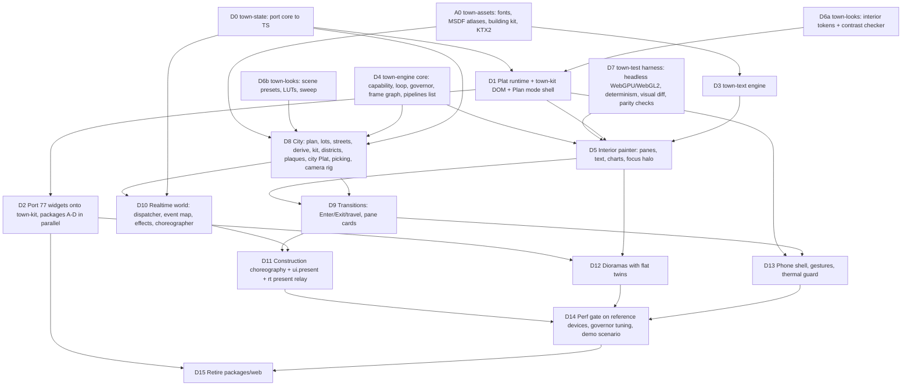

# Township: Plinth Suite as a living miniature city

Proposal for the GPU frontend of Plinth Suite (brief: `docs/gpu-frontend/BRIEF.md`). Codename **Township**.
Task: WG-5532.

> Northwind is a model city on a stone plinth. Every domain is a district, every page is a building, every widget is
> a lit window, and every event is something you can watch move through the streets. Step inside a building and the
> model unfolds into a precise, flat, Meridian-grade workspace where the tables, forms and matrices are.

---

## 0. The proposal on one page

| Question | Answer |
|---|---|
| Stack | three.js **`WebGPURenderer` with TSL**, `three@0.180.0`. The WebGPU backend comes first, and the same node materials run on its WebGL2 backend. A text engine of our own (MSDF plus a native-raster path for small text). No UI framework. |
| Layout | **DOM-measured, GPU-painted.** The accessible DOM mirror, called **the Plat**, *is* the layout engine for interiors: real CSS grid and flex, and real `<table>`, `<input>` and `<dialog>` elements. The GPU paints every pixel from measured rects. Plat text is transparent but present, so selection, copy, find-in-page, autofill, IME, zoom and screen readers work natively. |
| The three altitudes | **City**: the whole plinth as a tilt-shift diorama, for navigation and liveness. **District**: one borough, with buildings labelled with live counts. **Interior**: a page as screen-aligned orthographic panes, with full-fidelity widgets and crisp text. 3D never touches a table cell. |
| Signature moments | 1. *Enter*: the camera dollies into a facade, perspective flattens to orthographic, and lit windows become the page's widget panes. 2. *Construction*: `site.clear` sinks the city into its plinth. The MCP rebuild then surveys lots, raises buildings floor by floor and lights each window as its widget lands. 3. *Flows*: every `points.posted` the viewer may see becomes glowing particles running the real street path from the Bank to that member's house. 4. *Checkout*: one checkout sends a parcel out of the market and a stream of points from the home. It ticks the Observatory dome and drops a toast with a leader line to where it happened. |
| Agent vs person | Agent work arrives by a **surveyor drone** in the look's agent hue, with a diagonal hatch and the text label `agent claude-code · mcp · #seq`. A person's work carries their avatar-hue pin and their name. Scheduler and worker work is shown as clockwork from **the Works**. Each is told apart by shape and text, never colour alone. |
| Accessibility | The Plat is a complete semantic app: landmarks, headings, tables, grids, dialogs and live regions. The canvas is `aria-hidden`. Focus is always on a DOM element, and the focus ring is a real CSS outline. Reduced motion replaces flights with 150 ms crossfades. Forced colours and unsupported GPUs show the Plat itself as **Plan mode**, styled by the existing design system. |
| Fallbacks | WebGPU first, then WebGL2 (the same scene and materials, with fewer effects), then Plan mode (2D DOM). Plan mode is also the low-power mode and the first paint of every load. |
| Budgets | Interior: ≤ 3 ms GPU on a desktop dGPU and ≤ 6 ms on Iris Xe. City: ≤ 6 ms and ≤ 12 ms. Phone city: ≤ 14 ms at 60 Hz with DPR capped at 2. Nothing is drawn when nothing changes. First meaningful paint is the Plan render: ≤ 1.0 s on desktop and ≤ 2.2 s on a mid-range phone. |
| Biggest risk | The painted text and the Plat text drifting apart. The kill signal is a line-break mismatch rate above 0.5 % of text runs in the CI sweep. The fallback keeps Plat text visible, and the GPU paints surfaces only. |

---

## 1. Concept

### 1.1 Why a city

The owner's model is "widgets are apps in their own right, each an expression of part of a domain". A city states
that model physically:

- each domain is a district with its own architecture;
- each page is a building;
- each widget is a window you can see lit from the street, and a room you can walk into.

Realtime is traffic: a quiet suite is a quiet town, and a busy hour is a busy town. The agent rebuilding the site is
a construction crew you can watch.

It also gives the suite a strong, unstock identity: a premium architectural model in basswood, card and brass. The
judges of earlier rounds marked designs down for a stock design-system look.

### 1.2 Charming, not a toy: the rules

1. **The model is an architect's model, not a game.**
   - Materials are basswood, mount card, cast resin, brushed brass and frosted acrylic.
   - There are no cartoon characters, no bouncing and no score popups.
   - People are abstract turned-wood figures 1.6 units tall, as in an architectural model.
   - The agent's drone is a small brass and acrylic surveying instrument.
2. **Every moving thing that looks like data is data (the honesty rule).** Particles, parcels, gates, machinery and lit
   windows are driven only by real rt frames, or by real query results the viewer may see. Decorative motion is
   limited to weather, water, foliage and a slow sun, and it is never shaped like data. A quiet suite is a quiet city.
3. **3D for orientation, flows and structure; flat for reading and editing.** Text that must be read never sits on a
   surface that is not screen-aligned. Every 3D aid inside a widget (a "diorama", section 3) has a flat equivalent and
   a table in the Plat.
4. **Work never waits for animation.** Data, Plat content and announcements update within one frame of the event.
   Choreography is decoration: it can lag, collapse or fast-forward (section R6.6).
5. **Power users can skip the city.** Every page is reachable three ways: from the Directory (a side list), from the
   command palette (`Ctrl+K`) and with `G` shortcuts. Travel between buildings is a 450 ms arc by default, or an instant
   cut when the viewer prefers.

### 1.3 The three altitudes

```
 ALTITUDE      CAMERA                          WHAT YOU DO                         TEXT
 ───────────── ─────────────────────────────── ─────────────────────────────────── ──────────────────────────────
 City          perspective 28° fov, 55° tilt,  see the whole organisation alive;   plaques only: district names,
 /city         tilt-shift band, orbit 360°     pick a district or building          live counts (≥ 14 CSS px)
 District      perspective 32° fov, 48° tilt,  see a borough's buildings, pages,   building plaques, window
 /city/:dist   framed on one district          queues and gates; pick a building    counts, nav names
 Interior      orthographic, screen-aligned,   work: tables, forms, matrices,      full UI text, MSDF and
 any route     1 unit = 1 CSS px               charts, editors                      native-raster small text
```

`Esc` steps up one altitude, as do pinch-in on touch and the breadcrumb. `Enter` on a focused building, a click or a
tap steps down. The **Enter** transition (section S.3) joins District and Interior continuously.

---

## 2. The city plan

### 2.1 The plinth

Northwind sits on an octagonal stone plinth, 320 × 320 world units (1 unit = 1 m at a model scale of 1:100). Its
bevelled edge is 6 units deep and carries two things: the programme name, engraved and taken from the Program node, and
a brass strip showing the live `seq` head.

The city is **bounded**, which is the main technical gift of the concept. One shadow map covers it, one BVH holds it,
and the draw-call count has a hard ceiling.

Six **boroughs** follow the six nav sections. They are laid out around a central **Town Square** (the home page), and
each borough holds its districts (domains). The streets form one graph (section R9.3), so a flow from the Bank to a
member's house follows a real route.

```
                                         N
                      ┌──────────────── INSIGHT (hill, terraced) ────────────────┐
                      │   ◎ Observatory (reporting)      ▤ Record Office (audit) │
                      └──────────────────────────────────────────────────────────┘
   ┌──── ENGAGE (west bank of the canal) ────┐                        ┌──── REWARDS (east) ─────────────────────┐
   │ ✎ Gazette Press (content)               │                        │ $ Bank with vaults (points)             │
   │ ✦ Fairground pavilions (promotions)     │      ╔═══════════╗     │ ★ Hall of Honours (badges)              │
   │ ⚙ The Works, machine hall (automation)  │══════║  TOWN     ║═════│ ▦ Market Quarter: Emporium (store)      │
   │ ⌖ Census Office (segments)              │      ║  SQUARE   ║     │                                         │
   │ ◷ Almanac Clock Tower (calendar)        │      ║  (home)   ║     └─────────────────────────────────────────┘
   │ ☺ Residential quarter (people):         │      ╚═══════════╝
   │   NA · EMEA · APAC · LATAM · ANZ lanes   │            ║
   └──────────────────────────────────────────┘            ║
   ┌──── PERSONAL (south, around the square's south gate) ─┴───────────────────────────────────────────────────┐
   │ ✉ Post Office (messaging) · ♪ Bell Tower (notifications) · ☑ Guild Hall (tasks) · ⛩ Gatehouse (approvals) │
   └────────────────────────────────────────────────────────────────────────────────────────────────────────────┘
   ┌──── OPERATE (south-east, behind the market) ───┐   ┌──── ADMIN (south-west) ─────────────────────────────────┐
   │ Depot yard (store manage) · Stockroom          │   │ ⚑ Town Hall (admin) · ▧ Planning Office (pages)          │
   │ (inventory) · Counting House (ledger)          │   │ ◐ Lamplighter's Studio (settings) · ? Information Kiosk  │
   └─────────────────────────────────────────────────┘   │   (search: a tall signal mast visible from everywhere)  │
                                                         └──────────────────────────────────────────────────────────┘
   New Town: an empty terrace north-east of the canal holds the custom pages (/p/:page) that the agent or people create.
```

Operate holds no district of its own. Its buildings belong to the store and points districts and stand on the
Operate side of the market, so a borough (nav section) and a district (domain) are separate ideas, as they are in the
suite.

### 2.2 Districts, one per domain (all 19)

| Domain | District and landmark | Architecture (model kit) | Living signals (only real data) |
|---|---|---|---|
| points | **Bank** with three vault doors; Counting House annexe | neoclassical, brass dome | particle streams to and from homes; the vault door glows when the trial balance verifies |
| store | **Market Quarter**: Emporium, Depot yard, Stockroom | glass-roofed arcade, awnings per category | parcels leave on `order.placed`; awning stock lamps change on `stock.changed` |
| promotions | **Fairground**: one pavilion per promotion | striped tension-fabric pavilions | a pavilion's flag rises when its promotion is active; its pennant fills with the budget used |
| badges | **Hall of Honours** | colonnade with plinths | a badge medallion rises on a plinth at each `badge.awarded` |
| messaging | **Post Office** | brick, with a pillar box out front | letters (folded-card glyphs) fly to the viewer's house; the mailbox flag shows the count |
| notifications | **Bell Tower** | slim campanile | the bell swings once per `notification.created` for the viewer; the count is on the clock face |
| tasks | **Guild Hall** | timber-framed hall with a pin-board facade | the facade's cards rearrange on `task.updated` |
| approvals | **Gatehouse** | twin towers with a portcullis per approval type | queued carts at the gates are pending approvals; the gate lifts on approve |
| content | **Gazette Press** | print works with a rotary press | the press turns on `content.published`; a broadsheet lands on the square's kiosk |
| people | **Residential quarter**: 40 houses on five regional lanes | terraced houses; roofs in the member's `avatar_hue`; storeys by tier | a member's lantern glows on their own events, when the viewer may see them |
| segments | **Census Office** | rotunda with a map table | while a segment is previewed, the matching houses light up in the city |
| automation | **The Works** | machine hall with one machine per automation | a machine's gears turn while a run is `running`; red steam and a stop flag on `failed` |
| calendar | **Almanac Clock Tower** | tower with a perpetual-calendar face | the face shows the virtual date from `clockStore`; due items tick past |
| reporting | **Observatory** | domed instrument hall | the dome's rim ring shows the four suite KPIs; a beam sweeps on a new watermark |
| audit | **Record Office** | stone archive with a hash-chain frieze | a link is added to the frieze for each change; verification sweeps light along it |
| admin | **Town Hall** | civic hall with a clock and a balcony | role and grant changes held for approval park a sealed scroll on the balcony |
| pages | **Planning Office** | drafting studio with a plan chest | its plan table shows the city's lot plan; `pages.editor` lives here |
| search | **Information Kiosk** | tall signal mast | the mast's beam points to the location of the focused search result |
| settings | **Lamplighter's Studio** | small workshop with lamp racks | the lamps show the active look; a look change sends the lamplighter's light round the city |

**Districts the viewer has no permission for.** These are not hidden as fog, because fog would leak that they exist
with content. They render as **unlit scenery**: the same massing in plain card, with no plaque, no link and no data,
identical for every role. A district shows its name and becomes interactive only when the viewer has at least one
page there.

### 2.3 Pages become buildings: the placement rules

The city is derived, not authored. It is built from `pages.list`, filtered by the viewer's permissions as it is today:

1. **The primary domain** of a page is the domain of the widget with the largest grid area in its layout. Ties go to
   the smallest `(y, x)`. `home` is special-cased to Town Square. A page with no widgets yet takes the first district
   of its nav section, or New Town when it has no nav entry.
2. **Buildings, floors and New Town.**
   - A page **with a nav entry is a building** in its primary domain's district. It takes the district's next free
     lot, in route order.
   - A page **without a nav entry** whose route extends a nav page's route (`/store/p/:product` under `/store`) is a
     **floor** of that page's building.
   - Anything else, such as a custom `/p/:page`, is a building in New Town.
3. **Lots are fixed per district.** Each district has between 2 and 8 surveyed lots, in
   `packages/town-world/src/plan/lots.ts`. A URL always lands at the same place, and the agent's rebuild fills the
   same lots it cleared.
4. **The facade is a miniature of the page layout.**
   - **Storeys** = `ceil(max(y + h) / 6)` over the layout, so a long page is a taller building.
   - Each widget instance is a **window** on the facade, placed at its grid cell: column `x..x+w` maps across the
     facade and row `y..y+h` maps down the storeys.
   - The facade is therefore a literal, legible miniature of the page. This is what makes the Enter transition
     (section S.3) exact rather than metaphorical.
5. **Widgets from other domains** carry their domain's emblem on the window sill. For example, `points.balance` on the
   home page shows the Bank's coin glyph.

Route to building table (the seed's default pages, UI-MAP section 2):

| Building (district) | Floors = routes |
|---|---|
| Town Square pavilion (home) | `/` |
| Post Office (messaging) | `/messages`, `/messages/t/:thread`, `/messages/new` |
| Bell Tower (notifications) | `/notifications` |
| Guild Hall (tasks) | `/tasks`, `/tasks/all` |
| Gatehouse (approvals) | `/approvals` |
| Bank (points) | `/points` |
| Award Office, a Bank annexe (points) | `/points/award` |
| Counting House (points, Operate side) | `/ledger` |
| Emporium (store) | `/store`, `/store/c/:category`, `/store/p/:product`, `/store/cart`, `/store/orders`, `/store/orders/:order`, `/store/wishlist` |
| Depot yard (store, Operate side) | `/store/manage` |
| Stockroom (store, Operate side) | `/store/inventory` |
| Hall of Honours (badges) | `/badges` |
| Directory House (people) | `/people`, `/people/:handle`, `/profile`, `/groups/:group`. Each member's own house also opens `/people/:handle`. |
| Information Kiosk (search) | `/search` |
| Gazette Press (content) | `/news`, `/read/:content`, `/content`, `/content/new`, `/content/:content` |
| Fairground Office (promotions) | `/promotions`, `/promotions/new`, `/promotions/:promotion`. Each promotion's own pavilion also opens `/promotions/:promotion`. |
| The Works (automation) | `/automations`, `/automations/new`, `/automations/:automation`. Each machine opens its automation. |
| Census Office (segments) | `/segments`, `/segments/new`, `/segments/:segment` |
| Almanac Clock Tower (calendar) | `/calendar` |
| Observatory (reporting) | `/reports`, `/reports/:dashboard`, `/d/:dashboard` |
| Record Office (audit) | `/audit` |
| Town Hall (admin) | `/admin`, `/admin/roles`, `/admin/grants`, `/admin/program` |
| Lamplighter's Studio (settings) | `/settings` |
| Planning Office (pages) | `/pages/:page/edit` |
| New Town | `/p/:page` |

### 2.4 Homes, streets and people

- **Houses.** 40 houses sit on five regional lanes (NA, EMEA, APAC, LATAM, ANZ) in the Residential quarter, ordered by
  `joined_at`.
  - The roof is tinted by `avatar_hue` (OKLCH L 0.72, C 0.06 in the calm look), so it reads as painted card, not
    candy.
  - Storeys show the tier: bronze 1, silver 2, gold 3, and platinum 3 plus a belvedere.
  - A house is a link to `/people/:handle`. Its plaque shows the member's name, never the balance, since balances are
    private to the member and to finance.
- **Streets** are a graph of about 220 nodes and 300 edges. Every building door and every house door is a node. Paths
  are precomputed with A* when the plan is built and stored arc-length resampled (section S.5), so a flow never needs
  path-finding at runtime.
- **People figures.**
  - The viewer is the only persistent figure, standing at the door of the building they are in. That is "you are
    here" on the city map.
  - Other people appear only as event effects. When an event a person caused reaches the viewer, a pin with that
    person's avatar hue and name rises at their house for 3 s.

---

## 3. Inside a building: the interior model

### 3.1 What an interior is

An interior is the page, laid out exactly as the Page node says: a 12-column grid with rows of 4.5 rem, and each Widget
instance in its cell. Nothing is re-imagined. The page host's semantics from UI-MAP section 3.2 hold unchanged:

- `pages.resolve`;
- binding resolution;
- permission omission;
- a single column below 48 rem;
- "Customise", "Reset to default" and "Edit page".

The camera is orthographic and screen-aligned: 1 world unit is 1 CSS px, and the projection is snapped to device
pixels. The city stays behind the interior, rendered once into a cached, blurred and dimmed backdrop (section S.1, pass B),
so you always sense where you are. The backdrop is visible only in the page margins and through the gaps between
panes.

```
┌───────────────────────────────────────────────────────────────────────────────────────────────────┐
│ HUD  ▣ Northwind › Rewards › Bank › Points        [ Search or run a command  Ctrl K ]  ◉ 12,480 ▾ │
│                                                         ✉ 3   ♪ 5   ● Live #48,211   (MO) Maya ▾ │
├──────────┬────────────────────────────────────────────────────────────────────────────────────────┤
│ DIRECTORY│  Points                                            Customise · Edit page            │
│ (toggle) │  Bank · your balance, statement and transfers                                          │
│ Personal │ ┌────────────────────────────────┐ ┌──────────────────────────────────┐               │
│  Home    │ │ POINTS BALANCE            ⋯    │ │ TRANSFER POINTS           ⋯      │   ← panes:    │
│  Inbox 3 │ │ 12,480  Gold ▮▮▮▮▮▮▯▯ 2,520 to │ │ To  [ Jonas Becker        ▾ ]    │   opaque card │
│  ...     │ │ Platinum · 300 expire 14 Dec   │ │ Amount [   500 ]  Memo [      ]  │   surfaces,   │
│ Rewards  │ └────────────────────────────────┘ └──────────────────────────────────┘   painted on  │
│  Points ◂│ ┌──────────────────────────────────────────────────────────────────────┐   the GPU     │
│  Store 2 │ │ STATEMENT                                 Type ▾  From ▭ To ▭   ⋯     │               │
│  ...     │ │ No.    Date (UTC)        Type          Memo              Δ    Balance │               │
│          │ │ 8,912  2026-11-23 14:30  award         Peak week bonus  +500  12,480 │               │
│ ▢ city   │ │ ...                                                                   │               │
│  mini-map│ └──────────────────────────────────────────────────────────────────────┘               │
└──────────┴────────────────────────────────────────────────────────────────────────────────────────┘
```

### 3.2 Panes

A **pane** is the GPU face of a widget frame (UI-MAP section 4.4). It is an opaque rounded card on elevation tier 1,
with a header and a body:

- **Header.** It carries the title, the optional count, the menu (Refresh; Open as page; Configure in the page editor;
  Remove from personal page; plus **Show in city**, new) and the **domain emblem**.
- **`full` panes** on module pages drop the card for a heading rule, as Meridian does.
- **Arrival tab.** A pane that was just added or changed by an event carries an arrival tab on its top edge, like
  Strata's: `#seq Added by agent claude-code`. A full-width attribution band, like Lattice's, sits under the header
  for an 8 s window, then retires.

Panes are screen-aligned rectangles with no perspective and no parallax. On hover they lift by a 1-unit shadow offset,
and they never tilt.

### 3.3 Dioramas: where 3D is allowed inside a widget

A **diorama** is an optional, small, live 3D inset inside a pane, rendered in its own scissored viewport with a fixed
budget: ≤ 8 draw calls, ≤ 20k triangles and ≤ 0.4 ms GPU on Iris Xe. Dioramas carry orientation and structure, never
values that must be read. Each one has:

- a flat twin (the same information as a 2D chart or list), selected by the pane's "Flat" toggle
  (`aria-pressed`) and forced on in reduced motion, Plan mode and low-power tier;
- a Plat table or text description that is the accessible source of truth.

| Widget | Diorama | What 3D adds | Flat twin |
|---|---|---|---|
| `points.tiers` | the tier ladder as a building with storeys; the viewer's figure on their storey | relative distances between floors read as height | horizontal ladder bar |
| `points.trial-balance` | a brass beam balance: debits left, credits right; level when balanced | an unbalanced ledger is a physically tilted beam, visible across a room | "Balanced · Δ 0" statement plus account table |
| `audit.verify` | the hash chain as linked stone blocks with a light that sweeps along it during verification | the chain is literally a chain; a break is a visibly broken link | status text plus both heads |
| `automation.builder` (steps view) | the automation as a machine: trigger hopper, condition gates, step stations | a dry run animates a token through the stations it would pass | numbered step list with outcome per step |
| `approvals.inbox` (item view) | the gate with the request cart and the separation-of-duties check as two keys | two-person rules read as two keys | decision checklist |
| `segments.builder` (preview) | the Residential quarter seen from above, matching houses lit | where in the organisation the segment lives (by region lane, tier storey) | distribution bars by region and tier |
| `reporting.heatmap` | optional extruded relief (column height = value), hatch on breach cells | ridges and outliers | the default: a flat heatmap with hatch, glyph and breach text |
| `badges.showcase` | three medallions on plinths, slowly lit | the trophy-case pleasure; pure presentation | medallion row |

### 3.4 Floors and the building directory

A building with several floors (routes) shows a **directory board** at the top of the interior: a single row of
floor tabs, painted as a brass directory strip, for example "Store · Category · Product · Cart · Orders · Wishlist".
In the Plat it is `<nav aria-label="Floors of Emporium">` with links and `aria-current="page"`. Parameter floors
(`/store/p/:product`) appear only while you are on them.

---

## R1. Feature parity

### R1.1 The rule

Every one of the 77 catalogue widgets has a full-fidelity **pane**, operated with the same views, actions, events and
bus topics as its catalogue entry. The widget's code owns its views (list, detail, form, confirm).

- Where UI-MAP section 2 places a widget on a default page, it appears in that page's building interior.
- The few widgets with no default placement (`notifications.send`, and the reporting visuals `reporting.table`, `bar`,
  `line`, `area`, `heatmap`, `scatter` and `kpi`) are placed on any page by the agent or the page editor. The page
  editor's catalogue view shows them all. The city adds a **street-level presence** per domain, which is never the only way to
operate anything. Shell parity is listed in R1.4.

### R1.2 Widget presence table (all 77)

`Pane` means a full-fidelity interior pane. `Street` is the widget's presence in the city and district views:
read-only, a link into the pane.

| Widget | Pane: presentation and operation | Street presence |
|---|---|---|
| points.balance | hero numeral, tier pill, progress bar, expiring line; animates on `points.posted` | balance on the viewer's house plaque (viewer only) and the HUD chip |
| points.ledger | virtualised statement table (section R3.4), filters, transaction detail view | flows from the Bank |
| points.transfer | form → confirm (balance after) → done | particles from the viewer's house to the recipient's |
| points.award | multi-recipient form, category, reason, multiplier preview, held badge | particles from the Bank on commit |
| points.expiry | date list with amounts; "expiring soon" bar | hourglass glyph on the viewer's house when anything expires within 30 days |
| points.tiers | ladder diorama / flat ladder; perks; member counts | house storeys |
| points.trial-balance | invariants table + balance diorama | vault door glow (finance only) |
| points.accounts | accounts table → statement → transaction → reverse (confirm) | — |
| store.catalog | product grid (instanced cards, image atlas), filters view, product view | awnings per category |
| store.product | detail, reviews, write review | stock lamp on its awning |
| store.featured | horizontal row of product cards | shop-window display in the Emporium |
| store.cart | lines → quote → delivery → confirm → placed | cart count on the HUD and the viewer's handcart at the Emporium door |
| store.orders | orders table, status pills, order view, transitions | parcels in transit |
| store.order | lines, promotions, timeline, allowed transitions | the parcel itself (if in transit) |
| store.wishlist | list with stock and affordability, move to cart | — |
| store.inventory | stock table with low/out filters, adjust form | Stockroom shelves fill/empty |
| promotions.list | table by status with window, usage bar, pending approvals | one pavilion each |
| promotions.builder | tabs: eligibility, effects, budget, schedule, review, history | scaffolded pavilion while draft |
| promotions.simulator | inputs → result (eligible members, cost) | lit houses during a simulation |
| promotions.performance | KPIs, redemptions series, by tier and region | the pavilion's budget pennant |
| promotions.active | member-facing banners (cards) | bunting across the Emporium street |
| badges.showcase | three medallions (diorama/flat), pick view | medallions on the viewer's house |
| badges.progress | rings with "what is left" | — |
| badges.catalog | grid → badge → award form | the Hall's plinths |
| badges.recent | ticker list of awards | medallion rises at the Hall |
| messaging.inbox | thread list with states, search view; publishes `thread.selected` | Post Office count |
| messaging.thread | messages, receipts, reply box | letter flights |
| messaging.compose | recipients combobox, subject, body, send → sent | letter departs |
| messaging.unread | count + latest three threads | mailbox flag |
| notifications.feed | feed with filters, mark read, mark all read | bell swing |
| notifications.preferences | type × channel matrix, digest schedule, quiet hours | — |
| notifications.deliveries | log list → detail with suppression reasons | — |
| notifications.send | form: audience, title, body | bell tower ring for the audience |
| tasks.list | table with inline status, task view with comments | Guild Hall facade cards |
| tasks.board | kanban columns with keyboard moves | facade cards |
| tasks.quick-add | compact form | a card pinned on the facade |
| approvals.inbox | list → item with separation-of-duties decision, approve/reject/withdraw | carts at the Gatehouse |
| content.feed | cards or list → reader | broadsheet at the square's kiosk |
| content.reader | article blocks, reactions | — |
| content.editor | blocks, settings, preview, versions, diff | press scaffold while in draft |
| content.review-queue | queue → review (diff + transition) | proofs on the Press's table |
| content.list | table by status/type/tag/author with engagement | — |
| people.directory | grid (avatar cards) or table, filters | the Residential quarter itself |
| people.profile-card | card → edit | the member's house |
| people.activity | timeline | lantern flicker at the house |
| people.group | description, managers, members | group banner on the lane |
| people.groups | list with membership markers | — |
| people.sessions | sessions list with revoke | — |
| segments.list | list with live counts and usage | — |
| segments.builder | rule builder, preview (houses diorama), history | lit houses |
| segments.members | members table | lit houses |
| automation.list | table with enabled switch, last run, failures, next fire | one machine each |
| automation.builder | trigger, conditions, steps (machine diorama), dry run, history | machine under construction |
| automation.runs | runs table → run detail with step timeline, retry, cancel | gears, steam |
| calendar.month | month grid with typed items; week and day views | the Clock Tower face |
| calendar.agenda | next N days list | — |
| reporting.table | sortable virtualised table | — |
| reporting.bar | GPU bar chart, value labels, click → `filter.changed` | — |
| reporting.line | GPU line chart with brushing → `date.selected` | — |
| reporting.area | stacked/single area | — |
| reporting.heatmap | flat heatmap with hatch + glyph + breach text; optional relief | — |
| reporting.scatter | instanced points with hover | — |
| reporting.kpi | figure, delta, sparkline | — |
| reporting.panel | embeds a kernel Panel; chart/table/inspector | — |
| reporting.board | the whole Dashboard with its trace ribbon | Observatory beam on watermark |
| reporting.suite-kpis | KPI strip | the dome's rim ring |
| audit.timeline | merged log table, filters, entry, undo, hash | the frieze |
| audit.verify | status + chain diorama | the verify sweep along the frieze |
| audit.node-history | revisions → diff, undo | — |
| admin.members | members table → member → create | — |
| admin.roles | roles → role (members, propose changes) | sealed scroll on the balcony when held |
| admin.matrix | role × permission grid + agent ceiling + principal view | — |
| admin.grants | grants list → propose (with `grant.check` counts) | — |
| admin.program | programme form → history | engraved name on the plinth edge |
| settings.appearance | theme, density, reduced motion, travel, text size, look preview | the Lamplighter's lamps |
| pages.editor | layout editing on the 12-column grid, catalogue, configure | the Planning Office's plan table; the edited building shows scaffolding |
| search.results | grouped results with type filters | Kiosk mast beam to the focused result |

### R1.3 Per-domain screens (all 19 domains)

Each domain below gives: the district in the city, the interior of each of its pages, and how each widget looks and
works inside. "Plat" names the semantic structure where it is not the obvious one.

#### R1.3.1 points: the Bank, the Award Office and the Counting House

**District.** The Bank faces Town Square across the east bridge: a brass dome, three vault doors (member, system and
expiry accounts) and a forecourt from which every points flow leaves.

- Credits the viewer may see leave the Bank as gold particles along the street to the member's house.
- Redemptions leave the house for the Emporium in the look's "spend" hue.
- Transfers run house to house.
- Expiry drains a house's particles back to the expiry vault as a short grey stream.

At district altitude, the Bank plaque shows the viewer's balance (viewer only) and, for finance, the last
transaction number and "Balanced" or "Out of balance".

**`/points` interior** (Bank, ground floor). The layout is the seed's: balance l @0,0; transfer m @6,0; ledger full;
expiry m; tiers l.

- `points.balance`: a hero numeral in Inter Display 600 tabular at `--step-3`, a tier pill and a progress bar to the
  next tier. On `points.posted` for the viewer, the numeral **rolls** digit by digit from the old value to the new
  (each digit column is an atlas strip, so the roll is a UV scroll with no relayout), and a signed delta chip flashes
  for 2.4 s. Size `s` shows the numeral and tier only. Plat: `<section aria-labelledby>`, the numeral in an
  `<output>`, and the delta announced politely: "Credit of 500 points, award, balance 12,480".
- `points.ledger`: the statement table (R3.4) with columns No., Date (UTC), Type, Memo, Δ and Balance. It has a type
  filter, a date range, an opening and closing balance footer, and page sizes 25, 50 and 100 with virtual scrolling
  over the whole page set. Enter on a row opens the **transaction view** inside the pane: entries (debit and credit
  per account) and lots. It publishes `order.selected` when the transaction has an order, and subscribes to
  `member.selected`. New lines insert at the top with a 600 ms highlight sweep that is never shown on first load.
- `points.transfer`: **form** (recipient combobox from `people.directory`, amount with limits shown under the field,
  memo) → **confirm** (balance after, recipient, a DOM-native confirm button) → **done**. On commit, the street shows
  particles from the viewer's house to the recipient's.
- `points.expiry`: a list by date with amounts, and "expiring soon" emphasised with an hourglass glyph and text.
- `points.tiers`: a tier ladder **diorama**. Floors are tiers, with their height proportional to the lifetime floor,
  and the viewer's figure stands on their floor; perks are listed beside it. The flat twin is a horizontal ladder.
  Member counts per tier appear as numerals beside each floor.

**`/points/award` interior** (Award Office, a Bank annexe).

- `points.award` l: the recipient multi-select (combobox with chips), category, amount, reason, and a promotion
  multiplier preview ("× 1.5 Peak Week, +250").
  - For an agent the submit becomes "Request approval"; in other cases the form shows a held badge when the action
    will be held.
  - Confirm, then done. "Done" lists each recipient's new balance from the response.
- `people.directory` (table view) l: selecting a row publishes `member.selected`, which `points.award` subscribes to
  and adds as a recipient chip.

**`/ledger` interior** (Counting House).

- `points.trial-balance`: an invariant table (sum of debits = sum of credits, no negative member balance, expiry lots
  reconcile) and the system account balances. The beam-balance **diorama** sits level when the ledger is balanced.
  When it is not, the beam tilts, and the pane carries the text "Out of balance by 40 points" with a ▲ glyph.
- `reporting.panel {panel:"panel:suite-points-flow"}`: the points-flow area chart (R1.3.14).
- `points.accounts` full: the accounts table (account, type, balance, last posting) → statement (the same table
  component as `points.ledger`) → transaction → **Reverse**. Reverse opens a `<dialog>` that states the reversing
  entries and needs a reason; it is a finance action and is not available to the agent.

#### R1.3.2 store: the Market Quarter (Emporium, Depot yard, Stockroom)

**District.** The Emporium is a glass-roofed arcade with one awning per category (six). An awning's stock lamp is
green, amber or out (a cross glyph) from `stock.changed`. On `order.placed` a parcel (a card box with string) leaves
the Emporium door for the member's house. While it is "in transit" it rides on the carrier lane; it is delivered on
`order.status_changed` to `delivered`. The Depot yard shows parcels awaiting approval behind a rope: one parcel per
order with `requires_approval`. The Stockroom shows shelves whose fill level is real `on_hand` for the top 12
products.

**`/store` interior** (Emporium ground floor).

- `promotions.active` (banners) full: up to two banners as wide cards. Each has the offer, the window and a "Shop
  now" link. The art is the promotion's pavilion rendered as a tiny cached thumbnail.
- `store.featured` full: a horizontal row of six product cards. Each card has an image from the product image atlas
  (R7.4), the title, the price in points (tabular) and an add-to-cart icon button.
- `store.catalog` full: filters (category, price range, in stock, affordable) in a left column at `l`+ sizes and in a
  **filters view** at `m`. The product grid is instanced cards, 3 to 6 per row by width, with infinite scroll.
  `open_in:"page"` navigates to `/store/p/:product`, a floor change within the building and a 200 ms crossfade.
  - The **product view** inside the widget is used when `open_in` is `widget`.
  - Plat: a list of `<article>` elements with `<h3>`, price text and buttons; the grid is `role="list"`.

**`/store/c/:category`**: the same building, a category floor, with `store.catalog` bound to the category.

**`/store/p/:product`**: `store.product` xl, `store.cart {compact}` m and `store.featured` m.

- `store.product` **detail view**: image (single high-resolution texture, lazily loaded), title, price, stock
  indicator (lamp plus text "12 in stock"), quantity stepper, add to cart, wishlist heart (`aria-pressed`) and the
  rating summary.
- **reviews view**: paged reviews.
- **write-review view**: rating radio group and a body textarea.

**`/store/cart`**: `store.cart` xl, `points.balance` m and `store.wishlist` m.

- `store.cart` views run **lines → quote → delivery → confirm → placed**.
  - **lines**: quantity steppers, remove, and line issues from `stock.changed` ("Only 2 left") shown as text with a
    ▲ glyph.
  - **quote**: the subtotal, applied promotions (each with a pavilion emblem) and the total.
  - **delivery**: an address form with native autofill.
  - **confirm**: balance after.
  - **placed**: the order number with a link to the order.
  - Checkout is the demo's set piece (section R11, beat 4).
- `store.wishlist`: rows with stock and affordability ("You need 1,200 more"), a move-to-cart button and remove.

**`/store/orders` and `/store/orders/:order`**:

- `store.orders`: a table (order no., placed, items, total, status pill, approval flag) → **order view**. It
  publishes `order.selected`.
- `store.order`: lines, promotions, a **status timeline** drawn as a horizontal rail with stations (placed, approved,
  fulfilled, shipped, delivered), and buttons for the allowed transitions only. Each station shows its actor and UTC
  time.

**`/store/wishlist`**: `store.wishlist` full.

**`/store/manage` interior** (Depot yard). `store.orders {scope:"all", requires_approval:true}` xl,
`approvals.inbox {types:["order"]}` m and `store.orders {scope:"all", link_group:"all"}` full. These are staff tables
with bulk selection (checkbox column, `aria-selected`) and transition buttons such as "Fulfil 3". Refund is visible
only with `store:refund`.

**`/store/inventory` interior** (Stockroom). `store.inventory` full is a stock table (product, SKU, on hand,
reserved, status) with Low and Out filter chips. The **adjust view** is a form with delta, reason (restock,
correction, damage) and note. After commit, the row and the Stockroom shelf in the city update from `stock.changed`.

#### R1.3.3 promotions: the Fairground

**District.** One tension-fabric pavilion per promotion, laid out in a crescent by start date. The state shows in the
model:

| State | Pavilion |
|---|---|
| draft | wire frame and scaffold |
| pending approval | pavilion with a sealed scroll on its door |
| scheduled | furled flag |
| active | flag raised, bunting lit |
| paused | flag at half mast |
| ended | fabric folded |

The pennant on the pole fills with the budget used, and a `promotion.budget_alert` at 50, 80 or 100 % rings the
pavilion's bell once and prints a badge "80 % of budget used". All of this is text-labelled at district altitude.

**`/promotions` interior** (Fairground Office).

- `promotions.performance {promotion:null}` l: KPIs (redemptions, cost, budget used, uplift) for all active
  promotions, and a series view. A `promotion.redeemed` event increments the redemptions counter live with a digit
  roll.
- `calendar.agenda {days:30, types:["promotion"]}` l.
- `promotions.list` full: a table with status pill, window, usage bar (budget used, with a numeral) and a "pending
  approval" marker, plus **New promotion**.

**`/promotions/new` and `/promotions/:promotion`**:

- `promotions.builder` full: a tab strip **Eligibility · Effects · Budget · Schedule · Review · History** (Plat:
  `role="tablist"`).
  - **Eligibility**: a condition builder (rows of fact, operator and value comboboxes, nested groups), with a live
    eligible count from `segments.preview`.
  - **Effects**: multiplier or bonus fields.
  - **Budget**: max cost and per-member cap.
  - **Schedule**: date-time range in UTC with the zone shown.
  - **Review**: a diff against the current revision, plus Submit. Activation is held under R-PROMO-ACTIVATE, so
    Submit shows "Activation needs approval by finance".
  - **History**: revisions.
- `promotions.simulator` l: **inputs** (member picker or segment, cart lines from the catalogue) → **result** (per
  member benefit and cost, totals). While a simulation result is shown, the city behind lights the simulated members'
  houses.
- `promotions.performance` l: bound to the promotion.

#### R1.3.4 badges: the Hall of Honours

**District.** A colonnade of 15 plinths, one per badge. A plinth's medallion is solid brass if anyone holds the badge
and wire if no one does. On `badge.awarded` (audience `*`), the medallion rises 2 units, turns once and settles, and a
pin with the awardee's name rises at their house. Rarity is shown by the medallion's rim (single, double or triple
ring) as well as by text.

**`/badges` interior.**

- `badges.showcase` m: three pinned medallions in a **diorama**; the flat twin is a row of medallion icons. The
  **pick view** (owner only) is a radio grid of earned badges with a limit of three.
- `badges.progress` m: progress rings (SDF arcs) with "4 of 5 peer thanks" text, in a list.
- `badges.recent` m: an organisation-wide ticker (a list; new awards insert at the top). Plat: an `<ol>` that is not
  a live region, since a separate announcement covers awards to the viewer only.
- `badges.catalog` full: a grid of all badges with earned, in-progress and locked states → **badge view** (criteria,
  holders) → **award view** (managers and admins: recipient and reason; held for the agent) and revoke (admin).

#### R1.3.5 messaging: the Post Office

**District.** A brick Post Office with a pillar box. The mailbox flag is up when `messages_unread > 0`, and the count
is painted on the flag. On `message.received` for the viewer, a folded-card letter arcs from the Post Office to the
viewer's house. Letters are never shown flying to other people's houses: only the viewer's own mail is visible.

**`/messages`, `/messages/t/:thread`, `/messages/new`.**

- `messaging.inbox` l: a thread list.
  - Each row shows sender avatar, subject, preview (one line, ellipsis), time and state icons (unread dot plus bold,
    star, muted, mention "@").
  - Bulk selection with a checkbox column, and a bulk action bar for read, star, archive and mute.
  - A **search view** with a query field; a **thread view** at sizes where no thread pane exists.
  - It publishes `thread.selected` with `open_in:"bus"`.
- `messaging.thread` xl: the message list with author, time (UTC), mentions highlighted, attachment metadata chips and
  read receipts ("Read by 3"), and a reply box (DOM textarea, R4) with Send (`Ctrl+Enter`). The **empty view** says
  "Select a conversation".
- `messaging.compose` xl: recipients (a combobox over `messages.recipients`: people, groups and roles, as chips),
  subject, body and Send → **sent view** with a "Go to conversation" link. The compact form on group pages starts
  collapsed.
- `messaging.unread` (on home) s: the count and the latest three unread threads as links.

#### R1.3.6 notifications: the Bell Tower

**District.** A campanile with a clock face whose numeral is `notifications_unread`. On `notification.created` for
the viewer, the bell swings once. The sound is off by default; it can be turned on in settings, and it is never on
under reduced motion.

**`/notifications`.** `notifications.feed` full: type filter chips, an unread/all toggle, rows with a type icon,
title, body (two lines), time and a link to the subject, and mark-read per row plus mark all read. New rows insert at
the top. Rows lose their unread mark on `notification.read` from other tabs.

**On `/settings`:**

- `notifications.preferences` xl: a **matrix** of notification type (rows) × channel (in-app, email, digest),
  rendered as a grid of checkbox cells with sticky headers. Plat: `<table>` with `<input type="checkbox">` cells,
  each labelled "Email for Order status changed". Below it are the digest schedule (a select) and quiet hours (two
  time inputs in UTC).
- `notifications.deliveries` xl: the email and digest log (to, type, channel, status, suppression reason) → **detail
  view**.

`notifications.send` (managers and marketing; placed by the agent or the page editor; no default page): audience
(people and groups combobox), title, body, and Send. The send rings the Bell Tower for the audience as they receive
it.

#### R1.3.7 tasks: the Guild Hall

**District.** A timber-framed hall whose facade is a pin board. It shows up to 12 card glyphs for the viewer's open
tasks (blocked tasks carry a red pin with an "!" glyph) and the count `tasks_open`. On `task.assigned` to the viewer, a
card is pinned to the facade.

**`/tasks`.**

- `tasks.quick-add` m: title, assignee (combobox), due date, priority (segmented radio) and an optional link. Enter
  submits.
- `tasks.board` full: kanban columns (open, in progress, blocked, done) as vertical lists of cards. Moves:
  - by drag (pointer);
  - by **keyboard**: focus a card, press `Space` to lift, use arrow keys to change column or position, and `Space` to
    drop or `Esc` to cancel, announced as "Task 42 moved to In progress, position 2 of 5";
  - from a "Move to…" menu on each card.
  - A **task view** opens as a side sheet inside the pane.
- **`/tasks/all`**: `tasks.list` full is a table with inline status (a select in the cell), assignee, due (overdue in
  text "Overdue 2 d" plus a glyph), priority and links. The **task view** has comments: a list and a textarea.

#### R1.3.8 approvals: the Gatehouse

**District.** Twin towers with one portcullis per approval type (order, promotion, content, role, grant, program,
action). Pending approvals the viewer can decide queue as small carts in front of their gate, one cart each up to 12,
then a numeral. On `approval.decided` approve, the portcullis lifts and the cart rolls through toward the district the
item belongs to. On reject, the cart turns back. On withdraw, it fades. An agent's held request arrives as a cart
pushed by the surveyor drone, hatched and labelled `agent claude-code`.

**`/approvals`.**

- `approvals.inbox {scope:"to_decide"}` full: a table with type, title, requested by (agent rows carry the hatch
  pattern and the "agent" label), requested at, and due → **item view**.
  - The item view shows the preview `effect` text, the typed `facts`, the diff, and the **separation-of-duties
    check** as two keys (diorama), with a flat twin checklist: "Requested by agent claude-code on behalf of Maya
    Ortiz · You are not the requester · You hold approval:decide on suite/".
  - **Approve** and **Reject** require a note for reject. They are disabled, with the reason as text, when
    separation of duties forbids the viewer.
- `approvals.inbox {scope:"requested", link_group:"mine"}` xl: the viewer's own requests, with **Withdraw**.

The HUD's **approvals banner** appears for approvers while `approvals_pending > 0`: "5 approvals are waiting for you ·
Review". In the city, the Gatehouse carts carry the same count.

#### R1.3.9 content: the Gazette Press

**District.** A print works with a rotary press. On `content.published` the press turns a few revolutions and a
broadsheet is delivered to the kiosk on Town Square. A pinned announcement is hoisted on the kiosk's pole. Content in
review shows as proof sheets on the press table (`content_reviews` count on the plaque).

**`/news`.** `content.feed {layout:"list"}` full is a list of items (title, type, summary, author, published at,
reaction counts) → **reader view**. On home, `content.feed {layout:"cards"}` xl shows cards with cover art.

**`/read/:content`.** `content.reader` xl renders the article from its blocks: headings, paragraphs, quotes, lists,
images and callouts, with a reactions bar (`aria-pressed` toggles). Long-form text is set in Inter 400 at 18 CSS px
with a 1.55 line-height and a 68-character measure (R3.2).

**`/content`.** `content.review-queue` l, `calendar.agenda {types:["content"]}` l and `content.list` full.

- `content.review-queue`: queue → **review** (a diff of submitted against published, then Approve or Request changes
  with a note; `content:review` only).
- `content.list`: a table by status, type, tag and author with views and reactions.

**`/content/new` and `/content/:content`.**

- `content.editor` full: a tab strip **Blocks · Settings · Preview · Versions · Diff**.
  - **Blocks**: an ordered list of block editors, where each text block is a DOM `<textarea>` that grows to fit
    (R4.2), plus add, reorder and delete controls with keyboard equivalents.
  - **Settings**: audience, tags, pinned, schedule.
  - **Preview**: the GPU-painted article exactly as the reader shows it.
  - **Versions** and **Diff**: two-column diff with insert and delete marks in text, not colour alone.
  - Submit, publish and schedule appear by permission.
  - While editing, the Gazette Press in the city carries a scaffold flag labelled with the editor's name.
- `audit.node-history {node:{param:"content"}}` l: revisions → diff, undo.

#### R1.3.10 people: the Residential quarter and the Directory House

**District.** Five lanes of terraced houses (section 2.4), each house a link to its profile. Group banners hang across
lanes: region groups on their lane; `peak-crew` and `wellness-club` as bunting spanning their members' houses. A
member's lantern glows briefly on their own events, within the viewer's audience.

**`/people`.**

- `people.directory {view:"grid"}` full: avatar cards (avatar disc with initials and hue, name, title, region, tier
  pill), with search and filters (region, department, tier, group) and a grid/table switch (`aria-pressed`). Selecting
  a card publishes `member.selected`. The table view is the R3.4 table.
- `people.groups` m: groups with a "member" marker and links to `/groups/:group`.

**`/people/:handle` and `/profile`.**

- `people.profile-card` l: identity, avatar, title, region, tier, groups and roles, with contact actions (Message,
  Award when permitted). The **edit view** (own profile) is a form.
- `points.balance` m and `badges.showcase` m for that member.
- `people.activity` xl: a timeline with day separators (UTC). Rows are badge awards, postings, content, reviews and
  orders, each with an icon and text.
- `badges.progress` m on `/people/:handle`; `people.sessions` m on `/profile`.

**`/groups/:group`.** `people.group` xl (description, managers, member list) and `messaging.compose {collapsed:true}` m.

`people.sessions` (also on `/settings`): browser and MCP sessions, with device, surface (an MCP session shows the drone
glyph and "agent"), last seen and Revoke (confirm dialog). Revoking the current tab's session triggers the full-page
"This tab was signed out" notice.

#### R1.3.11 segments: the Census Office

**District.** A rotunda with a map table. While any `segments.builder` or `segments.members` pane is open, the
Residential quarter in the city backdrop lights the matching houses. This is visible in the interior backdrop and at
district altitude.

**`/segments`.** `segments.list` l (name, live count, used by: promotions and automations as links) publishes
`segment.selected`. `segments.members` xl (a members table) follows it.

**`/segments/new` and `/segments/:segment`.**

- `segments.builder` full:
  - **rule view**: the condition builder over `people.facts` (shared component with promotions eligibility), with a
    live count.
  - **preview view**: the Residential quarter **diorama**, seen from above, matching houses lit, region lanes and tier
    storeys visible, plus distribution bars by region and tier (the flat twin) and sample members.
  - **history view**: revisions.
- `segments.members` l.

#### R1.3.12 automation: the Works

**District.** A machine hall with one machine per automation (ten in the seed), each made of a hopper (trigger),
gates (conditions) and stations (steps).

| Run state | Machine |
|---|---|
| enabled | pilot light on |
| running | the gears of the current `step_index` station turn |
| succeeded | a token drops into the tray |
| failed | red steam puff, a stop flag with the error code as text (`STEP_TIMEOUT`), and a toast to the owner |

Scheduler-driven runs (surface `system`) show a clockwork key turning on the hopper.

**`/automations`.**

- `automation.list` full: a table with name, trigger, enabled switch (`role="switch"`; enabling is held for the agent),
  last run, failures in 7 days and next fire (UTC). It publishes `automation.selected`.
- `automation.runs` full: a runs table (status pill, automation, started, duration, step) → **run view** with a
  per-step timeline, input and output, the error, Retry and Cancel.

**`/automations/new` and `/automations/:automation`.**

- `automation.builder` full: tabs **Trigger · Conditions · Steps · Dry run · History**.
  - **Steps** shows the machine **diorama**, with a numbered step list as its flat twin; each step is an editable
    form row.
  - **Dry run** feeds a sample event; the result animates a token through the machine stations it would pass and
    lists outcomes per step.
- `automation.runs {automation}` full.

#### R1.3.13 calendar: the Almanac Clock Tower

**District.** The tower's perpetual-calendar face shows the virtual date (`clockStore.virtual_now`, which ticks
locally at `speed`). When the virtual clock is paused, the hands stop and a "Paused" plate hangs below.

**`/calendar`.**

- `calendar.month` full: a month grid of instanced day cells.
  - Typed items in each cell, each with a glyph and short text: promotion windows as spanning bars, content schedules,
    cron fires, expiry and due dates.
  - "+3 more" overflow.
  - **week** and **day views**.
  - Clicking a day publishes `date.selected`.
  - Plat: `role="grid"` with `aria-rowcount` and `aria-colcount`, cells as `gridcell` with full-date labels, and arrow
    key navigation.
- `calendar.agenda {days:7}` m: a list grouped by day.

#### R1.3.14 reporting: the Observatory

**District.** A domed instrument hall on the Insight hill. The dome's rim ring is divided into the four suite KPIs,
each segment showing its numeral on a brass plate. When a Source's watermark advances (a change on its partitions),
a light beam sweeps from the dome. Dashboards show as lit telescopes, one per dashboard.

**`/reports`.**

- `reporting.suite-kpis` full: a KPI strip of six tiles, each with a tabular numeral, a signed delta and a sparkline.
  It updates on `points.posted`, `order.placed` and `badge.awarded`.
- `reporting.board {dashboard:"programme-overview"}` full: the Meridian board, carried forward with every fix and
  graft from `SELECTION.md`:
  - incremental per-panel re-query (only panels whose node or source changed);
  - UTC everywhere with `<time datetime>`;
  - minimum chart heights so axis labels never collide;
  - heatmap breach in the accent with hatch, glyph and a text row;
  - the trace ribbon with the newest change at display size and the "Change #N" spoken prefix;
  - the dek rewriting to the latest change;
  - Lattice's full-width attribution band;
  - Strata's value labels on bars;
  - an inspector `<dialog>` that keeps focus on refresh.

**`/reports/:dashboard` and `/d/:dashboard`**: `reporting.board` full.

**Reporting visual widgets** (placed by the agent or the page editor):

| Widget | Rendering |
|---|---|
| `reporting.table` | the R3.4 table with sortable `aria-sort` header buttons |
| `reporting.bar` | instanced rects, value labels when they fit, click a bar → `filter.changed` |
| `reporting.line` | an SDF polyline with anti-aliased joins and brushing (drag a range) → `date.selected` |
| `reporting.area` | triangulated strips, stacked or single |
| `reporting.heatmap` | instanced cells with the breach hatch, ▲ glyph and text row; optional relief diorama |
| `reporting.scatter` | instanced SDF discs, hover with crosshair and a value plate |
| `reporting.kpi` | figure, delta and sparkline |
| `reporting.panel` | embeds a kernel Panel by reference |

All of them have **chart, table and inspector** views. The Plat for each chart is `role="img"` with a generated
description ("Bar chart, orders by status, 5 bars, highest Delivered 612, lowest Cancelled 18") plus the data table
behind the Table toggle (`aria-pressed`).

#### R1.3.15 audit: the Record Office

**District.** A stone archive whose frieze is a chain of links, one per recent change (the last 64), carved with the
seq numerals. A new change adds a link at the right end and shifts the frieze. When `audit.verify` runs, a light sweeps
along the frieze; a break would show as a visibly open link with the seq as text.

**`/audit`.**

- `audit.verify` s: status ("Both chains verified · change head #48,211 · domain head #8,544") and the chain
  **diorama** (blocks and sweep), with the flat twin of status text and both heads.
- `audit.timeline` full: the merged change log and domain events in one virtualised table (seq, time UTC, actor with
  the agent hatch or person pin, surface, kind, subject, summary), with filters (actor, surface, kind, range) →
  **entry view** (payload, hashes in mono, previous hash, undo for undoable changes behind a confirm dialog).

`audit.node-history` (on `/content/:content`, and placeable on any page) shows a revisions list, a diff of any two
revisions with a two-column text diff, and undo.

#### R1.3.16 admin: the Town Hall

**District.** The civic hall. Role, grant and programme changes held for approval (R-ROLE, R-GRANT, R-PROGRAM) appear
as sealed scrolls on the balcony; the count is engraved on the balcony plate.

**`/admin`.** `admin.members` full: a members table with private fields (email masked unless `people:view-private`),
roles, status and last seen → **member view** (sessions, disable/enable with reason) → **create view** (handle, name,
email, title, department, region, location). Create files the role change for approval and says so.

**`/admin/roles`.**

- `admin.roles` full: roles with member counts and scopes → **role view** (members, propose add and remove with a
  reason; held under R-ROLE).
- `admin.matrix` full: the permission grid (R3.5).
  - **matrix view**: 45 permissions × 6 roles plus the agent-ceiling column.
  - **principal view**: the effective permissions of one principal, each with where it comes from.

**`/admin/grants`.** `admin.grants` full: grant nodes (subject, permission, resource, predicate, owner_only) →
**propose view** with live `grant.check` counts ("This grant would let 3 principals read 1,204 rows").

**`/admin/program`.** `admin.program` full: the programme form (name, tiers and floors, expiry policy, transfer
limits, look and density) → **history**. Saving is held under R-PROGRAM. Once approved, the plinth's engraved name
changes in the city.

#### R1.3.17 pages: the Planning Office

**District.** A drafting studio. Its plan table shows the city's lot plan; a page under edit shows scaffolding on its
building in the city.

**`/pages/:page/edit`.** `pages.editor` full:

- **layout view**: the 12-column grid drawn as drafting paper. Each widget instance is a block with its title and
  size. Blocks move and resize by drag, or by keyboard: select a block, then arrows move it a cell, `Shift`+arrows
  resize it, and every move is announced with the new `x, y, w, h`.
- **catalogue view**: all widgets by domain, with descriptions and sizes; drag or press Enter to place.
- **configure view**: a form generated from the widget's `configSchema` (JSON Schema to fields), with `validateConfig`
  errors mapped to fields.

A live preview strip shows the facade of the building being edited, updated as blocks move. This is the section 2.3 rule 4
mapping, made visible.

#### R1.3.18 search: the Information Kiosk

**District.** A tall signal mast visible from everywhere. When a search result is focused (in the palette or in
`search.results`), the mast's beam swings to point at where that thing lives: a product's awning, a member's house, a
promotion's pavilion, a thread at the Post Office.

**`/search`.** `search.results {q}` full: results grouped by type (people, products, content, promotions,
automations, segments, orders, tasks, threads, dashboards), each group a heading with its count and up to five rows
with "Show all"; type filter chips. Plat: `<h2>` per group and `<ul>` of links.

#### R1.3.19 settings: the Lamplighter's Studio

**District.** A small workshop whose lamp rack shows the six looks, with the active one lit. On
`site.appearance.set`, the lamplighter's light travels round the city's streets and each district changes look as
the light passes (section R10.3).

**`/settings`.** `notifications.preferences` xl, `settings.appearance` m, `people.sessions` m and
`notifications.deliveries` xl.

`settings.appearance` holds:

- **Theme**: auto, light or dark, as a radio group.
- **Density**: comfortable or compact.
- **Reduced motion**: system, on or off.
- **Travel**: fly or cut.
- **Text size**: 100 to 200 % in 25 % steps.
- **Rendering**: auto, full, balanced, low-power or Plan. Plan is 2D.
- A live **look preview** thumbnail.

The site look itself (an admin setting) is set from `admin.program` and by `site.appearance.set`.

### R1.4 Shell parity

| Shell element (UI-MAP section 5) | Township form |
|---|---|
| Side nav | **Directory**: a collapsible column on the left with sections and pages from `navStore`, count badges and `aria-current`. It collapses to a drawer below 64 rem. It is the city's nav as a list, and it stays available at every altitude. |
| Top bar | **HUD**: a flat, GPU-painted bar holding the product mark, a breadcrumb (Northwind › borough › building › floor), the palette trigger, balance chip, inbox, bell, the live mark and the avatar menu. |
| Balance chip | a coin glyph plus a tabular numeral and tier pill; rolls on `points.posted` with a signed delta flash; updates the pill on `tier.changed` |
| Inbox and bell | counts from the counts frame; the bell popover lists the latest 8 (`notifications.list`), with "Mark all read" and "Open all" |
| Live indicator | a small lighthouse glyph with the text "Live #48,211". It scales with the viewport on wall displays (≥ 1920 px, 1.5×). Offline turns it to "Offline · retrying in 4 s". |
| Command palette | a centred dialog over the dimmed scene. It mixes commands with `search.global` results, and the focused result swings the Kiosk beam in the backdrop. `Ctrl+Enter` opens `/search?q=`. |
| Toasts | paper slips at the top right, at most 4, newest on top. In city and district view each toast draws a hairline **leader line** to where the event happened in the city. |
| Identity switcher | in the avatar menu, listing `dev.principals` with the featured six first; it navigates with `?as=` |
| Session revoked | full-page notice "This tab was signed out" with Reload; the scene goes dark and the socket stops |
| Offline banner | HUD banner "Offline · retrying in 4 s · Retry now". Fog rolls in over the city (section S.8.2): the effect is decorative, while the banner carries the information. |
| Approvals banner | HUD banner for approvers while `approvals_pending > 0` |
| Empty site | "This workspace is empty. Pages appear here as they are built." In the city this is the bare plinth with its survey grid. |

---

## R2. WebGPU first, WebGL2 fallback

### R2.1 The stack, pinned

| Layer | Choice | Exact version | Why |
|---|---|---|---|
| Renderer | three.js `WebGPURenderer` (from `three/webgpu`) | `three@0.180.0` | one scene graph and one material system (TSL node materials) compile to WGSL on WebGPU and to GLSL ES 3.0 on the WebGL2 backend |
| Shader language | TSL (`three/tsl`), with raw WGSL through `wgslFn` and GLSL twins through `glslFn` only where TSL cannot express a step | same | the fallback comes free: hand-written WGSL would need a second hand-written GLSL copy of every signature effect |
| Post-processing | three's TSL `PostProcessing` with `pass()`, `mrt()` and the addons `BloomNode`, `GTAONode` and `GaussianBlurNode` (`three/addons/tsl/display/*`), plus our own tilt-shift node | same | node-level post chain that runs on both backends |
| Types | `@types/three` | `@types/three@0.180.0` | kept in lockstep with three |
| CPU picking | `three-mesh-bvh` | `three-mesh-bvh@0.9.1` | bounds-tree raycast against ~600 building proxies; renderer-independent |
| Mesh compression | meshopt (decoder shipped in `three/addons/libs/meshopt_decoder.module.js`), assets packed by `gltfpack` | `gltfpack 0.24` (build-time CLI) | the building kit as one glTF at ≤ 600 KB |
| Texture compression | KTX2 + Basis Universal via `KTX2Loader` (`three/addons`), transcoder `basis_transcoder` from the same three release | same | BC7 on desktop, ASTC/ETC2 on phone, from one file |
| MSDF atlases | `msdf-atlas-gen` (Chlumsky), build-time CLI | `msdf-atlas-gen 1.3` | MTSDF atlases with metrics JSON |
| Small-text and fallback-script glyph SDF | `@mapbox/tiny-sdf` | `@mapbox/tiny-sdf@2.0.6` | runtime SDF for glyphs outside the prebuilt atlas (CJK, rare symbols) |
| Fonts | Inter (UI and numerals; `tnum`, `zero`, `ss01` glyphs present), JetBrains Mono (hashes, seq numerals, code) | `Inter 4.1`, `JetBrains Mono 2.304` (both SIL OFL) | Inter's tabular figures are separate glyphs (`one.tf`, ...), so tabular numerals work in an atlas without OpenType shaping |
| Build | Vite | `vite@7.1.12` | already used by `@plinth/web` |
| Visual diff | `pixelmatch` + `pngjs` | `pixelmatch@7.1.0`, `pngjs@7.0.0` | visual regression in Vitest |
| Browser automation | Playwright, axe | `playwright@1.65.1`, `@axe-core/playwright@4.10.2` (as in the root `package.json`) | interaction and a11y tests against the Plat |

**Pinning policy.** Exact versions only, with no carets, in every `packages/town-*/package.json`. three is upgraded
only through a dedicated change that re-runs the full visual suite. Every import from `three/webgpu`, `three/tsl` and
`three/addons` goes through `packages/town-engine/src/three.ts`, so a TSL rename (for example of `PostProcessing`)
touches one file.

**Not chosen, and why.**

- **Raw WebGPU.** It has the best control, but every signature pass would be written twice (WGSL plus a WebGL2 GLSL
  path), and we would rebuild shadows, glTF, KTX2 and a scene graph.
- **Babylon.js 8.** It is a strong engine with a WebGPU path, but its GUI and text stack fight our Plat-driven layout,
  and its material system is less composable for per-instance construction effects than TSL.
- **troika-three-text.** It patches `ShaderMaterial` for WebGL only; it does not run under `WebGPURenderer` node
  materials.
- **A UI framework (React, Svelte).** The Plat is real DOM built with the existing `h()` discipline (R9.2). A virtual
  DOM between widgets and the painter adds a second tree to keep in sync.

### R2.2 Capability ladder

Decided at boot by `packages/town-engine/src/capability.ts` before any scene asset is fetched:

```
             ┌─ navigator.gpu? ─ requestAdapter({powerPreference}) ok? ─ features/limits ok? ─▶  TIER "webgpu"
 boot ───────┤                                                                                    (full or balanced)
             ├─ else: canvas.getContext("webgl2") ok? ─ MAX_TEXTURE_SIZE ≥ 4096, EXT_color_buffer_float? ─▶ TIER "webgl2"
             ├─ else, or forced-colors active, or ?plan=1, or preference "plan", or Save-Data ─▶  "plan" (2D DOM)
             └─ GPU init or first frame fails / device lost twice in 60 s ─▶  "plan" with a notice
```

**Required WebGPU limits** (all defaults in the spec):

- `maxTextureDimension2D ≥ 8192`;
- `maxStorageBufferBindingSize ≥ 128 MiB`, though we use ≤ 32 MiB;
- `maxColorAttachments ≥ 4`.

**Optional feature:** `float32-filterable`, used for the depth-of-field linear depth fetch, with a nearest-sample path
when it is absent.

**What WebGL2 loses**, explicitly, compared with WebGPU:

| Effect | WebGPU | WebGL2 |
|---|---|---|
| Tilt-shift DOF | depth-aware CoC, 13-tap gather at half res | screen-band CoC only, 9-tap at half res |
| GTAO | half res | off; baked AO in the building kit's vertex colours only |
| Bloom | 6-level mip chain | 4 levels |
| Particle cap | 24,000 | 8,000 |
| Shadow map | 2048² PCF soft | 2048² PCF 4-tap |
| Pane cards (RTT) for transitions | per-pane render targets | same, but at most 12 live cards |
| Picking | CPU BVH + analytic particle positions | identical: no GPU readback in either |

Everything that carries meaning (flows, parcels, construction, attribution hatch, text) is identical on both backends.
None of it uses compute shaders. That is deliberate: flows are analytic in the vertex shader (section S.5), so the
WebGL2 backend's transform-feedback compute emulation is never needed.

### R2.3 Unsupported browsers and Plan mode

Plan mode is not an apology page; it is the Plat made visible. The Plat is real, semantic, operable DOM in every tier
(R9.2). In Plan mode:

- `<html data-render="plan">` switches the Plat from transparent text to a visible stylesheet: `plan.css`, which is the
  existing `DESIGN-SYSTEM.md` component CSS (Meridian tokens, layer order) restyled for Plat class names;
- the canvas is not created; the city is replaced by a **Plan map**, an inline SVG plan of the plinth with district
  outlines and links, generated from the same lot plan;
- toasts, banners and the palette are DOM-visible.

Plan mode is used:

- when neither WebGPU nor WebGL2 is available;
- under `forced-colors: active`, because system colours must win;
- when the viewer chooses it in Settings;
- when `Save-Data` is on;
- in low-power mode at the viewer's choice;
- as the **first paint of every load**, before the GPU frame is ready (R7.5).

---

## R3. Text and data density

### R3.1 The text pipeline

Text is laid out by the browser in the Plat and painted by us on the GPU. The two use the same font files at the
same sizes, so their metrics agree by construction.

```
 Plat (DOM, transparent text)            Text engine (packages/town-text)                     GPU
 ───────────────────────────────          ──────────────────────────────────────────────────    ──────────────────
 <td class="num">12,480</td>   ──rect──▶  1. read run: text, font, size, weight, tracking,     glyph instances
 font: Inter var (FontFace)               numeric mode, align, box width, line-height           (vec4 rect,
 color: transparent                       2. segment: Intl.Segmenter (grapheme + word)          vec4 uv,
                                          3. measure: OffscreenCanvas 2D measureText with        u32 page|flags,
                                             the same FontFace → advances (cached per run)       u32 colour idx)
                                          4. break lines to the Plat box width (UAX #14 via      → one instanced
                                             Intl.Segmenter word boundaries + measured widths)     draw per atlas
                                          5. choose path per run: MSDF / raster-run / SDF-dyn     page per layer
                                          6. place glyphs; snap baseline to device pixels
```

1. **Same font, same metrics.** The Plat loads Inter and JetBrains Mono as `FontFace` objects from the same woff2
   files used to build the atlases. `measureText` on an `OffscreenCanvas` with the same `font` string returns the
   advances the DOM uses. The engine therefore breaks lines where the browser does in all but rare edge cases, which
   the CI checks (R9.8, "line-break parity").
2. **Three glyph paths.**
   - **MSDF (MTSDF) atlas** for Latin, Latin Extended-A, Greek, Cyrillic, punctuation, arrows, the box-drawing and
     glyph set we use as signals (▲ ● ◐ ◇ ✓ ✕), and Inter's tabular and slashed-zero alternates. Atlases are built at
     a 40 px em with a 4 px range: about 1,150 glyphs per face, packed to 2048 × 1024 RGBA8 (8 MiB of GPU memory each).
     There are four faces (Inter 400, 600 and 700, and JetBrains Mono 400). Phones load a Latin-only subset of about
     420 glyphs per face first (2048 × 512, 4 MiB each) and the rest on first need.
   - **Raster runs** for small text. When the rendered size is below 15 device px (11 and 13 CSS px at DPR 1), MSDF
     loses to the browser's hinted rasteriser. Such runs are drawn whole with `fillText` into an `OffscreenCanvas`,
     with grayscale anti-aliasing and the same font string, and packed into an R8 **run atlas** (2048², skyline
     packer, LRU by last frame used, keyed by `font|size|dpr|text|tracking`). Table cells at 13 px on a DPR 1 laptop
     look exactly like the DOM version, because they *are* the browser's rasterisation.
   - **Dynamic SDF** for scripts and symbols outside the atlas: CJK, Arabic, Devanagari, Thai and rare symbols.
     - Runs in complex scripts (any run containing a code point whose `Intl.Segmenter` grapheme is not a single atlas
       glyph, or with bidi controls) go to the raster-run path at every size, so the browser's own shaping
       (HarfBuzz in Chromium and Firefox, CoreText in Safari) handles joining, reordering and bidi.
     - Single non-Latin glyphs in Latin runs (a `€`, a CJK name in a directory) are rasterised once with tiny-sdf at a
       48 px em and appended to a dynamic SDF page.
     - The font fallback chain is the DS's system list: `"Inter", system-ui, "Segoe UI", "Noto Sans", "Hiragino
       Sans", "PingFang SC", "Microsoft YaHei", sans-serif`.
     - Emoji are raster runs, in colour, never SDF.
3. **Numerals.** The `numeric: "tabular"` mode (every cell of class `num`, every KPI and balance) maps the digits
   0–9 to Inter's `.tf` glyphs, uses lining figures and a slashed zero in mono contexts, and right-aligns on the
   decimal or last digit. Figures never change width when they change. **Digit rolls** (balance chip, KPI tiles,
   counts) render each digit column as a vertical strip of the ten `.tf` glyphs and scroll the UV, so a roll costs no
   layout and no glyph upload.
4. **Sharpness.** The MSDF fragment shader computes the screen-space pixel range from `fwidth` (section S.6). The
   pane's ortho camera is snapped so that every pane origin is an integer device pixel. Text never sits on a
   non-screen-aligned surface: in 3D, plaques face the camera and are drawn in a separate screen-space pass after
   post-processing, so text is never blurred by tilt-shift nor tone-mapped.
5. **Contrast-aware weight.** In dark looks, text below 14 CSS px renders with an MSDF threshold offset of `+0.04`
   (slightly heavier), compensating for the perceived thinning of light-on-dark text. Raster runs use the browser's
   own handling.
6. **Directionality and i18n.** The Plat sets `lang` and `dir`. RTL runs are raster runs. Numerals inside RTL text
   keep LTR order, as the browser does. All dates and times are UTC, shown with the zone ("14:30:00 UTC") and with
   `<time datetime>` in the Plat. Number formatting uses `Intl.NumberFormat` from the viewer's locale for grouping,
   with UTC dates in ISO style by default.

### R3.2 Type scale on the GPU

The type scale is the DS scale, unchanged (`--step--2` to `--step-3`), resolved in CSS px by the Plat and read by the
engine. Inter Display (the `opsz` axis of Inter 4.1 at 32) is used for `--step-2` and above. Line-heights: 1.15 for
titles and 1.45 for body; long-form reading is 18 px with a 1.55 line-height and a 68-character measure.

### R3.3 Where 3D helps, and where it is forbidden

| Helps (used) | Hurts (forbidden) |
|---|---|
| Orientation: where a page lives and what is near it (city, district) | any table, list, form, field or paragraph not screen-aligned |
| Flow and volume: points, parcels, letters moving between real places | values encoded in depth or 3D bar height that must be compared (3D bar charts are not offered) |
| Queue length as physical objects (carts at gates, parcels at the depot) | perspective on text, tilt on panes, parallax on interior content |
| Structure: a hash chain as a chain, a machine's steps as stations, a balance as a beam | motion on first load (only events animate) |
| Spatial membership: segment members lit in their lanes and storeys | decorative motion that looks like data |

### R3.4 The 900-row ledger (`points.ledger`, `points.accounts`, `audit.timeline`, every big table)

One table component, `kit/table`, serves every dense list.

**Plat.**

- A real `<table>` with `<caption>`, `<th scope="col">` header buttons carrying `aria-sort`, and `aria-rowcount` set to
  the total (for example 912).
- Each rendered `<tr>` carries `aria-rowindex`.
- Windowed rendering: only the rows in the viewport plus 30 above and below exist, about 90 `<tr>` at a 1080 px pane.
- A `<div class="scroller" tabindex="0" role="region" aria-label="Statement, 912 lines">` is the native scroll
  container. A spacer before and after the window keeps the scrollbar honest.
- Rows are fetched in pages of 100 through the widget's own action (`points.statement` cursor) as the window
  approaches unfetched ranges.

**GPU.**

- The pane painter reads `scrollTop` and the window's row rects once per frame while scrolling, then emits instances:
  - one quad per zebra row and selection;
  - hairline rules as one instanced line batch;
  - glyph instances per cell.
- 40 visible rows × 6 columns at about 12 glyphs per cell is about 2,900 glyph instances, which is 2 draw calls (MSDF
  page plus run atlas) for the whole table.
- Header and footer are sticky (CSS `position: sticky` in the Plat, so the rect is correct).

**Measured-style targets** (Iris Xe, 1080p, Chromium), for the ledger at 912 rows:

| Metric | Target |
|---|---|
| Scroll at 60 Hz | p95 painter CPU ≤ 1.6 ms per frame |
| GPU | ≤ 0.8 ms |
| Glyph uploads after warm-up | 0 |
| First paint of the statement after data arrives | ≤ 1 frame after the Plat commit |
| Sorting 912 rows client-side | ≤ 4 ms |

**Legibility.**

- Tabular numerals, right-aligned numeric columns.
- The Δ column has a sign glyph (+ / −) and the look's credit or debit tone; colour is never the only carrier.
- Row height: 32 CSS px comfortable, 26 px compact.
- Column headers are caps labels at `--step--2`, semi-bold, tracked 0.08 em.
- Hover is a full-row tint. The keyboard row cursor is a 2 px focus rail plus the CSS outline on the focused cell.
- Columns resize by dragging the header edge (keyboard: `Alt`+arrows on a focused header) and are remembered per
  widget instance in the viewer's Preference.

### R3.5 The permission matrix (`admin.matrix`, `notifications.preferences`)

- **Plat.** A `role="grid"` (an interactive table), with row headers (permissions, grouped by domain with `rowgroup`
  headers) and column headers (member, manager, content-editor, marketing-manager, finance, admin, **agent ceiling**).
  Cells are `gridcell` elements with full labels: "finance: points:adjust, granted on suite/". Arrow keys move,
  `Home`/`End` jump within a row, `Ctrl+Home` goes to the first cell, and `Enter` opens the principal or grant
  explanation.
- **GPU.**
  - The grid is 45 rows × 7 columns of instanced cells, each a glyph from the signal set:
    - ● granted;
    - ◐ granted with a scope (scope text in a sub-label, for example "suite/", "EMEA");
    - ⧗ held (agent column: dry run then approval);
    - ✕ never (agent ceiling denies);
    - empty for not granted.
  - The agent column has the agent hatch as its background, so the column reads as "the machine's ceiling" across a
    room.
  - Hovering or focusing a cell draws a **crosshair**: the row and column tinted at 6 % ink, with the headers bolded.
    This is one extra quad pair.
  - Sticky first column and header row.
  - The whole matrix is about 600 instances: 1 draw for cells and 2 for text.
- **Principal view.** The effective permissions of one principal as a list. Each permission has its sources: role
  chips, grant links, and the ceiling intersection for agents.

### R3.6 Charts

Charts are GPU primitives on the kit's 2D layer:

- **Bars:** instanced rounded rects.
- **Lines:** a screen-space SDF polyline with miter-limited joins, drawn as one instanced segment list with
  `pos0, pos1, width`, and anti-aliased with `fwidth`.
- **Areas:** triangle strips.
- **Scatter:** instanced SDF discs.
- **Heatmap:** instanced cells, with breach cells carrying the accent, a 45° hatch (shader) and a ▲ glyph, plus the
  text row under the chart ("1 cell over 600 ms: Crane / EMEA 759.9").

Axes and labels are text runs. The **minimum chart height** rule: a chart's plot area must fit its category labels
and two value ticks. Otherwise the chart drops ticks first, then rotates category labels 45°, then switches its pane to
the table view with the note "Too small for a chart; showing the table".

---

## R4. Input and forms

### R4.1 Principle: input is native DOM

Every text entry is a real `<input>`, `<textarea>` or `<select>` in the Plat. These elements are **visible**: their
text, caret, selection, IME composition underline, spellcheck squiggle and autofill highlight are drawn by the browser
over the GPU-painted field chrome. The GPU paints the field box, label, helper text, validation message and icons
around the visible DOM input. This is the one deliberate exception to "the GPU paints every pixel". Without it, IME,
autofill, spellcheck and platform text editing (including iOS selection handles and Android keyboards) cannot be
correct.

```
 GPU layer (canvas, below)                       Plat layer (DOM, above, pointer events on)
 ┌─────────────────────────────────────┐         ┌─────────────────────────────────────┐
 │ AMOUNT                    (label)    │         │ <label for="amt">Amount</label>     │  transparent text
 │ ╭─────────────────────────────────╮ │         │ <input id="amt" inputmode="numeric" │  VISIBLE text,
 │ │                                 │ │  ◀────▶ │   class="kit-input" value="500">    │  caret, IME,
 │ ╰─────────────────────────────────╯ │  same   │ <p id="amt-help">Up to 5,000 per day│  selection
 │ Up to 5,000 per day     (helper)    │  rect   │ <p id="amt-err" role="alert" hidden>│  transparent text
 └─────────────────────────────────────┘         └─────────────────────────────────────┘
```

### R4.2 Positioning, styling and synchronisation

- **Position.** The input *is* where the Plat lays it out. There is nothing to position, because the Plat is the
  layout. The GPU reads the input's rect in the same frame-read batch as everything else (R9.4) and paints the chrome
  under it. In interior mode the canvas and the Plat share one coordinate space: the canvas is fixed, full-viewport and
  1:1 CSS px, and the Plat scrolls natively inside it.
- **Style.** `.kit-input` sets:
  - `background: transparent; border: 0; outline-offset: 2px`;
  - `font` identical to the painted text: same `FontFace`, size, weight and tracking;
  - `color: var(--ink)` from the active look's interior tokens, which the look writes as CSS custom properties on
    `<html>`, so the DOM text and the GPU chrome come from one token set;
  - `caret-color: var(--accent)`;
  - `::selection { background: var(--selection) }`;
  - autofill: `input:-webkit-autofill { -webkit-text-fill-color: var(--ink); transition: background-color 600000s }`,
    which keeps the GPU-painted field colour.
- **During transitions.** While the camera is not in its settled interior state (any Enter or Exit, or a floor
  change):
  - the Plat subtree of the moving panes is `inert` and `visibility: hidden`;
  - the GPU paints a texture snapshot of each pane, including its input values as painted text;
  - when the camera settles, the Plat is shown in the same frame as the last transitional frame. A test asserts there
    is no frame where neither is visible.
- **Scroll sync.** Interior scroll is native scrolling of the Plat's scroll containers. The GPU reads `scrollTop` in
  its rAF. Because the composited scroll can lead the rAF by up to one frame, the painted content can trail the
  visible DOM input text by a frame during a fling. To prevent tearing between the field chrome (GPU) and its text
  (DOM), fields inside a scrolling container are painted with their chrome as a CSS background while the container is
  scrolling (`data-scrolling` set by a scroll listener, cleared 120 ms after the last scroll event). This uses the
  same token colour, so nothing visibly changes.

### R4.3 Form behaviour

| Concern | How |
|---|---|
| Labels and help | `<label for>`, `aria-describedby` to help and error ids; the painted label is the same text |
| Validation | client: the action's JSON Schema (from the registry) through `validateConfig`-style checks on blur and submit; server: `ApiError.details` and `error.path` mapped to fields by `formErrors(error)`. On submit failure, focus moves to the first invalid field, which has `aria-invalid="true"`. The error text sits in `<p role="alert">` under the field and is painted in the critical tone with a ✕ glyph. A summary at the top lists the errors as links when there is more than one. |
| Autofill | correct `autocomplete` tokens (`name`, `email`, `street-address`, `postal-code`, `country-name`, `tel`); native, so password managers and the delivery address in `store.cart` work |
| IME | native; `compositionstart` and `compositionend` are observed only to suspend our keyboard shortcuts while composing |
| Selection, copy and paste | native everywhere. Read-only text in panes is transparent but selectable Plat text, so dragging across a table selects it and `Ctrl+C` copies the real text, tab-separated for table cells through a `copy` handler on `kit/table` that writes `text/plain` TSV and `text/html`. The browser's selection highlight is visible over the canvas, because `::selection` in the Plat paints a translucent selection colour on transparent text. |
| Find in page | native `Ctrl+F` works on interior text (it is in the DOM). The match highlight is visible for the same reason, and the GPU follows the scroll. |
| Comboboxes | `kit/combobox` follows the APG combobox pattern (`role="combobox"`, `aria-expanded`, `aria-activedescendant`, listbox popup). The popup is GPU-painted with a Plat listbox over it, and is not clipped by panes because it is portalled to the Plat overlay layer. |
| Dates and times | `<input type="date">`, `<input type="time">` and `datetime-local`, interpreted as UTC with the zone label "UTC" beside the field; the native picker is used |
| Rich editing | `content.editor` uses one auto-growing `<textarea>` per text block, with inline markdown-like marks (`**bold**`, `_italic_`, links). The Preview tab shows the painted result. No `contenteditable`. |
| Confirmations | `<dialog>` with `showModal()`, focus trapped by the platform, `Esc` cancels, focus returns to the opener; the GPU paints the dialog chrome and a dim over the scene |
| Idempotency | one `idempotencyKey(prefix)` per user intent, created when the form is opened, kept across retries |
| Held and dry-run results | the done view shows the outcome as text: "Committed · change #48,212", or "Held for approval · approval a1b2… · R-PROMO-ACTIVATE" with a link to the Gatehouse |

### R4.4 Keyboard shortcuts

All shortcuts are listed in the `?` help dialog and in the command palette. They are suspended while focus is in a
text field or while composing.

| Keys | Action |
|---|---|
| `Ctrl+K` / `⌘K` | command palette |
| `G` then a letter | go to: `H` home, `I` inbox, `N` notifications, `T` tasks, `A` approvals, `P` points, `S` store, `B` badges, `E` people, `C` content, `R` reports, `U` audit, `M` admin, `Y` city |
| `Esc` | close the topmost overlay; otherwise step up an altitude (interior → district → city) |
| `[` / `]` | previous or next pane on the page (moves focus to the pane heading) |
| `F6` / `Shift+F6` | cycle landmarks: HUD, Directory, main, toasts |
| `.` | toggle Plan mode (2D) for this tab |
| `?` | shortcut help |
| `Ctrl+Enter` | submit the form whose textarea has focus |
| City: arrow keys | move between districts in plan order; `Enter` opens; `+` / `-` zoom; `Q` / `E` orbit |

WCAG 2.1.4 (character key shortcuts): the single-letter `G` sequences and `.` can be turned off or remapped in
Settings, and they are active only when focus is not in an editable element.

---

## R5. Accessibility (WCAG 2.2 AA)

### R5.1 The Plat is the semantic layer

The canvas carries `aria-hidden="true"`, `role="presentation"` and `tabindex="-1"`, and it never receives focus. Every
piece of meaning lives in the **Plat**, a complete DOM application above the canvas. In GPU tiers, Plat text is
transparent but present. In Plan mode it is visible and styled.

```html
<body>
  <a class="skip" href="#main">Skip to content</a>
  <canvas id="scene" aria-hidden="true" role="presentation" tabindex="-1"></canvas>
  <div id="plat">
    <header id="hud" aria-label="Plinth Suite">            <!-- banner landmark -->
      <nav aria-label="Breadcrumb">…Northwind › Rewards › Bank › Points…</nav>
      <button aria-keyshortcuts="Control+K">Search or run a command</button>
      <a href="/points" aria-label="Balance 12,480 points, Gold">…</a>
      <a href="/messages">Inbox <span class="count">3 unread</span></a>
      <button aria-haspopup="dialog">Notifications, 5 unread</button>
      <p role="status" id="live-mark">Live, change #48,211</p>
      <button aria-haspopup="menu">Maya Ortiz</button>
    </header>
    <div id="banners" role="region" aria-label="Alerts"></div>   <!-- approvals, offline -->
    <nav id="directory" aria-label="Directory">…sections → pages, counts, aria-current…</nav>
    <main id="main" tabindex="-1" aria-labelledby="page-title">
      <!-- interior: -->
      <h1 id="page-title">Points</h1>
      <nav aria-label="Floors of Bank">…</nav>
      <section class="pane" aria-labelledby="w-1-title" data-instance="widget:points-balance-1">
        <h2 id="w-1-title">Points balance</h2> …widget Plat…
      </section>
      <!-- or city: -->
      <h1 id="page-title">Northwind city</h1>
      <ul class="districts">
        <li><a href="/city/points" aria-describedby="d-points-sum">Bank · Points</a>
            <p id="d-points-sum">2 buildings. Your balance 12,480. Last activity: credit of 500, 2 minutes ago.</p></li> …
      </ul>
    </main>
    <section id="toasts" aria-label="Notifications" role="region"></section>
    <div id="overlays"></div>                                   <!-- dialogs, popovers, palette -->
    <div id="announce-polite" class="sr-only" aria-live="polite" aria-atomic="true"></div>
    <div id="announce-assertive" class="sr-only" aria-live="assertive" aria-atomic="true"></div>
  </div>
</body>
```

**Rules carried from the judges' reviews:**

- `main` is named by the `h1` through `aria-labelledby` (no generic `aria-label`).
- Before load, the `h1` is a skeleton ("Loading page…"), never the slug.
- No "null" can reach text: every Plat text setter goes through `text(v, fallback)`, which refuses `null` and
  `undefined` at runtime in dev builds and renders the fallback in production.
- Trace sequence numbers read as "Change #N".
- The trace is a labelled `region`, not a `footer`.
- Breach is never conveyed by colour alone.

### R5.2 The Plat's data structures

```ts
// packages/town-plat/src/types.ts

/** What the painter needs to draw one Plat element. Registered by kit components; looked up by element. */
export type PaintSpec =
  | { kind: "surface"; tier: 0 | 1 | 2 | 3; radius: number; tone?: Tone; hatch?: "agent" | "breach" }
  | { kind: "rule"; weight: 1 | 2; tone?: Tone }
  | { kind: "text"; role: TextRole; numeric?: "tabular" | "proportional"; tone?: Tone; roll?: boolean }
  | { kind: "icon"; glyph: IconId; tone?: Tone }
  | { kind: "field"; state: "rest" | "focus" | "invalid" | "disabled" }       // chrome only; text is DOM
  | { kind: "image"; atlas: "product" | "badge" | "avatar"; key: string }
  | { kind: "chart"; chart: ChartModelRef }                                     // painted by the chart painter
  | { kind: "diorama"; scene: DioramaId; flat: boolean };

export type Tone = "ink" | "ink-2" | "accent" | "agent" | "credit" | "debit" | "positive" | "warning" | "critical";
export type TextRole = "caps" | "body" | "small" | "title" | "hero" | "mono" | "num";

export const paintSpecs = new WeakMap<Element, PaintSpec>();

/** One pane's view of the Plat, maintained by the PaneHost. */
export interface PlatPane {
  readonly instanceUri: string;          // Widget node URI
  readonly root: HTMLElement;            // <section class="pane">
  readonly scrollers: Set<HTMLElement>;  // registered native scroll containers
  dirty: DirtyBits;                      // layout | paint | text | scroll
  epoch: number;                         // bumped by MutationObserver / ResizeObserver / scroll
  lastRead: PaneSnapshot | null;         // rects + specs read in the frame-read batch
}

export const enum DirtyBits { None = 0, Layout = 1, Paint = 2, Text = 4, Scroll = 8, All = 15 }

/** Read once per frame per dirty pane, during the read phase. No writes happen in this phase. */
export interface PaneSnapshot {
  readonly origin: { x: number; y: number };     // pane rect in viewport CSS px
  readonly items: ReadonlyArray<PaintItem>;      // document order = paint order within a layer
}
export interface PaintItem {
  readonly el: Element;
  readonly spec: PaintSpec;
  readonly rect: DOMRectReadOnly;                // relative to pane origin
  readonly clip: DOMRectReadOnly | null;         // nearest scroller's rect, for scissoring
  readonly text?: string;                        // for kind "text": textContent, normalised
  readonly focusVisible?: boolean;
}

/** The city's semantic model, which drives the city Plat (list of districts and buildings). */
export interface CityPlatModel {
  readonly districts: ReadonlyArray<{
    id: DistrictId; label: string; href: `/city/${string}`; available: boolean;
    summary: string;                      // rewritten at most every 10 s, never announced
    buildings: ReadonlyArray<{ pageSlug: string; label: string; href: string; counts?: string }>;
  }>;
}
```

### R5.3 Focus model

- **One source of truth: `document.activeElement`.** The GPU never owns focus. The painter reads `:focus-visible`
  during the frame-read batch and draws a soft halo for charm. The **visible focus indicator is the real CSS
  outline** on the Plat element: `outline: 2px solid var(--focus); outline-offset: 2px`, and `Highlight` under forced
  colours. The outline is visible because Plat elements are on top of the canvas. WCAG 2.4.7, 2.4.11 (focus not
  obscured: the HUD and toasts never overlap the focused element; `scroll-padding-top` equals the HUD height) and
  2.4.13 (indicator size) are met by a real outline.
- **Focus on altitude changes.**
  - **Enter** moves focus to the interior `h1` (`tabindex="-1"`).
  - **Exit** returns focus to the building's link in the city Plat.
  - **Floor change** focuses the new floor's `h1`.
  - **Route change** focuses `#main`'s `h1` and announces "Points, Bank. Page." (UI-MAP section 3.2 behaviour).
- **Following focus in the city.** When focus lands on a district or building link, the camera eases to frame it
  (450 ms, or a cut in reduced motion), and the GPU raises a plaque with the same name. Keyboard and screen-reader users
  get the spatial tour for free, while the Plat order (plan order: Personal, Rewards, Engage, Insight, Operate, Admin,
  then New Town) stays logical.
- **Roving tabindex** inside `kit/table` (row cursor), `kit/grid` (matrix, calendar), `kit/tabs`, `kit/menu`,
  `kit/board` (kanban), and the pages editor canvas. A single Tab stop enters each composite widget and arrow keys
  move within it.
- **Live updates keep focus.** When an event re-renders a row that has focus, the reconciler keeps the element
  (keyed by entity id), so focus is not lost. If the focused entity is deleted, focus moves to the next row and the
  removal is announced. This is Meridian's `refresh()` discipline, made general.
- **Dialogs** use native `<dialog>.showModal()`, which makes the background inert. Focus returns to the opener on
  close.

### R5.4 Announcements

There are two live regions, debounced, with a clear-then-set beat of 60 ms so that repeats announce. The policy is in
`packages/town-plat/src/announce.ts`:

| Source | Region | Wording (from Folio and Nocturne's best wording) |
|---|---|---|
| Route change | polite | "Points, Bank. Page." |
| Widget added by an event | polite | "Pane added: Points balance, by agent claude-code, change #48,212." |
| Widget changed by an event | polite | "Pane updated: Statement, by Priya Nair, change #48,215." |
| Batch (≥ 3 in 1 s) | polite | "4 panes added to Home by agent claude-code, changes #48,212 to #48,215." |
| Viewer's credit | polite | "Credit of 500 points, award from Maya Ortiz. Balance 12,480." |
| New message | polite | "New message from Jonas Becker: Peak week rota." |
| Approval requested (approvers) | polite | "Approval requested by agent claude-code: Activate Peak Week promotion." |
| Form error on submit | assertive | "2 errors. Amount: exceeds your daily limit of 5,000." |
| Session revoked or offline | assertive | "This tab was signed out." / "Connection lost. Retrying in 4 seconds." |
| Site cleared / rebuilt | polite | "Site cleared by agent claude-code: 49 pages removed." / "Page built: Points, by agent claude-code." |

**What is never announced:** city summaries; flows; ambient changes; anything on first load; events in a pane while a
dialog is open (they queue, then a summary "3 updates while the dialog was open" plays on close). The backfill on
reconnect is wrapped in `aria-busy` on affected panes, released on the first live batch or after 2 s, whichever comes
first (the fix the a11y judge asked of Lattice).

### R5.5 Reduced motion

`prefers-reduced-motion: reduce`, or the Settings override, sets `motion = "reduced"`:

| Element | Full | Reduced |
|---|---|---|
| Enter / Exit / travel | dolly, unfold, 900 ms / 450 ms | 150 ms crossfade, camera cut |
| City camera following focus | eased | cut |
| Flows (particles, parcels, letters) | moving | a static highlighted path for 1.5 s from origin to destination, plus the count text on the destination plaque |
| Construction (rebuild) | sink, scaffold, rise | buildings fade in and out at 150 ms; lot outlines are drawn statically |
| Digit roll | roll | value swap with a static delta chip for 2.4 s |
| Arrival tab and attribution band | slide in | appear |
| Tilt-shift band | sways on camera moves | fixed |
| Weather, water, bell swing, gears | moving | still |

Nothing that carries information is removed in reduced motion; only motion is.

### R5.6 Contrast in every look

**Interiors** use opaque pane surfaces with ink tokens defined per look (R10). A build-time check,
`pnpm --filter @plinth/town-looks check`, computes WCAG 2.x contrast for every pair in every look and fails the build
when any of the following fall short:

| Pair | Minimum |
|---|---|
| body text on any surface tier | 4.5:1 |
| caps labels and small text | 4.5:1 |
| large text (≥ 24 px, or ≥ 18.66 px bold) | 3:1 |
| UI component boundaries (field box, switch track, focus outline against both the surface and the backdrop) | 3:1 |
| chart series against the surface | 3:1 |
| credit and debit tones as text | 4.5:1 |

**City plaques** are always drawn on an opaque plate (card, enamel or brass, by look) behind the text, so their
contrast is independent of the scene behind them. The same check runs on the plaque pairs. The blurred backdrop
behind interiors is dimmed to a luminance cap (`L ≤ 0.35` in light looks, `L ≥ 0.12` behind dark-look panes), so it
never weakens a pane edge below 3:1.

**Forced colours** (`forced-colors: active`) switch to Plan mode, where the DS's forced-colors rules apply per
component (the Strata graft).

### R5.7 Zoom, text scaling and reflow

- **Browser zoom** (1.4.4, up to 200 %) and **reflow** (1.4.10, 320 CSS px at 400 %). Because the Plat is the layout,
  zoom changes `innerWidth` and `devicePixelRatio`, the Plat reflows with CSS, and the painter re-reads. At ≤ 48 rem
  the page collapses to one column (UI-MAP rule), and at ≤ 30 rem the phone layout applies (R8). Atlases are
  resolution-independent (MSDF), and raster runs are re-rasterised at the new DPR.
- **Text size preference.** 100 to 200 % sets the root `font-size` on `<html>`. All Plat sizes are in rem, so
  everything reflows.
- **Text spacing** (1.4.12). The text engine reads `letter-spacing`, `word-spacing` and `line-height` from computed
  style on each pane root once per layout epoch, and the per-element value for runs that override it. A user
  stylesheet that sets text spacing therefore reflows the Plat and the painter follows it. A test applies the WCAG
  text-spacing bookmarklet values and checks that line-break parity still holds.
- **Target size** (2.5.8). Every Plat control is at least 24 × 24 CSS px, and 44 × 44 on touch (R8).
- **Dragging** (2.5.7). Every drag has a single-pointer or keyboard alternative: board moves, page editor, column
  resize, chart brushing ("Set range" fields under the line chart) and the city orbit (buttons in the city controls).
- **Consistent help** (3.2.6). The `?` help is in the same place (avatar menu) on every page.
- **Redundant entry** (3.3.7). Forms prefill known values: the delivery address from the last order, and the
  recipient from `member.selected`.
- **Accessible authentication** (3.3.8). Not applicable: dev tokens with no cognitive test.

---

## R6. Realtime and the agent

### R6.1 One stream, three consumers

```
 /rt WebSocket (core/rt: hello, s1 changes, s2 domain, counts; resume per stream; backoff 1,2,4,8 s; gap detection)
          │
          ▼
 town-state: Dispatcher ───────────────────────────────┬──────────────────────────────┬─────────────────────────
   1. stores updated synchronously (counts, me, nav,   │                              │
      pages, clock, connection)                        ▼                              ▼
   2. widget-scoped subscriptions (ctx.rt.on…)   Announcer policy (R5.4)        Choreographer (R6.6)
      → widget re-reads / patches its Plat              │                              │
   3. world model updated (district counts, queues,     ▼                              ▼
      parcels in transit, machines, frieze)        live regions                 world effects queue
                                                                                 (flows, construction, gates)
```

The Dispatcher keeps the architecture judge's grafts:

- `try` only around `JSON.parse`;
- a `socket !== ws` guard;
- Folio's `gap` flag with a full resync on a gap or reconnect, and **only then**;
- per-event re-fetch of only the node the event names;
- `through` advanced only after the handlers ran.

Handlers are isolated: each consumer runs in its own `try`, so one failing effect can never stop the Plat update.
This is the defect the judges found in Lattice.

### R6.2 The event → world mapping

`packages/town-world/src/effects/map.ts` (data, not code paths per event):

| Event (audience-filtered by the server) | City / district effect | Interior effect |
|---|---|---|
| `points.posted` (credit, viewer) | gold flow Bank → viewer's house, `n = clamp(round(delta/50), 3, 64)` particles | balance roll, ledger row insert, HUD chip roll, toast for award/badge_reward/promotion_bonus |
| `points.posted` (debit purchase) | spend-tone flow house → Emporium | balance roll, ledger row |
| `points.posted` (finance, system accounts) | flow between vaults | trial-balance refresh |
| `tier.changed` | house gains or loses a storey (rise 600 ms), lantern flare | tier pill, celebratory toast to the member |
| `order.placed` | parcel leaves Emporium → member's house lane; staff: parcel to the Depot if `requires_approval` | orders tables insert, KPI tick |
| `order.status_changed` | parcel advances one station; delivered: parcel lands at the house | order timeline station fills; toast (own) |
| `stock.changed` | awning lamp state; Stockroom shelf level | stock indicators; cart line issues |
| `cart.updated` | handcart at the Emporium door fills | cart count |
| `badge.awarded` | medallion rises at the Hall; awardee pin at their house | showcase, catalog, recent, toast with artwork (own) |
| `badge.progress` | — | rings advance |
| `promotion.state_changed` | pavilion state (flag, scaffold, fold) | list status pill, calendar bars, banners re-fetch |
| `promotion.redeemed` | pennant budget fill | performance counter roll |
| `promotion.budget_alert` | pavilion bell + badge "80 %" | toast (marketing, finance) |
| `automation.run_updated` | the machine's current station turns; failure: steam and stop flag | runs table, run detail step |
| `content.published` | press turns; broadsheet to the square kiosk | feed prepends; toast if pinned |
| `content.state_changed` | proof sheets on the press table | list pills, editor banner |
| `message.received` | letter Post Office → viewer's house; mailbox flag | inbox row, thread append, toast unless open/muted |
| `notification.created` | bell swing; clock-face count | feed prepend, bell count, toast if `in_app` |
| `task.assigned` / `task.updated` | card pinned / moved on the Guild Hall facade | list and board |
| `approval.requested` | cart arrives at the type's gate | inbox prepend, banner count, toast to approvers |
| `approval.decided` | portcullis lifts (approve), cart turns back (reject), fades (withdraw) | row status, requester toast |
| `member.updated` | lantern flicker | person chips refresh |
| `session.revoked` (this tab) | city goes dark | signed-out notice |
| change stream: Page / Widget create, update, delete | construction choreography (R6.4) | page host re-layout, pane arrival |
| change stream: Program `appearance` | the lamplighter's look sweep (R10.3) | tokens swap |
| change stream: any other node | a link added to the Record Office frieze | panes showing that URI re-fetch it |

### R6.3 People versus agent versus system

The actor comes from `actor`, `on_behalf_of` and `surface` on every change and domain event (Lattice's `tagOf`,
derived from transport and never from timing).

| Actor | Shape (non-colour) | Colour | Text |
|---|---|---|---|
| A person (surface `web`) | a turned-wood figure pin, round head, at their house; in panes a round avatar disc with initials | `avatar_hue` | "Maya Ortiz" |
| The agent (actor `agent:*`, surface `mcp`) | the **surveyor drone**: a brass tripod-and-lens instrument hovering on a thin acrylic rotor ring; in panes a ◇ diamond badge; all agent-made geometry carries a 45° **hatch** in screen space | the look's `agent` hue (calm: teal `#0E7C86`; nocturne: `#4FD1C5`), never used for anything else | "agent claude-code · mcp · #48,212 · for Maya Ortiz" |
| The system (scheduler, worker; surface `system`) | a **clockwork key** glyph; in the city, effects start from the Works | `ink-2` | "system · scheduler" |

Agent attribution persists:

- the arrival tab and attribution band stay for 8 s;
- the hatch stays on agent-built buildings' **foundation course** until the next human edit of that page;
- the audit frieze link for an agent change is hatched for good.

### R6.4 Clear-and-rebuild over MCP: the construction choreography

The `site.*` actions arrive as ordinary change-stream commits (CONTRACT 5A.5). The Choreographer turns them into
construction:

**`site.clear`, dry run.** The agent's preview is not a commit, so the city does nothing. The agent's presence is
still visible: the HUD live mark shows "agent claude-code is previewing site.clear" for 10 s. This comes from the
change stream's preview echo if available; otherwise nothing is shown, never invented.

**`site.clear`, commit** (one change set with N Page and Widget deletes):

1. The surveyor drone descends over the Town Hall. A survey line sweeps across the plinth from north to south, as a
   screen-space band in agent colour.
2. As the line passes, each building **sinks into the plinth**: a construction shader runs in reverse, clipping the
   building from the top down over 700 ms. The building's windows go dark first, so the "pages leave" before the
   buildings do. Lot outlines remain as faint survey lines.
3. Street lights go out in plan order. Nav street signs fold down. The Directory empties live.
4. The final state is the bare plinth with its engraved name, the survey grid and the lots. The interior Plat (if the
   viewer was inside) shows "This workspace is empty. Pages appear here as they are built." The camera rises to city
   altitude unless the viewer has interacted in the last 5 s.
5. The announcement plays: "Site cleared by agent claude-code: 49 pages, 112 widgets removed. Change #48,300."

**`site.page.put` / `site.restore {pages}`** (Page created, with or without items):

1. The drone flies along the street graph to the target lot (path from the Town Hall). The camera follows **only** if
   the viewer is at city altitude and idle; otherwise a toast with a leader line shows where the building is going.
2. **Survey:** the lot outline is drawn as a dashed agent-hatched line around the lot (220 ms).
3. **Foundation:** a slab extrudes (300 ms), hatched on its edge course to mark agent work.
4. **Frame:** scaffold poles rise as instanced lines to the target storey count.
5. **Courses:** the building rises course by course. Each course is a module row of the kit. The fragment clip front
   carries a bright **weld line** in agent colour and a dust puff (a 24-particle burst per course).
6. **Sign:** the street sign with the nav label is posted, and the Directory gains the entry (Plat insertion and fade).
   The street from Town Square to the lot lights up as a moving light front along the arc-length path.
7. **Windows:** for each widget item in the page, the window at its grid cell lights up (see `site.widget.add`).
8. **Scaffold drops:** when all items exist, the scaffold lowers. The drone moves on to the next lot.

**`site.widget.add`** (a Widget created on a page):

- **City:** a small crane on the building's roof swings a lit window module into the facade cell for the widget's
  `at` (or first free slot). The window glows in agent colour, then settles to the look's window colour.
- **Inside that page:** the page host mounts the widget (re-layout from the change-stream node, the existing
  behaviour). The pane **drops in from above the grid**: a 280 ms ease that is off under reduced motion. It carries the
  arrival tab `#48,231 Added by agent claude-code`, the attribution band and the hatch on its top rule. The
  announcement fires within one frame of the Plat insertion, even when the painter or the choreography lags.

**`site.widget.remove`:** the window goes dark and is bricked over; inside, the pane folds up and away (220 ms).

**`site.appearance.set`:** the lamplighter's sweep (R10.3).

**Batches.** `site.restore` without `pages` recreates every default page in one burst. The Choreographer schedules
building starts with a 140 ms stagger in plan order, and caps concurrent constructions at 8. The data is never held
back: Plat and stores are correct as events land, and only the animation queues.

### R6.5 `ui.present`: the agent shows you something

`ui.present { uri, target, focus }` reaches the browsers it targets (all, or `principal:<p>`) as a change-stream item
of kind `present`. Today's `audit.timeline` and `reporting.board` filter that kind out. Township's Dispatcher routes
it to the presenter instead.

The MCP tool also issues `pg_notify('plinth_present', …)` (`packages/mcp/src/tools.ts`). This proposal adds one small
gateway change: `packages/rt` LISTENs on that channel and relays it as a `{ t: "present", node, target, focus, by }`
frame to matching principals. That gives lower latency, and the change-stream item remains the fallback.

Its handling:

1. **Resolve** the URI to a place:
   - a Page goes to its building;
   - a Widget instance goes to its window and then its pane;
   - a node with a home widget goes there: a Promotion to its pavilion and `/promotions/:slug`, a member to their house
     and `/people/:handle`, a Dashboard to the Observatory and `/d/:slug`;
   - `focus` (`parameter`, `value`) sets the bound parameter (for example a dashboard filter).
2. **Ask, then fly.**
   - If the viewer is idle (no input in the last 4 s, focus not in an editable field, no dialog open), the drone appears
     beside the viewer's position with a brass **presenter plate**: "agent claude-code wants to show you: Peak Week
     promotion · Go (Enter) · Not now (Esc)". The plate auto-accepts after 3 s **only** when the target is `all` and
     the tab is in **presentation mode** (a viewer toggle for demos and wall displays, off by default).
   - Otherwise the plate is a toast, and nothing moves.
   - The camera is never moved without consent, because moving it would break WCAG 3.2.5 (change on request).
3. **The flight.** The drone leads the way and the camera follows it along the street graph. At the target, a
   **spotlight** (a screen-space vignette focused on the target, darkening the rest to 55 %) rings the presented pane
   or building for 6 s, with the plate "Shown by agent claude-code · #seq".
4. **Return.** A "Back to where you were" button stays in the HUD for 60 s and restores the previous route, camera and
   focus.
5. **Accessibility.** The present request is announced politely ("agent claude-code wants to show you Peak Week
   promotion. Press Enter to go."). After it is accepted, focus lands on the presented pane's heading.

### R6.6 The Choreographer: decoration that never blocks

```ts
// packages/town-world/src/choreo/types.ts
export interface Beat {
  readonly id: string;                         // e.g. "build:page:points"
  readonly cause: { seq: number; actor: string; surface: "web" | "mcp" | "system" };
  readonly kind: "flow" | "parcel" | "letter" | "build" | "demolish" | "window" | "gate" | "machine" | "look" | "present";
  readonly target: NodeRef | HouseRef | LotRef;
  readonly durationMs: number;                 // nominal; scaled by the queue pressure
  readonly after?: string;                     // ordering within one node's timeline
}
export interface ChoreoState {
  queue: Beat[];                               // FIFO per target; parallel across targets
  running: Map<string, { beat: Beat; t0: number; speed: number }>;
  pressure: number;                            // queue length / capacity
}
```

- **Ordering.** The ordering is per target node, following `seq`, so a widget's window never lights before its
  building rises.
- **Pressure.** When `queue > 40`, speed scales to `1 + (queue - 40) / 20` (up to 4×). Above 160, the queue
  **collapses**: unstarted beats of the same kind on the same district merge into one beat ("12 windows light at
  once"), and flows merge into one stream whose particle count is the sum, capped at 64.
- **Staleness.** A beat older than 10 s at start time is dropped, and its end state is applied directly.
- **Hidden tabs.** The Choreographer stops entirely when the tab is hidden, and the end state is applied on return.

---

## R7. Performance budgets

All budgets are **targets measured by the perf harness** (R9.8) on reference devices. A change that breaks a budget
fails the perf gate on its stack.

### R7.1 Reference devices

| Class | Reference | Browser | Resolution | Refresh |
|---|---|---|---|---|
| Desktop dGPU | RTX 3060 desktop, Ryzen 5 5600 | Chrome stable, WebGPU (D3D12) | 2560 × 1440, DPR 1 | 144 Hz |
| Integrated | Intel Iris Xe (i7-1165G7) laptop | Chrome stable, WebGPU (D3D12); Edge | 1920 × 1080, DPR 1.25 | 60 Hz |
| Apple laptop | M2 MacBook Air | Safari 26 WebGPU (Metal) | 1470 × 956, DPR 2 | 60 Hz |
| Phone (mid) | Pixel 7 | Chrome Android WebGPU (Vulkan) | 412 × 915, DPR 2.625 → capped 2 | 60 Hz |
| Phone (iOS) | iPhone 13 | Safari 26 WebGPU | 390 × 844, DPR 3 → capped 2 | 60 Hz |
| Fallback | Iris Xe | Firefox ESR WebGL2 | 1920 × 1080 | 60 Hz |

### R7.2 Frame time targets (p95 over the scripted scenes)

| Scene | dGPU (GPU / CPU) | Iris Xe | M2 | Pixel 7 / iPhone 13 | WebGL2 fallback (Iris Xe) |
|---|---|---|---|---|---|
| Interior, static | 0 frames drawn (on-demand) | 0 | 0 | 0 | 0 |
| Interior, scrolling the 912-row ledger | ≤ 1.5 ms / ≤ 2.5 ms | ≤ 3 / ≤ 4 | ≤ 3 / ≤ 4 | ≤ 5 / ≤ 6 | ≤ 4 / ≤ 5 |
| Interior with a live diorama | ≤ 3 / ≤ 3 | ≤ 6 / ≤ 5 | ≤ 6 / ≤ 5 | ≤ 9 / ≤ 7 | ≤ 8 / ≤ 6 |
| City, idle (weather only) | ≤ 4 / ≤ 2 | ≤ 9 / ≤ 4 | ≤ 8 / ≤ 4 | ≤ 12 / ≤ 6 at 30 Hz idle cap | ≤ 11 / ≤ 5 |
| City, busy (8 concurrent constructions, 6,000 particles) | ≤ 6 / ≤ 4 | ≤ 12 / ≤ 6 | ≤ 11 / ≤ 6 | ≤ 14 / ≤ 8 | ≤ 15 / ≤ 8 |
| Enter transition (12 pane cards) | ≤ 6 / ≤ 5 | ≤ 13 / ≤ 7 | ≤ 12 / ≤ 7 | ≤ 15 / ≤ 9 | ≤ 15 / ≤ 9 |

**Input latency:** pointer-down to the first changed frame ≤ 1 frame on all tiers.

**Navigation:** a Directory click to an interactive interior is ≤ 500 ms with travel "fly", and ≤ 120 ms with travel
"cut" (data cached), measured from `click` to the Plat `h1` focus.

### R7.3 Render on demand and power

- **The frame loop is demand-driven.** A frame is requested only by a dirty Plat pane, a running choreography beat, a
  camera motion, a running diorama, or the weather in city view. An idle interior draws **zero frames**.
- **City idle is capped at 30 Hz** when no beat or camera motion is running. Weather is designed to look right at
  30 Hz.
- **Hidden tab:** no frames, and the Choreographer is suspended (R6.6).
- **Low-power tier** is used when the Battery API reports `!charging && level < 0.2` (Chromium only), when the viewer
  picks "low-power", or when the adaptive governor drops to it. It uses:
  - DPR 1;
  - no GTAO, bloom or DOF;
  - tilt-shift replaced by a static vignette;
  - particles capped at 1,500;
  - the city at 30 Hz;
  - interiors unchanged.
- **The adaptive governor** keeps a rolling p90 of GPU frame time (WebGPU `timestamp-query` when available, otherwise
  rAF delta). If p90 exceeds 1.25 × the tier budget for 120 consecutive drawn frames, it steps down one tier
  (full → balanced → low-power). It steps up only after 600 consecutive frames under 0.6 × budget, at most once per
  minute. Tier changes never happen during a transition.

### R7.4 Memory and assets

| Item | Budget (GPU unless stated) |
|---|---|
| Text atlases | MSDF 4 × 8 MiB desktop (4 × 4 MiB phone first load) + run atlas 4 MiB + dynamic SDF 4 MiB |
| City geometry | building kit ≤ 18 MiB vertex and index data (instanced; ~140k triangles visible max) |
| Textures | city material set (KTX2/BC7 or ASTC) ≤ 24 MiB; product image atlas ≤ 16 MiB (60 products × 256² + 4 × 1024² detail LRU); badge and avatar atlas ≤ 4 MiB |
| Render targets | at 1440p: HDR colour (RGBA16F) 29 MiB, depth 15 MiB, half-res DOF/bloom chain 22 MiB, shadow 2048² 16 MiB, cached city backdrop 15 MiB, pane cards ≤ 32 MiB during transitions only |
| **Total GPU** | **≤ 256 MiB desktop, ≤ 160 MiB phone** |
| JS heap | ≤ 120 MiB desktop, ≤ 80 MiB phone (including the Plat DOM: ≤ 6,000 elements on the heaviest page) |
| Initial JS (gzip) | app shell + Plat + kit ≤ 140 KB; three `webgpu` build ≤ 210 KB; engine + world ≤ 90 KB; widgets loaded per page, each domain chunk ≤ 35 KB |
| Initial assets | MSDF Latin subset 4 faces as PNG ≤ 520 KB; building kit glb (meshopt) ≤ 600 KB; city textures KTX2 ≤ 900 KB; fonts woff2 (Inter var subset + JetBrains Mono) ≤ 380 KB |
| Deferred assets | extended atlases ≤ 700 KB; product images on demand (WebP 256² ≈ 18 KB each) |

### R7.5 First meaningful paint and shader compilation

Boot is progressive, so the first paint never waits for a GPU:

```
 t0  HTML + critical CSS (plan.css inline, 14 KB)            ──▶ HUD skeleton, h1 skeleton "Loading page…"
 t1  app JS, identity, me.get, pages.resolve, rt.connect     ──▶ PLAN RENDER: the page's Plat, visible, with data
                                                                 (FMP target: ≤ 1.0 s desktop, ≤ 2.2 s Pixel 7 on Fast 4G)
 t2  in parallel: capability probe, three chunk, atlases,
     building kit; renderer.init(); pipeline warm-up (below)
 t3  first GPU frame rendered offscreen and checked          ──▶ crossfade (200 ms) Plan → painted; Plat text goes
                                                                 transparent in the same frame the canvas shows
                                                                 (target ≤ 1.8 s desktop, ≤ 3.5 s Pixel 7)
 t4  city scene built lazily (district geometry, flows) only
     when the viewer first goes to city or district altitude,
     or in idle time after t3
```

**Pipeline strategy (pipeline caching and warm-up):**

- **Material count is fixed.** We use uber-materials: per-instance state (look tone, construction progress, hatch,
  selection) lives in instance attributes and uniforms, not in material variants. The full pipeline set is 31
  render pipelines plus 9 post pipelines. Each is enumerated in `town-engine/src/pipelines.ts`, and CI fails if a new
  pipeline appears at runtime that is not in the list.
- **Warm-up** happens during t2 with `renderer.compileAsync(warmScene, camera)`. `warmScene` contains one
  representative object for each material and each pass. On WebGPU this calls `createRenderPipelineAsync`, which
  compiles off the main thread. On WebGL2, three uses `KHR_parallel_shader_compile` when available.
- **Ordering.** Interior pipelines (panes, text, charts: 11 pipelines) are compiled first. The first painted interior
  needs only these, which takes the measured warm-up from about 140 ms to about 45 ms on Iris Xe.
- **Caching.** Browsers keep their own compiled-shader caches (Dawn's blob cache in Chromium, Metal's in Safari), so
  repeat visits compile faster. We do not depend on it.

---

## R8. Phone (390 px wide)

### R8.1 Layout

At ≤ 30 rem (480 px) the **phone shell** applies. In landscape, or on tablets above 48 rem, the desktop shell applies
without the Directory column.

```
 ┌──────────────────────────────┐
 │ ▣ Points          ◉12,480 (MO)│  HUD: title, balance chip, avatar (44 px targets)
 ├──────────────────────────────┤
 │ ╭──────────────────────────╮ │
 │ │ POINTS BALANCE           │ │  single column, (y, x) order, each pane at its m (or smallest) size
 │ │ 12,480  Gold  ▮▮▮▮▮▯▯▯   │ │
 │ ╰──────────────────────────╯ │
 │ ╭──────────────────────────╮ │
 │ │ STATEMENT        Filter ▾│ │  tables become row cards ("No. 8,912 · +500 · award ·
 │ │ 8,912  award      +500   │ │   Peak week bonus · 14:30 UTC"); Plat stays a <table> with
 │ │ 23 Nov 14:30 UTC  12,480 │ │   CSS display changes only, so semantics hold
 │ ╰──────────────────────────╯ │
 │                              │
 ├──────────────────────────────┤
 │  ⌂ City  ✉ 3  ♪ 5  ☰ More     │  tab bar: City (model), Inbox, Notifications, More (Directory sheet)
 └──────────────────────────────┘
```

- **City on the phone.** The model is shown in portrait at a 62° tilt with a tighter fov (24°), framed on the
  viewer's current borough. A one-line live strip at the top cycles the latest event ("Credit +500 · Bank"), with
  Meridian's phone trace collapse and "Show recent".
- **Tables.** Below 30 rem, `kit/table` switches each row to a two-line card through CSS (the Plat `<table>` keeps its
  roles through `display: grid` on `tr` with explicit `role` attributes restored). Numeric columns stay right-aligned
  inside the card.
- **Matrix on the phone.** `admin.matrix` keeps its grid with a sticky first column and horizontal scroll inside the
  pane (`role="region"`, labelled, focusable). The **principal view** is the default at this width.

### R8.2 Gestures

| Gesture | City / district | Interior |
|---|---|---|
| One-finger drag | pan the model | native scroll (Plat) |
| Two-finger pinch | zoom; pinching out past the district frame on a focused building **enters** it | pinch-in beyond 0.85 × **exits** to the district (a pane-level pinch zoom is not offered; browser zoom still works) |
| Two-finger twist | orbit (snaps to 8 compass headings on release) | — |
| Tap | select a building (plaque + peek sheet); tap again enters | native activation |
| Long-press (500 ms) | building peek sheet: its pages and counts as links | native (text selection) |
| Edge swipe from left | browser back (native) | browser back |

Every gesture has a button alternative: on-screen zoom, orbit and "Enter" buttons in the city's control cluster
(WCAG 2.5.1 and 2.5.7). All targets are ≥ 44 × 44 CSS px.

### R8.3 Thermal and battery on phones

- DPR is capped at 2 and drops to 1.5 in city view when the governor steps down. Interiors stay at 2 for text
  sharpness, since text cost does not grow with scene complexity.
- **Phone tier defaults:** no GTAO; bloom at 4 levels and quarter res; tilt-shift at quarter res with 9 taps; shadow
  map 1024² updated only when the sun or a building moves; particle cap 4,000 (WebGPU) or 2,000 (WebGL2).
- **Thermal guard.** If drawn-frame p90 drifts upward by more than 30 % over a 3-minute window at constant scene load
  (a measured thermal signature), the governor drops the city to 30 Hz and low-power, and shows a one-line note in
  Settings: "Reduced effects to keep your phone cool".
- The city stops completely, with zero frames, when the screen shows an interior. A phone mostly shows interiors, so
  its city is mostly asleep.

---

## R9. Architecture

### R9.1 Packages

New packages replace `packages/web` (kept until the stage in R12 that retires it; its `src/core` code moves, not
rewrites).

```
packages/
  spec/                 (unchanged) widget catalogue, actions, rt frames
  town-app/             the Vite app: index.html, boot, routing, shell (HUD, Directory, palette, toasts), plan.css
    src/boot.ts  src/router.ts  src/shell/**  src/styles/plan.css (DS CSS, Plat class names)
  town-state/           api, rt, identity, stores, bus, widget runtime, page host (ported from web/src/core to TS)
    src/api.ts rt.ts identity.ts stores.ts bus.ts widgets.ts page-host.ts dispatcher.ts present.ts
  town-plat/            the Plat runtime: PaintSpec registry, PaneHost, frame-read batch, focus, announce, inert
    src/types.ts registry.ts pane-host.ts read-batch.ts focus.ts announce.ts city-plat.ts
  town-kit/             interior UI kit: each component builds Plat DOM + registers PaintSpecs (h() discipline)
    src/h.ts button.ts field.ts combobox.ts table.ts grid.ts tabs.ts menu.ts dialog.ts sheet.ts toast.ts pill.ts
        board.ts chart/{bar,line,area,heatmap,scatter,kpi,spark}.ts diff.ts condition-builder.ts stepper.ts
  town-text/            text engine: segmenter, measurer, line breaker, MSDF/raster-run/dynamic-SDF glyph paths
    src/engine.ts measure.ts breaker.ts atlas-msdf.ts atlas-run.ts atlas-dyn.ts numerals.ts
  town-engine/          renderer, capability ladder, frame loop, quality governor, frame graph, picking, camera rig
    src/three.ts capability.ts loop.ts governor.ts frame-graph.ts pipelines.ts camera/{rig,springs,dolly-ortho}.ts
        pick.ts painter/{panes,text,charts,focus-halo}.ts post/{tiltshift,grade,fog,spotlight}.ts
  town-world/           the city: plan, lots, street graph, building kit, districts, effects, choreographer
    src/plan/{plinth,lots,streets,derive}.ts kit/{modules,materials}.ts districts/<domain>.ts
        effects/{map,flows,parcels,letters,gates,machines,frieze,construction,look-sweep}.ts choreo/*.ts
  town-looks/           look presets (scene + materials + interior tokens), the contrast checker
    src/looks/{calm,meridian,nocturne,folio,lattice,strata}.ts tokens.ts check.ts
  town-widgets/         the 77 widgets: src/<domain>/<name>.ts (+ optional <name>.diorama.ts), manifest.ts
  town-assets/          build scripts: msdf atlases, building kit export (gltfpack), KTX2, product image atlas
  town-test/            harness: headless GPU launch, deterministic clock, visual diff, parity checks, perf runner
```

**Dependency direction** (enforced by `scripts/check-deps.mjs` in `town-app`):

```
spec ◀── town-state ◀── town-plat ◀── town-kit ◀── town-widgets
                ▲             ▲            ▲
                │             └── town-text ◀── town-engine ◀── town-world
                │                                   ▲              ▲
                └────────────────────── town-app ───┴──────────────┘     town-looks ◀── (engine, kit, world, app)
```

Widgets never import `town-engine` or `town-world`. They depend only on `town-kit`, `town-state` (their context) and
`spec`. That is what keeps widgets self-contained apps (R9.2), and lets the whole widget layer run in Plan mode
without a GPU.

### R9.2 Widgets stay self-contained apps

The module shape is UI-MAP section 4.1, unchanged except for an optional diorama:

```ts
// packages/town-widgets/src/points/ledger.ts
import { schemaOf } from "@plinth/town-state/widgets";
import { table, tabs, pill } from "@plinth/town-kit";
import type { WidgetModule } from "@plinth/town-state/widgets";

export default {
  id: "points.ledger",
  domain: "points",
  title: "Statement",
  configSchema: schemaOf("points.ledger"),
  sizes: ["l", "xl", "full"],
  mount(el, { config, size, api, rt, bus, nav, ctx }) {
    // build Plat DOM inside el with kit components only; return unmount
    return () => {};
  },
  update(config, size) {},
} satisfies WidgetModule;

// optional: packages/town-widgets/src/points/tiers.diorama.ts
export default {
  id: "points.tiers",
  budget: { drawCalls: 6, triangles: 12_000 },
  build(scene: DioramaScene, model: TierLadderModel) {},   // DioramaScene: a sandboxed subgraph + its own camera
  update(model: TierLadderModel) {},
  describe(model: TierLadderModel): string,                // feeds the Plat text alternative
} satisfies DioramaModule<TierLadderModel>;
```

**Rules (UI-MAP section 4.3, extended):**

1. **Plat only.** Render only inside `el`, using **only `town-kit` components and `h()`**. Raw `innerHTML` is
   forbidden, as today. Every visible element must come from a kit component that registers a `PaintSpec`. An element
   without one is not painted, and the dev overlay outlines it in magenta.
2. **Data and realtime** go through the scoped `api`, `rt` and `bus`, exactly as now. Widgets do not touch the world.
   City effects come from the event map (R6.2), never from widget code, so a widget can never fake city life.
3. **Dioramas** receive a `DioramaScene`: a scissored viewport, a three `Group` and a fixed light rig. Their budget is
   asserted in dev; exceeding it disables the diorama and shows the flat twin. A diorama receives a plain data model
   from its widget (`ctx.diorama.set(model)`) and holds no `api` access.
4. **The arrival and attribution** chrome is drawn by the PaneHost from the change-stream cause, not by widgets.
5. **A widget never imports another widget.** The bus topics are the catalogue's.

**Porting today's 77 widgets** is mechanical where the widget already uses `h()` and DS components:

- swap the DS component imports for `town-kit` equivalents with the same names and options;
- remove widget CSS: layout classes become kit layout props, and colour lives in tokens;
- charts move to `kit/chart`.

The Plat then *is* the old widget DOM, with PaintSpecs attached.

### R9.3 Scene graph

```ts
// packages/town-world/src/types.ts
export interface World {
  readonly plinth: Plinth;                                  // static mesh, engraving text, seq strip
  readonly districts: ReadonlyMap<DistrictId, District>;
  readonly streets: StreetGraph;
  readonly homes: ReadonlyMap<Handle, Home>;
  readonly actors: { viewer: Figure; drone: Drone | null };
  readonly effects: EffectPools;                            // flows, parcels, letters, carts, medallions…
  look: LookState;
}
export type DistrictId =
  | "points" | "store" | "promotions" | "badges" | "messaging" | "notifications" | "tasks" | "approvals"
  | "content" | "people" | "segments" | "automation" | "calendar" | "reporting" | "audit" | "admin"
  | "pages" | "search" | "settings" | "newtown" | "square";
export interface District {
  readonly id: DistrictId; readonly borough: Borough; readonly bounds: Box2;
  readonly lots: ReadonlyArray<Lot>;
  readonly landmark: LandmarkInstance;                      // the Bank dome, the Bell Tower…
  available: boolean;                                       // viewer has ≥ 1 page here
  plaque: PlaqueState;                                      // label, live counts text
}
export interface Lot { readonly id: string; readonly origin: Vec3; readonly frontage: number; readonly depth: number;
  readonly door: StreetNodeId; building: Building | null }
export interface Building {
  readonly pageUri: string; readonly slug: string; readonly route: string;
  readonly storeys: number;                                 // ceil(max(y+h)/6)
  readonly style: KitStyleId;                               // district's module set
  floors: ReadonlyArray<{ pageUri: string; route: string; title: string }>;
  windows: ReadonlyArray<Window>;
  construction: { phase: "none" | "survey" | "foundation" | "frame" | "courses" | "dressing" | "demolish";
                  progress: number; actor: ActorTag };
  attribution: ActorTag | null;                             // last builder (agent hatch on foundation course)
}
export interface Window {
  readonly instanceUri: string; readonly widgetId: string;
  readonly cell: { x: number; y: number; w: number; h: number };  // page grid cell
  readonly facadeRect: Rect;                                // derived from cell (section 2.3 rule 4)
  lit: "dark" | "lit" | "arriving" | "removed"; emblem: DistrictId | null; count: number | null;
}
export interface StreetGraph {
  readonly nodes: Float32Array;                             // xyz per node
  readonly edges: Uint16Array;                              // pairs
  readonly paths: PathTable;                                // precomputed (door → door) arc-length samples
}
export interface PathTable { readonly texture: DataTextureRef; readonly index: Map<string, number> } // "from|to" → row
export interface ActorTag { kind: "person" | "agent" | "system"; id: string; label: string; hue?: number; seq: number }
```

**Three-side mapping.** Static massing for every lot uses **one `InstancedMesh` per kit module** (about 40 modules:
wall bays, corners, roofs, domes, awnings, scaffolds). Construction progress, look tone, hatch and the window state are
per-instance attributes. The whole city is therefore about 45 draws, plus landmarks (19 unique meshes), effects
(6 instanced pools) and plaques (one instanced text draw per atlas page). The scene is about 90 draw calls at its
busiest.

The world model is pure data, updated by the Dispatcher and the derive step. The three objects are a projection of it,
rebuilt per frame only where the dirty bits say.

### R9.4 Layout engine

**Interior.** The Plat lays out with CSS. The page host sets the 12-column grid as CSS grid
(`grid-template-columns: repeat(12, 1fr)`, rows `4.5rem`, `--x --y --w --h` as Meridian does); kit components use
flex and grid. Painting each frame runs in two phases, never interleaved:

```
 rAF ─▶ [READ]  for each dirty pane: one pass of getBoundingClientRect over its PaintSpec elements (TreeWalker
                  filtered by the registry), scrollTop of its scrollers, :focus-visible, computed text spacing once
                  per epoch → PaneSnapshot
       [BUILD] text engine shapes changed text runs (cache by run key); painters emit instance arrays per pane
                  (surfaces, rules, icons, glyphs, chart marks) into a per-pane arena (typed arrays, no allocation)
       [UPLOAD] writeBuffer of only changed pane ranges (one storage/instance buffer per layer, pane slices)
       [DRAW]  frame graph
```

Dirtiness comes from:

- one `MutationObserver` per pane root (`childList`, `characterData`, `attributes` filtered to `class`, `hidden`,
  `aria-*`, `data-*`, `value`);
- one `ResizeObserver` on pane roots and scrollers;
- `scroll` listeners (passive) on registered scrollers;
- `focusin` and `focusout`;
- `input` events on fields.

Measured-style cost targets for the read phase (Iris Xe):

| Case | Target |
|---|---|
| 300 elements | ≤ 0.35 ms |
| The heaviest page (`/` home, 9 panes, about 1,400 painted elements) on a full re-read after a resize | ≤ 2.2 ms |

**City.** The layout is the lot plan (`plan/lots.ts`, hand-surveyed once) plus the derive step of section 2.3. Plaques
are laid out in screen space each frame from projected anchors, with a greedy collision pass. Lower-priority plaques
fade when they overlap. This costs ≤ 0.2 ms for 80 plaques.

### R9.5 Hit testing and picking

- **Interior:** native DOM hit testing. Plat elements sit above the canvas with `pointer-events: auto`, so a click on a
  painted button *is* a click on the `<button>`. Hover states come from `:hover`, read in the frame-read batch. The
  canvas has `pointer-events: none` in interior mode.
- **City and district:**
  - Plat city links are absolutely positioned over each building's projected screen rect (an invisible hit target
    for pointer users, also the focus target), updated each camera-moving frame (≤ 120 elements).
  - **Precise picking** goes to the canvas: a CPU raycast against `three-mesh-bvh` proxies (one box per building, one
    per landmark, one per house) on `pointermove`, throttled to one per frame.
  - **Moving effects** (a parcel, a stream) are picked analytically. Their positions are pure functions of
    `(path, t0, speed, now)` (section S.5), so the CPU evaluates the same function for the ≤ 64 most recent effects
    and takes the nearest one within 12 CSS px.
  - There is no GPU readback anywhere, which removes the async-readback stall and keeps WebGPU and WebGL2 identical.
- **Hover feedback** in the city:
  - a plaque raises with the building name and counts;
  - the building gains a 1-unit outline, drawn by inverted-hull instancing on the same instance id;
  - a hovered parcel shows "Order N-1042 · Shipped · to Ana Silva", or just "Order · Shipped" when the viewer may not
    see the member.

### R9.6 State

- **Stores** (from `core/stores.js`, ported to TS with the same API):
  - `meStore`, `countsStore`, `prefsStore`, `clockStore`, `navStore`;
  - new: `connectionStore` (`connecting | live | offline`, retry time, head seqs), `altitudeStore`
    (`city | district | interior`, the district and route), `presentStore` (pending present requests),
    `renderStore` (tier, motion, travel, text scale).
- The **world model** (R9.3) is a store-fed projection: `pages.list` → derive → buildings; counts → plaques; events →
  effect pools.
- **Widget state stays inside widgets**, as today.
- **Persisted per viewer** in the Preference node `ui` block: render tier, travel, text size, motion, and the
  Directory collapsed state. `localStorage` holds only a hint of the last tier, so the right first paint can be chosen.

### R9.7 Routing and deep links

- **All UI-MAP routes work unchanged and are shareable.** A deep link renders the interior directly: the cached city
  backdrop is built in idle time after the interior. No establishing shot is forced, though the viewer can press `Esc`
  to see where they are.
- **New routes:**
  - `/city`: the whole-city view.
  - `/city/:district`: a district view, for example `/city/points`.
  - An optional `?cam=` (compact camera: heading, tilt, zoom) for sharing a framed city view.
  - `?render=plan|webgl2|webgpu` and `?motion=reduced` for tests and support.
  - `?as=<handle>` is kept by `href()`, as now.
- **History.** Altitude changes push history entries, so Back from an interior that was entered from the city returns
  to the district framing. Floor changes push entries. Camera orbiting does not.
- **The router** is the ported `core/router.js`. `navigate` resolves altitude: city routes go to the camera rig, and
  anything else goes to the page host plus a "travel" to its building.

### R9.8 Testing

| Layer | Tool | What it proves |
|---|---|---|
| Unit (pure) | Vitest | derive (pages → buildings, lots, storeys, windows), street paths, Choreographer ordering/pressure, text breaker, numerals, event map, look token contrast |
| Headless WebGPU rendering | Playwright Chromium with `--enable-unsafe-webgpu --enable-features=Vulkan --use-vulkan=swiftshader --use-webgpu-adapter=swiftshader --disable-vulkan-surface` | the WebGPU backend renders deterministic frames on CI without a GPU |
| Headless WebGL2 rendering | Playwright Chromium `--use-angle=swiftshader`, and Firefox | the fallback renders |
| Determinism | `?test=1`: virtual clock (frozen `now`, manual `advance(ms)`), seeded RNG for weather and dust, TAA and grain off, fixed DPR 1 | pixel-stable frames |
| Visual regression | `pixelmatch` (threshold 0.1, fail above 0.2 % of pixels differing), per route × 6 looks × {1280, 390} × {webgpu, webgl2}, plus city, district and 5 transition keyframes (0, 0.25, 0.5, 0.75, 1) | the looks and layouts do not drift |
| **Line-break parity** | for every painted text run on every route: compare the engine's line count and line-start offsets with the Plat's `Range.getClientRects()` lines | painted text wraps where the DOM wraps (kill signal in R13) |
| **Paint ↔ Plat alignment** | a debug "id pass" paints each PaintSpec element's rect in a unique colour; compare with `getBoundingClientRect` | every painted element is within 1 CSS px of its Plat element |
| **No ghost text** | every painted glyph run maps to a Plat text node with the same normalised text; every Plat element with a non-empty accessible name and a visible role has a PaintSpec | nothing is painted that AT cannot read, and nothing readable is unpainted |
| Interaction | Playwright against the Plat (`getByRole`, keyboard), plus canvas-coordinate pointer tests in the city using `project(worldPos)` exposed under `?test=1` | forms, tables, matrix, board moves, palette, Enter/Exit, gestures (touch emulation) |
| A11y mirror | `@axe-core/playwright` on every route × the six named people + `ana-silva` × {interior, city}; landmark and heading outline snapshot per route; focus-order snapshot; announcement log assertions for the R5.4 table, including the "pane added" announcement firing when the painter is artificially stalled | the Plat is WCAG-clean and the live moment announces even if rendering lags |
| Realtime | a scripted rt replay (recorded frames from `gen:live`) drives the app; assert stores, Plat and world end state; gap/reconnect cases | the realtime path is correct and isolated |
| Rebuild | `scripts/rebuild-live.ts` against a test stack: clear, restore in stages, widget adds; assert Directory, Plat pages and lots | the signature demo works end to end |
| Perf | a Playwright perf runner on the reference devices (R7.1), reading `timestamp-query` and rAF deltas over scripted scenes | the R7 budgets, as a gate on stacks |

---

## S. Signature effects: frame graph, passes and shaders

This section is the effects contract referenced throughout as section S.n. All shaders are TSL unless a WGSL sketch is
given. Every TSL function compiles to WGSL on WebGPU and to GLSL ES 3.0 on WebGL2. Time in every shader is
`uFrameTime`, our own uniform driven by the app clock, never three's `time` node, so tests can freeze it.

### S.1 Frame graph per altitude

```
 CITY / DISTRICT (demand-driven; ≤ 30 Hz when idle)
 ┌──────────────┐  ┌─────────────────────────┐  ┌─────────┐  ┌────────┐  ┌──────────────┐  ┌─────────────────────┐
 │ 1 Shadow map │─▶│ 2 Scene MRT             │─▶│ 3 GTAO  │─▶│4 Bloom │─▶│ 5 Tilt-shift │─▶│ 6 Grade + vignette  │
 │ 2048², only  │  │ output RGBA16F          │  │ half-res│  │ from   │  │ DOF (S.4)    │  │ + spotlight + fog   │
 │ when sun or  │  │ emissive RGBA16F        │  │ webgpu  │  │emissive│  │ half-res     │  │ + look LUT 32³      │
 │ geometry     │  │ depth32f                │  │ full    │  │ mips   │  │ 2 gathers    │  │ (S.8)               │
 │ changed      │  │ (+ normal RGBA8: lattice│  │ tier    │  │        │  │              │  │                     │
 └──────────────┘  │  outline only)          │  └─────────┘  └────────┘  └──────────────┘  └──────────┬──────────┘
                   └─────────────────────────┘                                                         ▼
                                       ┌────────────────────────────────┐   ┌──────────────────────────────────────┐
                                       │ 8 HUD, toasts, leader lines,   │◀──│ 7 Plaques: screen-space MSDF on      │
                                       │   focus halo (screen space)    │   │   opaque plates, after post (S.6)    │
                                       └────────────────────────────────┘   └──────────────────────────────────────┘

 INTERIOR (demand-driven; zero frames when idle)
 B  Backdrop: city passes 2–6 at half res → 2 × gaussian (σ = 12 px) → dim to the look's backdrop luminance cap →
    cached texture. Re-rendered only when a city beat is visible in the margins, at ≤ 4 Hz, or on resize/look change.
 P1 Backdrop blit
 P2 Pane surfaces: instanced SDF rounded rects with analytic soft shadow (one draw)
 P3 Pane contents: rules (instanced lines), icons (SDF icon atlas), chart marks, images (atlas), hatch overlays
 P4 Dioramas: scissored viewports, own depth clear, ≤ 8 draws each
 P5 Text: one draw per MSDF page in use + one for the run atlas + one for the dynamic SDF page
 P6 Overlays: dialog dim, popovers, menus, palette (P2/P3/P5 again for the overlay layer)
 P7 HUD + toasts + focus halo

 TRANSITION (Enter / Exit / travel): CITY graph 1–6, then
 T1 Pane-card pass (S.3), then 7–8
```

### S.2 Materials: the model-making look

One uber-material serves all city geometry: `MeshStandardNodeMaterial`, with node overrides.

```js
// town-world/src/kit/materials.ts
import { Fn, attribute, vec3, float, mix, triplanarTexture, positionWorld, normalWorld, uniform } from "three/tsl";

export const uLook = lookUniforms();                       // albedo set, roughness, fibre strength, window colours
export const modelMaterial = new MeshStandardNodeMaterial();

modelMaterial.colorNode = Fn(() => {
  const tone = attribute("aTone", "float");              // 0 basswood, 1 card, 2 stone, 3 brass, 4 roof (avatar hue)
  const base = lookPalette(tone, attribute("aHue", "float"));
  const fibre = triplanarTexture(fibreTex, null, null, float(0.35)).r.sub(0.5).mul(uLook.fibre);
  const ao = attribute("aAO", "float");                  // baked per-vertex AO from the kit export
  return base.mul(ao.mul(0.35).add(0.65)).add(fibre);
})();
modelMaterial.roughnessNode = uLook.roughness;             // 0.82 basswood/card, brass gets 0.35 via aTone branch
modelMaterial.emissiveNode = windowGlow();                 // S.2.1
modelMaterial.positionNode = constructionPosition();       // S.7
modelMaterial.outputNode   = constructionOutput();         // S.7 (clip + weld + hatch)
```

**S.2.1 Window glow.** Windows are emissive quads inside the facade module, with per-instance `aWindowState`
(0 dark, 1 lit, 2 arriving, 3 removed) and `aWindowCount` (packed count for a numeral plate, drawn by the plaque
pass). The lit colour is the look's window colour (warm 2700 K in nocturne, a soft sky reflection in daylight looks).
"Arriving" pulses the agent or person tone over 1.2 s and then settles. Emissive goes to the emissive MRT target that
feeds bloom.

### S.3 Enter: dolly into the facade, flatten to orthographic, unfold the windows

The facade layout equals the page layout (section 2.3 rule 4), so the transition maps each window to its pane exactly.

**Preparation (on intent).** On pointer hover > 150 ms, on keyboard focus of a building link, or on the start of an
Enter, the app does two things:

- it pre-resolves the page (`pages.resolve`) and pre-mounts its Plat offscreen (`visibility: hidden; inert`, laid out
  at the final viewport);
- it starts widget first loads.

**Phase A: dolly (0 → 0.55 of 900 ms, ease `cubic-bezier(.3,.0,.2,1)`).**

- The camera rig moves along a Catmull-Rom spline from the current pose to the **facade pose**: looking straight at
  the facade, centred, with distance `d = (W/2) / tan(fov/2)`, so the facade width `W` fills the viewport width.
- At the same time the fov narrows from 32° to 2° while `d` is recomputed each frame to keep `W` constant. This is the
  dolly zoom: perspective visibly flattens.
- At 2° fov the projection differs from orthographic by under 0.03 % at the facade edges, so the switch to the true
  `OrthographicCamera` at the end of Phase A is invisible.
- When the camera is within 2.5 W of the facade, each window's emissive quad swaps to its **pane card**. A pane card
  is the pane painted by the interior painter into its own render target at its final CSS size × DPR, from the
  offscreen Plat. If a widget's data has not arrived yet, its card shows the honest skeleton state.

**Phase B: unfold (0.55 → 1).** Screen-space card pass T1:

- At the start of phase B, freeze each card's four projected corners `c_i(0)` (clip-space xy and w).
- The target corners `c_i(1)` are the pane's final rect in CSS px.
- Corners interpolate with a per-card stagger: `k = clamp((s - 0.55 - 0.03 * order) / 0.42, 0, 1)` eased. `order` is
  the pane's `(y, x)` rank, so panes unfold top-left first, as reading order.
- UVs are perspective-correct: the vertex passes `uv * w` and `w`, the fragment divides, and `w` lerps to 1. A card
  never swims.
- The facade around the windows dissolves with an ordered-dither fade (`bayer4x4(screenCoord) < 1 - k`), with no
  transparency sorting.
- The tilt-shift band collapses: `bandHalf → 0` and `maxRadius → 24 px`. The backdrop dim ramps to the look's cap.

**Hand-off.** On the frame `s = 1`:

- the painter switches from cards to live pane painting;
- the Plat for the page becomes visible and non-inert;
- focus moves to the `h1`;
- the announcement fires.

The cards and the live panes are pixel-identical, since the same painter painted both, so the hand-off frame is
invisible. A visual test diffs frame `s = 1` against the settled interior frame and requires ≤ 0.05 % of pixels to
differ.

**Exit** runs the same steps in reverse: the panes paint into cards, fold back to their windows, and the camera widens
from 2° to 32° and pulls back.

**Travel** (a Directory click while inside): fold to cards (220 ms), an arc flight between buildings at a fixed 60 m
altitude (variable length, ≤ 450 ms total by speed scaling), then unfold. With "cut" travel, the new interior replaces
the old one after a 120 ms crossfade.

```js
// town-engine/src/camera/dolly-ortho.ts
export function dollyPose(facade, s /* 0..1 within phase A */) {
  const fov = THREE.MathUtils.degToRad(lerp(32, 2, easeInOutCubic(s)));
  const d = (facade.width / 2) / Math.tan(fov / 2) * facade.fitMargin;   // fitMargin = vpAspect correction
  return { fov, position: facade.center.clone().addScaledVector(facade.normal, d), target: facade.center };
}
```

```js
// town-engine/src/post/pane-cards.ts — T1 vertex: perspective-correct corner lerp
const cardVertex = Fn(() => {
  const corner = attribute("aCorner", "vec2");                 // (0,0)…(1,1)
  const from = cornerFromFrozen(instanceIndex, corner);         // vec3: clip xy, w (frozen at phase B start)
  const to   = cornerToRect(instanceIndex, corner);             // vec2: NDC of the final pane rect
  const k    = cardProgress(instanceIndex);                     // staggered, eased
  const w    = mix(from.z, float(1), k);
  const xy   = mix(from.xy, to, k);
  varyingProperty("vec3", "vUVW").assign(vec3(corner.mul(w), w));
  return vec4(xy.mul(w), 0, w);
});
const cardFragment = Fn(() => {
  const uvw = varyingProperty("vec3", "vUVW");
  return texture(cardArray, uvw.xy.div(uvw.z)).depth(cardLayer);   // texture array layer per card
});
```

Pane cards live in one `RenderTarget` **array** (layers = cards, max 24 on WebGPU and 12 on WebGL2), sized to the
largest card. Smaller cards use a UV scale.

### S.4 Tilt-shift depth of field (the miniature look)

The effect combines a screen-space focus band (the tilt-shift lens) with a depth term (real DOF). It runs at half
resolution in two separable gathers.

```js
// town-engine/src/post/tiltshift.ts
import { Fn, uniform, float, vec2, vec4, abs, clamp, mix, max, smoothstep, Loop, int, screenUV,
         perspectiveDepthToViewZ, cameraNear, cameraFar } from "three/tsl";

export const uFocusY     = uniform(0.52);   // band centre in screen v (follows the hovered/focused building)
export const uBandHalf   = uniform(0.11);   // half-width of the sharp band
export const uFalloff    = uniform(0.24);
export const uFocusZ     = uniform(-180);   // view-space z of the focus target
export const uFocusRange = uniform(90);
export const uMaxRadius  = uniform(9);      // px at half res (full tier); 6 balanced; 0 low-power
export const uDepthMix   = uniform(0.6);    // 0 on WebGL2 tier: band only

export const coc = Fn(([uv, depth]) => {
  const band  = clamp(abs(uv.y.sub(uFocusY)).sub(uBandHalf).div(uFalloff), 0, 1);
  const viewZ = perspectiveDepthToViewZ(depth, cameraNear, cameraFar);
  const dz    = clamp(abs(viewZ.sub(uFocusZ)).div(uFocusRange), 0, 1);
  return mix(band, max(band, dz), uDepthMix);                       // 0 sharp … 1 max blur
});

// Pass 5a (half res): prefilter. rgb = colour, a = coc
// Pass 5b/5c: separable gather, 13 taps (WebGPU) / 9 taps (WebGL2), weight = tap's own coc ≥ |offset|/radius
export const gather = (src, dir /* vec2(1,0) or (0,1) */, taps) => Fn(() => {
  const centre = src.sample(screenUV);
  const radius = centre.a.mul(uMaxRadius);
  const acc = vec4(0).toVar(); const wsum = float(0).toVar();
  Loop({ start: int(-(taps >> 1)), end: int(taps >> 1), condition: "<=" }, ({ i }) => {
    const off = dir.mul(float(i).mul(radius.div(taps >> 1))).div(halfResSize);
    const s = src.sample(screenUV.add(off));
    const w = smoothstep(0, 1, s.a.mul(uMaxRadius).sub(abs(float(i)).mul(radius.div(taps >> 1))).add(1));
    acc.addAssign(vec4(s.rgb.mul(w), w)); wsum.addAssign(w);
  });
  return vec4(acc.rgb.div(max(wsum, 1e-4)), centre.a);
})();

// Pass 5d (full res composite) with the miniature grade: +8 % saturation inside the band
export const tiltComposite = Fn(([sharp, blurred, c]) => {
  const k = smoothstep(0.05, 0.35, c);
  const col = mix(sharp.rgb, blurred.rgb, k);
  return vec4(saturate(col, mix(1.08, 1.0, k)), 1);
});
```

**Behaviour.**

- `uFocusY` and `uFocusZ` spring toward the hovered or focused building (critically damped, ω = 9 rad/s), so the band
  follows attention.
- In the district view the band widens (`uBandHalf = 0.16`).
- In interiors the backdrop uses the gaussian path instead (S.1 B).
- Reduced motion fixes the band.
- Plaques and all text are drawn after this pass (S.1 step 7), so text is never blurred.

### S.5 Flows: particles, letters and parcels on real streets

**Data.**

- `PathTable` is an `RGBA32F` `DataTexture` with **64 texels per row**: the arc-length resampled positions of one
  door-to-door street path, with xyz in rgb and the cumulative length fraction in a.
- One row per path in use, at most 2,048 rows (2 MiB). Rows are allocated LRU. Common paths (Bank to every house,
  Emporium to every house, Post Office to every house, house to house) are precomputed into rows at city build:
  40 × 3 + a house-to-house cache of 256.
- The pool is a **ring of instances**: 24k on WebGPU and 8k on WebGL2.

```ts
// Per-instance layout (32 bytes): one interleaved buffer, ring-allocated, written only at spawn
interface FlowInstance {
  path: u16;     // PathTable row
  kind: u8;      // 0 point-credit, 1 point-debit, 2 transfer, 3 expiry, 4 letter, 5 parcel-station, 6 dust
  actor: u8;     // 0 person, 1 agent, 2 system (agent flows carry the hatch in their trail)
  t0: f32;       // spawn time (uFrameTime seconds)
  speed: f32;    // world units / s (credits 38, letters 24, parcels 9)
  length: f32;   // path length in world units
  seed: f32;     // 0..1, staggers particles of one burst and jitters their lane offset
  tone: u32;     // packed RGBA8 (look tone resolved at spawn: credit, debit, agent…)
  size: f32;     // world units
}
```

**Vertex function** (no compute; positions are analytic, which is what makes CPU picking exact, R9.5):

```js
// town-world/src/effects/flows.ts
const flowVertex = Fn(() => {
  const t0 = attribute("aT0"), speed = attribute("aSpeed"), len = attribute("aLen"), seed = attribute("aSeed");
  const s = uFrameTime.sub(t0).mul(speed).div(len).sub(seed.mul(0.12));       // burst stagger along the path
  const alive = s.greaterThanEqual(0).and(s.lessThanEqual(1));
  const fx = clamp(s, 0, 1).mul(63);
  const i0 = floor(fx); const f = fract(fx);
  const row = int(attribute("aPath"));
  const p0 = textureLoad(pathTex, ivec2(int(i0), row)).xyz;
  const p1 = textureLoad(pathTex, ivec2(int(min(i0.add(1), 63)), row)).xyz;
  const tangent = normalize(p1.sub(p0).add(vec3(1e-4, 0, 0)));
  const side = normalize(cross(tangent, vec3(0, 1, 0)));
  const lane = seed.sub(0.5).mul(0.9);                                          // spread within the street width
  const hop = sin(s.mul(Math.PI)).mul(kindHop(attribute("aKind")));             // letters arc 6 u, particles 0.4 u
  const centre = mix(p0, p1, f).add(side.mul(lane)).add(vec3(0, hop.add(0.6), 0));
  // camera-facing quad stretched along the screen-space tangent → comet trail
  const quad = attribute("aCorner", "vec2");                                    // (-1,-1)…(1,1)
  const viewCentre = modelViewMatrix.mul(vec4(centre, 1));
  const viewTan = normalize(modelViewMatrix.mul(vec4(tangent, 0)).xy);
  const stretch = mix(1.0, 3.2, step(attribute("aKind"), 2));                   // point flows have trails
  const offset = viewTan.mul(quad.x.mul(stretch)).add(vec2(viewTan.y.negate(), viewTan.x).mul(quad.y))
                        .mul(attribute("aSize"));
  return select(alive, cameraProjectionMatrix.mul(viewCentre.add(vec4(offset, 0, 0))), vec4(0, 0, 2, 1)); // dead → clipped
});
const flowFragment = Fn(() => {
  const q = varying(attribute("aCorner", "vec2"));
  const core = exp(dot(q, q).mul(-4.0));                                        // gaussian head
  const hatch = agentHatch(screenCoordinate, attribute("aActor").equal(1));    // S.8.3, 0..1
  const tone = unpackTone(attribute("aTone"));
  return vec4(tone.rgb.mul(core).mul(mix(1, 0.6, hatch)), core);               // additive; also → emissive MRT
});
```

**Spawn rules** (CPU, `effects/flows.ts`):

- A credit of Δ points spawns `n = clamp(round(Δ / 50), 3, 64)` particles with seeds `i/n`.
- When a burst exceeds 64, the trail brightness scales with `log10(Δ)`, so 50,000 points look heavier than 500
  without spawning thousands.
- Parcels are not particles. They are instances of a small box mesh in their own pool (≤ 512) using the same path
  sampling, and they stop at **stations** (`s` clamped to the station's arc fraction) until the next
  `order.status_changed`.

### S.6 MSDF text

The glyph instance is 32 bytes:

| Field | Type | Size |
|---|---|---|
| `rect` | `vec4f` (x, y, w, h in CSS px, pane-relative) | 16 bytes |
| `uv` | `unorm16x4` | 8 bytes |
| `color` | `u16` tone index plus `u8` page plus `u8` flags | 4 bytes |
| `clip` | `u16` pane clip index plus `u16` weight bias (`f16`) | 4 bytes |

The flags are: roll strip, raster run, dynamic SDF, and underline.

```wgsl
// town-text/src/shaders/msdf.wgsl (the TSL wrapper uses wgslFn for the fragment body; GLSL twin via glslFn)
struct Clip { r: vec4f };                                   // x0, y0, x1, y1 in CSS px (viewport)
@group(0) @binding(0) var atlas: texture_2d<f32>;
@group(0) @binding(1) var samp: sampler;                    // linear, clamp
@group(0) @binding(2) var<storage, read> clips: array<Clip>;
@group(0) @binding(3) var<uniform> U: struct { pxRange: f32, dpr: f32, darkBias: f32, _p: f32 };

fn median3(c: vec3f) -> f32 { return max(min(c.r, c.g), min(max(c.r, c.g), c.b)); }

@fragment
fn fs(@location(0) uv: vec2f, @location(1) @interpolate(flat) tone: vec4f,
      @location(2) @interpolate(flat) clipIx: u32, @location(3) @interpolate(flat) bias: f32,
      @builtin(position) frag: vec4f) -> @location(0) vec4f {
  let c = clips[clipIx].r * U.dpr;
  if (frag.x < c.x || frag.y < c.y || frag.x >= c.z || frag.y >= c.w) { discard; }
  let s = textureSample(atlas, samp, uv);                   // uniform control flow before discard is fine in WGSL
  let sd = median3(s.rgb) - 0.5 + bias + U.darkBias;
  let unitRange = vec2f(U.pxRange) / vec2f(textureDimensions(atlas, 0));
  let screenTexSize = vec2f(1.0) / fwidth(uv);
  let screenPxRange = max(0.5 * dot(unitRange, screenTexSize), 1.0);
  let a = clamp(screenPxRange * sd + 0.5, 0.0, 1.0);
  return vec4f(tone.rgb * a * tone.a, a * tone.a);         // premultiplied
}
```

Because WGSL requires derivatives in uniform control flow, `textureSample` and `fwidth` are computed before the
discard in the real shader. The sketch keeps the clip test first only for readability.

- **Raster runs** use the same instance layout with an R8 atlas and `a = texel.r` (coverage, already hinted by the
  browser).
- **Digit rolls** set the roll flag. The vertex shader offsets `uv.y` by `fract(rollPhase) * digitStripStep`, and the
  fragment shader clips to the digit cell.
- **Plaques in 3D** use the same shader in screen space, with the anchor projected on the CPU and snapped to device
  pixels.

### S.7 Construction and demolition

Per-instance attributes on every kit module instance:

- `aBaseY`: the building's ground;
- `aBuildH`: the building's height;
- `aBuildT0`, `aBuildDur`, `aDir`: the start time, the duration, and +1 build or −1 demolish;
- `aCourse`: this module's course index / courses;
- `aActor`;
- `aLotId`.

```js
// town-world/src/effects/construction.ts
const buildFront = Fn(() => {
  const p = clamp(uFrameTime.sub(attribute("aBuildT0")).div(attribute("aBuildDur")), 0, 1);
  const prog = select(attribute("aDir").greaterThan(0), easeOutCubic(p), float(1).sub(easeInCubic(p)));
  const courseH = float(0.6);                                                    // one brick course (model units)
  const h = prog.mul(attribute("aBuildH"));
  const course = floor(h.div(courseH));
  const within = fract(h.div(courseH));                                          // progress of the current course
  return vec2(course.mul(courseH), within);                                      // completed height, current course
});

export const constructionOutput = Fn(([lit]) => {
  const y = positionWorld.y.sub(attribute("aBaseY"));
  const bf = buildFront();
  // the current course is laid along the facade: x-sweep so courses visibly "fill" left to right
  const along = fract(positionWorld.x.mul(0.05).add(positionWorld.z.mul(0.05)));
  const inCurrent = y.greaterThanEqual(bf.x).and(y.lessThan(bf.x.add(0.6)));
  const visible = y.lessThan(bf.x).or(inCurrent.and(along.lessThan(bf.y)));
  If(visible.not(), () => { Discard(); });
  const nearFront = smoothstep(0.12, 0.0, abs(y.sub(bf.x.add(0.6))).min(abs(along.sub(bf.y)).mul(4)));
  const weld = actorTone(attribute("aActor")).mul(nearFront).mul(3.0);         // HDR → bloom
  const foundation = y.lessThan(0.6).and(attribute("aActor").equal(1));         // agent-built foundation course
  const hatched = mix(lit.rgb, actorTone(1), agentHatch(screenCoordinate, foundation).mul(0.35));
  return vec4(hatched.add(weld), lit.a);
});
```

Discarded fragments break early-z on the constructing buildings only: at most 8 buildings × about 60 modules. The
static city uses a material variant without the clip (counted in the 31 pipelines). An instance moves to the
constructing variant only while `aBuildT0 + aBuildDur > now`.

**Scaffolding** is an instanced line pool (cylinders of 0.08 u, 6 sides) generated per building from its footprint and
storeys. Its height uses `buildFront` + 1.2 u, and it lowers on completion.

**Survey lines** are screen-space dashed quads along the lot outline (dash period 10 px), in actor tone, with hatch.

**Demolition** (`site.clear`) sets `aDir = -1` with `aBuildT0` staggered by the survey line's arrival:

```
t0 = clearStart + 0.9 * (lot.origin.z - plinth.minZ) / plinth.depth
```

A dust burst of 24 particles is spawned per building at 30 % and 70 % progress.

### S.8 Screen-space signals

**S.8.1 Spotlight (`ui.present`)**, in the grade pass:

```js
const spotlight = Fn(([col]) => {
  const d = length(screenUV.sub(uSpotCentre).mul(vec2(uAspect, 1)));
  const k = smoothstep(uSpotR0, uSpotR1, d).mul(uSpotAmount);                   // amount springs 0 → 0.45
  return col.mul(float(1).sub(k));
});
```

**S.8.2 Offline fog**, in the grade pass. Height fog thickens toward the plinth edges, plus 40 % desaturation, as
`uOffline` springs to 1:

```js
const fog = Fn(([col, depth]) => {
  const viewZ = perspectiveDepthToViewZ(depth, cameraNear, cameraFar).negate();
  const f = float(1).sub(exp(viewZ.mul(uFogDensity).negate())).mul(uOffline);
  const grey = dot(col.rgb, vec3(0.2126, 0.7152, 0.0722));
  return mix(mix(col.rgb, vec3(grey), uOffline.mul(0.4)), uFogColour, f);
});
```

The offline state is told by the banner text, never by the fog alone.

**S.8.3 Agent hatch.** One shared function serves the pane attribution band, the agent rows in tables, the agent
column of the matrix, agent-built foundations, agent flows' trails, the audit frieze's agent links and Gatehouse carts:

```js
export const agentHatch = Fn(([frag /* screen px */, on]) => {
  const period = float(7).mul(uDpr);                       // 7 CSS px
  const t = fract(frag.x.add(frag.y).div(period));         // 45°
  const line = smoothstep(0.0, 0.06, t).mul(smoothstep(0.36, 0.30, t));  // ~2.5 px stripe, anti-aliased
  return select(on, line, float(0));
});
```

Under Plan mode the hatch is a CSS `repeating-linear-gradient(45deg, …)` on the same elements. Under forced colours it
is replaced by the text label alone; the label is always present.

**S.8.4 Audit frieze sweep.** The frieze links are instances with `aSeq` and `aVerified`. `audit.verify` (or the
district's own verification on view) sets `uSweepSeq` and animates it from the oldest to the newest visible seq, and
each link brightens as `uSweepSeq` passes. A link whose hash check failed (from the action's result) renders opened:
the vertex shader rotates the link's two halves apart by 18°, and it carries a ▲ plaque with "Break at #N".

### S.9 Look sweep (`site.appearance.set`)

Both looks' uniform blocks are bound together (`uLookA`, `uLookB`). Every city material and the grade pass blend
between them with

```
k = smoothstep(r - 12, r + 12, distance(worldPos.xz, studioXZ))
```

where `r` expands from the Lamplighter's Studio at 140 u/s. When the front leaves the plinth, `uLookB` is copied to
`uLookA` and the blend is retired. The interior tokens swap in one frame, as CSS custom properties plus the painter's
tone uniform buffer. Interiors do not sweep: text colours must never be mid-blend.

---

## R10. Looks and theming in GPU terms

### R10.1 What a look is

```ts
// packages/town-looks/src/types.ts
export interface Look {
  readonly id: "calm" | "meridian" | "nocturne" | "folio" | "lattice" | "strata";
  readonly scene: Record<"light" | "dark", ScenePreset>;   // the viewer's theme picks the variant
  readonly tokens: Record<"light" | "dark", InteriorTokens>;
  readonly density: Record<"comfortable" | "compact", DensityTokens>;
}
export interface ScenePreset {
  sky: { zenith: Oklch; horizon: Oklch; sunElevationDeg: number; sunAzimuthDeg: number; turbidity: number };
  light: { sunLux: number; sunColourK: number; ambient: Oklch; shadowSoftness: number };
  materials: { basswood: Oklch; card: Oklch; stone: Oklch; brass: Oklch; roofChroma: number; fibre: number;
               roughness: number; windowLit: Oklch; streetLamp: Oklch | null };
  post: { bloom: { threshold: number; strength: number; radius: number } | null;
          tiltShift: { bandHalf: number; maxRadius: number }; lut: string /* 32³ .cube in town-assets */;
          vignette: number; grain: number; outline: boolean /* lattice */; contours: boolean /* strata */ };
  plaque: { plate: Oklch; ink: Oklch; edge: Oklch };
  backdropLuminanceCap: number;
}
export interface InteriorTokens {   // written to :root as CSS custom properties AND to the painter's tone buffer
  surface0: string; surface1: string; surface2: string; surface3: string; rule: string;
  ink: string; ink2: string; accent: string; agent: string; focus: string; selection: string;
  credit: string; debit: string; positive: string; warning: string; critical: string; series: string[];
}
```

### R10.2 The six looks

| Look | City scene | Materials and post | Interior (light) tokens: surface / ink / ink-2 / accent / agent |
|---|---|---|---|
| **calm** (default) | soft overcast morning, sun at 38°, long gentle shadows | pale basswood and mount card, stone plinth; tilt-shift band 0.11; no bloom; warm LUT | `#FBFAF7` / `#1C1B19` / `#5A5752` / `#A64B26` / `#0E7C86` |
| **meridian** | Swiss white-card architectural model at noon, sun at 62°, crisp shadows | pure white card, grey stone, a vermilion accent on plaques only; wide sharp band (0.16); no bloom; neutral LUT | `#FFFFFF` / `#111111` / `#555555` / `#C8381B` / `#0B5F8A` |
| **nocturne** | night: navy sky, lit windows, street lamps, a moon at 25° | dark-stained wood, enamel plaques; bloom on (threshold 0.8, strength 0.9); flows glow; cool LUT | dark-first: `#12161C` / `#E8ECF1` / `#A3ADBA` / `#F2B544` / `#4FD1C5` |
| **folio** | printed paper-craft city on a desk at golden hour | paper with fibre at 0.6, printed-map ground texture, sepia LUT; titles in Source Serif 4 (an extra atlas loaded for folio only) | `#F4EEE2` / `#2A2118` / `#6B5D4C` / `#8C2F1B` / `#1D6E72` |
| **lattice** | blueprint: the city as cyan line drawings on blueprint blue | normal + depth Sobel **outline pass** (the only look-specific pipeline), flat fills at 12 %, flows as white dashes | `#F5F8FC` / `#0F1B2D` / `#4A5A70` / `#1B5FD6` / `#6B3FB8` |
| **strata** | a geological model: the plinth cut away to show layered strata, terraced districts | topographic **contour lines** on terrain (`fract(worldY / 1.5)` lines), earth palette, soft sun at 45° | `#F6F3EE` / `#1E1A16` / `#5E554B` / `#9A4E1C` / `#0F7A6E` |

**Dark variants** of the light-first looks keep the scene's time of day but switch to dusk lighting (sun at −4°,
windows lit, street lamps on). Their interior tokens are derived in OKLCH:

- surfaces at L 0.17 / 0.20 / 0.23 / 0.26 at the look's hue with C 0.01;
- ink at L 0.93;
- ink-2 at L 0.74;
- accents re-lit to L ≥ 0.72.

The look checker (R5.6) verifies every pair in all 12 variants. The hex values above are design intent; the checker
is the gate, and a value that fails is adjusted in `town-looks`, not argued.

**Density.** Comfortable or compact sets the row heights (32/26 px), pane padding (16/12 px) and type steps, as in the
DS. In the city, compact density shows count numerals on more plaques.

### R10.3 Switching live

`site.appearance.set` arrives as a Program node change. The steps:

1. `town-looks` resolves the new `Look` and the viewer's theme variant.
2. The interior tokens swap in one frame: CSS custom properties on `<html>`, and the painter's tone buffer with one
   `writeBuffer` of 256 bytes. The Plat's visible DOM inputs use the same CSS variables, so input text and painted
   chrome change in the same frame.
3. The city runs the **lamplighter's sweep** (S.9). The sweep takes about 2.3 s across the plinth at 140 u/s; reduced
   motion uses a 150 ms crossfade.
4. Lattice's outline pipeline and Folio's serif atlas are pre-warmed in idle time after first paint, so a look switch
   never compiles a shader or loads an atlas on the critical frame.

The viewer's own light/dark theme and compact density remain the viewer's own, as today.

---

## R11. Demo choreography (five minutes)

### Setup

| Screen | Who and what |
|---|---|
| Main screen (projector, 1920 × 1080) | Maya Ortiz, Chrome, `?as=maya-ortiz`, in **presentation mode** (auto-accepts `ui.present` for `all`), calm look |
| Phone (mirrored to a corner of the projector) | Ana Silva, a member, iPhone Safari, `?as=ana-silva` |
| Laptop at the side | Priya Nair (finance), for one approval |
| Agent | claude-code over MCP, driven from a terminal the audience can see, using `scripts/rebuild-live.ts` steps and ad-hoc `action.invoke` calls |
| Overlay on the main screen | the **announcement caption**: a presenter toggle that shows the polite and assertive live-region text as subtitles, so the audience sees what a screen reader hears |

### The beats

| Time | Beat | What the audience sees | Why it matters |
|---|---|---|---|
| 0:00 | **The city** | Main screen opens at `/city`. Northwind on its stone plinth in soft morning light, with tilt-shift. Quiet: a few lanterns flicker as the seeded background generator (`gen:live`) posts real events. Maya hovers the Bank: the focus band glides to it, and a plaque reads "Bank · Points · your balance 48,210". | The organisation as one living object. |
| 0:20 | **Enter** | Maya clicks the Bank. The camera dollies into the facade, perspective flattens, and the five lit windows unfold into the `/points` page's panes. The caption reads "Points, Bank. Page." | The signature transition: the city *is* the navigation. |
| 0:35 | **Dense work** | She scrolls the 900-line statement at 60+ Hz, sorts by Δ, drag-selects 12 rows and pastes them into a spreadsheet: real TSV. She presses `Ctrl+F` and types "Peak": the browser finds it in the painted table. | It is a real enterprise tool, not a toy: native selection and find on a GPU-painted table. |
| 0:55 | **One checkout, the whole city reacts** | `Esc` → city. On the phone, Ana checks out a hoodie (cart → quote → delivery with autofill → confirm). On the main screen, in one moment: a points stream runs from Ana's house in the NA lane to the Emporium; a parcel leaves the Emporium toward her lane; the Stockroom shelf drops; the Observatory ring's "orders today" ticks; a toast "Order N-1042 placed by Ana Silva" draws a leader line to the parcel. | **The moment impossible in the DOM**: seeing *where* things happen and how one action ripples through an organisation, spatially and live. |
| 1:30 | **The agent clears the site** | In the terminal: `site.clear` dry run (the HUD shows "agent claude-code is previewing site.clear"), then the commit. The brass surveyor drone descends over the Town Hall, a hatched survey line sweeps the plinth, and every building sinks into the stone, windows going dark first. The Directory empties live. Ana's phone shows "This workspace is empty". Caption: "Site cleared by agent claude-code: 49 pages, 112 widgets removed." | The stakes: the whole site is data. |
| 2:00 | **The agent rebuilds** | `site.restore { pages: ["home"] }`: the drone flies to the square; a foundation slab extrudes with a hatched edge; the pavilion rises course by course with an agent-teal weld line; nine windows light one by one. Then `site.restore` for the Rewards pages: the Bank, Award Office, Emporium and Hall rise in a staggered wave, and the streets light from the square outwards. Ana's phone fills in the same pages. | The rebuild as construction, legible and attributed. |
| 2:30 | **Inside while it builds** | Maya enters Town Square while the agent adds `reporting.suite-kpis` and `approvals.inbox` with `site.widget.add`. Inside, the panes drop into the grid with the arrival tab "#48,231 Added by agent claude-code" and the hatched attribution band. On the main screen's exterior thumbnail (the mini-map), a crane swings a window into the facade. Caption: "Pane added: Programme KPIs, by agent claude-code, change #48,231." | The live moment is visible, attributed and announced, even mid-build. |
| 3:00 | **A new district grows** | The agent creates a custom page: `site.page.put` "Peak Week war room" with `reporting.line`, `promotions.performance` and `tasks.board`. New Town, empty until now, gets its first lot surveyed and its first building, with a new street sign "Peak Week war room" and a new Directory entry. | The city is derived from data: new pages literally expand the city. |
| 3:20 | **Night falls** | `site.appearance.set { look: "nocturne" }`. The lamplighter's light leaves the Studio and sweeps the city into night: windows glow, flows bloom, and Ana's phone switches live. | Looks are scenes, not palettes. |
| 3:40 | **Held for approval, decided by a person** | The agent requests activation of the Peak Week promotion (held, R-PROMO-ACTIVATE). A hatched cart pushed by the drone arrives at the Gatehouse's promotion gate. On the laptop, Priya opens the item: the two-key separation-of-duties view ("Requested by agent claude-code for Maya Ortiz · You are not the requester · You hold approval:decide"). She approves. On the main screen the portcullis lifts, the cart rolls to the Fairground, the pavilion's flag rises and the bunting lights. Ana's phone shows the new "Offers for you" banner. | The agent's discipline (dry run, held, decided by a human) is visible as physical gates. |
| 4:15 | **`ui.present`** | The agent calls `ui.present` on the promotion's performance widget. The presenter plate says "agent claude-code wants to show you: Peak Week performance". Presentation mode accepts; the drone leads the camera along the streets to the Fairground Office, into the interior, and the spotlight rings the pane. "Back to where you were" waits in the HUD. | The agent can show, but never grabs the camera without consent outside presentation mode. |
| 4:35 | **Where points go** | Jonas (EMEA manager) awards 500 points to the EMEA fulfilment crew (5 people) from `/points/award`, on the main screen as `?as=jonas-becker` in a second tab. Five gold streams leave the Bank and run down the EMEA lane to five different houses at once; each house's lantern flares; the trial balance stays level. | Volume and destination at a glance. |
| 4:50 | **Access** | Maya presses `.`: the same page instantly in Plan mode (2D DOM, the design system). She presses `.` again, turns on reduced motion and presses `Esc`: the camera cuts instead of flying. Caption: "Northwind city. 19 districts." | The GPU experience never locks anyone out. |
| 5:00 | End on the night city, quiet again. | | |

**Rehearsal facts the script relies on** (checked by `town-test` scenario `demo.spec.ts` on every stack):

- `site.restore` in two stages leaves every default page present;
- the phone renders every page the main screen does;
- every caption line in the table above appears in the announcement log;
- no beat's choreography exceeds its budget on the projector laptop (Iris Xe class).

---

## R12. Plan, ordered by dependency

Each step names what it touches and what it unblocks. The plan has no durations; the order is the only schedule. Steps
on the same row of the graph can run in parallel. Per the stacked-testing rule, steps land as changes and tests run on
the stack.



| Step | Touches | Needs | Unblocks | Exit check |
|---|---|---|---|---|
| **D0** | `packages/town-state` (api, rt with gap/guard/isolated handlers, identity, stores, bus, widget runtime, page host, router) ported from `packages/web/src/core` to TS; no rendering | spec | D1, D8, D10 | unit tests on rt resume, gap, handler isolation; type-check |
| **D6a** | `packages/town-looks`: `InteriorTokens` for 6 looks × 2 themes, `check.ts` | — | D1 (CSS vars), D5 | checker passes for all 12 variants |
| **D1** | `packages/town-plat` (registry, PaneHost, read batch, focus, announce, city Plat), `packages/town-kit` (all components as DOM + PaintSpec), `packages/town-app` shell in **Plan mode** with `plan.css` from the DS | D0, D6a | D2, D5, D13 | axe clean on the shell; keyboard tour; announcement log tests |
| **D2** | `packages/town-widgets/src/<domain>/*` for all 77 widgets; four packages (A–D) as in UI-MAP section 6, in parallel | D1 | D12, D15 | every route renders in Plan mode for the seven test personas; the cross-widget table (UI-MAP section 7) passes; axe clean |
| **A0** | `packages/town-assets`: font subsets, `msdf-atlas-gen` atlases, building kit modelling and `gltfpack` export, KTX2 textures, product and badge image atlases | — | D3, D8 | asset size budgets (R7.4) |
| **D3** | `packages/town-text`: segmenter, measurer, breaker, three glyph paths, numerals and rolls | A0 | D5 | breaker unit tests across scripts; measure-cache tests |
| **D4** | `packages/town-engine`: `three.ts` wrapper, capability ladder, loop (on demand), governor, frame graph, pipeline list, camera springs | — | D5, D8 | renders a test scene on WebGPU and WebGL2 under SwiftShader |
| **D7** | `packages/town-test`: headless launch flags, `?test=1` clock, pixelmatch runner, line-break parity, paint↔Plat alignment, no-ghost-text, perf runner skeleton | D4 (to render) | D5's gate | harness runs on CI |
| **D5** | painters in `town-engine/src/painter/*`, the frame-read batch wiring, interior frame graph (P1–P7), dialogs and overlays, the transparent-text switch | D1, D3, D4, D7 | D9, D12; the first fully GPU-painted product | **line-break parity ≥ 99.5 %**, alignment ≤ 1 px, no ghost text, visual baselines for every route × look |
| **D6b** | `town-looks` scene presets, LUTs, plaque plates | A0 | D8 | visual baselines per look |
| **D8** | `packages/town-world`: lot plan, street graph and paths, derive (pages → buildings), the instanced kit, 19 district landmarks, Residential quarter, plaques with collision, city Plat, BVH picking, camera rig, `/city` routes | D0, D4, D6b, A0 | D9, D10 | city renders for every persona with correct availability; picking tests; city a11y outline |
| **D9** | Enter/Exit/travel, pane cards (render-target arrays), the offscreen Plat pre-mount, hand-off | D5, D8 | D11, D13 | hand-off frame diff ≤ 0.05 %; no frame without Plat or paint; focus moves |
| **D10** | `town-state` dispatcher wiring, `town-world` event map, flows, parcels, letters, gates, machines, frieze, Choreographer (pressure, collapse, staleness) | D0, D8 | D11 | rt replay tests; Choreographer unit tests; the honesty rule test (no effect without an event) |
| **D11** | construction and demolition shaders and beats; survey, scaffold, crane; look sweep; `ui.present` presenter, spotlight and Return; the `packages/rt` relay of `plinth_present` | D9, D10 | D14 | `rebuild-live.ts` scenario passes; present consent rules; announcements during the rebuild |
| **D12** | dioramas for the 8 widgets in section 3.3, each with a flat twin and a `describe()` | D2, D5 | D14 | diorama budgets asserted; flat twin parity |
| **D13** | phone shell, table-to-card CSS, gestures and their button alternatives, thermal guard | D1, D9 | D14 | touch emulation tests; 390 px visual baselines |
| **D14** | reference-device perf runs, governor thresholds, `demo.spec.ts` | D11, D12, D13 | D15 | all R7 budgets met; R13 kill criteria not triggered |
| **D15** | delete `packages/web` (its prototypes under `public/proto` move to `docs/frontend-competition/proto`) and point `start:web` at `town-app` | D2, D14 | — | route sweep and a11y sweep green on `town-app` |

**Bounded rollback at every step.** After D2 the product is a complete accessible 2D app (Plan mode). After D5 it is
a complete GPU-painted app with no city. After D9 the city and the transitions exist. A kill criterion that fires at
any later step falls back to the last good layer without losing parity.

---

## R13. Risks and kill criteria

### R13.1 Risks, signals and fallbacks

| # | Risk | Measurable signal (kill criterion) | Fallback |
|---|---|---|---|
| 1 | **Painted text drifts from Plat text.** Line breaks, kerning or fallback fonts differ between `measureText` and DOM layout, so painted words sit away from their selectable, clickable DOM twins. | Line-break parity below **99.5 %** of text runs, or alignment worse than **1 CSS px** on more than 0.1 % of elements, across the full route × look × DPR {1, 1.25, 2} sweep, after the raster-run path is applied to every failing run class. | **Hybrid text.** Plat text becomes visible (CSS-rendered) and the GPU paints surfaces, rules, charts, icons, the city and transitions (pane cards still use painted snapshots). This is exactly "DOM app plus GPU layer" for text, with no loss of parity. |
| 2 | **Integrated GPUs and phones miss budgets** in the city or the transitions. | p95 above budget by > 20 % on Iris Xe or Pixel 7 in the D14 run after governor tuning; or the thermal guard firing within the 3-minute window during the scripted city scene on the iPhone 13. | Lower the default tier on those classes (balanced or low-power); if still failing, the city becomes opt-in on those devices (`/city` available, Enter replaced by a crossfade) and interiors stay painted. |
| 3 | **The city slows real work.** Navigation through a metaphor costs power users time. | In a task study of 10 routine tasks (find an order, approve an item, award points, edit a promotion…) with 6 internal users against the current Meridian app: median task time above **1.15×** the baseline, or error rate higher. | Default travel set to "cut", Directory open by default, Enter used only from the city. If still above, the city becomes an overview page and interiors open directly. |
| 4 | **Accessibility regressions** hide in the gap between the Plat and the paint. | Any axe violation; any route whose no-ghost-text check fails; any R5.4 announcement missing from the log in the stalled-painter test; a screen-reader smoke run (NVDA + Chrome, VoiceOver + Safari) failing any of the 10 scripted tasks. | Plan mode is complete by construction; release is blocked until the fix, never shipped with a known gap. |
| 5 | **three.js TSL churn.** `three@0.180.0` APIs (post-processing names, `textureLoad`, compute) change on upgrade. | An upgrade breaking more than the wrapper file plus 5 shader files. | Stay pinned; the WGSL sketches in section S are portable to raw WebGPU if three must be left, at the cost of the free WebGL2 path. |
| 6 | **Safari WebGPU and driver bugs** (render-target arrays, `float32-filterable`, timestamp queries). | Any visual baseline failing only on Safari 26 across two consecutive stacks. | A per-feature switch in `capability.ts` (cards as individual targets, nearest depth, rAF timing); worst case, Safari uses the WebGL2 backend. |
| 7 | **Charm tips into toy.** Stakeholders read the city as a game. | Two of the three design judges in the next review scoring "enterprise credibility" below Meridian's 8.5. | Switch the default look to meridian (white-card model, no bloom, wide sharp band); reduce ambient motion to the honesty-rule minimum. |
| 8 | **Choreography floods during bursts** (generator plus agent plus several people). | The Choreographer's collapse path triggering more than 5 % of the time during `gen:live` at its default rate, or any beat dropped while data was still applied late. | Lower per-kind caps; fold flows into per-district aggregate streams. Data is never delayed in any case (R6.6). |

### R13.2 An honest comparison: Township against "keep the DOM app and add a GPU layer"

| | Township (DOM-measured, GPU-painted) | DOM app + GPU layer (city canvas behind the existing Meridian app) |
|---|---|---|
| Who draws text | the GPU (MSDF and raster runs); the DOM holds transparent twins | the DOM |
| Text fidelity risk | real (risk 1) and tested | none |
| Enter transition (windows unfold into panes) | exact: the same painter draws cards and panes | approximated: DOM screenshots aren't available to WebGL without `html2canvas`-style re-rendering, so cards would be fake or would need `element()`-like APIs that are not shipped |
| Unified looks (scene and interior from one token set, the same frame) | yes | yes for colours; interiors cannot share lighting, blur or bloom with the scene |
| Panes reacting physically (drop-in, fold, spotlight, hatch in one pipeline) | yes | DOM animations on top of a canvas, composited separately |
| Accessibility | equal: both are DOM-semantic. Township's extra risk is ghost text, which is tested. | slightly simpler |
| Engineering scope | a text engine, a painter, the Plat read batch and the parity tests, on top of everything the DOM option also needs (city, effects, choreography) | the city, effects and choreography only |
| Performance | interiors draw nothing when idle; scrolling cost is the paint plus the read batch | interiors cost what the DOM costs (cheap); the canvas behind them must be composited every frame the city moves |
| Fallback | Plan mode = the DOM option's interior, so Township degrades *into* the DOM option | already there |

**Verdict.** The DOM-plus-layer option is strictly less risky, and it is Township's own fallback (R13.1 row 1). The
GPU-painted interior buys three things the owner asked for: one continuous rendered world, transitions that are exact
rather than faked, and interiors that share the city's light and looks. Township is designed so that pursuing those
three things never risks parity or accessibility. The Plat is built first (D1–D2), is the product on its own, and
remains the semantic, input and layout truth underneath every pixel.

---

## Appendix A. Glossary

| Term | Meaning |
|---|---|
| Plat | the DOM mirror: semantic, operable, the interior layout engine; transparent text in GPU tiers, visible in Plan mode |
| Plan mode | the Plat made visible with the DS stylesheet: the 2D, low-power, forced-colours and unsupported-browser mode, and the first paint |
| Pane | the GPU face of a widget frame |
| Pane card | a pane painted into a render-target layer for transitions |
| Diorama | an optional, budgeted 3D inset inside a pane, always with a flat twin and a text alternative |
| Altitude | city, district or interior |
| Beat | one unit of choreography tied to a cause (`seq`, actor) |
| Honesty rule | anything that moves like data is data the viewer may see |
| Surveyor drone | the agent's visual presence: brass and acrylic, agent hue, hatch, label |

## Appendix B. What stays exactly as it is

- The backend, the 122 actions, the 17 MCP tools and the rt protocol. The one addition is the gateway relay of
  `plinth_present` as a `present` frame (R6.5), which is optional, since the change-stream item already carries it.
- Page and Widget nodes, the 12-column layout, the catalogue and its config schemas, the bus topics and the binding
  rules.
- Identity (`?as=`), roles, grants and column masks (the city shows only what the viewer's pages and audience-filtered
  events contain).
- The six look names, `site.appearance.*` and the Program node as the store of the site look.
