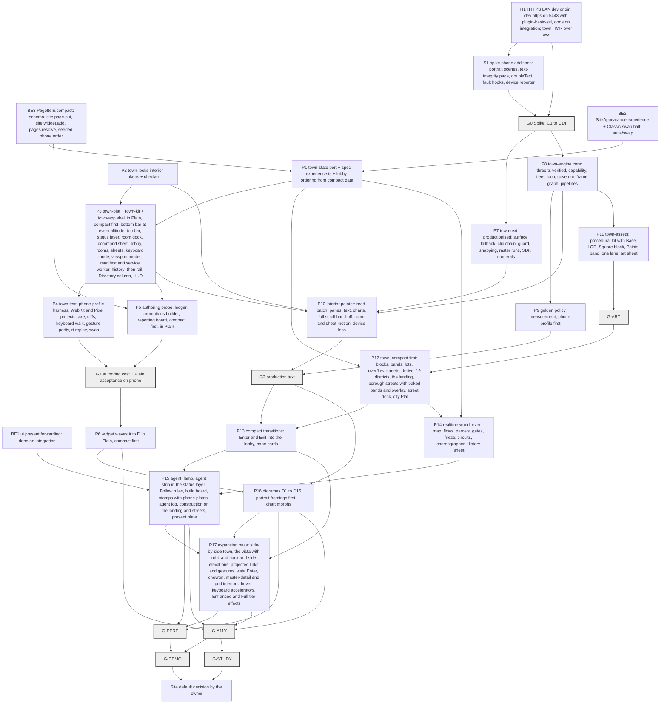

# 07. Plan, gates, kill criteria and fallbacks

Part of the Township canonical spec (`README.md`). Requirement IDs are `TWN-R-7.<section>.<n>`.
`00-mobile-first.md` binds this file.

The plan is ordered by dependency only. It names what each step touches, what it needs and what it unblocks. Steps
with no dependency between them can proceed in parallel. It carries no durations and no sizes.

**Mobile first.** Every step builds and accepts the compact (phone) design first; the expansions to medium, expanded
and wide are accepted after it, in the same step or in the expansion step P17. Every gate measures the phone first:
G0 now includes phone-emulation measurements and a real-phone WebGPU check over HTTPS on the LAN.

Base: `../proposals/township.md` R12 and R13, with Orbit's gate discipline (G1 before any widget wave, K1 to K7),
Atelier's Plain-first order (widgets accepted without a GPU), the feasibility judge's six spikes and the access judge's
task-time gate.

---

## 7.1 Gates at a glance

| Gate | What it decides | Needs | Blocks |
|---|---|---|---|
| **G0 Spike** | whether GPU text over a transparent Plat, the WebGL2 path, the frame budget, Plain and forced colours and the Enter hand-off hold on the reference machine (C1 to C9, measured), **and** whether text integrity holds in phone emulation, WebGPU reaches real phones over HTTPS, and the Base tier is plausible on real mid-range phones (C10 to C14) | S1, H1 | everything that paints |
| **G1 Authoring cost and Plain acceptance** | whether porting Classic widgets onto `town-kit` (with their compact presentations) is mechanical, and whether Plain mode meets the a11y bar at 390 × 844 with touch and on mobile screen readers | P3, P4, P5 | the widget waves P6 |
| **G2 Production text** | whether the productionised painter meets the text requirements across the full route, look and DPR sweep, phone DPRs first | P10, P9 | P13, P16, and any GPU-painted release |
| **G-ART Art direction** | whether the procedural town reads as an architectural model in every look, judged on the phone first | P11 | P12 (all districts beyond the Bank) |
| **G-PERF Devices** | the unmeasured budget columns: the mid-range phones at Base first, then laptops at Enhanced | P12 to P17 | G-DEMO, the site default |
| **G-A11Y** | the full accessibility suite including VoiceOver (iOS), TalkBack, NVDA and VoiceOver (macOS) scripts | P6, P13 to P17 | G-DEMO, the site default |
| **G-DEMO** | the five-minute demo, rehearsed phone-led on the real phones, then on the big screen | G-PERF, G-A11Y | owner sign-off |
| **G-STUDY Daily use** | whether daily users are as fast in Town as in Classic, on phones and on desktops | G-A11Y | setting `appearance.experience: "town"` as the site default |

Every gate is a Workgraph task. Its measurements and verdict are recorded on the task; the next steps' tasks depend on
it, so Workgraph enforces the order.

## 7.2 G0: the spike (first gate)

**Where:** `packages/town-spike` on branch `suite/town-spike`, documented in `docs/gpu-frontend/spike/SPIKE.md` on that
branch (WG-5533).

**Two halves.** C1 to C9 were fixed in SPIKE.md before any measurement and are not edited. C10 to C14 are added by the
mobile-first restructure (WG-5536) and are fixed here, before any phone measurement is recorded; they are copied into
SPIKE.md as an addendum with this file's wording. G0 passes only when both halves pass. (C11 to C14 were revised once
by the mobile review, before any of them was measured: C12(a) described a tap during a fling, which platforms do not
deliver, and C11 and C12 now cover the landing, baked streets, Android battery and the iOS "guard only" rule.)

**Phone figures are targets.** Each C11 to C14 figure is a target fixed before measurement. Its measured value is
recorded beside it. If a target proves unreachable while the design works (for example warm-up on an Adreno 6xx), the
owner may reset it on the G0 task, with the measured value and the reason, before P8 starts; a kill threshold is never
reset.

**What is already known.** On the reference machine the prototype has shown text alignment within 1 CSS px, 100 %
line-break parity and interior and city frame p95 of 1 to 6 ms. Phone budgets have not been measured. An exploratory
phone-emulation run by the coordinator (Pixel 7 in Chrome at DPR 2.625, iPhone 13 in WebKit) found "double vision"
text: painted text not clipped by Plat ancestors' overflow (KPI values in narrow tiles painting over their
neighbours), painted runs drifting up to 52 px from their DOM boxes after the narrow-layout reflow (70.6 % of runs
within 1 px), Plat text never made transparent (breadcrumbs) so two copies showed, and an error screen on older iOS
Safari, which has no `OffscreenCanvas`. That run was exploratory, not C10; it is why C10 exists and why `03` section
3.5.6 was written. A fix to the prototype is in progress; C10 is measured after it.

### 7.2.1 Reference machine (C1 to C9, unchanged)

**Reference machine:** the Windows 10 desktop with the NVIDIA GTX 1080 Ti, Playwright's Chromium, headless, with
`--enable-unsafe-webgpu --use-angle=d3d11 --enable-gpu --ignore-gpu-blocklist`, 1440 × 900 CSS px at DPR 1.

| Id | Criterion | Pass | Kill |
|---|---|---|---|
| C1 | Paint ↔ Plat alignment of text runs | ≥ 99.5 % of runs within 1 CSS px | < 97 %, or any run off by > 4 px not explained by a line break |
| C2 | Line-break parity | ≥ 99.5 % of text nodes match | < 99.0 % |
| C3 | Interior frame time (ledger scroll and static) | p95 ≤ 16.7 ms | p95 > 33 ms |
| C4 | City overview frame time (shadows, tilt-shift, bloom, flows, plaques) | p95 ≤ 16.7 ms | p95 > 33 ms |
| C5 | WebGL2 parity | every scene renders with graceful, listed degradations | a scene fails, a shader fails, or an effect is missing |
| C6 | Selection and copy | exact memo string and exact three-row TSV | any mismatch |
| C7 | Typing into transfer inputs | values land, inputs visible, confirm shows them | lost typing or invisible inputs |
| C8 | Plain mode and forced colours | readable Plat text, no canvas | transparent text or a canvas over it |
| C9 | Enter and Exit hand-off | focus on `h1`, Plat live, altitude right; reduced motion is a ≤ 200 ms crossfade | lost focus or inert Plat |

### 7.2.2 Phone (C10 to C14, added by the mobile-first restructure)

**Spike additions they need (step S1):** portrait scenes (the landing with the Square, Rewards and Personal tiles and
the other tiles as placeholders; the Rewards street with baked band images inside the scroller and the live overlay;
the `/points` lobby in its authored compact order and the Statement room in the list presentation with its dock; a
compact Enter from the Bank facade into the lobby); hybrid text at Base; a text-integrity test page (nested
`overflow` clips, `contain: paint`, narrow KPI tiles with `text-overflow: ellipsis`, the breadcrumb, a 10,000 px tall
page); `__spike.doubleText()`, `__spike.clipCheck()` and fault-injection hooks; the device reporter
(`?test=device`, POSTing results to the dev server); and the HTTPS LAN setup of step H1.

**Phone emulation** runs on the reference machine in three projects: Chromium 390 × 844 at DPR 3, Chromium 412 × 915 at
DPR 2.625 (Pixel 7), and WebKit 390 × 844 (iPhone 13), each with touch and, in Chromium, CPU slowed 4× through CDP.

**Real phones** are the owner-named pair: an Adreno 6xx class Android phone in Chrome and an A15 class iPhone in
Safari, on the LAN, loading the spike through `https://<host>:5173/town/` with the mkcert CA installed.

| Id | Criterion | Where | Pass | Kill |
|---|---|---|---|---|
| C10 | **Text integrity in phone emulation.** Phones run hybrid text (`03` section 3.5.7), so (a) and (e) test the phone path and (b) to (d) test GPU text in narrow panes with a fine pointer forced (the desktop narrow-pane case at phone DPRs). (a) `doubleText()` empty on every spike scene and after each of: a breakpoint crossing (resize 390 → 800 → 390), rotation (844 × 390 and back), keyboard open and close (`visualViewport` emulation), a scroll fling, Enter and Exit. (b) No painted glyph ink outside its element's clip chain on the test page; every ellipsis-truncated element shows the browser's visible string or is DOM-painted. (c) After each reflow in (a), every **painted** run within 1 CSS px of the browser's box, with the per-element guard on; the DOM-fallback share reported. (d) Every glyph baseline on an integer device pixel at DPR 2.625 and 3, and the canvas backing size equal to `round(css × dpr)`. (e) With `OffscreenCanvas` deleted before boot (all three projects) the scenes paint and pass (a) to (d); with each init step forced to fail, the route ends in Plain mode with its notice and no uncaught error. | emulation, all three projects | (a), (b), (d), (e) hold everywhere; (c) 100 % of painted runs within 1 CSS px and DOM-fallback share ≤ 0.5 % | any double text, any ink outside a clip, an error screen on any injected failure, or a DOM-fallback share > 2 % in any project |
| C11 | **WebGPU and the Base tier on real phones over HTTPS.** Each phone loads the spike over HTTPS from the LAN: record `isSecureContext`, `navigator.gpu`, the adapter's info and limits, and the active backend; then run the portrait scenes on WebGPU (where exposed) and forced WebGL2, recording frame p95 for the Statement list scroll, the Rewards street (the scroll must need no canvas frame; the overlay at rest with effects), one band re-bake, the busy landing (8 constructions, 1,500 particles, the lamp) and the compact Enter, plus the interior warm-up time after `renderer.init()`. Also record whether WebGPU is exposed when the certificate is clicked through (`@vitejs/plugin-basic-ssl@2.3.0`). | the two real phones | secure context on both; WebGPU active on at least one of the two (each phone's result recorded); every portrait scene renders on both backends; list scroll p95 ≤ 16.7 ms, street scroll with zero canvas frames, overlay at rest ≤ 16.7 ms, band re-bake ≤ 8 ms, busy landing ≤ 33 ms, compact Enter ≤ 16.7 ms, warm-up ≤ 600 ms (targets), on at least the WebGL2 backend of both phones | no secure context on either phone with either certificate method; a scene or shader failing on either backend; list scroll or overlay p95 > 33 ms on either phone |
| C12 | **Touch, scrolling and thermals on real phones.** (a) In the Rewards street, 50 taps after a fling has settled land on the link under the finger, and 50 taps during a fling stop the scroll and activate nothing (TWN-R-1.4.3). (b) A slow-motion recording (240 fps where the camera allows, else the device's screen recording) of a street fling shows the buildings and their DOM plaques moving together (no frame with a plaque more than 2 px from its building), and of a Statement fling shows no frame with text missing or doubled. (c) A 10-minute scripted soak (landing and street, two rebuild bursts, interior work) at Base: on Android, `dumpsys thermalservice` status every 10 s and `dumpsys battery` level before and after (unplugged, 50 % brightness); on iOS, the drift guard's log and the frame-time trace, recorded as "guard only". | the two real phones | (a) 100 % as described; (b) no such frame; (c) Android status ≤ LIGHT, drain ≤ 4 %, no thermal step-down; iPhone: no thermal step-down by the guard | (a) any tap navigating to a building other than the one under the finger, or any tap during a fling navigating; (b) any frame with a plaque more than 8 px from its building, or text missing or doubled; (c) Android status above MODERATE, or drain > 8 %, or the guard firing within 3 minutes on either phone |
| C13 | **Memory on real phones.** GPU allocation accounting and the JS heap (`performance.memory` on Chrome, Web Inspector on Safari) through 20 Enter and Exit cycles and the soak; context loss and tab reloads counted. | the two real phones | GPU ≤ 96 MiB, heap ≤ 64 MiB, no context loss and no tab reload | GPU > 160 MiB, or a tab reload or two context losses during the run |
| C14 | **Main-thread cost and loading in phone emulation.** Main-thread CPU per frame (read, build, submit) while scrolling the Statement list and the Rewards street, a full read-batch re-read of the lobby, t1 and t3 on the design network with a cold cache, and the compressed bytes before t1 and before t3, with the three r187 build's own size reported separately. | emulation, Chromium 390 × 844 DPR 3, 4× CPU | CPU per frame p95 ≤ 6 ms; re-read ≤ 4 ms p95; t1 ≤ 2.5 s, t3 ≤ 4.0 s; ≤ 170 KB before t1 and ≤ 450 KB before t3 (targets) | CPU per frame p95 > 12 ms; t1 > 4 s; bytes before t1 > 250 KB |

### 7.2.3 What the spike result changes in this spec

| Outcome | Effect on the spec |
|---|---|
| C1, C2 pass | the text architecture of `03` section 3.5 stands; G2 then holds the stricter production rules |
| C1 or C2 kill | K1 fires before any further work: the whole spec proceeds with hybrid text (visible Plat text, GPU surfaces, city, transitions) |
| C10 pass | phones run hybrid text by design; GPU text in narrow panes on fine-pointer devices stands, with the per-element guard and the local hybrid switch as runtime protection |
| C10 kill on (a) or (e) | the hybrid-text phone path itself shows doubled text or an error screen: fixed in the spike and C10 re-run before G0 passes |
| C10 kill on (b) to (d) | K1 fires for narrow panes (pane-compact) on every device: those panes use hybrid text |
| C3 or C4 kill | K4 fires: the frame graph of `03` section 3.7 is cut back and re-measured before P8 starts |
| C11 kill (list scroll or overlay) | K14 fires: the Base tier is cut back (no tilt band, fewer pane cards, smaller pools) and C11 re-run before P8; if still failing, phones default to Low-power |
| C11 targets missed but no kill | the measured value and the owner's reset (or the change that will meet the target) are recorded on the G0 task before P8 |
| C11 without WebGPU on a phone | not a kill: WebGL2 is the Base path; the spec records which phones expose WebGPU over HTTPS; if the click-through certificate hides WebGPU but mkcert does not, mkcert becomes the dev default (`06` section 6.11) |
| C12 or C13 kill | K5 (thermals) or K14 (budgets) fires for phones |
| C14 kill | K11 or K12 fires for phones: the read batch or the critical path is cut back before P10 |
| C5 degradations | the WebGL2 table in `03` section 3.3 is rewritten from the spike's findings; a missing meaning-carrying effect fires K3 |
| C6 to C8 fail | the Plat approach is wrong for that concern; fixed in the spike and re-run before G0 is recorded as passed |
| C9 fail | the hand-off design of `03` section 3.9.1 is revised before P13 |
| Spike deviations | the spike's findings become spec decisions: tabular numerals need a tabular-by-default face (`03` section 3.5.4); MSDF is deferred (`03` section 3.5.1); tilt-shift form and pane-card targets are chosen from the measured variants |

| ID | Requirement | Test |
|---|---|---|
| TWN-R-7.2.1 | No step that paints with the GPU (P8 onward) starts before G0's results table and decision (C1 to C14) are filled in SPIKE.md and recorded on the G0 Workgraph task. | Workgraph dependency. |
| TWN-R-7.2.2 | C10 to C14 are copied into SPIKE.md as an addendum, worded as in section 7.2.2, before any phone measurement is recorded there, and are not edited afterwards. | Git history of SPIKE.md: the addendum's commit precedes every commit recording a C10 to C14 result. |
| TWN-R-7.2.3 | The G0 record for C11 to C13 names each phone (model, OS and browser version, GPU), the backend used and the certificate method, and is produced by the device reporter, not transcribed. | Review of the G0 task's attached JSON from `/__town/results`. |

## 7.3 The plan



| Step | Touches | Needs | Unblocks | Exit check |
|---|---|---|---|---|
| **H1** | `packages/web` `dev:https` on port 5443 with `@vitejs/plugin-basic-ssl@2.3.0` (done on the integration line, `a65851f`); the town dev server's HMR over `wss` on 5443; the phone setup note; mkcert only if C11 requires it (`06` section 6.11) | none | S1, G0 | TWN-R-6.11.1 to 6.11.3 |
| **BE3** | `packages/spec/src/suite/nodes.ts` (`PageItemCompact`, `PageItem.compact`, the layout check), `packages/spec/src/suite/api/pages.ts` (`SitePageItemIn`, `SiteWidgetAddIn`, `ResolvedItem`), `packages/engine/src/suite/handlers/site.ts` and the resolve handler, `default-pages.ts` (compact data for the pages in `02` section 2.1.3; the rest in P6), CONTRACT.md 5A, `pnpm schema:gen` (`06` section 6.8) | none | P1, P5 | TWN-R-6.8.1 to 6.8.3 |
| **S1** | `packages/town-spike` on `suite/town-spike`: portrait scenes, the text-integrity page, `doubleText()`, `clipCheck()`, fault hooks, the `OffscreenCanvas` fallback, the device reporter, the SPIKE.md addendum | H1 | G0 | the addendum committed (TWN-R-7.2.2); the scenes run in the three emulation projects |
| **G0** | measurement and verdict, C1 to C14 | S1, H1 | P7, P8 | section 7.2 |
| **BE1** | `packages/rt`, `packages/mcp`, `packages/spec/src/rt.ts`: present forwarding (CONTRACT 6.3) | none | P15 | already on the integration line |
| **BE2** | `packages/spec` (`SiteAppearance.experience`, `experience.ts`), `packages/api` (`site.appearance.*`), `packages/web` (top-bar Town toggle, boot redirect, live swap, unsupported notice) | none | P1 | Classic's half of the swap tests (TWN-R-6.7.1, 6.7.3 to 6.7.7 from the Classic side) |
| **P1** | `packages/town-state`: TypeScript port of `packages/web/src/core` (api, rt with `onPresent`, identity, stores, bus, widget runtime, page host with lobby order, router with `/town` base and room and sheet history), dispatcher with the DOM-round fixes, experience and layout stores | BE2 | P3, P12, P14 | unit tests on rt resume, gap, isolation, history stack; type-check |
| **P2** | `packages/town-looks`: interior tokens for 6 looks × 4 variants, `check.ts` | none | P3, P10 | TWN-R-4.9.1 |
| **P3** | `packages/town-plat` (registry, PaneHost, focus, announce, inert, breakpoints, history, `visualViewport` handling, city Plat), `packages/town-kit` (every component as DOM plus PaintSpec, list and table presentations, sheets, the room dock, room, lobby card ordered by `compact` data), `packages/town-app` shell in Plain mode at `/town/`: **compact first** (top bar with Motion, the bottom bar at every altitude with the Approvals slot for approvers, the status layer with its priority cap, the command sheet with the Directory, You sheet with Classic, Hand, Text size and Agent log, passive toasts, the keyboard mode, the viewport model, overscroll rules, the manifest and service worker), then the medium rail and the expanded HUD and Directory column; the town side of the swap contract | P1, P2 | P4, P5, P10 | at 390 × 844 with touch first, then 1440 × 900: axe clean on the shell; touch and keyboard tours; sheet and history tests (TWN-R-2.4.6 to 2.4.8, 6.6.3); thumb-zone and platform tests (TWN-R-0.2.3 to 0.2.6, 0.4.1 to 0.4.6); swap scenario passes |
| **P4** | `packages/town-test`: phone-profile default project, WebKit and Pixel projects, expansion projects, axe sweep, Plat-versus-Classic diffs, keyboard walk, gesture parity, rt replay, swap scenario, capability inventory | P3 | G1 | harness runs on the stack, phone profile first (TWN-R-0.8.1, 6.9.3) |
| **P5** | three widgets ported to `town-kit` in Plain mode with compact presentation first: `points.ledger` (list presentation, Search all, Select, Copy all, Export, fast-scroll rail; then the table), `promotions.builder` (entry card, stepper room), `reporting.board` (vertical panel stack, portrait charts) | P3 | G1 | each passes its Plain acceptance at 390 × 844 then 1440 × 900 |
| **G1** | measurement and verdict | P4, P5 | P6 | section 7.4 |
| **P6** | `packages/town-widgets` for all 77 widgets in four waves cut as UI-MAP section 6 (A: messaging, notifications, people, search; B: points, store, badges; C: promotions, automation, content, segments, calendar; D: reporting, approvals, tasks, audit, admin, settings, pages), in parallel; each widget's compact presentation accepted before its expansion | G1 | P16, G-A11Y | TWN-R-2.9.1 to 2.9.4 in Plain mode in both profiles; diffs clean per route |
| **P7** | `packages/town-text`: the 2D surface with the `OffscreenCanvas` fallback, segmenter, measurer, breaker, runtime guard with the box and ellipsis conditions, clip chain, device-pixel snapping, raster-run and SDF paths, numerals and rolls, from the spike's code | G0 | P10 | breaker, path-chooser, clip and snapping unit tests over the 2,000-string corpus at all six DPRs |
| **P8** | `packages/town-engine`: `three.ts` with every API of `03` section 3.2 verified in 0.187 source, capability ladder with the Plain-on-failure guard, tiers, render-on-demand loop, governor, thermal guard, frame graph per tier, pipeline inventory, the landing, street-bake and vista camera rigs, the band baker | G0 | P9, P10, P11 | boots both backends in the phone and reference profiles; pipeline inventory check; TWN-R-3.3.4 |
| **P9** | golden policy measurement (`06` section 6.9.1), phone profile first | P8 | G2 | `policy.json` committed |
| **P10** | painters (panes, text, charts, focus halo, rim), the read batch with reflow epochs, the runtime guard and DOM fallback, the full scroll hand-off, room and sheet motion, overlays and dialogs, the Plain → painted crossfade, device-loss recovery | P2, P3, P7, P8 | G2 | TWN-R-3.4.*, 3.5.*, 3.6.*, 3.15.1 on the routes ported so far, in the phone profile first |
| **G2** | measurement and verdict | P9, P10 | P13, P16 | section 7.4 |
| **P11** | `packages/town-assets`: procedural kit generator with Base and detail levels, the Square block, the Points band (Bank, Award Office), one People lane, `scripts/town-art-sheet.ts` | P8 | G-ART | TWN-R-1.7.1, 1.7.3, 1.12.2 |
| **G-ART** | owner review of the art sheet, phone captures first | P11 | P12 | `01` section 1.12 |
| **P12** | `packages/town-world` at compact and medium width: blocks, bands, lots with annexes, overflow, street graphs per layout and the landing's tile paths, derive, 19 district recipes, the People district with lanes, the landing with vignettes and live signals, borough streets with baked band images inside the scroller and the sticky overlay, snap, the street dock, the side-by-side medium layout, the short (landscape) layout, plaques as Plat text, the city Plat, `/town/city`, `/town/city/b/:borough` and `/town/city/:district` routes | P1, G-ART | P13, P14 | TWN-R-1.4.*, 1.5.*, 1.6.*, 1.8.*, 1.9.*, 1.10.1, 4.12.1 at 390, 844 × 390 and 840 px |
| **P13** | compact Enter and Exit (facade to lobby), pane cards (individual targets), pre-mount on `pointerdown`, hand-off | G2, P12 | P15, P17 | TWN-R-2.3.1, 3.9.1 and 3.9.3 checks, 4.3.4 in the phone profile |
| **P14** | dispatcher wiring to the world, the event map, flows, parcels, letters, gates, machines and circuits, frieze, Choreographer, the History sheet scrubber | P1, P12 | P15 | TWN-R-5.1.*, 5.2.*, 5.8.*, 5.9.*, 5.10.* |
| **P15** | the lamp (light, light pool), the agent strip in the status layer, the Follow rules of `05` section 5.5.1, the build board, stamps with their phone plates and the Agent log, construction and demolition on the landing and in streets, look sweep, present resolver, the present plate, spotlight and Back, presentation mode (wake lock, touch indicators, captions) | BE1, P13, P14 | P17, G-PERF, G-A11Y | TWN-R-5.3.*, 5.4.*, 5.5.*, 5.6.*, 5.7.*, 5.12.3 at 390 × 844 |
| **P16** | the 15 dioramas with flat twins, portrait framings first then landscape, the vellum fan, terrain, flow ribbons, the exploded matrix, circuits; chart morphs | P6, G2 | P17, G-PERF, G-A11Y | TWN-R-2.4.1 to 2.4.5, 2.4.9, 2.7.* |
| **P17** | the expansion pass: the plinth vista (blocks rotated to face the Square, back and side elevations of every module and landmark, perspective camera, orbit, zoom, projected and de-overlapped links, gestures with camera buttons, hover plaques), vista Enter (dolly) with the render-target array, the follow pose and chevron, wide "City beside", master-detail at medium and the grid at expanded with pane focus, hover previews, keyboard accelerators, the Enhanced and Full tier effects (shadow maps, bloom, GTAO, depth tilt-shift, decor, larger pools, the lamp spot shadow, blurred backdrop) | P13, P15, P16 | G-PERF, G-A11Y | TWN-R-0.7.1, 1.4.6, 4.11.1, 4.11.2, 3.10.1, 5.5.* in the vista; the expansion projects of every suite |
| **G-PERF, G-A11Y, G-DEMO, G-STUDY** | measurement and verdict | as the graph | the site default decision | section 7.4 |

**Bounded rollback at every step.** After P6 the town app is a complete accessible app in Plain mode on phones and
desktops. After G2 it is a complete GPU-painted app with no city. After P15 the phone design is complete: the landing
and borough streets, transitions, realtime and the agent. P17 only adds the expansions; a kill criterion during P17 falls back to the
phone design's layouts on wider screens (the landing beside a street, and the lobby in columns), which already work there. A
kill criterion at any later point falls back to the last good layer without losing parity, and Classic is always there.

| ID | Requirement | Test |
|---|---|---|
| TWN-R-7.3.1 | Each step and gate above exists as a Workgraph task with the dependencies of the graph, testable acceptance criteria taken from the exit check column, and a `Task-ID` trailer on its commits. | Workgraph review of the project's tasks against this table. |
| TWN-R-7.3.2 | Every step that has both a compact and an expansion part records the compact acceptance before the expansion acceptance on its task. | Workgraph review of the step tasks' progress records. |

## 7.4 Gates in detail

**G1: authoring cost and Plain acceptance** (feasibility spike 5).

- For each of the three probe widgets, report the ported module's line count (compact presentation and expansion
  included) and the number of distinct kit components used, against the Classic widget's line count including its CSS.
- Pass: the three ported widgets' total line count is ≤ 1.3 × Classic's total (the compact presentations are new
  design, which Classic does not have), no single widget exceeds 1.6 ×, and all three pass Plain acceptance at
  390 × 844 with touch and at 1440 × 900 (axe, interaction and gesture-parity tests, the diffs with Classic, the
  keyboard walk), and the 13-task screen-reader script's tasks that touch them pass on VoiceOver (iOS) and TalkBack.
- Kill: total > 1.6 × or any single widget > 2 × (K10).

**G2: production text.**

- The parity sweep (TWN-R-3.5.3) over every route ported so far × 6 looks × {390 × 844 at DPR 2.625 and 3,
  1440 × 900 at DPR 1, 1.25 and 2} shows zero painted mismatches, and a DOM-fallback share ≤ 0.5 % in every profile.
- Alignment within 1 CSS px for every painted run, including after reflows (TWN-R-3.5.4).
- Text integrity: `doubleText()` empty everywhere (TWN-R-3.5.8), the clip test (TWN-R-3.5.7), snapping
  (TWN-R-3.5.9), the `OffscreenCanvas` fallback (TWN-R-3.3.5) and init failure to Plain (TWN-R-3.3.4).
- SSIM of painted text against DOM text on the ledger list and the matrix's By role view at DPR 3 and 2.625, and on
  the ledger table and the grid at DPR 1 and 1.25: ≥ 0.97 for raster runs and ≥ 0.94 for SDF runs.
- A blind side-by-side of the ledger and matrix (painted against Plain), shown on a phone first and on a desktop
  second, to 5 internal reviewers: fewer than 3 prefer Plain on either.
- IME (TWN-R-4.6.2) and autofill (TWN-R-4.6.3), including the manual checks on the iPhone and Android phone.
- Fail on any of these fires K1.

**G-ART:** `01` section 1.12.

**G-PERF: devices.**

- **Phones first:** the two G0 phones (or the owner's later choice of an Adreno 6xx class Android phone and an A15
  class iPhone) run the perf runner's portrait scenes at Base over HTTPS: every Base budget of `00` section 0.6 and
  `03` section 3.11, the 10-minute soak with Android thermal status and battery drain and the iPhone's guard-only
  record (TWN-R-3.12.3, 3.12.4), memory (TWN-R-3.13.2) and first paint over the design network (TWN-R-3.14.4, on a
  throttled Wi-Fi profile or a real cellular connection).
- **Then the expansions:** an Iris Xe class laptop and an Apple M-class laptop at Enhanced, and a Firefox WebGL2 run on
  the integrated laptop.
- Results replace the "unmeasured" labels.
- Pass: every budget met, or met at the governor's first step-down with the owner's agreement recorded.
- Kill signals: K4, K5 and K14.

**G-A11Y:** every requirement of `04` section 4.15 passes, including the VoiceOver (iOS) and TalkBack scripts first and
the NVDA and VoiceOver (macOS) scripts second, run by the owner's designated tester and recorded per task.

**G-DEMO:** `demo.spec.ts` passes on the stack; one full **phone-led** rehearsal on the real rig (the presenter
iPhone mirrored to the projector, the Android phone, the side laptop) passes every rehearsal fact of `05` section 5.12
and TWN-R-5.12.2; then one big-screen rehearsal passes the same facts.

**G-STUDY:** `04` section 4.16, in all four conditions. Its result decides whether the owner may set the site default
to `"town"`.

## 7.5 Kill criteria

Each criterion has a measurable signal, the gate or stack where it is measured, and the fallback. Kill criteria are
evaluated where stated and recorded on the Workgraph task with the numbers.

| Id | Risk | Signal | Where | Fallback |
|---|---|---|---|---|
| **K1 Text** | painted text differs from the browser's, or shows twice (phones run hybrid text by design, so K1 concerns fine-pointer devices and narrow panes) | G0 C1 or C2 at kill; G0 C10 (b) to (d) at kill; at G2, any painted mismatch that cannot be fixed, any `doubleText()` entry, DOM-fallback share > 0.5 % in any profile, SSIM below 0.97 (raster) or 0.94 (SDF), or 3 of 5 reviewers prefer Plain | G0, G2, every stack's parity and integrity sweeps | **Hybrid text:** Plat text visible everywhere; the GPU paints surfaces, rules, charts, icons, dioramas, the city and transitions (what phones already run). It may fire for narrow panes alone when only C10 (b) to (d) fail. At runtime the same switch happens per tab on a device whose fallback share passes 2 % (`03` section 3.5.6 rule 3). |
| **K2 Mirror and AT** | the Plat and the paint diverge for assistive technology | any axe serious or critical violation caused by painting (absent in Plain); any of the 13 screen-reader tasks failing on any of the four readers after one fix round; the diffs with Classic failing | G1, G-A11Y, stacks | Interiors default to Plain mode (per device class or reader); the city and transitions stay; if still failing, release is blocked and Classic stays the site default |
| **K3 WebGL2 parity** | a meaning-carrying effect cannot run on WebGL2 | G0 C5 kill, a C11 scene failing on WebGL2, or any meaning-carrying effect absent in the WebGL2 visual suite | G0, stacks | WebGL2 browsers get Plain interiors and the city without the missing effect plus a text equivalent; if the city itself fails, WebGL2 browsers are redirected to Classic with the notice |
| **K4 Frame time (expansions)** | the GPU cost of the expanded design is too high | G0 C3 or C4 p95 > 33 ms; on the reference machine any `03` section 3.11 budget exceeded by > 20 % after tuning; at G-PERF a laptop-class p95 > 16.7 ms by > 20 % after governor tuning | G0, stacks, G-PERF | Lower the starting tier on that class (Enhanced, then Base); if still failing, the vista is opt-in on that class and the two-column street is the default city there |
| **K5 Phone thermals and battery** | phones overheat or drain | G0 C12 (c) at kill; at G-PERF Android status above LIGHT or a drain above 4 % in the 10-minute soak, or the drift guard stepping down within it on either phone (the only signal on iOS) | G0, G-PERF | Phones start at Low-power; if still failing, phones default to Plain interiors and show the city at Low-power only on request |
| **K6 Input** | native input breaks under the canvas | IME tests failing for Japanese, Korean or Chinese, or autofill failing in Chrome or Safari (desktop or phone), or the keyboard covering a focused field (TWN-R-4.6.7) | G2, G-A11Y | Release blocked; the affected form is fixed in the Plat (inputs are already native); Classic stays the site default meanwhile |
| **K7 Toy** | charm reads as a toy | G-ART: `calm` fails twice on the phone captures; or 2 of 3 design reviewers in the next review score enterprise credibility below 8.5 | G-ART, review | Default look `meridian` (white-card model, no bloom), decor motion removed, Motion default stays Reduced |
| **K8 Choreography floods** | bursts overwhelm the effects | collapse path in > 5 % of frames under `gen:live` plus a rebuild in either profile, or any beat dropped while its data was pending | stacks (perf runner) | Lower per-kind caps; fold flows into per-district aggregate streams; data is never delayed in any case |
| **K9 Daily use** | the town slows real work | any of the 10 study tasks > 10 % slower in Town than in Classic, or a higher error rate, in any of the four conditions | G-STUDY | The site default stays `"classic"`; Town remains a per-viewer choice; the slow tasks are filed as work |
| **K10 Authoring cost** | the kit is not mechanical to port to | G1: total > 1.6 × Classic's lines or any probe widget > 2 × | G1 | Stop before the waves; simplify the kit to Classic's component API plus the list presentation, or keep Classic widgets' DOM verbatim inside the Plat with generic PaintSpecs and a CSS-only compact layout |
| **K11 Read batch** | measuring the DOM stalls the main thread | TWN-R-3.6.3 or TWN-R-3.6.4 failing, G0 C14 re-read at kill, or a fling dropping frames on a phone attributable to reads | G0, stacks, G-PERF | Painter paints only at rest: during resize, reflow and font loads the Plat text is visible (as during scroll) until a split re-read completes; if still failing, K1's hybrid |
| **K12 First paint and bundle** | the town app loads slowly | in the phone profile t1 > 2.5 s or t3 > 4.0 s (G0 C14 at kill: t1 > 4 s); bytes before t1 > 170 KB or before t3 > 450 KB compressed; on the reference machine t1 > 1.0 s or t3 > 1.8 s | G0, stacks, G-PERF | Ship the Base interior pipeline set only on first load and stream the rest; defer the city chunk until the first City tap; on slow connections stay in Plain until the viewer opts in |
| **K13 three churn** | an API this spec relies on is missing or different in 0.187 | a 3.2 table entry with no equivalent in 0.187 source | P8 | Replace with our own TSL node in `three.ts`; if the post-processing pipeline itself is unusable, write the passes as plain render-target draws with node materials |
| **K14 Base tier on phones** | the baseline tier misses its budgets on the mid-range phone | G0 C11 or C13 at kill; at G-PERF any Base budget of `00` section 0.6 missed by > 20 % after tuning on either phone | G0, G-PERF | Cut the Base tier (no tilt band, 3 pane cards, 500 particles, city DPR 1.5) and re-measure; if still failing, phones start at Low-power; if Low-power fails, phones get Plain interiors and the landing and streets at Low-power on request |

## 7.6 The fallback ladder

```
 Town, full                         (every gate passed; phones at Base, desktops up to Full)
   │ K1 (for phones or for all)
   ▼
 Town, hybrid text                  (Plat text visible; GPU paints surfaces, city, transitions, dioramas)
   │ K4 on a laptop class
   ▼
 Town, phone design on wider screens (two-column street instead of the vista; lobby columns)
   │ K14, K5 on phones; K2 on a reader
   ▼
 Town, Low-power or Plain interiors + city (per device class or per viewer)
   │ K3 on WebGL2
   ▼
 Town, Plain only                   (forced colours, Save-Data, slow connections, viewer choice, init failures)
   │ no WebGPU and no WebGL2, or K9 for the site default
   ▼
 Classic                            (always present; the reference and the fallback)
```

Every rung keeps feature parity: the Plat is the product at every rung, the phone design is complete on its own, and
Classic is never removed.

## 7.7 Honest comparison: Township against "keep Classic and add a GPU layer"

| | Township (DOM-measured, GPU-painted) | Classic plus a GPU layer behind it |
|---|---|---|
| Who draws text | the GPU, with DOM fallback per element, during scroll and after reflows | the DOM |
| Text risk | none on phones (hybrid text by design); real on fine-pointer devices, gated by G0 C10 and G2, with K1's hybrid as the floor | none |
| Enter transition | exact: the same painter draws cards and panes | approximated: DOM content cannot be sampled into WebGL without re-rendering it |
| One world (interior shares the town's light, looks, lamp and construction) | yes | colours only; DOM panes composite separately from the scene |
| Dioramas and morphs inside panes | in the same pipeline as the pane | possible as canvases inside DOM panes, composited separately |
| Phone cost | one canvas, painting at rest and handing scrolling content to the DOM | the DOM plus a canvas behind it; similar |
| Accessibility | equal: both are DOM-semantic; Township adds the no-ghost-text, double-text and parity checks | simpler |
| Scope | a text engine, a painter, the read batch and the parity and integrity tests, on top of everything the alternative needs (the landing, borough streets, the vista, effects, choreography, agent) | the city, effects, choreography and agent only |
| Fallback | degrades into the alternative at K1 and into Classic beyond that | it is the fallback |

The alternative is strictly less risky and is Township's own K1 fallback. Painting the interior buys one continuous
world, exact transitions, and interiors that share the town's light, looks and agent. The plan pursues that only after
G0 (on the reference machine and on phones) and G2 prove it, with the Plat as the product underneath at every step
and Classic kept beside it.
